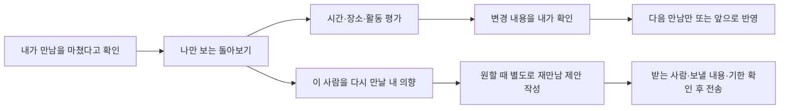

# Atlas 공통 능력 이력 — 2026-10-05~08

> [공통능력 문서](../../../아틀라스_공통능력_고도화_20261005.md)의 날짜별 후속 기록을 2026-10-08에 그대로 옮겼다([Atlas 검토 10-07 §3-5](../../아틀라스검토_인계_20261007.md) 「현재 상태 한 쪽만 두고 이력은 qa로」). 문장은 고치지 않았고 상대 링크만 이 폴더 기준으로 바꿨다. 지금 상태는 원래 문서를 본다.

## 검증 기록과 운영 전 경계

1차 공통 능력 보강의 자동시험은 **572/572 통과**다. [실행 파일 목록·결과·검사한 원본 SHA256](../atlas-20261005/report.json)과 같은 폴더의 로그를 보관한다. 아래 후속 작업의 검증은 별도 기록이다.

| 범위 | 결과 | 확인 내용 |
|---|---|---|
| 공통 원본·연결 제품 | 536/536 | `tests/atlas*.test.js`, 동기화, SHIFT·회사 제공/클라이언트, 런처, 교사 화면, PATH, 컴퓨터 원본 규칙 |
| Talk | 32/32 | 사본·세션·저장·연습·계정 기억·Strata 정합. 합성 DB 경로이며 운영 서버 시험 아님 |
| 웹사이트 편지 | 4/4 | 기존 체험 동작 회귀. 전체 홈페이지 빌드·공개 사이트 검증 아님 |
| SHIFT 실제 Chromium | 11/11 | 추천·표시 근거·실제 노출·미관측·320/390 폭·저장 복원. [보고서](../../../../experiences/shift-workbench/qa/20261005-domain/report.json) |
| 상담 실제 Chrome | 모두 통과 | 1280/390 폭의 복수 선택·해제·확정·예산·OS 충돌·기존 기기 행동과 단일 HTML 공유판. [보고서](../../../../experiences/atlas-lab/qa/question-value/result.json) |

최종 상담 질문 계산은 같은 로컬 PC에서 10회씩, 1280 폭 중앙값/최대 4.0/5.4ms, 390 폭 2.9/3.8ms였다. 실제 휴대폰 속도나 운영 요청 지연 측정은 아니다.

교차 검토에서 발견한 근거 제외 우회, 저장 이력의 과제·문항·결과 불일치, 보관 기간이 다른 평가 체인의 잔존, 복수 작업 손실, OS 충돌·기기 행동 누락을 수정하고 회귀로 고정했다. SHIFT는 25회 연속 저장 복원과 구형 200개 평가 상한의 정리도 확인했다. 상세 요약이 없어진 완료 평가 체인은 함께 정리하며 미응답 실패로 바꾸지 않는다.

`node tools/build-game-learning.js --check`, `node tools/sync-atlas.js --check`, 런처 2파일·PATH 3파일의 원본 바이트 대조와 관련 `git diff --check`가 통과했다. 다른 작업의 미커밋 변경은 보존했다. [웹사이트 동기화 기록](../../../../../SYNK-website/qa/RESULTS.md#2026-10-05-atlas-core-24-공통-원본-동기화--로컬).

운영 배포·유료 AI 호출은 실행하지 않았다. 회사 로그인 화면의 실제 브라우저 검증, 실제 이용자 추천 정확도·성향 예측·생산성·인과 효과는 이 작업의 로컬 검사로 확인되지 않는다. 다음 운영 배포에서는 Core 2.4 기록을 받는 Talk 서버 검증기(synk-account·synk-learning·events)를 앱보다 먼저 맞춰야 한다. 새 유료 모델 시험은 현행 비용 확인 절차를 따른다. 현재 결과 위치는 [트랙](../../트랙.md)에 연결한다.

## 후속: 원문 해석과 사용자 확인

사용자의 후속 진행 승인에 따라 **평가 사례와 대화 이해 연결**을 추가한다. Core의 [`interpretation.js`](../../../../atlas/interpretation.js)는 선택 모듈이며 별도 엔진·모델 실행기가 아니다. 컴퓨터 상담의 [`interpretation.mjs`](../../../../experiences/atlas-lab/interpretation.mjs)가 분야별 항목과 명시 표현을 제공한다.

`prepare({contract, scope, sources, proposals, at})`는 Domain 계약, 승인된 원문과 해석 제안을 검증한다. 원문은 `id/scope/at/text/actor`, 선택적 `excludedAt`을 갖는다. 제안은 `id/field/value/subject/stance/evidence`이고 근거는 `sourceId/start/end/quote`다. 위치는 JavaScript UTF-16 기준이며 실제 원문 구간과 정확히 일치해야 한다. `subject`와 `stance` 역시 해석자의 제안이다. 인용이 정확해도 그 내용이 값을 뒷받침하는지는 이 검사만으로 알 수 없다.

- 미확인 제안은 Domain 관측에 들어가지 않는다. 현재 본인의 명확한 단일 값만 `confirm`할 수 있다. 서로 다른 값이 있으면 모순을 표시한다. 잘못된 대안을 거절하면 남은 값을 확인할 수 있고, 사용자가 직접 값을 정정할 수도 있다.
- `review`는 확인·정정·거절·철회 이벤트를 만든다. `resolve`는 이력을 검사해 Domain의 `declared` 관측과 근거 계보를 반환한다. 정정은 **사용자의 새 선언**이며 원문이 정정값을 입증한다고 기록하지 않는다.
- 이력에는 검토한 원문 전체·제안·범위·계약을 묶은 `basis`가 있다. 원문을 바꾼 뒤 옛 확인을 재사용할 수 없다. 나중에 다른 해석이 도착해도 이미 있었던 사용자 확인을 소급 취소하지 않는다. 새 확인에는 현재의 모순 검사를 적용한다.
- 철회와 원문 제외는 마지막 선언을 비워 옛 값의 부활을 막는다. 다른 미확인 제안을 거절했다고 기존 확인을 지우지 않는다. 같은 검토 ID의 동일 재전송은 한 번만 처리하고 내용이 다르면 거절한다.
- 원문은 한 건 4,000자·32건·총 64,000자, 제안 100건·근거 4개, 검토 200건을 상한으로 둔다. 인증과 실제 확인 이벤트의 진위, 원문 보관·삭제·접수 시각은 호스트 책임이다. `basis`는 검증용 원문 사본이므로 개인정보와 동일하게 취급하고 일반 분석 로그에 내보내지 않는다.

실제 상담은 **문장 입력 → 인용과 제안 표시 → 항목별 확인/수정 → 기존 추천과 Ask 질문**으로 연결한다. 누락한 항목을 거짓·기본값으로 채우지 않으며, 복수 용도는 확인한 긍정 항목만 묶는다. 수동 선택이 우선한다. 원문 변경·제거 시 원문에 의존한 답을 철회하고, 오래된 비동기 결과는 요청 ID·입력 revision으로 거절한다. 용도를 끄거나 보유 상태를 바꾸면 그에 딸린 세부 답과 원문 확인도 철회한다. 다시 켜도 옛 세부 답을 되살리지 않으며 남아 있는 제안을 다시 확인할 수 있다. 같은 원문을 재해석할 때는 유효한 새 결과가 도착할 때까지 기존 확인을 보존하고, 새 결과를 받은 뒤에는 재확인한다. 단일 HTML 공유판도 같은 원본을 포함한다.

현재 기본 추출기는 **한국어 명시 표현 일부를 인식하는 로컬 규칙**이다. 타인·부정·과거·불확실 표현은 보류할 수 있고 범용 대화 이해를 완성한 상태가 아니다. 제품 어댑터의 `buildExtractionRequest/ingest`는 다른 해석기가 같은 제안 계약을 공급하는 연결점이다. 이 단계에서는 모델 호출이 없었고, 아래 후속에서 회사 호스트에 선택적 연결을 추가한다. 기존 회사 안내는 규칙 기반이며, Talk의 유료 호출 예산 모듈은 별도의 인증·DB 계약을 가진다. 해당 API를 상담용으로 우회 사용하지 않았다.

## 후속: 독립 작성 사례 평가

Temper의 [`temper-interpretation.js`](../../../../atlas/temper-interpretation.js)는 원문과 수작업 기대값을 공급받아 저장된 해석 출력을 평가한다. [`작성 사례`](../../../../tests/fixtures/atlas-interpretation-cases.json)는 실제 사용자 개인정보가 없는 합성 한국어 문장이다. 부정·현재/과거·타인·미확인·모순·정정·단위 혼동과 기존 항목으로 표현할 수 없는 필수 조건을 포함한다. 정답을 추출기 코드로 생성하지 않는다.

[`evaluate-atlas-interpretation.mjs`](../../../../tools/evaluate-atlas-interpretation.mjs)는 저장된 결과만 읽으며 모델이나 네트워크를 호출하지 않는다. `extractor-output`과 `proposal-replay`를 구분한다. 결과 없는 사례는 `not_run`, 형식이 깨진 출력은 실패, 빈 제안은 실행된 유보로 집계한다. 필드별 일치·누락·잘못 추가한 조건과 금지 단정, 미정 상태 유지 여부를 분리한다. 형식 오류를 성공 분모에서 몰래 빼지 않으며, 필드 지표의 대상이 형식 검사를 통과한 출력임을 밝힌다. 데이터셋 v2는 필수 사실 `facts`와 있어도 타당한 추가 사실 `permittedFacts`를 나눈다. 예를 들어 현재 본인 컴퓨터의 램을 명시한 문장에서 `owned=have`를 제안해도 오답은 아니지만, 그것을 생략했다고 필수 사실 누락으로 세지도 않는다. 미정·금지·필수 항목과 허용 추가 항목의 모순은 검증에서 거절한다.

이는 향후 같은 입력으로 추출기·모델을 비교하기 위한 회귀 기준이다. 평가기 자체 시험, 원문 해석 결과, Core의 필수 조건·Ask의 질문 가치 시험, 실제 사용 결과인 Temper outcomes를 섞지 않는다. 작성 사례 점수로 실제 이용자의 성향 예측 정확도나 추천 효과, 모델 간 일반적인 우열을 선언하지 않는다.

### 후속 검증 결과

- **자동시험 489/489:** 공통 `tests/atlas*.test.js`, 두 학습 허브 서버 시험과 컴퓨터 원본 규칙. 이 안에 신규 Core 확인 30개·Temper 평가 23개·상담 어댑터 29개가 포함된다. [파일 목록·해시·결과](../atlas-interpretation-20261005/report.json)와 [실행 로그](../atlas-interpretation-20261005/tests.txt).
- **실제 Chrome:** 1280·390·320 폭에서 원문 입력, 확인 전 미반영, 확인·정정·제외·철회, 모순 대안 거절, 수동 답 보존, 오래된 응답 거절과 가로 넘침을 검사했다. 같은 흐름의 단일 HTML 공유판도 통과. [실행 결과·화면](../../../../experiences/atlas-lab/qa/interpretation/result.json). 기존 질문 가치·복수 선택·기기 행동·OS 충돌 경로도 [재검증](../../../../experiences/atlas-lab/qa/question-value/result.json)했다.
- **실제 로컬 추출 결과:** 작성 사례 28개 모두 실행했고 형식 오류는 0개다. 21개 사례가 기대값과 일치하고 7개는 실패했다. 필수 사실 20개 중 13개 일치·7개 누락, 허용 추가 사실 5개다. 모순된 RAM 16/32GB 문장 하나에서는 두 값을 모두 현재 본인 제안으로 내어 지원되지 않는 단정 2개로 채점했다. 이 사례는 Core에서 `conflict`가 되어 자동 확정·일반 확인이 차단된다. 확인 전에는 28개 사례 모두 추천에 사용할 사실이 0개였다. [원출력·평가 보고서](../../../../experiences/atlas-lab/qa/interpretation-evaluation/current-local-report.json), [실행 해시·시간·Core 확인 단계](../../../../experiences/atlas-lab/qa/interpretation-evaluation/capture.json).

어려운 복합 문장을 통째로 보류하기 때문에 과거/현재, 타인/본인, 미확인 정보/확정된 용도, 부정/긍정이 섞인 문장에서 유효한 사실도 놓친다. 모순된 말의 의미를 해소하는 능력도 부족하다. **범용 대화 이해를 완성했다는 결과가 아니라, 부족한 부분을 같은 기준으로 측정하고 확인된 값만 사용하는 경로를 만든 결과다.** 개발 중 사례를 보며 기본 표현을 보강했으므로 위 점수는 보지 않은 문장에 대한 평가가 아니다. 유료 모델·실사용자·배포 시험은 하지 않았다.

재현 명령은 다음과 같다. 첫 번째는 현재 로컬 추출기를 실제 실행하고 결과·해시를 저장한다. 두 번째는 다른 호스트가 저장한 출력만 채점하거나 같은 사례의 기준 출력과 비교한다.

```sh
node experiences/atlas-lab/evaluate-local.mjs
node tools/evaluate-atlas-interpretation.mjs --outputs candidate.json --baseline baseline.json --report comparison.json
node tests/atlas-lab-interpretation-smoke.mjs
```

## 후속: 실제 모델 연결과 보지 않은 문장 평가

같은 날 사용자의 두 작업 묶음 진행 요청에 따라, 제품용 [`model-extraction.mjs`](../../../../experiences/atlas-lab/model-extraction.mjs)와 기존 회사 호스트의 상담 전용 경로를 연결한다. Core의 `interpretation`과 Temper의 평가기를 재사용한다. Atlas 자체에 모델 선택기·자동 실행기·사용자 인증·비용 저장을 추가하지 않는다.

### 모델과 확인 경로

공식 Responses API의 구조화 응답에 맞춰 **GPT-6 Luna / `gpt-6-luna`, reasoning `none`, 최대 출력 3,000토큰**을 첫 평가 후보로 고정한다. 이는 비용이 낮은 후보 선택이며, 기존 로컬 규칙보다 정확하다는 결과가 아니다. [공식 모델 규격](https://developers.openai.com/api/docs/models/gpt-6-luna)과 [Structured Outputs](https://developers.openai.com/api/docs/guides/structured-outputs)를 2026-10-05 확인했다. 계정의 실제 사용 권한은 유료 시험 전까지 확인되지 않았다.

- 서버 원본에서 만든 허용 필드·선택지와 사용자 원문만 단일 요청에 담는다. 브라우저가 보낸 프롬프트·사용자 ID·계약을 시스템 권한으로 받아들이지 않는다. 도구 호출·이전 대화·자동 재시도·모델 대체는 없다.
- 모델은 인용문과 같은 인용의 등장 순번을 반환하고, 제품 어댑터가 원문에서 실제 UTF-16 위치를 계산한다. 없는 인용·잘린 글자·다른 필드의 선택지·임의 확정값은 거절한다. 인용 일치가 의미의 진위를 증명하지는 않는다.
- 완료되지 않은 응답·거절·잘못된 JSON·예상하지 않은 도구 응답을 정상적인 빈 결과로 바꾸지 않는다. 유효한 결과만 기존 `ingest → 확인/정정 → 추천` 경로로 보낸다.
- `store:false`는 Responses의 응답 저장을 끄는 설정이다. 제공자의 모든 보관을 없애거나 Zero Data Retention을 보장한다는 뜻은 아니다([공식 데이터 보관 설명](https://developers.openai.com/api/docs/guides/your-data)). 사용자는 AI 버튼에서 원문이 OpenAI로 전송됨을 확인한다. 로컬 정리와 단일 HTML 공유판은 원문을 보내지 않는다.

### 평가 분리

[`heldout-v1`](../../../../tests/fixtures/atlas-interpretation-heldout-v1.json)은 기존 28개 개발 사례와 별도로 작성한 합성 한국어 문장 30개다. 작성자는 추출 규칙·모델 프롬프트를 읽지 않고 기존 제품 어휘와 평가 규격만 사용했다. 구현 담당자는 새 문장·기대값을 보지 않은 채 모델 어댑터를 작성했다. 원본 해시와 작성 범위는 [manifest](../../../../tests/fixtures/atlas-interpretation-heldout-v1.manifest.json)에 남긴다.

첫 실행 전에 모델 프롬프트·스키마·제품 어휘·해석 규칙·평가기의 파일 해시를 고정한다. 평가 결과를 본 뒤 변경하면 같은 사례의 재시험은 개발 회귀로 표시하고 새 독립 평가라고 하지 않는다. 합성 30건의 일치는 실제 사람·성향·추천 만족도의 일반화 성능이 아니다. 기대값은 모델 요청에 포함하지 않는다.

실제 유료 실행은 **API 키 연결과 시험 비용 확인 뒤** 진행한다. 현재 구현 환경의 `OPENAI_API_KEY`와 AI 활성화 설정은 없으며, 실제 모델 응답·정확도·지연·실제 청구 비용은 아직 관측하지 않았다. 무비용 모의 응답 시험과 유료 평가 결과를 분리해 기록한다.

### 회사 호스트와 시험 비용

[`computer-interpretation-service.mjs`](../../../마케팅/온라인마케팅지도/engagement/company/computer-interpretation-service.mjs)는 기존 회사 서버의 `/api/computer-interpretation` GET/POST에 연결한다. 현재 유료 시험은 관리자만 사용할 수 있다. POST는 현재 세션·정확한 Origin·CSRF와 전송 직전/응답 전달 전 권한을 검사한다. 브라우저 입력은 `id(UUID), requestId, revision, sourceId, text`만 허용한다. 서버에서 모델·목적·사용자·필드 계약을 결정한다.

SQLite `computerAIRequests`에 사용자별 UUID와 입력 지문, 예약·보수 비용, 상태를 남긴다. 같은 요청은 저장된 결과를 재생하고, 다른 입력으로 바꾸면 거절한다. 병렬 요청과 재시작에서도 예약을 유지한다. 전송 결과나 사용량이 불명확하면 비용을 0으로 만들거나 자동 재전송하지 않는다. 알려진 사용량은 잘못된 해석·세션 철회 후에도 기록한다. 예약 범위를 넘는 사용량은 후속 유료 호출을 차단한다.

원문 전체를 장부의 평문에 저장하지 않는다. 검증된 결과에는 인용이 들어 있으므로 그 결과를 암호화해 보관하고, 화면에도 보관 사실을 알린다. 2026-10-06 후속에서 시험 장부의 **접수 후 24시간 만료와 본인 응답 삭제**를 연결했다. 브라우저의 ‘원문 지우기’는 해당 브라우저에서 추천에 사용하던 원문과 확인을 지우는 기능이며, ‘서버에 보관된 내 AI 응답 지우기’는 별도 기능이다. 보관 범위와 검증은 아래 후속 절에 둔다.

공식 단가는 입력 **$0.10/백만 토큰**, 출력 **$0.50/백만 토큰**이다. 입력 예약에는 cache-write 상한인 **$0.125/백만 토큰**을 사용하고 할인을 빼지 않는다([2026-10-05 확인](https://developers.openai.com/api/docs/pricing)). 전체 요청 JSON의 UTF-8 바이트 수와 4,096토큰 여유, 최대 출력 3,000토큰을 기준으로 예약한다. 실제 토큰 수나 청구서와 동일한 계산이라고 주장하지 않는다.

고정한 30건의 보수 예약 합계는 **112,711 microUSD(약 $0.113)**, 가장 큰 요청은 **3,764 microUSD**다. [계산 근거](../atlas-model-20261005/cost-estimate.json). 아래는 **유료 시험 전 확인할 제안 설정**이며 실제 환경에 적용하거나 기존 한도를 올리지 않았다. 총액은 모든 관리자의 상담 요청과 불명확한 예약을 함께 세는 서버 장부 누적 상한이며 자동 초기화하지 않는다.

| 서버 환경 변수 | 제안 값 |
|---|---|
| `SYNK_COMPUTER_AI_ENABLED` | `1` — 기본 미설정/꺼짐 |
| `SYNK_COMPUTER_AI_MODEL` | `gpt-6-luna` |
| `SYNK_COMPUTER_AI_MAX_OUTPUT_TOKENS` | `3000` |
| `SYNK_COMPUTER_AI_INPUT_PER_MILLION_MICRO_USD` | `125000` |
| `SYNK_COMPUTER_AI_OUTPUT_PER_MILLION_MICRO_USD` | `500000` |
| `SYNK_COMPUTER_AI_REQUEST_LIMIT_MICRO_USD` | `10000` — 요청당 $0.01 |
| `SYNK_COMPUTER_AI_TOTAL_LIMIT_MICRO_USD` | `250000` — 누적 $0.25 |
| `OPENAI_API_KEY` | 기존 비밀 설정으로 연결. 문서·브라우저·채팅에 값 기록 금지 |

### 동결 평가 실행과 현재 결과

[`freeze.json`](../atlas-model-20261005/freeze.json)은 데이터셋과 해석 관련 6개 원본을 묶는다. [`capture-atlas-interpretation-evaluation.mjs`](../../../../tools/capture-atlas-interpretation-evaluation.mjs)는 기본으로 비용 없는 계획만 만든다. 실제 캡처는 승인 환경값, 루프백 회사 서버, 관리자 세션/CSRF, 같은 모델·출력 상한, 동결 해시를 확인한 뒤에만 진행한다. 첫 POST 전에 UUID 목록을 저장하고 같은 폴더로 재개하면 재사용한다. 자동 재시도 없이 첫 오류에서 멈추고 해당 결과를 성공으로 채우지 않는다. 폴더별 총 POST 시도도 30회로 제한한다.

```sh
node tools/capture-atlas-interpretation-evaluation.mjs --plan --freeze-manifest docs/_ops/qa/atlas-model-20261005/freeze.json --output-dir docs/_ops/qa/atlas-model-20261005/model-capture
```

유료 실행 전에는 동결 원본으로 회사 서버를 재시작한다. 2026-10-06 후속부터 캡처 도구가 **서버가 실제로 로드한 해석 코드의 해시**까지 확인하며, 로컬 파일 해시만 일치하는 옛 서버는 평가에 쓰지 않는다. `--capture` 실행에는 `--max-calls 30`, `--output-dir`, `--freeze-manifest`와 `SYNK_COMPUTER_EVALUATION_APPROVED=1`, `SYNK_COMPUTER_EVALUATION_ORIGIN`, `SYNK_COMPUTER_EVALUATION_SESSION_COOKIE`, `SYNK_COMPUTER_EVALUATION_CSRF`가 필요하다. 모델 대신 로컬 규칙을 실행해 AI 결과로 표시하지 않는다.

동결 뒤 실제로 실행한 것은 **로컬 규칙 기준선 30건**이다. 모든 출력의 형식은 맞지만 제안은 0개였고, 필수 사실 37개를 모두 놓쳤다. 사례 일치 8건은 보류가 기대값인 사례였으며 읽어낸 사실의 정확도를 의미하지 않는다. 미정 항목 39개는 모두 미정으로 유지했다. [기준선 평가](../atlas-model-20261005/heldout-local-report.json)와 [실행·동결 검증 기록](../atlas-model-20261005/heldout-local-capture.json). AI 모델 결과는 아직 없으므로 두 방식의 성능 차이도 아직 측정하지 않았다.

2026-10-05~06 초기 연결 묶음의 로컬 검증은 **자동시험 525/525 통과**였다. 공통·제품·회사 호스트 512개와 캡처 도구 13개를 합산했으며 이전 단계의 시험 수를 중복 합산하지 않았다. [당시 파일 목록·66개 원본 해시·결과](../atlas-model-20261005/report.json)에 실행 범위를 남긴다. 아래 브라우저 결과 파일은 후속 검증 때 갱신되므로 초기 실행의 수치는 이 기록에서 확인한다.

- [회사 호스트+실제 Chrome](../../../../experiences/atlas-lab/qa/model-company/result.json): 임시 관리자 로그인·실제 세션/CSRF/API·모의 제공자·인용 검증·사용자 확인·추천을 1280/390/320 폭에서 연결했다. 원문 편집 뒤 늦은 응답은 버리고 요청 장부를 확인했다. 모의 제공자 요청 4건, 실제 외부/유료 호출 0건이다.
- [AI 화면 검사](../../../../experiences/atlas-lab/qa/model-host/result.json): 명시적 전송, 중복 누름, 같은 UUID 수동 재시도, 취소·원문/수동 답/로컬 전환 뒤 늦은 응답, 잘못된 인용 시 기존 답 보존, 미설정 상태를 검사했다. HTTP로 연 공유판도 호스트 조회·전송이 0건이었다.
- 기존 [원문 확인](../../../../experiences/atlas-lab/qa/interpretation/result.json)과 [질문 가치](../../../../experiences/atlas-lab/qa/question-value/result.json) 브라우저 흐름도 통과했다. 실제 폰 기기나 실제 AI 답변의 정확도를 검사한 결과는 아니다.

현재 결과는 로컬 연결 완료다. 공개 배포·운영 서버 재시작·한도 변경은 하지 않았다. 실제 모델의 품질·비용·지연 비교는 API 연결과 시험 비용 확인을 마친 뒤 같은 동결 평가로 이어간다.

## 후속: 서버 인용 보관·삭제와 실행판 확인 (2026-10-06)

기존 회사 호스트와 컴퓨터 상담의 보관·평가 연결을 보완했다. Atlas의 원문 해석·추천 기준과 동결한 의미 코드 6개, 독립 평가 30문장은 변경하지 않았다. 새 엔진이나 모델 실행기를 추가한 작업은 아니다.

### 서버에 보관한 응답의 수명

- 접수 시각부터 **24시간**이 지나면 암호화된 인용 응답을 장부에서 제거한다. 재조회해도 기한이 늘어나지 않는다. 서버 시작, 관련 요청, 가장 가까운 만료 시각의 타이머에서 정리하며 서버가 꺼져 있는 동안 지난 기한은 다음 시작 때 정리한다. 만료 정보가 없는 이전 기록도 최초 접수 시각을 기준으로 처리한다.
- 로그인한 활성 계정은 `GET /api/computer-interpretation/privacy`로 자기 보관 상태를 확인하고, `POST /api/computer-interpretation/delete`에 빈 객체를 보내 자기 응답을 지울 수 있다. 계정은 세션에서 정한다. Origin·CSRF를 검사하며 관리자 권한이 없어졌거나 AI 설정이 꺼졌어도 본인 삭제는 가능하다.
- 삭제·만료 표시를 남겨 이미 전송한 요청의 늦은 응답도 저장·반환하지 않는다. 알려진 사용량은 정산하고, 전송·사용량이 불명확하면 비용 예약을 유지한다. UUID·입력 해시·비용 기록은 남아 같은 요청 번호를 다시 보내도 재과금하지 않는다. 제거한 응답의 재조회는 410이며 자동으로 새 요청을 보내지 않는다.
- 화면의 삭제 버튼은 처리 중 AI 응답 반영도 즉시 취소한다. 화면에 남은 원문·직접 선택·확인한 답은 유지한다. 삭제 범위, 처리 중 응답, 만료 뒤 새 AI 요청의 비용 가능성을 함께 표시한다. 무통신 공유판에는 서버 기능을 넣지 않는다.

이 삭제는 **현재 SQLite 장부의 응답 필드를 제거**하는 기능이다. 외부 백업·SQLite 파일의 과거 바이트·제공자 보관·다른 브라우저에 이미 전달된 사본까지 제거한 증거는 아니다. 실사용 서비스의 보관 정책으로 확대하기 전에는 해당 제품의 저장 경로와 백업까지 별도로 다룬다.

### 평가에 사용한 실행 코드 연결

[`computer-interpretation-runtime.mjs`](../../../마케팅/온라인마케팅지도/engagement/company/computer-interpretation-runtime.mjs)는 [Node 공식 모듈 로더](https://nodejs.org/api/module.html)의 `registerHooks`로 기존 어댑터가 실제로 로드하는 소스 바이트를 관찰한다. 코드를 교체하거나 변환하지 않고 로드 후 훅을 해제한다. 동결 6개 중 서버 해석에 필요한 5개의 경로·SHA-256을 묶은 `buildId`와 로드 시각을 보관한다. 나머지 Temper 평가 코드는 캡처 도구가 로컬 동결 해시로 확인한다.

이미 캐시된 CommonJS·ESM 코드가 있어 전체 소스를 관찰하지 못하면 실행판 확인을 성공으로 표시하지 않는다. 로드 뒤 디스크 파일만 바뀌어도 이미 실행 중인 서버의 `buildId`는 바뀌지 않는다. 인증된 평가 클라이언트는 요청 전에 로드 해시를 동결 원본과 대조하고, 각 요청의 `expectedBuildId`와 응답의 `buildId`를 확인한다. 서버는 불일치 요청을 비용 예약 전에 거절한다. 평가를 재개할 때도 이전 기록과 같은 빌드인지 확인하며, 같은 빌드로 재시작한 경우의 로드 시각은 별도 실행 이력에 남긴다.

이 기록은 **신뢰하는 로컬 서버에서 실제 로드한 원본과 평가 결과를 연결하는 근거**다. 호스트 자체의 위조나 모든 런타임 메모리 변경을 방지하는 보안 인증은 아니다. 현재 Node 24.18.0에서 검증했다.

### 이번 검증과 남은 일

관련 자동시험 **548/548 통과**. 이전 525개를 포함한 현재 실행 결과이며 두 수를 합산하지 않는다. 실제 회사 로그인·CSRF·API를 통과하는 캡처 통합시험과 Chrome 1280·390·320 폭도 확인했다. 진행 중 삭제 후 늦은 응답의 재저장 방지, 화면 원문·답과 비용 기록 보존, 기한 경계·시계 후퇴·재시작·타이머 종료·계정 격리·미증명 실행판 거절을 포함한다. 캡처 연결 시험은 새로 만든 전송용 문장을 사용했으며 독립 평가 문장이나 정답을 열어 수정하지 않았다.

[이번 검증 기록](../atlas-lifecycle-20261006/report.json)과 [자동시험 원본](../atlas-lifecycle-20261006/tests.tap)에 실행 범위·소스 해시·화면 결과를 남긴다. 실제 모델 호출과 외부 API 비용은 **0**이다. 모델의 이해 정확도·실사용 효과·실제 청구 비용은 여전히 미검증이며, 다음은 API 연결과 시험 비용 확인 후 같은 동결 평가의 실제 모델 결과를 얻는 일이다. 운영 서버 재시작과 공개 배포는 하지 않았다.

## 후속: 추천 품질 비교와 소개팅 최소 적용 (2026-10-06)

사용자가 세 가지 후속을 함께 진행하도록 요청했다. 실제 모델 평가용 API 설정은 이어서 **“이건 다음에 정하자”**고 지정하여 보류했다. 모델을 대신 실행하거나 미측정 결과를 채우지 않았다. 동결 30문장·6개 원본은 유지하고, 비용 없는 실행 계획과 [현재 준비 상태](../atlas-quality-20261006/model-readiness.json)를 남겼다. [공식 요금표](https://developers.openai.com/api/docs/pricing)를 다시 확인한 [보수 예약 계산](../atlas-quality-20261006/model-cost-estimate.json)은 30건 합계 $0.112711, 제안 누적 상한 $0.25다. 실제 비용·사용량은 측정하지 않았으며 설정·한도도 변경하지 않았다.

### 고정 질문 순서와 Atlas 질문 선택의 비교

[`evaluate-atlas-consultation.mjs`](../../../../tools/evaluate-atlas-consultation.mjs)는 기존 컴퓨터 도구의 질문 순서와 `consultation.choose → Core Ask`를 같은 합성 응답으로 실행한다. 새 [`atlas-consultation-cases.json`](../../../../tests/fixtures/atlas-consultation-cases.json)은 개발용 11사례이며 실제 사용자나 보지 않은 문장 평가셋이 아니다. 기존 모델 평가 30문장과 분리한다.

- 두 방식에 같은 초기 답과 응답을 주고, 기존 제품의 질문 적용 조건을 매번 다시 확인한다. 모름·모순·미응답에서 멈추며 빈 답을 임의로 채우지 않는다. 최대 20문항이다.
- 수작업으로 정한 필수 답·사양 조건과, 모든 준비된 답을 같은 제품 규칙에 넣은 추천 내용의 일치를 **별도로** 집계한다. 후자는 규칙의 자기 일관성 검사이며 추천 자체가 옳다는 독립 정답은 아니다.
- 전체 11사례의 질문은 **53→32개**지만 이 합계에는 미완결과 예산 확인 누락이 포함된다. 양쪽 모두 사전 품질 기준과 전체 답 참조 일치를 충족한 **5사례에서 34→21개**로 줄었다. 비교한 내용은 폼팩터·OS·RAM·저장·GPU·기존 기기 조치·예산 경고다. CPU 세부, 모든 설명 문구, 실시간 가격은 평가하지 않았다.
- 가벼운 웹 작업 1사례에서 Atlas가 예산을 묻지 않아 평가의 필수 답 조건을 놓쳤다. 현재 사양·경고가 바뀌지 않아 질문 가치가 0인 경우다. 평가 기준이나 정답을 바꿔 통과시키지 않았다. 화면에는 **예산 미확인인 사양 안내**라고 표시하고, 건너뛴 예산도 사용자가 직접 확인·변경하는 통로를 연결했다. 이 수동 통로를 자동 정책의 개선 성과로 합산하지 않는다.
- 계산 시간만 기록하며 사용자 완료 시간·정정 횟수는 `null`이다. 현재 만족도·실사용 성능·통계적 효과·정책 채택은 미판정이다.

실행: `node tools/evaluate-atlas-consultation.mjs --report docs/_ops/qa/atlas-quality-20261006/consultation-report.json`. [결과](../atlas-quality-20261006/consultation-report.json)에 각 질문·중단·미충족 조건·분모를 보존한다.

### 소개팅의 최소 제품 계약과 화면

[`matching.mjs`](../../../../experiences/atlas-lab/matching.mjs)는 **Core domain·Ask·Temper outcomes를 선택해서 재사용**하는 제품 어댑터다. 새 공통 엔진은 만들지 않았다. [`실험실 화면`](../../../../experiences/atlas-lab/index.html)에서 합성 두 사람의 ‘가능한 만남 시간’과 ‘대화 속도’ 두 항목으로 연결을 확인한다. 사람이 직접 밝힌 자기 특성과 상대에게 필수로 요구하는 조건을 구분하며, 말하지 않은 성향이나 민감정보를 추론하지 않는다.

- 양쪽 필수조건과 소개 동의가 모두 확인되어야 소개를 준비한다. 미확인은 Ask의 확인 질문으로 남고, 빈 답을 상대가 원하는 값으로 채우지 않는다. 반대쪽 조건 하나가 어긋나도 소개를 막는다.
- 소개 결정·각 당사자에게 실제로 보여 줌·각자 수락·상호 수락 결과 전달을 따로 기록한다. 한쪽 수락이나 미응답은 상호 수락이 아니다. 두 사람에게 소개가 전달된 뒤 명시적으로 거절한 경우만 현재 소개의 결과 0으로 기록한다.
- 조건·동의 변경 또는 만남 의향 철회는 현재 소개를 무효화한다. 새 소개·전달·수락을 다시 확인하며 과거 수락을 가져오지 않는다. 과거에 결과를 보여 준 사실은 별도 이력으로 남겨, 철회가 상대의 기억까지 지웠다고 표현하지 않는다.
- 입력 시각을 UTC로 정규화해 같은 시각의 상충 선언·동의·의향을 표기 차이로 덮지 못하게 한다. 같은 수락을 다시 입력해도 최초 유효 시각과 이미 전달한 결과를 보존한다. 독립 검토에서 재현한 두 경계를 회귀에 추가했다.
- 합성 사례의 동의와 소개 유효기간은 1일, 특성 선언은 30일, 결과 관측 기간은 30분이다. 기간 중에는 관측 대기로 두고, 30분 뒤 무응답은 관측 누락으로 남는다. 두 사람이 연결된 사례를 독립적인 성과 표본으로 해석하지 않으며 최소 표본 5에 못 미쳐 정책 효과 비교는 하지 않는다. 이 기간들은 검증용 제품 설정이다.
- 상태는 브라우저 메모리에만 있다. 실제 계정 인증·사용자 간 전송·저장·차단/신고·개인정보 운영은 연결하지 않았다. 5개 가상 사례와 사용자 조작으로 계약을 검증하는 범위이며, 관계 적합성이나 실제 소개팅 성과를 확인한 결과가 아니다.

[화면 검증](../../../../experiences/atlas-lab/qa/matching/result.json)과 [전체 검증 기록](../atlas-quality-20261006/report.json)에 자동시험 **580/580 통과**·Chrome 1280/390/320 폭·공유판 무통신·소스 해시를 남긴다. 580개는 현재 묶음의 실행 수로 이전 단계와 중복 합산하지 않는다. 소개팅 계약의 [5사례와 관측 기간 후 집계](../atlas-quality-20261006/matching-report.json)도 별도로 남긴다. 실제 모델 평가는 사용자 요청으로 보류, 추천의 실제 사용자 효과와 소개팅 실사용은 미검증, 운영 배포는 미실행이다.

## 후속: 컴퓨터 상담의 필수 확인 완료 기준 (2026-10-06)

Core Ask의 `none`은 현재 정책으로 고를 다음 질문이 없다는 뜻이다. 상담의 필수 정보가 확인됐다는 뜻으로 쓰지 않는다. [`consultation.mjs`](../../../../experiences/atlas-lab/consultation.mjs)의 제품 계약 `computer-completion-1`이 이 구분을 담당한다. 공통 Ask·8개 엔진이나 모델 해석의 동결 코드는 이번에 바꾸지 않았다.

`completion(answers)`와 `choose(answers).completion`이 같은 결과를 반환한다. `status`는 `not-started / provisional / ready`, `path`는 `undetermined / reuse / purchase`이며, 필수 필드·미확인 필드·필드별 `known / missing / unknown / invalid`·예산의 필요 여부·기본 가정을 함께 제공한다. `ready`의 범위는 **사양 안내에 필요한 기본 입력의 확인**이다. 구매 가능, 실기기 성능, 기존 기기의 실제 작업 성공을 보장하는 상태는 아니다.

| 조건 | 제품이 요구하는 확인 |
|---|---|
| 공통 | 용도, 기존 기기 유무, 선호 운영체제. 운영체제 `any`는 명시적으로 선택을 맡긴 유효한 답이다. |
| 선택한 작업 | 사진·개발·설치형 AI의 상세 작업. 영상은 프로그램·해상도, 4K가 아닐 때만 작업량을 확인한다. |
| 기존 기기가 있음 | RAM·현재 운영체제·사용 경험. 무거운 작업이나 RAM 부족으로 기기 형태에 따라 안내가 달라지면 노트북/데스크톱도 확인한다. `untried`는 아직 시험하지 않았다는 명시적 답이며 기존 체험 권고를 유지한다. |
| 새 구매·추가 구매 또는 기존 기기 판단 후 구매 검토 | 이동성·예산. `unknown` 예산은 임시 사양으로 남는다. |
| 기존 기기 계속 사용·원인 점검 | 필요한 현재 기기 정보가 확인되고 규칙의 `keep`이 참이면 구매 예산을 요구하지 않는다. 기기 정보가 미확인이라 `keep=false`인 것만으로 구매 경로를 열지 않는다. |

동시 사용량은 추가 질문 정책에 맡기고, 답이 없으면 ‘보통(탭 10~20개와 메신저)’으로 계산한다는 가정을 표시한다. 용도를 바꾸면 필수 항목도 다시 계산하며, 현재 용도에 해당하지 않는 옛 미확인 답은 완료를 막지 않는다. 예산 부족·운영체제 충돌 경고는 입력 확인 완료 후에도 유지한다.

화면은 이 계약으로 ‘임시 사양 안내 / 필수 확인 완료’와 남은 항목을 표시한다. ‘남은 필수 항목 확인하기’에서 질문 정책이 건너뛴 조건과 미확인 답을 직접 보완할 수 있다. 예산은 기존 직접 확인 입구를 쓴다. 여러 작업 선택은 확인 버튼을 누른 뒤에만 반영한다. ‘모르겠어요’로 바꾸거나 새 용도를 추가하면 즉시 임시 상태로 돌아간다.

### 평가에서 구분한 결과

[`평가기`](../../../../tools/evaluate-atlas-consultation.mjs)의 보고서 v2는 `questionSelectionFinished`와 `productCompletion`을 구분하고 같은 제품 계약을 호출한다. 기존 11개 작성 사례와 자동 질문 순서는 그대로다. 작성자가 정한 필수 답·점검 조건의 통과 여부를 별도로 보존하고, 제품 조건까지 충족한 비교만 `qualityComparable`로 집계한다.

| 합성 11사례의 자동 질문 결과 | 고정 순서 | Core Ask |
|---|---:|---:|
| 질문 수 | 53 | 32 |
| 질문 선택 종료 | 7 | 7 |
| 제품 필수 확인 완료 | 6 | 1 |
| 임시 안내 | 4 | 9 |
| 용도 미선택 | 1 | 1 |
| 기존 작성 기준 통과 | 6 | 5 |

이전 작성 기준만 보면 5사례의 질문이 **34→21**이었다. 제품 필수조건까지 양쪽 모두 확인한 비교는 **1사례, 8→5**다. 기존 질문 감소 수치를 전체 상담의 품질 유지로 확대하지 않는다. 별도 수동 확인 화면의 질문·사용자 소요시간은 자동 정책 비교에 포함하지 않았으며, 실제 성과나 총 상담 시간의 개선을 측정한 결과도 아니다. 추가 기준으로 드러난 미확인 항목을 성공으로 바꾸지 않고 [평가 결과](../atlas-completion-20261006/consultation-report.json)에 남겼다.

관련 자동시험 **591/591 통과**, 새 완료 상태 브라우저 시험 **8개 경로 통과**. Chrome 1280/390/320 폭과 단일 파일 공유판에서 예산 변경·필수 멀티선택·용도 변경·기존 기기 재사용을 확인하고 대표 화면을 육안 검사했다. 기존 질문 선택·원문 확인·소개팅 화면 회귀도 통과했다. [전체 검증 기록](../atlas-completion-20261006/report.json), [완료 상태 화면 결과](../../../../experiences/atlas-lab/qa/completion/result.json). 동결 6개 원본·30문장 데이터 해시는 유지됐고 실제 모델/API 평가는 사용자 요청대로 보류했다. 외부 유료 호출 0, 운영 배포 없음.

## Claude 검수와 보완 (2026-10-06)

위 묶음 전체를 591개 검증 시점 기준으로 검수하고 커밋했다. 판단·재현·남긴 일은 [검수 기록](../atlas-review-20261006/README.md)에 있고, 이 문서의 계약이 달라진 곳만 여기에 적는다.

- **동결 원본의 줄바꿈 고정.** 동결 6개 원본, 평가 문장과 그 매니페스트, `freeze.json`을 `.gitattributes`에서 LF로 고정했다. 이 저장소는 `core.autocrlf=true`라, 새 워크트리처럼 git이 다시 꺼낸 작업본에서는 같은 내용이 CRLF가 되어 캡처 도구와 서버 실행판 확인이 「동결 원본이 바뀜」으로 멈췄다(커밋 내용을 그렇게 풀면 시험 19개 실패). 동결 대상을 늘릴 때는 같은 자리에 경로를 더한다.
- **어댑터를 못 읽어도 회사 서버는 뜬다.** `computer-interpretation-runtime.mjs`가 어댑터 로드 실패를 잡아 `computerAdapterStatus()`로만 알린다. 상태는 `adapter-unavailable`, 전송은 503이고 실행판은 증명하지 않는다. 보관 응답의 조회·삭제는 그대로 된다.
- **로그인 없는 상태 조회는 장부를 열지 않는다.** `GET /api/computer-interpretation`은 관리자 확인 뒤에만 만료 정리를 한다. 만료는 서버 시작·타이머·인증된 요청이 맡는다.
- **남는 입력 지문은 저장소 키로 계산한다.** 응답 삭제·만료 뒤에도 남는 지문을 키 없는 SHA-256에서 저장소 키(`encryption.key`)의 HMAC-SHA256으로 바꿨다. 같은 입력의 재생과 다른 입력의 거절은 그대로다. 이 변경 전에 만든 장부 행은 같은 요청 번호를 다시 보내면 「다른 원문」으로 거절된다(운영에서 켠 적이 없어 해당 행은 로컬 시험분뿐이다).
- **공유판 빌드의 격리 검사.** `build-share.mjs`가 호스트 차단 치환이 실제로 적용됐는지 확인하고 아니면 빌드를 멈춘다.
- **SHIFT.** 검토 기록 모듈이 없을 때 준비한 한국어 안내가 나오고, 결과 화면의 제안 문구를 바로잡았다.

- **상담 손실 정의(`computer-question-value-3`).** 새로 사는 경우에는 「동작 가능」이 아니라 화면에 내는 추천값에 못 미치는 것도 부족으로 센다. 그 전에는 답에 따라 추천 램이 두 배가 되는 질문도 가치 0으로 건너뛰어, 무작위 답 1,500조합의 11.5%에서 전체 질문을 답한 추천과 달랐다(평가기 없는 Ask는 0.7%). 고친 뒤 2.1%이고 평균 질문 수는 6.45 → 6.67개다. 위 합성 11사례의 수치(53→32, 완료 6/1)는 그대로다. 측정은 `node tools/probe-atlas-consultation-fidelity.mjs`, 회귀는 `tests/atlas-consultation-fidelity.test.mjs`.

자동 질문이 끝났을 때 위 「필수 확인 완료 기준」까지 충족하는 경우는 같은 1,500조합의 5%다. Ask가 멈춘 뒤 필수 항목을 이어 묻는 일은 [트랙](../../트랙.md)에 남겼다. 게임·앱을 Core 2.4로 공개하기 전에 talk 서버 판정기를 먼저 올려야 한다는 순서도 같은 곳에 적었다.
## 후속: 원하는 만남과 직접 확인한 피드백이 다음 제안을 바꾸는 체험 (2026-10-06)

사용자 관점의 목표는 ‘내가 원하는 경험을 알아주고, 한 가지를 고치면 다음 제안이 달라지는 것’이다. [Atlas Lab](../../../../experiences/atlas-lab/index.html)의 `meeting-title`에서 **원하는 첫 만남 → 구체적 제안 → 두 역할의 확인·수락 → 가상 만남 뒤 돌아보기 → 변경 승인 → 다음 제안**을 직접 체험한다. 실제 사람을 추천하거나 연결하는 운영 서비스는 아니다.

공통 개선은 기존 Core [personalization.js](../../../../atlas/personalization.js)의 `preferences.record/project`다. 이번 회차의 선택·계속 적용할 선호·확인 전 변경 후보를 구분한다. [제품 어댑터](../../../../experiences/atlas-lab/meeting.mjs)는 Core Domain과 Ask를 함께 사용하고, 가상 카페·산책 16가지 후보의 일정·분위기·길이 및 공유·필수조건을 선언한다. 모든 엔진을 강제로 붙이지 않으며 새 엔진·자체 실행기는 만들지 않았다.

- ‘90분이 길었어요’를 골라도 선호는 즉시 바뀌지 않는다. 본인이 ‘다음 만남에만 적용’하면 다음 제안이 40분으로 바뀌고, 그 회차 뒤에는 평소 90분 선택으로 돌아간다. ‘앞으로도 적용’과 범위별 선택 지우기도 지원한다.
- 피드백과 그 이유는 해당 가상 역할에만 표시한다. 변경을 승인해도 공유 조건으로 자동 전환하지 않는다. 본인이 구체적 만남을 공동 제안으로 올리면 그 계획을 함께 보되, 비공개 피드백은 상대 화면에 붙이지 않는다. 역할 전환은 체험 장치이며 실제 인증·개인정보 보호 구현은 아니다.
- 새 제안은 두 사람이 각각 확인·응답한다. 제안 변경 시 이전 수락을 가져오지 않는다. 필수조건 불일치는 제안을 막고, 여유 없음·거절·철회는 다음 회차로 넘어갈 수 있다. 미응답과 일정 사정을 비호감·고정 성향으로 학습하지 않는다.
- 이미 만남을 확인한 기록과 이후 조건 변경을 구분한다. 만남 피드백은 양쪽의 가상 만남 완료 확인 이후에만 받는다. 사용자 입력을 기억하는 별도 서버·실제 메시지 전송·유료 모델 호출은 없다.

[자동시험·화면·동결 파일 검증 기록](../atlas-meeting-20261006/report.json)과 [실제 브라우저 조작 결과](../../../../experiences/atlas-lab/qa/meeting/result.json)를 남긴다. 로컬·파일 공유판·HTTP 공유판의 동작 검증이며 만족도 상승의 실증은 아니다. 다음 효과 검증은 사용자가 추천 이유를 이해하고 고칠 수 있는지, 실제로 원하는 만남에 가까워졌는지, 수정에 든 부담이 줄었는지를 대상 사용자에게 확인하는 일이다. 실제 모델 평가는 사용자 요청대로 보류한다.
## 후속: 상황 선택으로 여러 가상 후보를 비교하는 체험 (2026-10-06)

고정 A/B의 만남 계획 다음으로 [후보 탐색](../../../../experiences/atlas-lab/discovery.mjs)과 [상황 선택 화면](../../../../experiences/atlas-lab/discovery-ui.mjs)을 추가했다. 기존 Core의 Domain·Ask·`Personalization.preferences`를 제품에서 재사용한다. 이번 후보 탐색은 공통 엔진 코드를 새로 고친 작업이 아니며, 사람 후보·상황 문구·양방향 조건을 결합하는 기준은 제품이 맡는다.

사용자는 자신의 대화·계획 방식과 상대에게 바라는 방식을 따로 고른다. 먼저 밝힌 동의·가능한 시간과 서로의 필수조건을 확인한 뒤 공개 동의한 가상 성인 후보를 비교한다. ‘내가 듣는 편’이라는 답이 ‘듣는 상대를 선호한다’는 답으로 복제되지 않는다. 상황 선택은 직접 밝힌 선호로만 기록하며 성격·호감·관계 성공률을 추론하지 않는다.

추천에는 맞는 이유·상대가 밝힌 조건·다른 점·미확인을 함께 표시한다. 명시적인 ‘상관없음’만 조건을 생략하고, 모르는 답은 미확인으로 남긴다. 상대의 필수조건 위반은 높은 선호 점수로 상쇄하지 않으며, 적합한 후보가 없으면 조건 변경을 강요하거나 몰래 완화하지 않는다. 답을 고치면 후보와 설명을 다시 계산하고 이전에 살펴보던 후보 선택을 해제한다. 후보 선택·취소는 탐색 행동이며 상대의 수락·만남 완료·선호 학습으로 바꾸지 않는다.

화면의 `discovery-title`에서 빈 답부터 시작하거나 준비된 사례·불일치 사례를 볼 수 있다. 현재 탭의 메모리만 사용하며 계정·실제 사람 데이터·전송·유료 모델은 연결하지 않는다. 최초 후보 탐색 검증 당시에는 A/B 만남 체험과 독립적이었다. 아래 후속에서 사용자가 고른 후보와 첫 만남 준비를 명시적으로 연결했다. 별도의 소개 동의 사례(`matching-title`)는 독립된 시연이다.

검증 범위는 [자동시험과 소스 기록](../atlas-discovery-20261006/report.json), [PC·모바일·파일/HTTP 공유판 조작](../../../../experiences/atlas-lab/qa/discovery/result.json)이다. 다음 실사용 확인에서는 대상 사용자가 도움 없이 ① 자신의 방식과 상대 선호를 입력하고 ② 추천 이유를 자기 말로 설명하고 ③ 한 답을 고쳐 기대한 후보 변화 또는 보류를 이해하는지 본다. 필수조건 위반·미확인을 긍정으로 처리한 사례는 0건이어야 한다. 정정에 든 시간·도움 요청·이유 이해 여부를 기록하되, 소수 사용성 확인을 실제 소개팅 만족도나 연애 성과의 입증으로 확대하지 않는다.

## 후속: 고른 후보와 첫 만남 준비·조건 변경 미리보기 (2026-10-06)

사용자가 후보를 골라 **‘이 사람과 첫 만남 준비하기’**를 누르면 그 후보의 이름과 두 사람이 직접 밝힌 일정으로 만남 체험을 시작한다. 후보 탐색의 동의는 만남 제안 수신 동의와 구분한다. 분위기·길이·활동, 각자의 의향과 수락은 새로 확인하며 모르는 선호를 추정해 채우지 않는다. 같은 선택에서 다시 들어오면 진행하던 제안과 피드백을 유지한다.

조건 변경은 **‘바꾸면 어떻게 될까?’ → 기존·변경 후 후보 비교 → 적용 또는 취소**로 살펴볼 수 있다. 미리보기는 원래 답·선택·만남 기록을 바꾸지 않는다. 꼭 필요한 조건이나 상대의 필수조건 때문에 보류되는 이유도 함께 보여 준다. 동의 변경은 미리보기가 아니라 직접 확인으로만 처리하고, 현재 동의가 없으면 후보 미리보기도 허용하지 않는다.

실제 답을 고치거나 선택을 취소·변경하면 연결된 만남 준비를 닫는다. 새 후보에게 이전 상대의 수락·피드백을 가져오지 않고, 나중에 이전 후보를 다시 선택해도 새 연결로 시작한다. 오래된 상태에서 만든 미리보기나 바뀐 미리보기 내용을 적용하면 거절한다. 제품의 연결 키는 로컬 시연의 기록 구분용이며 실제 인증 수단은 아니다.

구현은 [탐색 어댑터](../../../../experiences/atlas-lab/discovery.mjs)의 `preview/applyPreview/handoff`와 [만남 어댑터](../../../../experiences/atlas-lab/meeting.mjs)의 `createFromSelection`이다. Core Domain·Ask·공통 선호 기능을 그대로 재사용하고 공통 엔진 원본은 추가 수정하지 않았다. [검증 기록](../atlas-journey-20261006/report.json)과 [브라우저 연결 동작](../../../../experiences/atlas-lab/qa/journey/result.json)에 구현 확인을 남긴다. 실제 사용자의 만족도·수정 부담 감소는 아직 측정하지 않았으며 유료 모델 평가 보류를 유지한다.

<a id="dating-context-reconnect-design"></a>
## 소개팅 MVP: 평소 취향·이번 상황과 다시 만날 의향 — 로컬 구현 (2026-10-06)

**상태: 가상 체험의 구현과 무료 로컬 검증.** 사용자가 ‘설계만’이라는 범위 해석을 정정하여 지금 구현과 무료 검증을 진행했다. 후보 탐색의 평소/이번 선택, 본인 회고·비공개 재만남 의향·명시적 초대, 기기 저장과 복원, 독립된 두 가상 역할의 loopback HTTP 흐름을 연결했다. 유료 AI 호출 기능과 평가는 보류하며 이 절의 검증에 모델을 부르지 않는다. 실제 계정·성인 확인·서비스 운영·공개 배포와 실사용자 만족도는 아직 확인하지 않았다. 통합 근거는 [소개팅 MVP 검증 기록](../atlas-mvp-20261006/report.json)에 모은다.

### 1. 사용자가 얻는 변화와 구현 범위

| 사용자 관점 | 현재 로컬 구현 | 남은 운영 연결 |
|---|---|---|
| 오늘 사정 때문에 평소 취향이 바뀌지 않음 | 평소·이번·현재 반영 값을 나란히 표시하고, 명시적 미확인·복귀·회차 종료·확인한 만료를 구분 | 운영 계정의 프로필·회차를 여러 기기에서 함께 사용 |
| 사람과 만남 방식을 구분해 의견을 남김 | 내 완료 확인만으로 비공개 회고를 열고, 별도 의향 기록과 두 단계 초대 전송·구체적 약속 수락을 구분 | 실제 만남·프로필·신고 및 보관 정책 연결 |
| 돌아오면 필요한 부분만 확인 | 동의한 기기에 가상 체험 전체 snapshot 저장, 명시적 이어 보기, 복원 검증·충돌·삭제 처리 | 계정별 암호화·권한·다중 기기 동기화·삭제 전파 |
| 기다림과 취소의 다음 행동을 이해 | loopback 서버가 두 가상 역할의 독립 세션·응답·기한·중복·경합을 처리 | 실제 두 사람의 인증·원격 전달·알림·운영 저장 |

### 2. 후보 추천의 평소 기준과 이번 상황

**화면 흐름:** ‘평소 내가 원하는 만남’ → 선택 사항인 ‘이번에는 달라진 점이 있나요?’ → 후보·이유·적용 범위 → 변경 미리보기 → 적용. 이번 상황에 답하지 않아도 알려진 평소 기준으로 진행하며, 추천을 막는 필수 미확인만 다시 묻는다. 아직 평소 답이 없으면 미확인으로 남긴다.

| 층 | 담는 것 | 추천에 쓰는 방식 |
|---|---|---|
| 평소 기준 | 내가 밝힌 방식, 상대에게 바라는 방식, 항목별 필수 여부 | 사용자가 ‘앞으로도’로 저장한 명시 선택. 일반 선호와 꼭 지킬 조건을 구분 |
| 이번 추천의 선택 | 이번에 원하는 상대의 방식, 가능한 일정 등 직접 고른 값 | 현재 추천 회차에만 적용. 같은 항목의 일반 선호보다 우선하며 평소 값을 덮어 저장하지 않음 |
| 이번 만남의 방식 | 길이·장소 유형·분위기 등 경험에 관한 선택 | 만남 계획에만 적용. ‘40분을 원함’을 ‘조용한 성격의 상대를 원함’으로 변환하지 않음 |
| 계속 지킬 조건 | 본인이 명시한 필수조건, 상대의 필수조건, 공개·제안 수신 동의 | 두 사람 각각 확인. 임시 선호나 높은 순위로 불일치를 상쇄하지 않음 |

“이번 주는 지쳤어요” 같은 설명만으로 대화 방식·성격·건강 상태를 추론하지 않는다. 필요한 경우 “이번 만남은 짧게 준비할까요?”처럼 행동 가능한 선택을 제시하고, 직접 고른 값만 적용한다. 이 MVP는 원문 분석 모델을 추가하지 않으며 상황의 이유를 상대에게 자동 공개하지 않는다.

**추천 회차와 우선순위**

- 제품이 추천 회차 ID를 만들고 시작·종료를 관리한다. 후보 한 명을 바꾸거나 새로고침했다는 이유로 회차를 새로 만들지 않는다. ‘새 추천 시작’, ‘이번 추천 끝내기’, 사용자가 확인한 만료 시점이 종료 조건이다. 후보 선택과 만남 연결 ID는 추천 회차 ID와 다르다.
- ‘이번 추천에서만’은 해당 회차가 끝날 때까지다. ‘이번 주’라고 표시하려면 사용자의 시간대와 실제 종료 날짜를 함께 보여 주고 확인받는다. 날짜 없는 입력을 임의로 일주일 동안 유지하지 않는다.
- **동의·접근 가능 여부 → 양쪽의 필수조건 → 이번에 명시한 일반 선호 → 나머지 평소 일반 선호** 순서다. 평소 필수조건과 충돌하는 임시 선택은 적용 전에 알려 주고 추천을 보류한다. 사용자가 별도로 필수조건 자체를 고쳐야 완화할 수 있다. 상대의 필수조건은 본인이 완화할 수 없다.
- ‘이번 선택 지우기’는 그 임시 값만 철회하여 유효한 평소 값으로 돌아간다. ‘이번에는 상관없어요’는 일반 선호에 한해 그 회차의 명시적 무관심 값이다. ‘이번에는 아직 모르겠어요’는 해당 회차의 항목을 미확인으로 표시하여 평소 답으로도 채우지 않는다. 필수 확인에 해당하면 다시 묻고, 선택 사항이면 그 항목을 제외하고 진행한다. 이 세 동작을 같은 삭제로 구현하지 않는다.
- 평소 답을 지우면 그 답을 복원 근거로 사용할 수 없다. 필수로 지정했던 항목은 답을 지웠다는 이유로 일반 선호가 되지 않는다. 필수 지정의 철회는 별도 행동으로 남긴다.
- 같은 입력에서 일반 선호를 ‘앞으로도’로 바꿀 때는 기존 Core처럼 그 항목의 이번 회차 선택도 정리한다. 화면에서 “평소 기준도 바꾸고 이번 추천에도 적용해요”를 알린다. 양쪽 값을 그대로 유지하는 숨은 중복 저장은 하지 않는다.
- 이번 선택이 끝나면 유효한 평소 일반 선호로 돌아가며 이유에 범위 종료를 표시한다. 종료로 필수 일정·동의·제안 내용이 유효하지 않게 되면 진행 중인 제안은 다시 확인해야 한다. 이미 마친 만남의 당시 조건과 피드백은 소급 변경하지 않는다.

로컬 후보 탐색은 진행 중인 추천 회차 하나를 두고 항목별 평소·이번·현재 값, 미확인·필수 여부·근거·회차 종료 시점을 반환한다. 초기 옛 기록은 `current-discovery`로 읽고 새 추천에는 별도 ID를 만든다. 여러 탭의 저장은 snapshot revision·삭제 세대로 비교하며 자동 병합하지 않는다. 독립 역할 HTTP 호스트의 쓰기는 작업 ID·기대 revision과 서버가 결정한 역할로 처리한다. 실제 계정의 프로필/회차 revision과 다중 기기 동기화는 운영 연결 과제이며, 로컬 역할 이름을 인증된 사람으로 간주하지 않는다. 상대 화면에는 내 개인 설정 묶음을 보내지 않는다.

미리보기는 현재 입력과 회차에 묶고 적용할 때 원본 상태·회차 만료를 다시 확인한다. 미리보기 자체는 답·후보 선택·만남을 바꾸지 않는다. 실제 답 변경은 후보 선택과 연결된 만남의 재확인을 요구한다. 후보가 달라졌을 때 다른 사람의 수락·회고를 새 쌍에 붙이지 않는다. 로컬 체험은 새 연결을 열면 이전 연결 snapshot을 대체하며, 운영 서비스의 영속적인 과거 전송·완료 이력 보관을 대신하지 않는다. 실제 후보 자료 판본과 상대 동의 변경을 원격으로 받는 검증은 운영 연결에서 추가한다.

**보이는 설명 예시:** “평소에는 미리 계획하는 사람을 선호해요. 이번 추천에서는 차분히 듣는 사람을 우선해요. 주말만 가능하다는 조건은 그대로 지켜요.” 후보와 함께 어떤 직접 답이 적용됐는지 보여 주며, 추천 점수를 성격 확신이나 호감 확률로 표시하지 않는다.

Core의 `preferences.record/project`와 추가 조회 `preferences.layers`를 사용한다. 공통 조회 판본·호환성은 [Core 담당 원문](../../../코어엔진_설계.md#context-preference-design)에 둔다. 후보 분야의 의미·필수 지정·회차 수명·명시적 미확인·동의·저장은 [Discovery 제품 어댑터](../../../../experiences/atlas-lab/discovery.mjs)가 맡는다. 현재 만남으로 넘기는 것은 선택한 가상 후보의 식별과 양쪽이 명시한 일정뿐이며, 만남 동의와 분위기·길이·활동은 미확인으로 시작한다. 대화 취향·비공개 상황 이유를 만남 동의나 상대의 취향으로 복제하지 않는다.

### 3. 만남 방식, 다시 만날 의향, 상대에게 보내는 행동



내 회고를 여는 데 상대의 완료 확인을 요구하지 않는다. ‘내가 만났다고 밝힘’과 ‘양쪽이 완료를 확인함’은 다른 상태다. 다음 회차로 넘어가도 최근 본인이 완료한 회차의 회고·의향 입력은 남아 있으며, 지연 회고의 변경안은 아직 시작하지 않은 현재 또는 다음 회차에만 적용한다. 과거 수락·완료 사실을 소급 변경하지 않는다. 서로 기록이 달라도 상대의 회고를 열어 대조하거나 거짓 여부를 자동 판정하지 않는다. 완료 전 `busy/decline/withdraw` 응답은 경험 피드백으로 집계하지 않는다. 현재 쌍의 차단은 어느 단계에서도 가능하며, 실제 신고 접수·처리는 운영 연결 과제다.

| 별도 기록 | 값 또는 행동 | 반영·공개 범위 |
|---|---|---|
| 만남 방식 평가 | 시간이 길었음 / 다른 활동 희망 / 방식이 편했음, 또는 미응답 | 나만 봄. 시간·활동 변경안을 확인한 뒤에만 앞으로의 내 계획에 반영 |
| 다시 만날 내 의향 | `yes` 다시 만나고 싶음 / `no` 다시 만나지 않음 / `unsure` 아직 모르겠음 / `not-now` 지금은 여유 없음 / 미응답 | 나만 봄. 특정 사람·만남에 대한 자기보고이며 일반 취향·성격·다른 사람의 추천 점수로 자동 학습하지 않음 |
| 재만남 제안 | 받는 상대와 전달 문구·응답 기한을 확인하고 직접 전송 | 전송한 내용만 상대에게 보임. 비공개 의향·피드백·변경 이력은 첨부하지 않음 |
| 구체적인 다음 만남 수락 | 최신 일정·방식·제안판에 각자가 응답 | 재만남 의향 `yes` 또는 초대 수신 동의를 구체적 약속의 수락으로 대신하지 않음 |

**문구:** “만남 시간은 어땠나요?” 다음에 “이 사람과 다시 만나고 싶은 마음은 어떤가요? 이 답은 나만 봐요.”를 따로 제시한다. `yes`를 골라도 자동 전송하지 않는다. “마음을 기록했어요. 상대에게 보내려면 재만남 제안을 따로 확인해 주세요.”라고 안내한다. “시간은 길었지만 다시 만나고 싶어요”는 시간 단축 후보와 특정 상대에 대한 `yes`가 함께 존재할 수 있다.

`no`는 이 상대와의 새 제안을 자동 추천하지 않도록 하는 개인별 제외에만 쓰며, 차단·신고나 다른 사람에 대한 비선호로 확대하지 않는다. `not-now`는 이 상대에 대한 제안 권유를 잠시 멈추고 내가 다시 열 때 재개한다. `unsure`와 미응답은 거절·수락 어느 쪽도 아니며 자동 독촉하지 않는다. 사용자는 모든 값을 고치거나 지울 수 있다. 과거 답은 수정 근거일 뿐 현재 의향을 대신하지 않는다.

이미 보낸 제안과 비공개 마음의 수정은 서로 다른 행동이다. 비공개 답을 고치거나 지우는 것만으로 별도로 승인한 초대·전송 큐를 취소하거나 전송·철회 알림을 만들지 않는다. 진행 중인 제안이 있으면 “보낸 제안도 철회할까요?”를 별도로 제공한다. 철회는 이후의 유효성·표시·전송 대기를 바꾸며 상대가 이미 본 내용을 보지 않았던 것으로 만들 수는 없다. 전송 당시 문구·제안판·응답은 현재 유효성과 구분한 이력이며, 개인정보 삭제 정책이 적용될 때까지 과거의 전송 사실을 새 답으로 덮지 않는다. 단, 초대 철회·해당 공유 동의 철회·차단·탈퇴는 호스트의 접근 규칙에 따라 진행 중인 전송과 제안을 중단한다.

방식 피드백을 ‘앞으로도’로 적용해도 기본 대상은 지금 확인한 만남 맥락이다. 여러 상대에게 쓸 내 일반 만남 기준으로 옮기려면 별도의 범위 확인을 거친 새 명시 선택으로 저장한다. 다른 상대의 기록·수락·비공개 회고를 새 만남에 통째로 복사하지 않는다.

### 4. 재방문 때 기억하는 것 — 명시 동의한 기기 저장

| 항목 | 현재 기억·복원 범위 |
|---|---|
| 저장 동의 | 기본은 메모리 사용. ‘이 기기에 기억하기’를 누르면 가상 체험의 답·후보 선택·만남·비공개 회고 전체 snapshot을 IndexedDB에 저장하며 이후 변경도 같은 범위로 저장 |
| 다시 이어 보기 | 사용자가 ‘기억한 체험 이어 보기’를 선택하면 제품 기록을 검증하고 현재 시점의 회차 만료·후보와 만남 연결을 다시 확인. 만료·해제된 연결을 이전 상태로 되살리지 않음 |
| 비공개 기록 | 가상 역할별 화면에서는 다른 역할의 회고·의향을 숨김. 한 기기의 가상 체험 snapshot은 두 역할 기록을 담으므로 실제 두 계정의 보안 저장소로 사용하지 않음 |
| 탭 간 충돌 | IndexedDB 읽기·쓰기 트랜잭션에서 기대 revision·삭제 세대를 비교하는 CAS 적용. 오래된 수정은 저장하지 않고 충돌을 알리며 자동 병합하지 않음 |
| 저장 끄기·삭제 | 저장값을 비우고 저장 동의를 끄며 revision·삭제 세대를 올림. 오래된 탭이 지운 snapshot을 다시 저장하지 못함. 현재 탭의 임시 체험은 남는다고 표시 |
| 공유판·원격 역할 | 단일 HTML 공유판은 기기 저장을 끔. 두 역할 HTTP 호스트는 이 IndexedDB와 별개인 서버 메모리만 사용 |

구현은 [journey-memory.mjs](../../../../experiences/atlas-lab/journey-memory.mjs)에 있다. 저장된 체험이 있으면 이어 보기나 삭제를 사용자가 고르게 하며, 기존 저장값을 새 탭의 초기 상태로 몰래 덮지 않는다. 저장 실패 시 성공으로 표시하지 않고 현재 탭의 체험을 유지한다. 계정·클라우드·다른 기기에 보내지 않으며, 운영 계정으로 익명 체험을 합치는 기능도 없다.

비공개 의향의 ‘지우기’는 현재 유효 답을 철회하는 제품 행동이며 저장 전체 삭제와 다르다. 실제 계정에서는 원본·파생·캐시의 삭제 정책과 전파, 보관 기간, 신고 자료의 제한 보관을 별도로 구현해야 한다. 지금의 IndexedDB 삭제 세대나 메모리 호스트 종료를 다중 기기·운영 서버의 개인정보 삭제 완료로 보고하지 않는다.

### 5. 독립된 두 가상 역할의 제안 상태 — loopback HTTP

[journey-host.mjs](../../../../experiences/atlas-lab/journey-host.mjs)는 loopback 접속만 허용하고 두 역할에 독립된 세션·HttpOnly 쿠키를 발급한다. 쿠키 경로를 역할별로 나누므로 같은 브라우저의 두 탭도 구분한다. 역할과 시각은 서버가 정하며 Origin·CSRF·기대 revision·요청 ID와 쌍별 직렬 처리를 검사한다. 기본 세션 유효기간은 24시간, 가상 쌍의 수명은 72시간이다. 데이터는 메모리 안에만 있고 프로세스 종료 후 이어지지 않는다. 이것은 서로 다른 가상 역할의 HTTP 흐름 검증이며 실제 사람의 신원·연령을 확인하는 계정 서비스가 아니다.

별도 역할 창에서는 ‘최신 내용 확인하기’를 눌러 상대의 응답을 갱신한다. 서버는 매 조회·수정 때 권한과 기한을 다시 검사하지만, 이미 열린 상대 화면을 즉시 지우는 push나 실시간 동기화는 구현하지 않았다. 차단·삭제 뒤 이전 화면의 텍스트가 다음 확인 전까지 남는 것과 서버가 이후 접근을 거절하는 것을 구분한다. 네트워크 검증은 로컬 loopback에 한정한다.

| 상태 | 다음으로 가는 직접 행동·조건 | 사용자에게 보이는 것 |
|---|---|---|
| 작성 중 | 상대가 제안을 받을 수 있는지 확인하고 본인이 보내기 | 아직 전송하지 않은 초안 |
| 전송 접수 | 서버가 명시적 초대 기록을 수락하고 수신 역할이 최신 상태를 조회 | 접수만으로 ‘상대가 봤어요’라고 표시하지 않음. 별도 푸시·메일·전송 큐·읽음 공개 없음 |
| 응답 대기 | 수신자가 수락·이번에는 어려움·거절, 발신자가 철회, 또는 기한 종료 | 보낸 제안과 남은 기한·내가 할 수 있는 행동. 비공개 의향·읽음 여부·사유는 숨김 |
| 만남 준비 | 유효한 초대에 수신자가 수락 | 두 사람이 구체적인 일정·방식을 정하는 단계. 이전 만남의 수락을 재사용하지 않음 |
| 구체적 만남 확인 | 최신 제안판에 양쪽이 각각 수락 | 같은 제안을 함께 확인했다는 사실만 표시 |
| 종료 | 이번에는 어려움·거절·철회·초대 기한 종료·현재 쌍의 차단 또는 호스트 연결 폐쇄·삭제·만료 | 일반적인 종료 안내와 내 다음 행동. 무응답을 비호감으로 기록하지 않음 |

초대 응답 기한은 전송 전 알리는 72시간이 기본값이며, 독립 역할 호스트에서는 서버 시각과 남은 쌍의 접근 수명을 함께 적용한다. 초대 기한과 세션·쌍의 기한은 서로 다른 제한이다. 기한이 지난 응답은 예전 제안을 되살리지 않는다. 수락과 철회가 동시에 도착하면 순서와 revision을 확인해 한 전이씩 처리하고, 차단·연결 폐쇄 이후에는 새 수락을 허용하지 않는다. 같은 요청 ID의 같은 내용은 중복 초대를 만들지 않으며 다른 내용의 ID 재사용은 거절한다. 현재 계획은 가상의 주말/평일 저녁과 활동이며 실제 예약 날짜·장소·시작 시각을 다루지 않는다. 실제 약속 시각보다 늦은 수락을 막는 일정·예약 연동은 운영 과제다.

이번에는 어려움·거절·기한 종료 뒤 같은 제안을 자동 재전송하지 않는다. 현재 쌍에서는 진행 중인 재만남 초대 한 건만 허용한다. 기한 종료 뒤 재작성은 본인의 새 전송 확인과 상대의 현재 수신 설정을 거친다. 초대에 ‘이번에는 어려움’ 또는 거절로 답하면 현재 초대를 종료하고, 수신자가 이 쌍의 초대를 다시 허용하기 전까지 재전송할 수 없다. 비공개 `not-now`를 고치거나 지우는 것으로 실제 초대 수신을 다시 허용하지 않는다. 다른 가상 쌍은 새 체험으로 생성되므로 이 제한은 서비스 전체에서 동일인을 식별해 재가입·다른 후보 ID 우회를 막는 기능이 아니다.

‘잠시 쉬기’와 차단은 **현재 가상 쌍 범위**다. 쉬기는 이 쌍의 새로운 만남 준비와 초대 수신·권유를 멈추며, 진행 중 초대의 응답이나 이미 합의한 약속을 자동 취소하지 않는다. 남은 초대·약속을 보면서 별도로 철회할 수 있다. 복귀는 본인 행동으로만 하며 만료된 초대를 되살리지 않는다. 차단은 이 쌍의 프로필·제안 접근과 진행 중 초대를 중단하고, 미완료 구체약속의 과거 수락도 무효화한다. 차단 해제는 이를 복원하지 않으며 이미 기록한 완료 사실은 보존한다. 상대에게 차단 주체나 사유를 따로 보여 주지 않는다. 서비스 전체 후보 노출 중지·계정 휴면·동일인 차단·신고는 구현 범위 밖이다.

실제 계정의 주체 확인·성인 대상 가입 조건·프로필 공개 동의·상호 접근권·신고 처리·탈퇴 및 삭제 전파는 향후 제품 호스트가 연결해야 한다. Core는 신뢰할 수 있는 주체와 허용 후보를 받아 계산할 뿐 이 권한을 부여하지 않는다. 현재 메모리 호스트의 세션 폐쇄·쌍 삭제를 운영 계정의 탈퇴·법정 보관·전 기기 삭제로 해석하지 않는다.

### 6. 지금 검증하는 범위와 남은 운영 확인

1. **지금 구현:** 기존 `record/project` 호환성을 유지한 `layers` 조회, Discovery 회차·선호 층, 본인 완료 회고·재만남 reducer, 명시 동의한 IndexedDB 저장과 독립 역할 HTTP 호스트를 연결했다. [meeting.mjs](../../../../experiences/atlas-lab/meeting.mjs)·[reconnect.mjs](../../../../experiences/atlas-lab/reconnect.mjs)는 제품 의미와 상태 전이를 맡고 새 공통 엔진은 만들지 않았다.
2. **지금 무료 검증:** [Core 층 조회](../../../../tests/atlas-preference-context.test.js)·[Discovery](../../../../tests/atlas-discovery.test.mjs)·[만남](../../../../tests/atlas-meeting.test.mjs)·[재만남](../../../../tests/atlas-reconnect.test.mjs)·[HTTP 호스트](../../../../tests/atlas-journey-host.test.mjs)의 자동시험과 [브라우저 검증](../../../../tests/atlas-next-smoke.mjs)을 수행한다. 합성 데이터의 회귀·저장/삭제·역할 격리·기한·경합을 확인하며 무료 검증을 출시 직전까지 미루지 않는다. 최종 실행 범위와 결과는 [통합 기록](../atlas-mvp-20261006/report.json)에서 확인한다.
3. **남은 확인:** 실제 두 계정·기기·운영 데이터 저장과 전달·동의/신고·삭제 전파를 연결하고 대상 사용자의 이해·부담·만남 만족도를 따로 확인해야 한다. 유료 AI 호출 기능·모델 평가는 사용자 보류를 유지하며 이 기능의 무료 검증과 구분한다.

| 확인 장면 | 로컬 검증 기준 및 운영 경계 |
|---|---|
| 평소 계획 선호에 이번 대화 선호를 추가하고 종료 | 이번 선택만 끝나고 평소 값·출처가 보존됨. 필수조건은 자동 완화되지 않음 |
| 임시 답 지우기 / 상관없음 / 모르겠음 | 각각 평소 복귀 / 일반 선호 제한 없음 / 미확인으로 구분되고 이유가 일치 |
| 회차 만료·여러 탭의 옛 수정 | 만료된 연결을 다시 확인하고 revision·삭제 세대가 낡은 저장은 거절. 실제 다중 기기 동기화는 별도 |
| 시간이 길었지만 다시 만나고 싶음 | 시간 변경 후보와 특정 상대의 `yes`가 별개이며 자동 전송·일반 취향 학습 없음 |
| 상대는 완료 미확인, 나는 완료 확인 | 내 비공개 회고는 가능하고 상대 화면에는 드러나지 않음. 양쪽 완료로 집계하지 않음 |
| 양쪽 모두 비공개 `yes` | 초대·약속·알림은 저절로 생기지 않음. 각각 필요한 전송·수락 행동을 거침 |
| 무응답·거절·철회·동시 요청·기한 종료 | 중복 전송·종료 뒤 수락·자동 재권유가 없고 무응답은 선호 학습에 쓰지 않음 |
| 현재 쌍의 쉬기·차단·삭제 후 복귀 | 유지한 약속과 종료한 제안을 구분하고 차단 해제 후 옛 수락을 되살리지 않음. 기기 snapshot 삭제 뒤 낡은 탭의 재저장 차단 |
| 대상 사용자의 설명 — 미측정 | 어떤 답이 이번 추천에 쓰였는지, 내 회고가 누구에게 보이는지, 무엇을 보내는지 도움 없이 설명 가능한지 실제 사용자에게 확인 |

실제 사용자에게서는 추천 이유 이해·정정에 든 부담·원치 않은 공개나 제안 여부·원하는 만남에 가까워졌다는 자기보고를 각각 확인한다. 체류 시간이나 제안 전송량 증가만으로 만족도 개선을 대신하지 않는다. 성과 목표와 관측 기간은 실사용 평가 전에 확정하며, 합성 데이터의 로컬 통과를 만족도 상승의 증거로 보고하지 않는다.

### 7. 입력·권한·저장 실패 경계 재점검 (2026-10-06)

정상 체험 이외의 실패를 재현하고 수정했다. [재점검 기록](../atlas-mvp-audit-20261006/report.json)에 무료 자동시험과 실제 Chromium 결과를 모은다.

- **선택과 시각:** 미리보기 한 번에 같은 시각을 쓰고, 적용 범위만 바꿀 때 미저장 답을 유지한다. 새 체험은 실제 현재 시각에서 시작하므로 합성 사례의 고정 시각 때문에 미래 종료 시점이 거절되지 않는다. 화면이 이미 관측한 만료는 기기 시계가 뒤로 가도 되돌리지 않는다. 평소 답 삭제는 해당 회차의 명시적 ‘모름’을 지우지 않는다.
- **동의와 재만남:** 새 만남 동의를 철회하면 새 초대를 막고 대기·준비 중 초대를 종료한다. 쉬기 중에는 약속 편집이나 다음 회차 이동으로 새 준비를 우회하지 못한다. 다음 회차로 이동한 뒤 옛 초대가 뒤늦게 수락되어 현재 약속을 건너뛰지 않는다. 과거 완료·회고와 기존 저장 로그의 초대 ID는 보존한다.
- **참가자 화면:** 접근 거절 응답은 이전 상대 정보를 지우는 근거로 사용하며 뒤따르는 조회가 실패해도 되살리지 않는다. 전송 실패 때 직접 작성한 문구를 남기고 자동 재전송하지 않는다. 초대 입력은 어댑터와 동일한 280자 제한을 쓰고 앞뒤 공백만 정리한다. 역할 창 준비 중 후보를 바꿔도 새 후보의 준비 버튼이 비활성 상태로 고착되지 않는다.
- **저장 복구:** 명시 삭제는 구버전·손상된 저장도 처리한다. 삭제마다 새로운 `epoch`를 갖는 v2 삭제 상태를 기록하고 revision·generation·epoch를 함께 비교해 옛 탭의 재저장을 막는다. 유효한 v1은 계속 읽을 수 있으며 명시 저장 때 v2로 옮긴다. 자동 복원·자동 저장 동의를 추가하지 않는다. JSON으로 복원할 수 없는 IndexedDB 값도 오류로 끝내므로 삭제 대기열을 멈추지 않는다.
- **요청 처리 중 만료:** 로컬 호스트는 생성 요청의 본문 수신이 끝난 뒤에도 만료를 다시 확인한다. 만료된 역할 링크를 되돌려주지 않으며 만료된 쌍이 새 체험의 한도를 차지하지 않는다.

이 확인은 합성 프로필·로컬 저장·두 가상 역할의 동작 근거다. 실제 계정 연결·대상 사용자 만족도·공개 운영의 증거로 확대하지 않는다. 유료 AI 호출과 튜터 보류는 유지한다.

### 8. 사용자용 소개팅 흐름과 계정 호스트 (2026-10-06 후속)

사용자가 승인한 후속 10개 항목을 [사용자 화면](../../../../experiences/atlas-lab/dating.html)과 별도 제품 호스트에 연결했다. 앞 절의 실험실·메모리 호스트는 유지하며, 이 절은 서버에 계정별 기록을 저장하는 새 구현의 범위다. Atlas는 기존 Core의 Domain·Ask·Personalization을 재사용하고 제품의 질문·공개 범위·일정·권한을 제품 어댑터에서 정한다.

| 승인 항목 | 구현과 사용자가 하는 일 |
|---|---|
| 1. 상황 질문 확장 | 대화·약속 방식에 관계 목적·연락 빈도·생활 리듬을 추가. 자신의 방식과 상대에게 바라는 방식을 따로 답하는 12개 항목. 직접 고른 답만 기록하며 성격·호감으로 단정하지 않음 |
| 2. 추천이 빗나간 이유 | 조건·지금 상황·끌리지 않음·이유 모름 중 선택. 이유만 기록하거나 이 후보만 이번 회차에서 제외. 일반 선호는 별도의 명시 편집으로 변경 |
| 3. 질문 부담 | Core Ask가 유효한 질문을 고르고 선택 질문은 중단·재개 가능. 동의·일정·본인이 지정한 필수조건은 중단으로 우회하지 않음 |
| 4. 변경 기록과 되돌리기 | 평소/이번/현재 답과 변경 전후를 기록. 같은 회차의 해당 항목 마지막 변경만 되돌리며 동의·후보 선택·기존 약속 수락은 복원하지 않음 |
| 5. 반복·집중 노출 | 다음 추천으로 넘어갈 때 표시한 후보를 기록. 같은 우선순위 후보끼리 개인 및 계정 전체 노출을 분산. 후보가 부족하면 기다림을 안내하며 필수조건을 자동 완화하지 않음 |
| 6. 무료 비교 평가 | 같은 쌍방 필수조건을 통과한 후보를 고정 순서로 제시하는 기준과 Atlas 순위를 직접 작성한 가상 12사례에서 비교. 정해 둔 기대 우선순위와 일치하는지 검사 |
| 7. 사용자 화면 | 시작·내 소개 → 오늘의 추천 → 내 기준 → 초대·약속 → 본인 회고 → 설정을 단계 화면으로 제공. 긴 실험실과 별도 입구 |
| 8. 계정·저장·공개 | 기존 SYNK PKCE와 중앙 계정 검증 API 재사용. 제품 전용 세션 이름, SQLite 영속 저장·계정 revision·요청 멱등성. 비공개 추천 답과 상대에게 공개할 답을 별도로 직접 선택 |
| 9. 초대·일정 | 두 주체의 앱 내 초대함, 실제 날짜·시간대·장소, 양쪽 수락, 변경 시 양쪽 재수락, 취소·응답 기한·읽음·알림 설정. 화면이 열렸을 때 12초마다 새 응답 확인, 작성 중인 폼은 보존. 외부 푸시·이메일 전송은 없음 |
| 10. 계정 보호 | 성인 본인 진술·공개/수신/저장 동의·전체 쉬기·계정 차단·신고와 처리 상태·검증된 운영자 처리·명시적 기록 삭제. 성인 인증이 끝났다고 표시하지 않음 |

**비공개와 중단의 의미.** 개인 추천 답을 공개 프로필에 자동 복사하지 않는다. 공개 항목의 미선택은 미확인으로 남기며, 추천 설명에도 상대의 비공개 답·회고가 들어가지 않는다. 계정 모드의 후보는 현재 공개와 성인 본인 진술, 계정 상태, 차단을 통과한 프로필만 사용한다. 명시적 소개 연결 시에도 현재 쌍방 필수조건을 다시 검사한다. 공개를 철회한 후보가 과거 피드백이나 선택에 남아 있어도 현재 화면에 되살리지 않는다.

쉬기는 새 추천·연결·일정 제안·변경·수락을 멈추지만 이미 정한 약속과 본인 회고를 보존한다. 취소·본인 완료·회고·읽음은 가능하다. 차단·공개/초대/성인 진술 철회는 기존 연결의 접근과 수락 효력을 끝낸다. 다시 연결하면 새 약속에서 시작하며, 종료된 연결에서 자신이 남긴 회고만 개인 보관함에서 볼 수 있다. 명시적 계정 기록 삭제는 프로필·선호·약속 원문을 제거하고 삭제 상태를 남겨 낡은 기기의 쓰기를 막는다. 상대가 쓴 개인 회고는 상대의 비공개 기록으로 보존한다. SYNK ID 전체 탈퇴를 대신하는 기능은 아니다.

**저장과 인증.** [계정 클라이언트](../../../../experiences/atlas-lab/dating-account.mjs)는 기존 공통 PKCE 코드를 쓰고 로그인 정보만 별도의 sessionStorage 이름에 둔다. 제품 내용은 서버에 저장한다. 만료·철회된 인증은 비우며 계정 전환 뒤 늦게 온 응답은 적용하지 않는다. [계정 호스트](../../../../experiences/atlas-lab/dating-service.mjs)는 클라이언트가 보낸 actor·시각을 받지 않고 검증된 SYNK ID와 서버 시각을 사용한다. [SQLite 저장소](../../../../experiences/atlas-lab/dating-store.mjs)는 쓰기·결과 투영·멱등 기록을 같은 트랜잭션으로 처리한다. DB에 마지막 관측 시각을 남겨 재시작·시계 역행으로 기한이 되살아나지 않는다. 운영자 권한은 서버에 설정한 검증된 ID와 현재 active 상태 모두를 요구한다.

가상 체험은 별도의 demo DB와 24시간 임시 토큰을 쓴다. 운영 인증 실패를 가상 로그인으로 바꾸지 않는다. 데모의 고정 비교 후보와 두 역할의 가상 계정은 다른 대상임을 화면에 표시한다. 계정 모드는 공개 프로필을 추천 입력으로 사용하며, 테스트에서만 주체 검증기를 대체한다. 현재 호스트는 loopback 로컬 구현이고 공개 서비스로 배포하지 않았다. 후보 계산은 현재 최대 100개 공개 프로필 범위의 MVP 구현이다.

**실행.** `node experiences/atlas-lab/dating-server.mjs`는 기본 가상 체험 서버를 빈 포트로 열고 주소를 출력한다. DB 기본 위치는 사용자 홈의 `.synk/atlas-dating/demo.sqlite`이며 정적 공개 경로 밖이다. 운영 모드는 `SYNK_DATING_MODE=account`, 별도로 등록한 소개팅용 공개 OAuth 설정 파일의 경로 `SYNK_DATING_ACCOUNT_CONFIG`, 운영 DB 경로 `SYNK_DATING_DB`로 구성한다. 비밀 키는 브라우저 설정에 넣지 않는다. 실제 인증·배포를 켜거나 설정 파일에 키를 기록한 작업은 이번 범위에 없다.

**검증 범위.** [통합 기록](../atlas-product-20261006/report.json)에 Node·HTTP·SQLite·브라우저 결과와 [합성 비교](../atlas-product-20261006/discovery-evaluation.json)를 모은다. 실제 중앙 로그인, 물리적인 두 기기, 성인 인증 사업자, 운영 백업·복구·탈퇴 연동, 공개 배포, 사용자 만족도·질문 부담·만남 성과는 아직 검증하지 않았다. 브라우저 컨텍스트 두 개와 로컬 DB 재시작은 실제 다중 기기 운영의 증거로 확대하지 않는다. 유료 AI 기능·모델 시험·튜터는 사용자 지시대로 보류한다.

### 9. 소개 동의와 거절·회고·변경 안내 (2026-10-06 후속)

사용자가 승인한 다섯 가지를 같은 사용자 화면과 계정 호스트에 연결했다. 기존 Core 추천은 재사용하고, 소개·약속의 동의와 다음 입력 제안은 제품 어댑터가 담당한다.

| 사용자에게 달라진 점 | 동작과 경계 |
|---|---|
| 원치 않는 반복 제안 방지 | `시간만 안 맞아요`는 이번 일정만 닫고 대안 입력을 연다. `이 만남은 원하지 않아요`는 본인이 요청 받기를 다시 열기 전까지 새 소개·일정 제안을 막는다. 일정 무응답 만료와 취소에도 재전송 방지 상태를 둔다. 새 연결 생성·차단 해제·예전 성공 요청 재전송으로 우회할 수 없다. 과거 `이번에는 어려워요` 기록은 이전 일정 거절로 표시하며 새 의미를 소급하지 않는다. |
| 회고를 다음 약속에 연결 | `조금 짧았으면 좋겠어요` 회고는 본인에게만 시간 단축을 제안한다. 명시 적용 후 다음 새 약속 입력에만 한 번 쓰며, 취소·재적용·숨김이 가능하다. 일반 선호·상대 메시지를 바꾸지 않고 일정도 자동 전송하지 않는다. 원본 회고를 고치면 이전 제안과 입력 힌트가 무효가 된다. 다른 활동 회고는 장소·활동을 직접 고치도록 안내한다. |
| 소개와 일정 동의 분리 | 소개 요청 → 상대 소개 수락 → 실제 일정 제안 → 두 사람의 일정 수락. 소개 수락만으로 일정이 확정되지 않는다. 소개 요청 응답 기한은 72시간, 일반 재요청 간격은 마지막 요청부터 7일이며 수신자가 명시적으로 다시 열면 대기를 해제한다. 소개 거절·철회와 일정 수신 중단은 계정 쌍에 보존한다. 본인 재개는 옛 소개·약속 수락을 복원하지 않는다. |
| 추천이 없을 때 다음 행동 | 내 필수 답 미확인, 비교할 공개 후보 없음, 이번 회차 넘김, 상대 공개 정보 미확인, 필수조건 불일치를 구별해 다음 행동 하나를 안내한다. 확인 단추는 해당 질문을 열며 대신 답하지 않는다. 상대의 비공개 상태·호감은 추정하지 않고 필수조건을 자동 완화하지 않는다. |
| 변경을 확인하고 재수락 | 일정의 시작·종료·시간대·장소·메모 변경 전후를 보여 준다. 실제 변경이 없는 재제안으로 수락과 기한만 초기화하는 동작을 막는다. 시간 불일치 응답 뒤에는 새 일정 입력을 바로 열며 전송은 별도 명시 동작이다. |

**제품 구현.** [소개 어댑터](../../../../experiences/atlas-lab/introductions.mjs), [약속 어댑터](../../../../experiences/atlas-lab/appointments.mjs), [추천 안내](../../../../experiences/atlas-lab/discovery-guidance.mjs), [계정 호스트](../../../../experiences/atlas-lab/dating-service.mjs), [사용자 화면](../../../../experiences/atlas-lab/dating-ui.mjs)에 연결했다. 계정 쌍 소개 상태는 별도 SQLite 테이블에 저장한다. 기존 DB의 소개 수락은 추정하지 않으며 기존 확정 일정 열람·취소·본인 완료·회고는 유지한다. 약속 이벤트는 과거 기록 재생과 새 정책 적용을 구별한다. 시간 단축의 현재 제품 규칙은 기존 시간의 2/3을 5분 단위로 내림하고 최소 15분이며, 15분 이하는 자동 단축안을 만들지 않는다. 최적 시간이나 만족도 향상을 검증한 규칙은 아니다.

**검증.** [이번 무료 검사 기록](../atlas-experience-loop-20261006/report.json)에 자동시험과 독립 브라우저 두 역할의 14개 흐름 결과를 모았다. 거절 후 우회, 날짜 만료·서버 재시작, 오래된 revision, 회고 정정·제안 출처·타인 비노출, 적용 취소/재적용, 새 폼의 1회 소비, 변경 전후 표시를 검사했다. 외부 모델 호출·실사용자 시험·공개 배포는 없으며 §8의 실제 운영 미검증 범위는 그대로다.

소개팅 관련 시험은 **153/153 통과**다. 전체 회귀는 **843개 중 824 통과, 19 중단**이다. 중단된 19개는 `atlas/domain.js`가 과거 모델 평가의 동결 해시와 달라 사전 검사에서 멈췄으며, 기능 단언에 도달하지 못했다. 동결 대상 9개 중 나머지 8개는 해시가 일치한다. 이번 작업에서 Core를 수정하거나 과거 동결 기준을 새 해시로 덮어쓰지 않았다. 과거 모델 평가를 현재 Core의 검증 근거로 사용할 수 없으며, 유료 평가 재개 전에 그때의 코드로 새 평가 버전을 정해야 한다.

### 10. 사용자가 이해하고 고치는 개인화 (2026-10-06 후속)

앞 §9의 완료 뒤 사용자가 승인한 여섯 가지를 구현했다. 사용자가 원하는 이유를 구별하고, 추천에 쓰는 기준을 직접 조절하며, 그 결과가 기대에 맞았는지 본인의 경험으로 돌아보는 흐름이다. [최신 무료 검사 기록](../atlas-personalization-detail-20261006/report.json)에 이번 소스와 검사 범위를 남긴다. 앞 절의 시험 수는 각 당시 실행 결과다.

| 사용자에게 달라진 점 | 구현과 경계 |
|---|---|
| 같은 조건을 원하는 이유 구별 | 연락을 원하는 이유를 `대화`, `미리 알 수 있음`, `이번 상황`, `아직 모름`으로 따로 기록한다. 이유는 본인에게만 보이며 이유 저장만으로 취향을 바꾸지 않는다. 예측 가능성을 원하는 경우 `바쁠 때 미리 알려주는 방식`을 별도 기준으로 제안하고 사용자가 미리보기 후 적용한다. 자기 방식·상대에게 바라는 방식 두 축을 추가해 답 항목은 14개가 됐다. 공개 답은 별도로 직접 정한다. |
| 더 중요한 기준 두 개 | 상대에게 바라는 기준을 최대 두 개 고르고 평소 또는 이번 회차에 적용한다. 일반 선호 비교에서 해당 기준의 가중치만 2→4로 바꾸며, 상대 쪽 선호의 가중치는 1을 유지한다. 동의·일정·필수조건은 완화하지 않는다. 이 수치는 MVP 규칙이며 최적값이나 만족도 향상은 검증하지 않았다. |
| 추천 근거에서 바로 정정 | 후보의 추천 근거에 내 답·평소/이번 출처와 수정 입구를 연결한다. 상대의 답은 수정할 수 없다. 저장 전에 같은 공개 후보로 현재/변경 후 후보와 순서를 비교하고 명시 적용·취소한다. 미리보기는 서버에 답이나 노출을 저장하지 않으며 계정·revision·후보 공개 상태·노출 순서·조건 기한에 묶여 5분 동안 유효하다. 만료 전에 만든 미리보기는 거절하지만 만료 후 새 미리보기는 정상 적용한다. |
| 조건별 종료 시각 | 사용자가 평소 또는 이번 답에 종료 시각을 직접 넣을 수 있다. 기한이 끝난 임시 답은 유효한 평소 답으로 돌아가고, 덮어쓴 옛 답·삭제한 답은 되살리지 않는다. 필수 답이 사라지면 추천을 보류하며 예전 선택·만남 연결을 재사용하지 않는다. 되돌리기도 원래 종료 시각을 연장하지 않는다. |
| 질문을 받는 속도 | 사용자가 간단히/자세히를 고르면 선택 질문에 하루 2개/5개 상한을 적용한다. 한국 시각 자정 기준이며 같은 날 회차를 바꿔도 초기화되지 않는다. 선택 질문 하나를 7일 뒤로 미룰 수도 있다. 기존 사용자가 방식을 고르기 전에는 이전 동작을 유지하며 동의·일정·필수조건은 이 상한으로 건너뛰지 않는다. 질문 중단·재개도 유지한다. |
| 내 기준으로 경험 돌아보기 | 원하는 경험(편안함/관계 방향/내 속도), 추천의 의도 반영, 질문 부담, 본인이 완료한 만남의 편안함을 따로 기록한다. 응답은 선택이며 `모름`·무응답은 실패가 아니다. 정정·철회 가능하고 상대에게 공개하거나 상대 점수로 사용하지 않는다. 부담 응답 뒤 질문 줄이기, 어긋난 추천 뒤 기준 고치기는 별도 직접 행동이다. |

**엔진 개선과 제품 연결.** [Core 선호 원본](../../../../atlas/personalization.js)의 `set`·`apply`에 선택적 `until`과 만료 근거를 추가하고 `toDomain`이 원래 선언 시각과 더 짧은 유효기간을 전달하도록 보강했다. `until`이 없는 과거 기록의 형태·행동은 유지한다. 이 부분은 공통 엔진 개선이며 [Core 계약](../../../코어엔진_설계.md)에 반영했다. 중요도·질문 정책·선택 배경·정정 화면은 기존 Core Domain/Ask를 쓰는 [제품 추천 어댑터](../../../../experiences/atlas-lab/discovery.mjs)에 둔다. 별도 Atlas 엔진이나 실행 하네스를 추가하지 않았다.

**경험 기록과 평가의 구분.** [개인 경험 어댑터](../../../../experiences/atlas-lab/product-experience.mjs)는 기존 Temper의 결정→전달→명시 응답 계약을 재사용한다. 화면의 `지금 추천 돌아보기`로 해당 추천을 선택하고, 표시된 기록에 직접 응답할 때 전달 사건과 응답을 잇는다. 단순 조회를 노출·만족으로 간주하지 않는다. 의도/질문 부담 관측창은 1일, 편안함은 7일이며 같은 값을 재저장해도 원래 응답 시각이 바뀌지 않는다. 개인 기록 저장과 별도로 평가 사용에 동의한 이후의 기록만 평가에 포함한다. 동의를 끄면 기존 기록도 평가에서 제외하며 다시 켜도 과거 기록을 소급 포함하지 않는다. 저장 동의를 철회하면 경험 기록을 지운다. 후보가 비공개·탈퇴하면 과거 기록에서도 후보 이름과 ID를 숨기며 본인 응답 철회는 가능하다.

현재 Temper 결과는 본인 자기보고의 기술통계다. 비교 정책을 실제 실행하지 않았고 참여자·근거가 부족하므로 개선 효과로 해석하지 않는다. 소개 수락률·체류시간을 만족도의 대용으로 쓰지 않는다. 실제 사용자에게 추천 이유 이해, 정정 부담, 질문량, 의도 반영, 만남 편안함을 확인하는 일은 남아 있다. 실제 운영·공개 배포는 하지 않았으며 유료 AI 기능·모델 평가·튜터의 보류를 유지한다.

### 11. 기준 발견과 수정 후 경험의 연결 (2026-10-06 후속)

사용자가 승인한 다섯 가지 보강을 같은 소개팅 MVP에 연결했다. [최신 무료 검사 기록](../atlas-personalization-followthrough-20261006/report.json)에 이번 범위와 결과를 남긴다.

| 보강 | 사용자 흐름과 한계 |
|---|---|
| 수정 후 경험 확인 | 본인이 확인한 추천에 `일부 맞음/내 방향과 다름`을 남긴 뒤 `기준 고치기`로 들어가면 해당 경험에 수정을 연결한다. 변경 미리보기는 읽기 전용이며 명시 적용으로 실제 값·범위·중요도가 달라졌을 때만 연결 기록을 만든다. 같은 기준·맥락·원선언 출처가 유지된 다음 추천 기록에 한 번 연결하고, `더 가까워짐/비슷함/더 멀어짐/모름`을 별도로 남기거나 철회할 수 있다. |
| 짧은 장면으로 기준 발견 | 연락하는 간격·바쁠 때 알려주는 시점·약속을 정하는 시점의 세 장면을 제공한다. 두 장면은 해당 축 하나만 다르며 `첫 번째/두 번째/둘 다 아님/상황에 따라 다름` 중 선택한다. 반응 저장 자체는 선호를 바꾸지 않는다. 변경안을 미리 보고 직접 적용할 때 이번 추천의 기준에만 반영한다. 필수조건과 원래 유효기간을 보존한다. |
| 확인한 범위의 추천 안정성 | 내 명시 답 14개 중 확인한 수와, 미확인 답 하나를 바꿨을 때 공동 선두 집합이 바뀌는지를 분리해 보여준다. 현재 Core Ask가 실제 검토한 단일 답 시나리오를 재사용한다. 여러 답의 동시 변화·상대의 미공개 답·호감·성공 확률을 계산했다고 표현하지 않는다. 질문 중단·유보·하루 상한을 우회해 확인을 권하지 않는다. |
| 두 후보의 중요한 차이 | 현재 비교 가능한 두 공개 후보를 골라 본인의 중요 기준 최대 두 개에서 기존 추천 근거를 나란히 보여준다. 중요 기준을 지정하지 않았으면 비교할 항목만 따로 고를 수 있으며 추천 중요도는 바뀌지 않는다. 양쪽 답이 미확인이면 같다고 판단하지 않고, 사람의 우열·전체 궁합 점수를 붙이지 않는다. |
| 평소 답과 공개 답의 차이 | 유효한 평소 `self.*` 답 중 공개 답과 다른 항목만 보여준다. 직접 선택→공개 전후 확인→갱신으로 진행하며 서버가 최신 revision·동의·값의 유효성을 다시 확인한다. 상대에게 바라는 답·일정·동의·이번 상황·회고는 복사하지 않고, 다른 공개 답과 공개 켜짐/꺼짐 상태를 그대로 보존한다. |

**기록의 근거와 철회.** 수정 연결은 원 경험의 ID와 실제 `intent` 응답 값·시각, 적용한 기준의 원선언과 맥락에 묶는다. 같은 값을 다시 입력하거나 되돌린 뒤 원래 값으로 돌아와도 옛 연결을 되살리지 않는다. 원 응답 정정·철회와 상대의 공개 철회는 비교 근거를 무효화하며, 이미 직접 적용한 선호 자체는 독립적으로 유지한다. 무효가 된 비교 응답도 본인이 삭제할 수 있다. 다음 추천에 연결되기 전 기한이 끝나거나 회차가 바뀌면 연결하지 않는다. 기존 기록에 수정 연결을 추정해 추가하지 않는다. 후속 경험의 관측창은 7일이며 별도 평가 동의와 비소급 원칙을 따른다. 후보·상황이 동시에 바뀔 수 있으므로 본인의 비교 응답은 인과효과를 입증하지 않는다.

장면 반응은 질문 부담 예산을 함께 사용한다. 아직 질문 방식을 고르지 않은 경우 장면 선택에는 하루 1회의 보수적 상한을 적용하고, 간단히/자세히를 고르면 기존 2개/5개 상한을 쓴다. 새 회차를 시작해도 하루 사용량은 초기화하지 않는다. 원래 답을 다시 선언·수정하거나 장면 반응을 철회하면 예전의 미적용 제안은 쓸 수 없다. 이미 별도 확인해 적용한 기준은 `내 기준`에서 직접 바꾸거나 되돌린다.

**재사용과 책임.** 이번에는 기존 Core 선호·Domain·Ask와 Temper를 재사용했으며 엔진 원본을 추가 수정하지 않았다. 장면 내용·공개 범위·비교 문구·후속 경험의 의미는 [Discovery](../../../../experiences/atlas-lab/discovery.mjs), [비교·공개 차이](../../../../experiences/atlas-lab/dating-insights.mjs), [개인 경험](../../../../experiences/atlas-lab/product-experience.mjs), [제품 호스트](../../../../experiences/atlas-lab/dating-service.mjs), [사용자 화면](../../../../experiences/atlas-lab/dating-ui.mjs)의 책임이다. 다른 제품에서도 적용 가능한 장면→변경안 확인, 수정→후속 경험의 연결 방식은 이번 구현에서 얻은 재사용 후보이며 다른 제품의 실제 소비까지 완료한 것은 아니다.

고객 가치 가설은 자기 기준을 발견하는 부담·후보 비교의 읽기 부담·공개 답 중복 입력을 줄이고, 수정이 반영되는 과정을 이해하게 하는 것이다. 기존 소개팅 흐름 안에서 이어지며 다른 사업의 개인정보를 가져오거나 앱 이동을 강요하지 않는다. ‘내가 고르고 바로잡을 수 있는 개인화’라는 제품 약속을 유지한다. 이해도·부담·만족도가 실제 개선됐는지는 실사용자 확인이 남아 있고 유료 AI·튜터·배포 보류는 유지한다.

### 12. 추천한 상대와 약속까지 이어지는 흐름 (2026-10-06 후속)

사용자가 승인한 네 가지 보강을 소개팅 MVP에 연결했다. 기존 Core Domain·Ask·선호 계약과 소개·약속 어댑터를 재사용했으며, 이번 묶음에서 엔진 원본이나 별도 Atlas 하네스를 추가하지 않았다. [무료 검사 기록](../atlas-dating-continuity-20261006/report.json)에 범위와 근거를 둔다.

| 보강 | 사용자가 확인하고 정하는 것 |
|---|---|
| 추천한 같은 상대와 소개·약속 | 추천 카드의 계정 ID가 소개 요청과 약속의 상대 ID로 이어진다. 가상 체험도 추천용 고정 인물과 별도 초대 계정을 나누지 않고, 같은 가상 계정으로 역할을 열어 직접 응답한다. 추천이나 요청만으로 소개·일정을 수락하지 않는다. |
| 공개 일정으로 첫 약속 준비 | 양쪽이 현재 공개한 가능 요일의 교집합으로 내일 이후 날짜를 최대 세 개 안내한다. 미공개 답·불일치에서는 시간을 추측하지 않는다. 첫 약속의 날짜·시간·길이·장소는 빈칸에서 시작하며, 사용자가 시작과 길이를 입력한 경우에만 종료를 계산한다. 직접 수정한 종료 시간은 보존한다. 비공개 만남 회고에서 본인이 적용한 길이 제안은 기존 계약대로 별도로 사용한다. |
| 이 사람을 잠시 숨기기 | 7일/30일을 직접 골라 추천에서 숨기면 회차를 바꿔도 원래 기한까지 유지한다. 내 기준에서 먼저 해제할 수 있다. 일반 취향·상대 점수로 학습하지 않으며 기존 약속을 자동 취소하지 않는다. 서버도 현재 숨김·양쪽 필수조건·공개 상태를 다시 확인해 새 소개를 막는다. |
| 지금 이어 할 일 하나 | 받은 소개, 일정 응답, 서로 소개를 수락한 뒤 준비, 확정 약속 확인 등의 현재 단계를 앞세운다. 나머지 추천과 설정은 펼쳐서 볼 수 있다. 추천 단계에서는 첫 후보와 공통점 두 개를 먼저 보여주고 다른 후보·자세한 근거·선택 질문은 따로 펼친다. |

**같은 추천과 노출 기록.** 직접 다음 회차를 여는 행동에서 현재 펼쳐져 보이는 후보만 노출로 기록한다. 비교 가능한 후보가 없으면 그 빈 결과를 명시적으로 기록할 수 있지만 동의 전에는 이 행동을 제공하지 않는다. 당시의 내 기준·공개 후보·후보 상태·공동 선두 묶음이 같으면 그대로라고 설명한다. 동점 후보끼리 표시 순서를 나눴다는 이유만으로 새로운 추천이라고 표현하지 않는다. 후보의 신규 유입이나 외부 알림을 약속하지 않는다.

**기존 기록과 권한.** 샘플 계정은 명시적으로 가상 체험을 시작할 때 없는 계정만 만든다. 기존 수정·탈퇴 상태와 실제 계정 영역을 보존한다. 옛 고정 후보 로그에서 자신의 명시 답은 이어가되 과거 가상 후보의 선택·노출·평가를 새 계정의 관계로 옮기지 않는다. 기존 소개·약속은 따로 보존한다. 닫힌 연결 기록이 있어도 다시 요청할 권한을 얻은 경우에는 새 소개를 요청할 수 있으며 과거 수락을 복원하지 않는다.

구현은 [제품 호스트](../../../../experiences/atlas-lab/dating-service.mjs), [후보 숨김·반복 판정](../../../../experiences/atlas-lab/discovery.mjs), [현재 행동·공개 일정 준비](../../../../experiences/atlas-lab/dating-journey.mjs), [사용자 화면](../../../../experiences/atlas-lab/dating-ui.mjs)에 있다. 날짜 계산은 입력 시간대의 달력을 사용하며 서머타임·윤일·날짜 경계를 시험했다. 이는 요일 참고 기능이며 실제 가능한 시각이나 만남 성립을 입증하지 않는다.

관련 33파일 **524/524**, 브라우저 **47개 흐름**(새 연결 6, 소개팅 18, 개인화 5, 기존 탐색·여정·만남 각 6)을 무료 로컬 환경에서 확인했다. 독립 검토에서 자동 종료 시각 잔존, 닫힌 연결 이후 새 소개 버튼 누락, 동의 전 회차 버튼 실패를 찾아 수정하고 브라우저로 재확인했다. 만족도 향상의 실증·실제 SYNK 로그인·물리적 두 기기·공개 운영은 남아 있다. 과거 모델 평가의 원본 해시 불일치 1/9는 그대로이며 동결 기준을 바꿔 통과시키지 않았다. 유료 AI 기능·모델 평가·튜터는 보류한다.

### 13. 만남에서 배운 기준을 다음 추천에 연결 (2026-10-07 후속)

사용자가 승인한 네 가지 보강을 §12의 같은 소개팅 흐름에 연결했다. 만남 뒤의 자기보고를 자동으로 취향이나 상대 평가로 바꾸지 않고, 본인이 확인한 기준만 다음 추천에 적용하도록 했다. [이번 무료 검사 기록](../atlas-dating-learning-20261006/report.json)에 실행 범위와 결과를 모은다.

| 보강 | 사용자가 확인하고 정하는 것 |
|---|---|
| 만남에서 중요했던 기준 돌아보기 | 원래 소개를 시작할 때 중요하게 고른 기준 중 한 항목에, 본인이 완료한 만남 뒤 `도움이 됨/생각보다 덜 중요함/모름`을 선택적으로 남긴다. 회고는 비공개이며 과거 소개에 현재 기준을 소급해서 붙이지 않는다. `less-important` 저장만으로 기준을 바꾸지 않고 출처·기한이 유효할 때 미리보기 후 별도로 적용한다. 필수 지정과 답은 유지하고 중요도만 낮춘다. 정정·철회하면 옛 제안을 쓸 수 없으며 이미 따로 적용한 기준은 자동으로 되돌리지 않는다. |
| 수정 뒤 더 멀어졌을 때 되돌리기 | 연결된 다음 추천에 `worse`를 남겼을 때 그 경험에 연결했던 원수정 하나만 복원 미리보기로 보여준다. 이후 다른 항목의 수정은 보존한다. 같은 항목이나 같은 중요도 범위를 다시 수정했으면 옛 수정을 덮어쓰지 않고 거절한다. 복원할 옛 답도 원래 기한을 따르며 미리보기 뒤 만료되면 다시 확인한다. 후보 선택·소개·수락은 복원하지 않는다. |
| 선택에 도움이 되는 질문 | 기존 Core Ask의 `evaluate`에 제품의 명시적 결정 가치와 질문 비용을 연결했다. 필수 미확인 해소와 본인이 중요하게 고른 기준의 실제 후보 선택 차이를 우선하며, 하위 후보 순서만 바꾸는 질문은 생략할 수 있다. |
| 후보가 없을 때 일정 하나 비교 | 사용자가 정말 다른 일정도 가능한 경우에 한해 이번 회차의 `주말/평일 저녁/둘 다 가능` 중 한 답만 비교한다. 다른 필수조건과 숨김은 그대로이며, 결과가 달라지지 않는 대안도 그대로라고 표시한다. |

**질문의 가치와 부담.** 선택 질문 비용 `0.125`, 필수 확인 비용 `0`은 기존 선언 적합도의 단위로 정한 제품 정책이다. 실측된 부담이나 개인의 응답 확률이 아니다. 응답 분포를 추정해 넣지 않고 Core의 균등 가정을 사용하며, 같은 가상 답 아래에서 현재 선택과 답을 확인한 뒤 선택을 비교한다. 필수 확인은 선택 질문의 중단·하루 상한으로 건너뛰지 않고, 선택 질문은 기존 상한·7일 유보·명시적 모름을 유지한다. 동일 합성 사례에서 단순 변경량 정책은 일반 대화 기준을 먼저 고르지만 새 정책은 본인이 중요하게 고른 연락 기준을 먼저 고르는 차이를 시험했다. 이는 결정 순서의 비교이며 실제 부담 감소나 만족도 향상의 증거는 아니다.

**일정 비교와 되돌리기의 경계.** 일정 비교는 자동 완화나 저장이 아니다. 기존 `preview`→명시 적용을 사용하고, 평소 답·다른 필수조건·상대 조건·후보 숨김을 유지한다. 이번 회차와 원래 일정 기한 중 더 이른 시각을 넘기지 않는다. 미확인 필수답, 공개 후보 부재, 숨기거나 넘긴 후보만 있는 상태, 상대 일정 미확인을 구별하며 없는 답을 채우지 않는다. 유효한 이번 일정이 있으면 만료된 평소 일정과 혼동하지 않는다. 되돌리기는 기존 항목 변경 기록과 중요도 변경의 출처를 사용하므로 같은 값을 다시 선언하거나 원래 값으로 돌아와도 옛 적용 권한이 되살아나지 않는다.

**재사용과 검증.** [Core Ask](../../../../atlas/ask.js)·[Domain](../../../../atlas/domain.js)·[선호 계약](../../../../atlas/personalization.js)과 기존 Temper를 재사용했으며 이번 묶음의 엔진 원본 수정은 **0**이다. 질문 가치·일정 비교·복원은 [Discovery](../../../../experiences/atlas-lab/discovery.mjs), 개인 회고와 수정 출처는 [경험 어댑터](../../../../experiences/atlas-lab/product-experience.mjs)와 [제품 호스트](../../../../experiences/atlas-lab/dating-service.mjs), 명시 확인은 [사용자 화면](../../../../experiences/atlas-lab/dating-ui.mjs)에 둔다. 별도 엔진이나 실행 하네스를 추가하지 않았다.

관련 **34파일 543/543**, 브라우저 **7개 묶음 51개 흐름**(새 학습 연결 4, 소개팅 18, 개인화 5, 기존 연결 6, 탐색·여정·만남 각 6)을 무료 로컬 환경에서 확인했고 모두 통과했다. 마지막 UI 보완 뒤 새 학습 연결 4개와 기존 연결 6개도 재확인했다. 교차 검토에서 내 기준 화면을 벗어난 뒤 일반 비교에 이전 기준 출처를 잘못 붙이던 경로를 해제했고, 회고 저장 후 기준 수정·원수정 복원 행동이 바로 보이도록 개선했다. 사용자가 펼친 상위 추가 탐색 영역도 저장 뒤 열린 상태를 유지한다. 모델 호출·외부 API 비용·실제 사용자 참여는 **0**, 공개 배포는 하지 않았다. 과거 모델 평가의 `atlas/domain.js` 동결 해시 불일치 **1/9**는 그대로이며 이번 검사와 혼동하지 않는다. 실제 사용자의 이해·정정 부담·만남 만족도와 운영 연결은 남아 있고 유료 AI 기능·모델 평가는 보류한다.

### 14. 입력 부담과 개인화 변화 설명 (2026-10-07 후속)

사용자가 승인한 네 가지 보강을 §13의 같은 소개팅 흐름에 연결했다. 이미 남긴 답을 다시 묻기보다 현재 기준을 확인하고, 필요한 회고 하나와 다음 행동을 직접 고르도록 했다. [이번 무료 검사 기록](../atlas-dating-clarity-20261007/report.json)에 최종 실행 결과를 모은다. 기존 [§13 검사](../atlas-dating-learning-20261006/report.json)는 그때의 검증 이력으로 보존한다.

| 보강 | 사용자가 확인하고 정하는 것 |
|---|---|
| 만남 뒤 회고 하나부터 | 완료한 만남에서 `편안함/시간과 활동/중요하게 고른 기준` 중 남기고 싶은 주제 하나를 고르면 그 입력만 보여준다. 다른 회고도 본인이 원할 때 고를 수 있다. 한 주제를 선택하거나 저장해도 다른 경험 기록을 자동으로 채우지 않으며 비공개 범위를 유지한다. |
| 시간이 안 맞았던 약속의 초안 | 본인이 최신 약속에 `시간만 안 맞음`으로 응답했고 현재 새 제안이 가능한 경우, 명시적으로 고르면 직전에 공유한 장소와 길이만 새 초안에 넣는다. 날짜·시각·메모는 빈칸이며 과거 수락을 복원하지 않는다. 별도로 적용한 회고 힌트가 없는 보통의 새 제안은 기존대로 빈칸에서 시작하며, 본인이 이미 적용한 다음 만남의 길이 힌트는 기존 계약대로 유지한다. 취소·거절·중지·닫힌 연결·새 버전에서는 재사용을 막고 현재 출처를 다시 확인한다. |
| 지금 추천에 쓰는 내 기준 | `꼭 지킬 조건/더 중요하게 고른 기준/이번에만 적용/아직 확인할 답` 네 그룹으로 표시하고 각 항목에서 원래 수정 화면을 연다. 일반 평소 답 전체를 반복하지 않는다. 필수인 평소 답과 이번 답의 충돌, 명시적 모름, 기한 만료와 유효한 평소 답으로의 복귀를 구별하며, 답을 아는 우선 기준만 두 개 이내로 보여준다. 동의 항목을 취향 요약에 넣거나 새 질문을 만들지 않는다. |
| 지난 확인 이후 달라진 조건 | 사용자가 직접 살펴본 결과를 기준으로 내 답·필수조건·사용 범위·중요도, 항목 기한, 추천 회차, 후보 숨김·넘김, 현재 공개 후보 구성의 확인 가능한 변화를 보여준다. 바뀐 항목을 직접 확인할 수 있으며 조건이 달라도 비교 결과가 같으면 그대로라고 설명한다. |

**변화 설명의 범위.** `shownBasis`는 당시 조건을 대조하기 위한 최소 메타데이터와 내용 대신 비교용 지문을 보관한다. 현재 공개 범위 밖 후보의 정보나 타인의 비공개 회고를 설명에 사용하지 않는다. 확인된 조건 변화와 추천 순위 변화의 인과·기여도를 동일시하지 않으며 호감이나 만족도를 추정하지 않는다. 이 근거가 없는 옛 노출 기록에는 세부 변화 이유를 소급해서 만들지 않는다. 기존 명시적 `expose`에 더해 `view-result`·`connect`의 직접 행동에도 기록을 연결한다. 다음 회차를 열기 전의 기존 노출 기록은 유지하며 조회·새로고침을 노출로 기록하지 않는다.

**책임과 재사용.** 기준 요약은 [표시 헬퍼](../../../../experiences/atlas-lab/dating-insights.mjs), 일정 초안의 권한·출처 검사는 [여정 헬퍼](../../../../experiences/atlas-lab/dating-journey.mjs), 확인 조건의 비교는 [Discovery](../../../../experiences/atlas-lab/discovery.mjs), 기록 연결은 [제품 호스트](../../../../experiences/atlas-lab/dating-service.mjs), 명시 선택과 입력은 [사용자 화면](../../../../experiences/atlas-lab/dating-ui.mjs)에 둔다. 기존 Core Domain·Ask·선호 계약과 Temper의 관측 계약을 재사용하며 이번 묶음의 엔진 원본 수정은 **0**이다. 별도 엔진이나 실행 하네스를 추가하지 않았다.

**무료 검증 결과.** 관련 **35파일 562/562 통과**이며 중단·건너뜀은 없다. 두 헬퍼의 회귀 **36/36**은 이 통합시험에 포함하므로 중복 합산하지 않는다. 브라우저 **26/26 흐름**(새 입력·설명 4, 기존 소개팅 18, 학습 연결 4)도 모두 통과했다. 브라우저 오류·외부 통신·모델 호출은 **0**이며 로컬 서버가 제공하는 관련 파일 **8/8**을 작업본과 대조했다. 모델 비용·실제 사용자 참여는 **0**, 실제 사용자 만족도·입력 부담 개선과 운영 효과는 미검증이며 공개 배포는 하지 않았다. 과거 모델 평가의 동결 원본은 **8/9 일치**하고 기존 `atlas/domain.js` 불일치 **1/9**는 유지한다. 이번 구현의 검증과 과거 모델 평가를 구분하며 유료 AI 기능·모델 평가와 튜터는 보류한다.

### 15. 첫 만남에서 맞출 한 가지와 무료 사용성 확인 준비 (2026-10-07 후속)

사용자가 승인한 두 가지를 §14의 같은 소개팅 MVP에 연결했다. 추천에 사용한 공개 방식의 차이를 첫 만남 준비까지 이어 주고, 실제 사용자가 추천을 이해·정정·사용할 수 있는지 관찰할 자료를 준비했다. [참가자 과제·진행자 참고·빈 관찰지](../../../../experiences/atlas-lab/usability.html)는 브라우저에서 읽거나 인쇄할 수 있다. [이번 무료 검사 기록](../atlas-dating-alignment-20261007/report.json)에 실행 범위와 결과를 모은다. 실제 참가자 확인은 아직 시작하지 않았으며 자동시험 결과를 만족도로 기록하지 않는다.

**첫 만남 조율.** 서로 소개를 수락한 활성 연결에서 현재 양쪽이 직접 공개한 `self.plan → self.pace → self.notice` 중 확실히 다른 첫 항목 하나만 골라 미리 작성한 제안을 보여준다. 없는 답이나 유연한 답에서 차이를 추정하지 않는다. 기본 입구는 선택 항목으로 접혀 있고, 내 답과 상대 답을 각각 보여준다. `이 방식이 좋아요/다른 방식이 좋아요`를 직접 고르며 내 답을 철회할 수 있다. 미응답·다른 방식은 합의가 아니며 양쪽의 `yes`만 이번 첫 만남의 참고 합의로 표시한다. 답은 상대에게 공유된다는 안내를 선택 전에 표시한다. 질문 열기·조회는 답을 기록하지 않는다.

**동의와 출처.** 조율은 소개·약속 수락이나 전할 말 입력을 대신하지 않는다. 답하지 않아도 기존 일정 제안과 수락을 진행할 수 있으며, 저장한 조율로 개인 취향·중요도·비공개 경험을 자동 수정하지 않는다. 조율에 답하는 동안 작성 중이던 일정 초안은 같은 소개·약속 버전이 유지될 때 화면에 보존하며 자동 전송하지 않는다. 소개 ID와 현재 공개 근거의 세대, 별도 조율 revision을 서버에서 대조한다. 공개 답 변경·철회, 쉬기·다시 시작, 소개 철회·재요청, 공개 권한·성인 진술 철회, 차단·정지에서 옛 응답을 무효화하고 삭제 시 조율 저장도 소거한다. 공개 답을 원래 값으로 돌려도 옛 합의는 복원되지 않는다. 이 변경으로 이미 제안·수락한 약속의 내용과 수락을 소급 수정하지 않는다.

**첫 만남 범위.** 같은 계정쌍의 양쪽이 수락한 약속이 시작 시각에 도달한 뒤에는 조율을 다시 사용하지 않는다. 시작 이후 취소하거나 연결을 새로 만들어도 이어 쓰지 않는다. 시작 전 취소된 약속은 만남이 진행됐다는 근거로 세지 않는다. 여기서 시작 시각은 준비 기능을 끝내는 제품 정책이며 실제 만남 여부를 입증하지 않는다.

**무료 사용성 확인 준비.** 처음 사용하는 성인 5~8명은 탐색용 제안 표본이다. 가상 인물로 `추천 이유 설명 → 기준 정정 → 소개·약속 준비 → 미응답·다른 방식·합의·철회 이해`를 도움 없이 시도하도록 구성했다. 참가자 과제에는 정답 버튼·조작 순서를 넣지 않고 진행자 참고를 별도로 접어 두었다. 익명 코드·과제 시간·독립/도움 후 완료·중단/오류/건너뜀·직접 관찰한 오해·선택적 재사용 의사를 빈 관찰지에 기록한다. 참가자별 임시 DB로 실행하는 PowerShell 명령을 제공해 기존 체험 저장을 보존한다. 진행자가 상대 역할을 조작한 사실을 밝히며 이를 실제 상대 자율 행동·물리적 두 기기 검증으로 기록하지 않는다. 참가자 모집·외부 메시지·민감한 연애 경험 수집은 실행하지 않았다.

**책임과 재사용.** [조율 어댑터](../../../../experiences/atlas-lab/meeting-alignment.mjs)는 공개 방식에 대한 제품 문구와 독립 응답 상태를, [제품 호스트](../../../../experiences/atlas-lab/dating-service.mjs)는 현재 공개 근거·권한·소개·약속 범위를, [저장소](../../../../experiences/atlas-lab/dating-store.mjs)는 별도 조율 CAS·재시작·삭제를, [화면](../../../../experiences/atlas-lab/dating-ui.mjs)은 명시 선택과 두 응답 표시를 맡는다. 기존 Core Domain·Ask·선호 계약과 Temper 기반 추천·회고는 계속 재사용하며 이번 묶음의 엔진 원본 수정은 **0**이다. 고정 문구의 제품 연결을 새 Atlas 엔진 개선으로 보고하지 않는다.

**무료 검증 결과.** 관련 **37파일 575/575 통과**, 중단·건너뜀 **0**이다. 새 저장·권한·조율 시험 **13개**는 이 합계에 포함한다. 브라우저 **28/28 흐름**(새 조율·자료 6, 기존 소개팅 18, 입력 설명 4)이 통과했고, 마지막 초안 보존 보완 뒤 새 6개 흐름을 다시 확인했다. 브라우저 오류·외부 통신·모델 호출은 **0**이다. 320/390/1280px 화면과 관찰지의 인쇄 CSS를 확인했으며 로컬 제공 파일 **8/8**이 작업본과 일치한다. 실제 사용자 참여·외부 API 비용은 **0**, 공개 배포는 하지 않았다. 과거 모델 평가 동결 원본은 기존대로 **8/9 일치**, `atlas/domain.js` 불일치 **1/9**이며 이번 묶음에서 변하지 않았다. 실제 추천 만족도·정정 부담과 만남 준비 효과는 위 자료로 관찰할 다음 과제다. 유료 AI 기능·모델 평가와 튜터 보류는 유지한다.

### 16. 새 만남 방식의 합의와 조건부 선호 (2026-10-07 후속)

사용자가 요청한 순서대로 §15의 **다른 방식 제안 → 새 안에 양쪽 확인**을 먼저 연결·확인하고, 이어서 **조건을 붙여 허용하는 연락 선호**를 구현했다. [이번 무료 검사](../atlas-dating-flexibility-20261007/report.json)에 실행 결과를 모으며, [사용성 확인 자료](../../../../experiences/atlas-lab/usability.html)에는 두 흐름을 확인할 과제를 추가했다. 실제 참가자 관찰은 아직 시작하지 않았다.

**대안을 전하고 함께 확인.** 공개 근거에서 나온 현재 조율 주제에 대해 작성된 대안 중 하나를 직접 고른다. 선택만으로 전송하지 않고 `이 방식으로 새로 제안`을 눌렀을 때만 공유한다. 새 제안은 양쪽의 이전 답을 해제하며 제안자도 그 새 안에 직접 답해야 한다. 두 `yes`가 같은 제안 버전에 있을 때만 합의로 표시한다. 다른 안으로 수정하거나 본인이 제안한 대안을 취소해 기본안으로 돌아가도 버전·응답 키를 새로 만들어 옛 동의를 복원하지 않는다. 상대가 제안한 안을 본인 취소로 지울 수는 없다. 옛 `meeting-alignment-1` 기본안 기록은 계속 읽으며 새 확장 필드는 대안을 처음 작성할 때 생긴다. 모든 대안은 날짜·장소가 필요한 기존 약속 계약과 맞췄고, 일정 입력 초안은 같은 소개·약속 버전에서 보존한다.

**원래 선호를 남겨 두는 허용 조건.** 현재 유효한 `wants.contact=daily`를 직접 선언했고 연락 빈도를 필수로 지정하지 않은 경우에만 선택할 수 있다. 사용자가 `contact-with-notice`를 미리보기 뒤 적용하면, 현재 공개된 `self.contact=few-days`와 `self.notice=advance`가 함께 확인된 상대에게만 대안을 허용한다. 원래 일치와 조건부 허용을 추천 이유·두 후보 비교에서 각각 표시한다. 조건이 없거나 다른 답이면 충족했다고 판단하지 않는다. 개인 선호·프로필 공개 답·상대의 답·회고를 자동으로 바꾸지 않는다. 새 조건을 추가하거나 철회해도 소개·약속은 변경하지 않는다.

**범위·기한·필수.** 이번 회차 또는 앞으로의 사용 범위를 본인이 고르고 선택적으로 종료 시점을 정한다. 규칙은 현재 원답의 출처에 연결한다. 같은 원답을 다시 선언하거나 바꾸기·모름·되돌리기·필수 지정 등으로 출처나 사용 조건이 달라지면 옛 규칙을 영구 무효화한다. 원답과 규칙의 정확한 기한부터 적용하지 않고 일회 답을 평소 규칙으로 넓히지 않는다. 임시 규칙은 새 회차로 이어 쓰지 않으며, 평소 규칙은 변하지 않은 유효 원답이 있을 때만 이어 쓴다. 내 연락 필수조건과 상대/다른 항목의 필수조건은 모두 그대로 검사한다. 미리보기 중 원답·규칙 기한이나 공개 후보가 바뀌면 적용을 거절한다. 조건부 허용은 기존 원답 정정의 경험·복원 기록과 독립적으로 관리하며 새 규칙을 옛 `undo-field` 출처로 위장하지 않는다.

**엔진과 제품의 책임.** 기존 8개 중 **Core 공통 능력**으로 [conditional-preference.js](../../../../atlas/conditional-preference.js)를 추가했다. [Core 정본](../../../코어엔진_설계.md#3-4-1-직접-확인한-조건부-허용--공통-구현-2026-10-07)에 범용 입력·출력·경계를 정리했다. enum 계약·개인/제품/맥락 범위·원답 출처·필수·조건의 미확인/시효를 검사하는 순수 함수이며, 인증·공개·저장·실제 행동은 맡지 않는다. 기존 Domain·Ask·선호 계약은 재사용한다. 조건부 허용의 점수는 Domain의 별도 제품 정책 목적을 사용하며, 해당 항목의 원래 일치/조건부 허용/불일치는 보통 중요도 `2/1/0`, 우선 기준 `4/2/0`으로 비교한다. 이는 같은 다른 조건 아래의 제품 정책이며 실측된 만족도나 호감 확률이 아니다. 범용 모듈 안에 소개팅 문구나 이 가중치를 넣지 않는다. 대안 제안은 [조율 어댑터](../../../../experiences/atlas-lab/meeting-alignment.mjs), 규칙의 출처·표시·후보 비교는 [Discovery](../../../../experiences/atlas-lab/discovery.mjs), 계정 경계와 미리보기는 [제품 호스트](../../../../experiences/atlas-lab/dating-service.mjs), 명시 선택은 [화면](../../../../experiences/atlas-lab/dating-ui.mjs)이 맡는다. 새 Atlas 엔진이나 자체 실행 하네스는 추가하지 않았다. 다른 콘텐츠의 실제 재사용은 미검증이다.

**무료 검증 결과.** 관련 **40파일 614/614 통과**, 최종 실행의 중단·건너뜀 **0**이다. 대안 관련 23개, 새 Core·Discovery 조건부 23개, 조건부 계정 서비스 5개, 새 두 후보 비교 1개는 이 합계에 포함한다. 브라우저 **32/32 흐름**(새 통합 10, 기존 소개팅 18, 입력 설명 4)이 통과했고 오류·외부 통신·모델 호출은 **0**이다. 독립 검토에서 대안 문구와 장소 필수입력의 모순, 초안 복원 뒤 자동 종료 계산이 끊기던 문제를 찾아 수정했다. 자동/직접 수정 모드를 함께 보존하도록 보완한 뒤 새 10개 흐름을 재확인했다. 320/390/1280px 화면과 관찰지 인쇄 CSS를 확인했고 제공 파일 **8/8**이 작업본과 일치한다. 최초 과도한 병렬 실행에서 첫 화면 이동 제한시간을 넘겨, 해당 검사와 전체 회귀를 제한된 동시 실행으로 다시 확인했다([실행 이력](../atlas-dating-flexibility-20261007/run-note.json)). 기존 모델 평가 원본은 그대로 **8/9 일치**, 기존 `atlas/domain.js` 불일치 **1/9**이며 평가 기준을 바꾸지 않았다. 실제 사용자·외부 비용은 **0**, 공개 배포는 하지 않았다. 실제 사용자 만족도·정정 부담·다른 콘텐츠의 재사용·운영 효과는 미검증이다. 유료 AI·모델 평가와 튜터 보류를 유지한다.

### 17. 입력 보존과 사용 범위의 설명 (2026-10-07 후속)

사용자가 이어 하기를 요청하고 **참가자 모집은 나중에, 무료 보강부터**로 정했다. §16을 다시 점검해 취소 후 입력 소실, 평소 조건 철회의 설명 누락, 사용성 과제의 준비 조건 충돌을 보강했다. [이번 무료 검사](../atlas-dating-usability-readiness-20261007/report.json)에 수정 전 재현과 수정 후 확인을 구분한다. 실제 참가자 관찰은 실행하지 않았다.

**취소 후 내 입력.** 조건부 연락 선호의 범위와 종료 시각은 저장 전의 화면 초안으로 보존한다. 미리보기 취소는 이 초안을 저장하지 않고 다시 고칠 수 있게 한다. 초안은 같은 계정·현재 원답의 출처·추천 회차·저장된 허용 조건에만 묶인다. 원답 재선언·변경·기한·새 회차·역할 전환·저장 동의 철회·쉬기·계정 정지 등으로 경계가 달라지면 폐기한다. 적용이 충돌로 거절된 미리보기에서 돌아올 때는 최신 상태를 먼저 읽는다. 다른 탭의 원답 변경은 폐기하고 상대의 공개 답만 바뀐 경우에는 내 미저장 초안을 유지한다. 초안은 브라우저 메모리에만 있으며 계정 기록이나 상대에게 전하는 답이 아니다.

**평소와 이번을 각각 확인.** 편집 화면과 기준 요약에 저장된 두 범위의 상태와 종료 시각을 각각 표시한다. 미리보기는 평소·이번 허용 조건의 변경을 분리해 설명하고, 원답·현재 사용하는 조건이 그대로인지 함께 밝힌다. 이번 조건이 유지되는 동안 평소 조건만 철회해도 그 철회가 설명에서 사라지지 않는다. 현재 후보 순서가 같다는 사실이 다음 회차에 남는 규칙까지 같다는 뜻은 아니다. 서버 미리보기에는 허용 조건·원답·이번 회차 중 가장 이른 명시 기한과 한국 시간 표시를 사용한다. 원답이 같아도 출처가 바뀌어 옛 규칙이 무효화되는 경우에는 그 이유를 설명한다.

**관찰 자료의 공통 출발점.** [사용성 자료](../../../../experiences/atlas-lab/usability.html)의 과제 2에는 정정 전의 비필수 연락 선호 `daily`와 사전 예고 선호 미확인을 진행자 준비에 명시했다. 공개 프로필을 만들었다고 개인 추천 기준까지 생긴 것으로 가정하지 않는다. 양쪽을 주말 가능으로 준비하면서 과제 3에 무조건 ‘내일’을 요구하던 충돌은 두 사람이 가능한 날을 고르게 바꿨다. 참가자 과제에는 버튼 이름이나 정답 절차를 추가하지 않았다. 과제 5의 독립 임시 DB와 익명 빈 관찰지는 유지한다.

**책임과 확인 범위.** 이번 변경은 [사용자 화면](../../../../experiences/atlas-lab/dating-ui.mjs)과 [제품 호스트](../../../../experiences/atlas-lab/dating-service.mjs)의 입력·표시 보강이다. §16의 Core 조건부 선호·기존 Domain/Ask를 재사용하며 엔진 코드와 추천 가중치를 추가 변경하지 않았다. 관련 **6파일 125/125**, 합성 브라우저 **41/41 흐름**(새 초안·충돌·층별 철회 9, 기존 통합 10, 소개팅 18, 입력 설명 4)을 확인했고 최종 실패·중단·건너뜀·브라우저 오류·외부 통신·모델 호출은 **0**이다. 320/390/1280px 화면과 관찰지 인쇄를 확인했으며 이전 614개 전체 시험을 이번에 다시 실행했다고 기록하지 않는다. 수정 전 의도한 결함 재현과 시험 초기 준비 누락은 최종 통과와 구분한다. 실제 만족도·만남 결과·다른 콘텐츠 재사용·운영 계정/성인 인증·물리적 두 기기·공개 배포는 확인하지 않았다. 유료 AI·모델 평가·튜터 보류는 유지한다.

### 18. 개별 제외 취소와 허용 조건 회고 (2026-10-07 후속)

사용자가 두 보강을 모두 승인해 **이번 추천에서 넘긴 한 사람의 제외 취소 → 조건부 허용을 사용한 추천의 비공개 회고** 순서로 연결했다. [이번 무료 검사](../atlas-dating-agency-20261007/report.json)에 자동시험·합성 브라우저·로컬 제공 파일을 구분한다. 참가자 모집은 계속 보류하며 실제 관찰 결과를 채우지 않는다.

**실수로 넘긴 한 사람만.** 현재 회차에서 본인이 직접 `skip-current`로 제외한 최신 출처를 지정해 그 제외만 취소한다. 이유만 남긴 기록이나 옛 회차·이미 취소한 출처·다시 제외하기 전의 옛 출처는 취소 권한이 아니다. 다른 후보의 제외, 현재 임시 답·중요도, 기간 숨김과 원래 노출·피드백 기록은 보존한다. 선택·소개·수락·약속을 자동 복원하지 않는다. 현재 공개된 후보만 취소 목록에 표시하고 공개 철회·차단·이용 불가 상태를 다시 확인한다. 제외를 취소해도 지금 필수조건이 다르면 후보는 여전히 제외·보류될 수 있다. 과거의 유효한 취소 기록은 이후 공개 철회에도 읽을 수 있지만 옛 이름·프로필을 다시 보여주지 않는다.

**실제로 사용한 허용 조건만 돌아보기.** 본인이 `지금 추천 돌아보기`를 눌러 만든 추천 기록 중 실제 첫 후보의 연락 비교에 현재 조건부 허용이 충족되어 사용된 경우에만 당시 원규칙·원답 출처·범위·기한·회차와 공개 후보 근거를 비공개로 연결한다. 옛 기록에는 소급해 추정하지 않는다. `지금 범위와 기한대로 괜찮음/허용 조건을 빼고 싶음/아직 모름`은 추천 후보를 살펴본 본인의 느낌이며 실제 상대 행동이나 만남을 확인한 기록이 아니다. 일반 만족도·효과 지표로 섞거나 추천 가중치·원래 선호·공개 답을 자동 수정하지 않는다. 괜찮다고 답해도 범위나 기한을 늘리거나 일회 조건을 평소 기준으로 승격하지 않는다.

**느낌과 변경을 분리.** 허용 조건을 빼고 싶다는 회고를 저장했을 때만, 현재 출처가 유효하면 해당 층 하나의 철회 미리보기를 제안한다. 취소하면 기준은 유지하고 별도 적용 뒤에만 그 층을 철회한다. 다른 층과 원래 `daily` 선호·기존 소개·약속은 유지한다. 미리보기 뒤 회고를 정정·철회하거나 같은 응답을 지웠다가 다시 남겨도 옛 적용 권한을 재사용하지 않는다. 원답·규칙을 같은 값으로 재선언하거나 기한·회차·필수조건·공개 근거·계정 권한이 바뀌면 현재 근거로 다시 검사하며 변경 후 복원으로 옛 권한을 부활시키지 않는다. 회고가 무효가 된 뒤에도 본인 응답은 지울 수 있다. 저장 동의 철회와 계정 삭제는 기존 소거 경로를 따른다.

**책임과 사용자 화면.** 기존 Core 조건부 선호·Domain·Ask·Temper의 계약을 재사용했으며 엔진 원본과 추천 가중치의 추가 변경은 **0**이다. 개별 제외의 출처와 현재 후보 판정은 [Discovery](../../../../experiences/atlas-lab/discovery.mjs), 비공개 회고와 전달·응답 분리는 [경험 어댑터](../../../../experiences/atlas-lab/product-experience.mjs), 계정·공개 세대·철회 미리보기는 [제품 호스트](../../../../experiences/atlas-lab/dating-service.mjs), 직접 선택은 [화면](../../../../experiences/atlas-lab/dating-ui.mjs)이 맡는다. 새 엔진이나 자체 실행 하네스를 만들지 않았다. 최신 추천뿐 아니라 이전 허용 조건 회고도 내 기록에서 확인·철회할 수 있다. [사용성 자료](../../../../experiences/atlas-lab/usability.html)에 선택 과제 6·7과 빈 관찰칸을 추가했으며 준비된 과제를 실제 참가자 검증으로 기록하지 않는다.

**무료 검증 결과.** 관련 **43파일 647/647**(전체 회귀 646개와 소스 동결 뒤 추가한 공개 권한 경계 1개), 합성 브라우저 **50/50 흐름**(새 기능·자료 9, 기존 초안 9·조건부 통합 10·소개팅 18·입력 설명 4)을 확인했다. 최종 실패·중단·건너뜀·브라우저 오류·외부 통신·모델 호출은 **0**이다. 독립 검토에서 레거시 제외 취소 이관 오류, 질문 편의설정으로 회고 연결이 끊기는 과도한 출처 범위, 후보 변경 뒤 옛 적용 안내 잔존, 관찰지 ‘한 장’ 문구를 보완하고 재확인했다. 본인 공개를 끄면 기존 정책상 후보·선두·추천 토큰도 없어지는 경계를 실제 로컬 HTTP로 확인했으며 후보 정책을 임의로 바꾸지 않았다. 초기 시험 준비 오류와 수정 전 표시·통과본은 [실행 이력](../atlas-dating-agency-20261007/run-note.json)에 분리했다. 320/390/1280px와 빈 관찰지 인쇄 CSS를 확인했으며 실제 PDF 분할·프린터 출력은 주장하지 않는다. 로컬 제공 파일 **8/8**이 작업본과 일치하고 기존 모델 평가 원본의 **8/9 일치·domain.js 기존 불일치 1/9**는 변하지 않았다. 비용·실제 사용자 참여·공개 배포는 **0**이다. 실제 사용자 만족도·만남 결과·물리적 두 기기·실제 로그인/성인 인증·운영 효과는 미검증이다. 유료 AI·모델 평가·튜터와 참가자 모집 보류를 유지한다.

### 19. 미확인 답과 작성 중인 약속 (2026-10-07 후속)

사용자가 남은 두 보강을 승인했다. 실제 화면에서 **미확인 답에 첫 보기가 선택돼 보이는 문제**와 **메뉴를 오가면 미전송 약속 입력이 사라지는 문제**를 먼저 재현하고 수정했다. [수정 전 기록](../atlas-dating-input-continuity-20261007/reproduction.json)과 [이번 무료 검사](../atlas-dating-input-continuity-20261007/report.json)를 구분한다. 참가자 모집·유료 AI·평가·튜터 보류는 유지한다.

**선택하지 않은 답은 그대로.** 현재 유효한 답이 없는 미확인·만료 항목의 편집기는 `아직 선택하지 않음`을 표시한다. 유효한 평소 기준으로 돌아온 항목은 그 답을 보여 준다. 필수조건 체크만 바꿔도 첫 보기를 대신 선언하지 않으며, 실제 보기를 고르기 전에는 미리보기와 저장을 진행하지 않는다. 명시 선택한 미리보기를 취소하면 같은 출처에서 다시 고칠 수 있지만, 적용·원답 삭제·만료·회차·계정·동의가 달라지면 옛 편집값을 복원하지 않는다. 미확인은 점수나 확인된 성향으로 바꾸지 않는다.

**보내기 전 입력을 이어서.** 같은 탭에서 메뉴를 오가거나 앱의 새로고침을 눌러도 시작·길이·종료·장소·전할 말과 입력칸의 펼침 상태를 유지한다. 직접 비운 값도 보존하며 종료 시각의 자동 계산과 직접 수정 모드를 함께 이어 간다. 새 제안과 기존 약속의 변경 제안은 별도 초안으로 다룬다. 복원은 입력칸만 채우며 전송·수락하지 않는다. 성공적으로 보낸 초안은 비운다. 브라우저 메모리에만 보관하므로 페이지 재로드·탭 종료·다른 기기로 이어지지는 않는다.

**현재 연결에서만 복원.** [제품 호스트](../../../../experiences/atlas-lab/dating-service.mjs)는 인증된 계정의 현재 소개·공개 권한 세대·공개 약속 사건·본인의 적용된 다음 입력 힌트·서로 공개한 일정으로 불투명한 `scheduleDraftBasis`를 제공한다. 원문 세대값이나 상대의 비공개 회고·목표·저장동의를 노출하지 않는다. [화면](../../../../experiences/atlas-lab/dating-ui.mjs)은 폼을 만들 때의 기준과 계정·제안 ID/버전·최신 작성 권한을 대조한다. 소개 철회·공개 철회·쉬기·차단·이용 불가·저장 동의 철회·제안 변경 뒤 옛 초안을 폐기하며, 조회 사이에 쉬기나 본인 저장 동의를 껐다 켜도 부활시키지 않는다. 단순 읽기·알림설정과 상대의 비공개 회고는 내 초안을 지우는 근거가 아니다. 상대 변경은 최신 조회 후 반영하며 기존 서버의 권한·revision 검사를 대체하지 않는다.

**가져온 장소·길이도 같은 경계.** 직접 누른 이전 약속의 장소·길이 복사는 현재 새 폼의 기준에 묶는다. 저장 동의가 없으면 현재 화면에만 명시 복사하고 메뉴 이동 뒤 기억하지 않는다. 저장 동의를 꺼도 기존 연결에서 직접 일정 제안을 할 수 있는 권한은 유지한다. 독립 검토에서 발견한 별도 복사 캐시의 동의·쉬기 왕복 누락을 같은 기준으로 보완했다.

**책임과 확인 범위.** 기존 Core·Domain·Ask·선호·약속 계약을 제품에서 재사용한 입력 보강이다. 엔진 원본·추천 가중치 추가 변경과 새 엔진은 **0**이다. 실제 만족도·만남 결과·참가자 사용성·실제 로그인/성인 인증·물리적 두 기기·공개 운영 효과는 미검증이다. 비용·실제 사용자 참여·공개 배포는 **0**이다.

**무료 검증 결과.** 관련 **8파일 164/164**(새 초안 기준 6개 포함), 합성 브라우저 **52/52 흐름**(새 입력·철회 11, 기존 조건부 초안 9·통합 10·소개팅 18·입력 설명 4)을 확인했다. 최종 실패·중단·건너뜀·브라우저 오류·외부 통신·모델 호출은 **0**이다. 수정 전 두 결함과 복사 캐시 보완 전 10개 통과본은 [실행 이력](../atlas-dating-input-continuity-20261007/run-note.json)에 따로 보존했다. 320/390/1280px 화면을 확인하고 로컬 제공 파일 **8/8**을 대조했다. 이전 647개 전체 시험을 이번 결과에 합산하지 않는다. 기존 모델 평가 동결 **8/9 일치·domain.js 기존 불일치 1/9**를 변경하거나 유료 평가를 실행하지 않았다.

### 20. 최종 탈퇴 전달과 현재 제외 취소 (2026-10-07 후속)

**현재 구현.** 중앙 계정의 최종 탈퇴를 소개팅까지 전달하고, 넘긴 후보를 다시 보고 싶을 때 개별 제외 취소를 먼저 안내한다. [무료 검사](../atlas-dating-lifecycle-20261007/report.json)는 합성 계정과 임시 DB만 사용한다. 운영 연동·참가자 모집·유료 AI·평가·튜터는 켜지 않았다.

**최종 탈퇴만 삭제한다.** 중앙의 기존 7일 취소 유예와 삭제 확정 SQL을 유지하고, deleted 확정과 전달 대기 사건을 같은 거래에 저장한다. 삭제 요청·취소·disabled·인증 오류는 이 사건을 만들지 않는다. 사용자가 다시 접속하지 않아도 별도 서버 작업이 전달할 수 있는 구조이며, 기본 설정에서는 실행되지 않는다. 이 계약은 최종 삭제 전용으로, 제한·요청 상태를 다른 후보에게 즉시 전파하는 기능은 포함하지 않는다. 수신 완료 전 후보가 남을 수 있으므로 즉시 전체 서비스에 반영됐다고 주장하지 않는다.

**지우고 확인한 뒤 완료한다.** [수신부](../../../../experiences/atlas-lab/dating-lifecycle.mjs)는 account 모드·전용 서버 비밀값·HTTPS 또는 loopback·고정 발행자/수신자·일곱 필드만 받는다. 브라우저 Origin·일반 로그인/가상 토큰·다른 사건·지나친 미래 시각은 거절한다. 프로필·선호·소개·약속·본인 신고/회고·관련 노출 기록을 지우고 연결을 닫으며, 상대가 직접 남긴 비공개 회고만 상대 계정에 보존한다. 아직 제품에 없던 계정도 삭제 표식을 남겨 늦은 접속으로 부활하지 않게 한다. 데이터 삭제와 영수증을 같은 SQLite 거래로 확정한 다음에만 중앙이 delivered로 기록한다. 동일 사건 재시도는 같은 응답이며 다른 본문이면 409다. 수신/전달 재시작·응답 유실·기한 지난 전달 임대·전체 소개 로그에서도 삭제가 막히지 않는 것을 확인했다.

**다시 보고 싶은 사람만.** [안내](../../../../experiences/atlas-lab/discovery-guidance.mjs)는 현재 공개된 후보와 일치하는 유효한 개별 취소 목록이 있을 때 `이번에 넘긴 사람 확인하기`를 먼저 제시한다. [화면](../../../../experiences/atlas-lab/dating-ui.mjs)은 목록을 펼쳐 첫 취소 단추에 초점을 옮기며 답·회차·제외를 바꾸지 않는다. 한 사람의 제외 취소는 다른 답과 다른 제외를 유지하고 지금 공개된 조건으로 다시 비교하며, 선택·소개·수락을 복원하지 않는다. 공개 철회된 이름과 옛 권한은 보여 주지 않는다. 새 회차는 별도 명시 단추로 유지한다. 모두 넘긴 상태를 필수조건 불일치라고 표시하던 일반 안내도 수정했다.

**확인 범위.** 관련 무료 시험 **141/141**과 합성 브라우저 **38/38 흐름**(개별 제외 안내 5·기존 소개팅 18·설명 4·입력 보존 11)을 확인했다. 초기 응답 비교·null 비교·임시 DB 정리 오류, 스키마 검사 등록 누락을 수정한 실행 이력은 따로 남긴다. 기존 서비스 57개 통과는 초기 혼합 실행에서 확인하고, 실패했던 새 시험만 수정 후 다시 확인했으며 중복 집계하지 않는다. 320/390px 화면과 로컬 제공 파일 8/8을 대조한다. 중앙 원격 DB·실제 로그인/성인 인증·운영 권한/비밀/일정·실제 백업 복원·실제 사용자 만족도·공개 배포는 미검증이다. [중앙 설정·독립 삭제 원장 보존·재전달 절차](../../../../../SYNK-talk/docs/공통계정_운영기준.md#소개팅으로-최종-탈퇴-전달-2026-10-07-로컬-구현)를 따른다. 기존 엔진 재사용이며 엔진 원본/가중치 추가 변경·새 엔진·모델 호출·외부 비용·실제 참여자는 **0**이다.

### 21. 작성 중 새 응답과 전송 결과 확인 (2026-10-07 후속)

**현재 구현.** 입력을 지키면서 새로운 응답과 권한 변화를 확인하고, 저장 응답이 끊겼을 때 이미 반영된 일을 중복 전송하지 않도록 보강했다. [무료 검사](../atlas-dating-live-recovery-20261007/report.json)는 합성 계정·로컬 HTTP·임시 SQLite만 사용한다. 중앙 탈퇴 요청/제한의 별도 노출 중단 전달은 다음 범위로 남기고, 유료 AI·튜터·실제 참가자·운영 연동은 켜지 않았다.

**조회와 입력 화면을 분리한다.** [실시간 변경 비교](../../../../experiences/atlas-lab/dating-live.mjs)는 현재 허용된 두 제품 화면만 비교하며 원시 사건·상대의 비공개 기록을 읽지 않는다. [화면](../../../../experiences/atlas-lab/dating-ui.mjs)은 보이는 탭에서 기존 12초 주기 조회를 입력 중에도 수행한다. 일반 새 응답은 입력칸과 초점을 유지하며 알림으로 먼저 표시하고, 직접 확인하면 최신 상태를 반영한다. 같은 계정·동의·해당 입력의 원본이 유효할 때만 입력을 복원한다. 단순 조회 시각·revision·추천 토큰 변경을 새 응답으로 표시하지 않고, 최신 추천 확인 토큰은 화면을 다시 그리지 않고 내부 상태에 반영한다. 5분 만료 뒤에도 같은 추천의 회고를 시작할 수 있도록 가상 시계 6분 경계에서 실제 저장 성공을 확인했다. 입력하지 않은 폼을 작성 중으로 오인하지 않는다. 요청 실행 중과 숨겨진 탭에서는 조회하지 않으므로 즉시 전달을 보장하는 push 서비스는 아니다.

**권한이 바뀌면 다음 조회에서 정리한다.** 상대의 공개 철회·소개 종료·제안 버전 변경, 본인 계정 이용 불가·동의·답 출처 변화는 최신 허용 화면을 바로 반영한다. 해당 옛 초안과 미리보기는 폐기하되 다른 연결이나 본인의 무관한 소개글 입력은 보존한다. 공개 답과 중요도·조건부 기준·조율 제안도 각자의 원본에 묶는다. 401/계정 관련 403·410은 비공개 화면·초안·전송 대기를 정리하고, 타인의 연결 종료를 본인 계정 탈퇴로 오인하지 않는다. 서버 인증과 revision/권한 검사는 그대로 유지한다.

**저장 확인과 재전송은 직접 한다.** [계정 클라이언트](../../../../experiences/atlas-lab/dating-account.mjs)는 네트워크 단절·응답 읽기 실패·불완전한 성공 응답·5xx를 결과 불명확으로 다룬다. [전달 복구](../../../../experiences/atlas-lab/dating-delivery.mjs)는 처음 보낸 UUID·본문·revision·계정을 탭 메모리에만 유지한다. 불명확한 동안 추가 변경과 입력 수정은 잠그고, 먼저 `저장 여부 확인`을 누르게 한다. 본인 전용 `GET /api/atlas-dating/receipt?requestId=UUID`는 현재 인증/권한과 기존 영수증을 검사하며, 원래 행동·본문·digest를 노출하지 않고 처리 시점과 현재 제품 화면을 돌려준다. 확인 기록이 없다는 것은 처리되지 않았다는 확정이 아니다. 확인되지 않으면 별도 `같은 내용으로 다시 보내기`로 같은 UUID·원본문만 보낸다. 자동 POST 재시도는 없다. 저장 확인 뒤 원래 미리보기의 과거 설명을 되살리지 않고 현재 결과를 보여준다. 여러 항목을 순서대로 저장하다 멈춘 경우 후속 미전송 항목을 자동으로 실행하지 않는다.

**확인 범위.** 관련 무료 시험의 중복 제외 **117개**와 합성 브라우저 **70개 흐름**을 확인했다. 서비스 57개는 초기 56개 통과 후 과도했던 제한 계정의 기존 POST 재조회 차단만 제거하고 해당 1개를 다시 확인했으며, 전체를 수정 후 다시 실행한 것은 아니다. 새 결과 복구/갱신 13개, 기존 소개팅 18개, 입력 보존 11개, 조건부 허용 9개, 조율/허용 10개, 설명 4개, 개별 제외 5개를 실제 브라우저로 확인했다. 기존 시험의 새 요청 재전송과 수동 취소 전까지 미리보기 유지 기대는 현재 동작에 맞춰 수정하고 초기 실패 기록을 보존했다. 320/390px 화면과 제공 파일 **10/10**을 대조하며, 최종 브라우저 오류·외부 통신·모델 호출·비용·실제 참여자는 **0**이다.

**책임과 한계.** 기존 제품의 영수증·계정 인증·초안·Core/Domain/Ask/선호/약속 계약을 재사용한 보강이다. 엔진 원본/가중치 변경·새 엔진·유료 호출은 **0**이다. 대기 요청과 입력은 페이지 재로드·탭 종료·다른 기기로 보존하지 않는다. 실제 SYNK 로그인·성인 인증·물리적 두 기기·사용자 만족도·운영 배포는 미검증이다. 이번 코드가 요청 유예 중인 중앙 계정을 다른 후보에게 자동 제외하는 기능까지 구현한 것은 아니다. 관련 시험과 화면 결과·초기 계약 충돌·수정 이력·제공 파일 대조는 [이번 검사 기록](../atlas-dating-live-recovery-20261007/report.json)에 남긴다.

### 22. 계정 중단·새로고침 복구·연결 상태 (2026-10-07 후속)

**현재 범위.** 중앙의 탈퇴 요청·이용 제한을 소개팅 노출에 전달하고, 새로고침 뒤에도 앞선 전송 결과를 확인하며, 통신 복구를 현재 상태로 표시하는 무료 MVP 보강이다. [구현·시험 기록](../atlas-dating-availability-20261007/report.json)은 가상 신원·임시 SQLite·로컬 PGlite·루프백 HTTP만 사용한다. 실제 중앙 migration·비밀값·운영 일정·공개 배포·유료 AI·튜터·참가자 모집은 켜지 않았다.

**기록을 지우는 일과 이용을 멈추는 일을 구분한다.** [중앙 migration](../../../../../SYNK-talk/supabase/migrations/20261007030000_synk_account_availability_c16.sql)은 계정 상태·주체별 순번·전달 대기 사건을 같은 거래에 보관한다. 신규·기존 계정의 초기 상태는 순번 1, 실제 `active/deletion-requested/disabled` 전이만 순번을 증가시킨다. 본인이 소개팅에 다시 접속하지 않아도 전용 서버 작업이 전달할 수 있으며, 기존 최종 삭제 v1 원장은 유지한다. v2 상태 전달은 기존 인증 계약의 아홉 필드만 받고, 중복·역순·순번 충돌을 검사한다. [제품 수신부](../../../../experiences/atlas-lab/dating-service.mjs)는 중앙 상태를 로컬 운영자 정지와 분리해 저장하며, 요청·제한 시 프로필·새 연결을 중단하고 기존 소개·조율 권한을 닫는다. 계정의 선호 원본·완료 사실·비공개 회고는 보존한다. 차단된 본인 화면은 계정 상태와 빈 목록만 돌려주며, 영수증 GET·새 변경은 거절한다. 기존 POST 영수증 재생은 변경을 다시 실행하지 않고 현재 제한 화면만 돌려준다.

**해제는 옛 동의의 복원이 아니다.** 중앙 해제는 제품 재진입만 허용한다. 공개·초대 범위는 기존 설정에서 본인이 다시 선택하고, 닫힌 상대의 소개도 직접 다시 연 뒤 새 소개와 상대의 새 수락을 거친다. 중간 요청·제한 사건보다 해제가 먼저 도착해도 숨겨진 옛 동의를 복원하지 않는다. 최종 삭제 표식은 늦은 해제보다 우선하며, 중앙 해제가 로컬 운영자 정지를 해제하지 않는다. 새 닫힘 문서로 소개 원본을 보존·교체할 때에도 저장 행의 공개 버전은 단조 증가해 예전 상대의 재개 요청이 현재 요청으로 오인되지 않게 한다. 원래 소개 기록은 삭제 때 함께 정리한다.

**새로고침 뒤에는 저장 여부만 확인한다.** [확인 표식](../../../../experiences/atlas-lab/dating-checkpoint.mjs)은 `sessionStorage`에 요청 UUID·계정 식별자·모드·공개 등록 바인딩의 SHA-256 지문·생성 시각만 최대 24시간 보관한다. 계정 식별자도 개인정보와 연결될 수 있는 최소 식별 정보이며 익명 데이터라고 주장하지 않는다. 원문·선호·일정·행동·revision·자격증명은 표식에 저장하지 않는다. 기존 OAuth 세션 저장은 별도 계정 계약을 유지한다. 첫 POST 전에 표식을 실제 읽고 쓸 수 있는지 검사하고 실패하면 전송하지 않는다. 같은 계정·등록 범위에서 다시 열면 `checkOnly`로 복원해 본인 영수증 GET만 제공한다. 원문이 없으므로 자동 POST·재전송 버튼은 제공하지 않는다. `not-found`는 미저장 확정이 아니며 계속 확인할 수 있다. 저장 확인·확정 거절·계정 변경·로그아웃·만료 때 정리하고, 정리 실패는 저장 성공 자체를 실패로 바꾸지 않고 따로 알린다. 페이지 재로드 전에 미저장 입력·미리보기·대기 전송이 있으면 브라우저의 떠나기 확인을 요청한다. 브라우저가 확인 창을 보장하지 않으며, 탭 종료·다른 기기·전체 입력 복구를 제공하는 것은 아니다.

**연결 상태와 행동 결과를 따로 알린다.** [화면](../../../../experiences/atlas-lab/dating-ui.mjs)의 연결 상태는 마지막으로 최신 화면을 확인한 시각을 표시한다. 조회 실패 시 마지막 성공 시각과 작성 중인 입력·초점을 유지하고, 같은 결과로 다시 조회에 성공해도 즉시 복구를 표시한다. 통신 안내가 저장 결과·사용자 행동 안내를 덮지 않는다. 온라인 전환과 보이는 탭 복귀에서는 기존 조회 경로를 호출하되 자동 저장하지 않는다. 현재 로컬 `no-store` 환경의 실제 뒤로가기는 새 문서로 정상 부팅했고 캐시 복원 문제는 재현되지 않았으므로 오류로 확정하지 않는다([별도 점검](../atlas-dating-next-audit-20261007/bfcache-audit.json)).

**무료 확인 결과.** 최종 코드에서 중복 제외 **172/172**를 확인했다. 중앙 SQL·전달 43개, 제품 수신·소개 78개, 계정·표식·전송·갱신·영수증 49개, 중앙에서 제품까지의 실제 로컬 HTTP 연동 2개다. 서비스·최종 삭제·영수증 회귀는 소개 버전 수정 후 전체 재실행했다. 합성 브라우저 **22/22**(새 보강 9·기존 갱신/전송 13)과 320/390px 화면, 실제 떠나기 확인·온라인 복귀를 확인했다. 중앙 보류 중에는 입력을 유지한다는 잘못된 안내도 정리 안내로 바꿨다. 독립 검토에서 찾은 기본 체험 입구의 재로드 복구 누락과 첫 접속 인증 실패 때 확인 표식 잔존을 실제 브라우저로 재현하고, 공개 체험 역할 URL 유지와 초기 인증 실패 정리로 수정한 뒤 새 9개 흐름을 재확인했다. 제공 파일 **11/11**이 최종 작업본과 일치한다. 최종 실패·건너뜀·브라우저 오류·외부 통신·모델 호출·비용·실제 참가자·공개 배포는 0이다. 기존 모델 평가 동결은 8/9 일치와 `domain.js`의 기존 불일치 1/9가 그대로이며 이번 변경은 없다.

**책임과 한계.** 기존 계정·영수증·Core/Domain/Ask·소개·약속 계약의 재사용이며 엔진 원본/가중치 변경·새 엔진은 0이다. 중앙 운영 연결은 기본 꺼짐이며 사건 수신 전까지 제품에 이전 상태가 남을 수 있으므로 전체 서비스의 즉시 차단을 주장하지 않는다. 실제 SYNK 로그인·성인 인증·물리적 기기·참가자 만족도·운영 원장 복원·공개 운영은 미검증이다. 순번 원장은 중앙 상태·전달 원장과 함께 복원해야 하며 옛 백업 복구로 주체별 순번을 다시 시작하면 안 된다. 실행 범위·초기 fixture 실패·재개 경계 수정·제공 파일 대조는 [이번 기록](../atlas-dating-availability-20261007/report.json)에 둔다.

### 23. 추천 준비·보류 이유·성인 확인 계약·복구 리허설 (2026-10-07 후속)

**사용자가 승인한 네 보강.** 처음 추천까지 필요한 확인을 알리고, 내 답 보완과 현재 공개 정보의 대기를 구분하며, 성인 확인의 서버 계약과 두 저장소의 복구 리허설을 로컬에서 구현한다. 실제 사용자에게 도움이 되는지는 아직 측정하지 않았다. [이번 검사 기록](../atlas-dating-readiness-20261007/report.json)은 가상 신원·로컬 검증 함수·PGlite·SQLite·루프백과 무료 Chrome 검사만 사용한다. 실제 인증 업체·나이 판정·유료 모델·튜터·참가자 모집·운영 설정·공개 배포는 보류한다.

**첫 추천에 필요한 확인과 선택 질문.** [준비 상태 헬퍼](../../../../experiences/atlas-lab/discovery-guidance.mjs)의 `getDiscoveryReadiness`는 현재 허용 화면만 읽는다. `필요한 확인 / 현재 추천 / 추가 질문`을 나누고, 실제 `discovery.status=ready`와 비교 가능한 후보가 함께 있을 때만 현재 답으로 추천 가능하다고 알린다. 다른 후보의 확인이 남아도 지금 비교할 수 있는 후보의 준비를 취소하지 않는다. 답변 총수·퍼센트·미확인 항목 수를 완성도나 호감 확률로 쓰지 않는다. 초대 수신 동의는 추천 열람의 필수조건으로 만들지 않는다. [사용자 화면](../../../../experiences/atlas-lab/dating-ui.mjs)은 처음에는 지역·짧은 소개가 선택이라는 간단한 준비 안내, 추천에서는 짧은 세 줄과 필요한 항목만 펼치는 설명을 제공한다. 이미 준비된 경우의 다른 보류 항목은 접어 둔다. 기존 필수 확인과 선택 질문·질문량 제어를 그대로 연결한다.

**내 기준이 잘못됐다는 뜻이 아닌 대기.** 보류된 후보의 구조화된 `unknown` 근거, 본인의 현재 유효한 필수 답, 같은 ID의 유일한 허용 공개 프로필에 비교 답이 없는 사실이 모두 있을 때만 공개 정보 확인 대기로 설명한다. 근거에는 이름·후보 ID·기준 값·원문·상대의 비공개 기준을 넣지 않는다. 본인 답이 필요한 항목과 분리하고, 구분할 근거가 부족하면 그대로 미확인이라고 알린다. 실제 연락 방식이 다르거나 조건부 허용의 사전 예고만 미확인인 경우를 연락 방식 미공개로 바꾸지 않는다. 기존 안내 ID·명시적 다음 행동을 보존하며 필수조건 완화·공개·답변을 자동 변경하지 않는다.

**서버가 받은 성인 확인만 신뢰한다.** [최소 결과 계약](../../../../experiences/atlas-lab/dating-adult.mjs)은 서버 코드에서 명시적으로 주입한 `adultVerification:{required:true,issuer,verify,timeoutMs?}`만 받는다. 버전·주체 ID·고정 issuer·상태·양의 안전 정수 순번·발급 시각·유효기간의 정확한 일곱 필드만 검증한다. 생년월일·신분증·증빙·공급자 토큰·클라이언트가 보낸 인증 주장은 받지 않는다. 나이 기준을 새로 계산하거나 인증 사업자를 대신하지 않는다. 실제 공급자 요청·웹훅·운영 설정은 구현하거나 켜지 않았다. 새 미연결 DB와 가상 체험은 본인 선언과 `verified:false`를 유지한다. 한 번 서버 확인을 요구한 DB는 마지막 계정을 삭제해도 비개인 DB 정책 표식이 남아, 검증기 설정 없이 재시작해 본인 선언만으로 돌아가지 않는다.

**만료·철회·오류와 재개.** 확인되지 않은 성인 결과는 추천 후보·새 소개·수락·일정 권한을 제한하며, 본인의 프로필·개인 기준·비공개 회고·삭제 관리는 유지한다. 확인을 처음 요구할 때에도 기존 본인 선언 수락을 인증된 수락으로 승격하지 않는다. 다시 유효한 결과가 와도 공개·초대 범위와 상대별 요청 받기를 본인이 다시 선택하고 새 소개·새 수락을 거친다. 같은 순번의 서로 다른 결과는 별도의 충돌 보류로 남겨 더 높은 신뢰 순번이 오기 전까지 풀리지 않게 하며, 단순 통신 오류와 구분한다. 로컬 운영자 정지와 최종 삭제는 인증으로 해제하지 않는다. 본인 상태에만 확인 상태·기한·재개 필요를 표시하고 상대의 인증 결과는 노출하지 않는다. `checkedAt`만 바뀐 조회는 새 응답으로 알리지 않으며 상태·기한·재개 권한 변화는 옛 미리보기와 관련 입력을 다시 검사한다.

**실제 파일을 되돌리는 무료 리허설.** [복구 시험](../../../../tests/atlas-dating-backup-restore.test.mjs)은 중앙 PGlite의 `dumpDataDir/loadDataDir`와 제품 SQLite의 `backup`을 실제 파일로 실행한다. 가상 쓰기·HTTP 진입·전달 작업을 멈춘 같은 경계에서 묶음과 물리 해시·논리 원장 목록을 확인한다. 응답 유실 사건의 같은 영수증 재사용, 중단 뒤 명시적 재개·새 수락, 최종 삭제 표식, 원장 누락·서로 다른 시점의 백업을 구분한다. 재시작만으로 복구했다고 기록하지 않는다. 두 DB가 함께 오래된 정상 백업으로 되돌아가면 둘 내부에서 이후 삭제를 알아낼 수 없다는 반례도 확인한다. 최신 순번·삭제 지식은 백업 묶음 밖에 유지하고 재조정한 뒤 운영을 열어야 한다. 이는 로컬 시험의 진입 점검이며 운영 자동 복구 기능·원격 백업·보관·암호화·일정·실제 운영 DB 복원은 아니다.

**무료 확인 결과.** 중복 제외 **285/285**(추천·준비129, 성인 계약21, 서비스·상태·영수증75, 계정·표식·전송·갱신·삭제 연동55, 실제 묶음 백업·복원5)를 확인했다. 성인 정책·순번 충돌 보강 뒤 관련 서버 회귀와 백업·복원 전체를 다시 실행했다. 마지막 계정 삭제 후 설정 누락과 같은 순번 충돌 재개는 수정 전 실제 실패2개를 보존하고 수정 후 통과했다. 합성 브라우저 **36/36**(새 준비·성인 확인9, 기존 복구9, 소개·약속18)과 320/390px 화면7장을 확인했다. 공개 정보 대기 제목은 모바일 검토 후 `공개 답이 더 필요해 추천을 보류했어요.`로 구분했고, 준비129·새 브라우저9·소개18을 그 문구에서 다시 확인했다. 기존 복구9는 성인 정책 최종본·문구 보강 전에 실행했으며 제목을 검사하지 않고 안내 ID·행동 계약도 바뀌지 않았다. 실제 제공 파일 **11/11**이 현재 소스와 같으며 최종 브라우저 오류·외부 요청·모델 호출·비용·실제 참가자는 0이다.

**책임과 한계.** 기존 Core/Domain/Ask의 선언·필수조건·추천 결과와 제품의 계정·동의·소개·영수증을 재사용한 보강이며 엔진 원본·추천 가중치 변경과 새 엔진은 0이다. 실제 로그인·실제 성인 인증·물리적 다중 기기·참가자 이해도·만족도·운영 효과는 미검증이다. 운영 공급자 연결 전에 일괄 상태 조회·지연·비용·철회 전달 계약을 따로 확인해야 한다. 검증한 코드·무료 시험·합성 화면·처음 재현한 실패와 수정 이력·제공 파일 대조는 [이번 기록](../atlas-dating-readiness-20261007/report.json)에 둔다.

### 24. 관계 목적·시작 속도·실제 만남 지역·새 중요 기준 (2026-10-07 후속)

**사용자가 승인한 세 보강.** 진지한 관계를 원하면서 천천히 알아가려는 사람을 구분하고, 실제 만날 수 있는 지역을 직접 확인하며, 만남 뒤 새로 중요해진 기준을 다음 추천에 반영하도록 구현했다. [이번 무료 검사](../atlas-dating-fit-20261007/report.json)는 실제 회원·만남·만족도 관찰을 대신하지 않는다. 유료 AI 기능·모델 평가·튜터·참가자 모집·운영 공급자 연결·공개 배포는 보류한다.

**관계의 목적과 시작 속도를 따로 묻는다.** [제품 선언 계약](../../../../experiences/atlas-lab/discovery.mjs)에 본인의 `self.relationshipGoal`·`self.relationshipSpeed`, 상대에게 바라는 `wants.relationshipGoal`·`wants.relationshipSpeed`를 각각 추가했다. 목적은 진지한 관계·대화와 교류부터·알아가며 정하기, 속도는 천천히·마음이 맞으면 자주·서로 조율하기다. 상대 답에는 어느 쪽도 괜찮다는 직접 선택이 별도로 있다. 두 축은 각각 필수·평소·이번·기한·미리보기·취소·출처를 따른다. 과거의 목적과 속도 혼합 답 `purpose`는 기록으로 보존하고 새 답을 추정해 채우지 않는다. 옛 필수조건도 유지하며, 현재의 같은 답으로 필수 해제 미리보기 또는 답이 만료·철회된 경우 명시적 해제 후 새 두 축을 직접 확인한다. 새 편집기·중요도 선택에는 옛 혼합 답을 다시 선택하게 하지 않는다.

**가능한 지역은 직접 고른 집합으로 비교한다.** [지역 계약](../../../../experiences/atlas-lab/meeting-regions.mjs)은 서울의 다섯 권역과 나머지 광역 시·도를 합친 21개 고정 ID 중 한 개부터 여섯 개까지 받는다. 빈 배열·중복·임의 지역명·일곱 개 이상은 거부한다. `self.meetingRegions`는 추천용 비공개 답의 평소·이번·기한·되돌리기를 지원한다. 소개의 자유 지역 글·GPS·거주지·인접 지역·이동 거리를 가능 지역으로 변환하지 않는다. 두 답 모두 없으면 기존 흐름을 유지하고, 어느 한쪽만 확인됐으면 보류하며, 직접 고른 집합이 겹치면 비교 가능·겹치지 않으면 제외한다. 권역이 넓으므로 실제 거리·이동 시간·장소 운영을 보장하지 않는다.

**공개와 실제 소개 권한을 따로 확인한다.** 공개 지역은 추천용 답과 별개로 선택하고 지금 공개/저장 후 공개를 확인한 뒤 저장한다. 미리보기 취소·공개 취소는 비공개 답을 바꾸지 않는다. 선택한 유효한 평소 답을 직접 공개하는 기능도 공개·초대 수신 동의를 켜지 않는다. [서비스](../../../../experiences/atlas-lab/dating-service.mjs)는 새 소개 보내기와 대기 소개 수락 직전에 두 사람 각각의 현재 비공개 가능 지역과 상대가 현재 공개한 지역의 교집합을 확인한다. 상대의 비공개 지역은 후보·이유·안내에 노출하지 않는다. 만료된 본인 답을 공개 복사본으로 되살리지 않는다. 지역이 바뀐 대기 소개는 수락을 막되 명시적 거절·보낸 요청 취소는 유지하며, 이미 서로 수락한 소개와 약속을 이후 추천 기준 변경으로 소급 취소하지 않는다. 공개 답 대기는 현재 본인 답·구조화된 근거·같은 ID의 유일한 허용 공개 프로필이 함께 확인될 때만 설명한다.

**만남 뒤 새 기준은 저장 후 직접 적용한다.** [개인 경험 계약](../../../../experiences/atlas-lab/product-experience.mjs)은 본인이 완료한 약속·제안 버전과 현재 본인이 직접 답한 선호에서 새 중요 기준 하나를 받는다. 원래 중요 기준에 없었어도 남길 수 있지만, 원하는 답을 확인해야 하며 미확인·어느 쪽도 괜찮음·옛 혼합 답을 새 중요 기준으로 추정하지 않는다. 회고 저장은 당시 중요 기준·현재 추천·상대 기록을 바꾸지 않는다. 적용 미리보기에서 새 기준·직접 확인한 원하는 답·평소/이번 범위·대신할 기준·기한을 보여 준다. 중요 기준이 두 개면 무엇을 대신할지 직접 고르고, 한 개면 기존 기준을 유지하며 추가한다. 적용 기한은 현재 유효한 원답·회차·중요도 기한보다 늦을 수 없고 만료된 임시 중요도를 과거 기한으로 재사용하지 않는다. 필수조건은 중요도로 낮추지 않는다.

**다음 추천의 본인 경험으로 이어 간다.** 적용한 기준과 출처가 같은 다음 추천을 실제로 전달한 뒤에만 본인 후속 응답을 연결한다. 만남에서 확인한 기준의 표시와 추천 뒤 느낌을 따로 보며, 한 번의 만남이나 회고를 만족도 향상의 원인으로 확정하지 않는다. 원답·출처·기한·회차·허용 범위가 바뀌거나 회고를 철회하면 옛 미리보기와 후속 연결을 다시 사용할 수 없다. 회고 철회는 별도로 직접 적용한 중요도를 자동 취소하지 않는다. 쉬는 동안에도 본인 회고 확인·철회는 유지한다. 평가 동의는 앞으로만 적용하며 철회 후 다시 켜도 옛 평가 권한을 부활시키지 않는다.

**무료 확인 결과와 책임.** 중복 제외 **378/378**을 확인했다. 추천·관계·준비150, 지역11, 새 기준·제품·최종 서비스88, 화면 투영·갱신·공개차이73, 지역·성인·중앙상태·영수증45, 계정·표식·전송·삭제37, 실제 묶음 백업·복원5의 실행409에서 준비 안내31의 반복을 제외한 수다. 최종 서비스57 전체와 영향을 받은 준비·공개차이·갱신 회귀를 마지막 수정 뒤 다시 실행했다. 합성 브라우저 **42/42**(새15·소개와 약속18·준비9), 새 모바일320/390px 캡처14장과 제공 파일 **14/14**를 확인했다. 쉬기 회귀·만료된 중요도 재사용·거절 단추 누락·한 개 기준의 잘못된 교체 선택지는 수정 전 재현과 수정 후 확인을 보존했고, 초기 시험 자료 오류도 별도로 남겼다. 최종 브라우저 오류·외부 요청·유료 호출·비용·실제 참가자는 0이다. 기존 Core/Domain/Ask/Temper를 제품 선언과 명시적 경험 출처에 연결한 재사용이며 엔진 원본·가중치 추가 변경과 새 엔진은 0이다. 실제 로그인·운영 인증·물리 기기·실제 만남·만족도 향상은 미검증이다.

### 25. 소개 불가의 다음 행동·새 추천 전 확인·임시 기한 선택 (2026-10-07 후속)

**사용자가 승인한 세 보강.** 소개 요청이 막혔을 때 할 수 있는 일을 알리고, 이번 선택을 끝내기 전에 달라질 기준을 확인하며, 임시 개인화의 기한을 쉽게 고르도록 구현했다. [이번 무료 검사](../atlas-dating-control-20261007/report.json)는 가상 계정·로컬 HTTP·합성 만남·무료 브라우저만 사용한다. 실제 만족도 확인·참가자 모집·유료 AI 기능·모델 평가·튜터·공급자 설정·공개 배포는 보류한다.

**소개 불가의 이유와 직접 행동.** [소개 안내](../../../../experiences/atlas-lab/introduction-guidance.mjs)는 현재 서버가 허용한 본인 초대 설정·본인 실제 지역·본인 공개 지역·현재 상대 공개 지역·본인 소개 권한만 받는다. 내 초대받기가 꺼져 있으면 설정, 내 실제 답이 없으면 해당 답, 내 공개 답이 없거나 다르면 별도 공개 답 편집기로 이동한다. 현재 이어갈 소개·받은 요청·재개 권한은 해당 소개 화면을 먼저 확인한다. 상대의 비공개 지역·받기 설정·감정은 원인으로 식별하거나 노출하지 않고 일반 확인 대기로 남겨 최신 상태를 확인하도록 한다. 안내를 누르는 것만으로 공개·초대 동의·답·소개 요청을 바꾸지 않는다. 기존 서버의 양방향 지역·동의·성인·소개 권한 검사는 그대로 유지한다.

**이번 선택을 끝내기 전에 확인한다.** [Discovery 미리보기](../../../../experiences/atlas-lab/discovery.mjs)의 `start-context`는 끝나는 이번 답·만남 지역·중요도·조건부 허용·이번 제외와 돌아갈 유효한 평소 답 또는 미확인, 유지하는 필수조건·기간 숨김을 본인 정보로 설명한다. 이미 끝난 회차도 새 시작을 미리 볼 수 있다. 미리보기에서는 계정 기준·공용 노출 기록·회차를 저장하지 않고 취소 시 그대로 유지한다. [서비스](../../../../experiences/atlas-lab/dating-service.mjs)는 실제 화면에 표시한 후보 목록을 현재 비교 가능한 고유 ID로 검증해 토큰 안에 보관한다. 직접 적용할 때만 검토한 옛 회차 노출→새 회차 시작을 같은 거래·영수증에 기록하며 부분 실패는 함께 롤백하고 같은 요청의 재시도는 중복 적용하지 않는다. 복귀할 평소 답·중요도·허용·숨김의 기한이나 공개 후보·계정 버전이 바뀌면 다시 확인한다. 회고의 기준 수정 링크를 새 회차 시작에 섞지 않는다. 소개·약속·공개 동의는 회차 전환으로 소급 변경하지 않는다. 허용된 화면 표시 목록은 물리적인 사람이 실제로 읽었다는 증거는 아니다.

**기한을 고르는 부담을 줄인다.** [기한 도우미](../../../../experiences/atlas-lab/preference-deadline.mjs)와 [화면](../../../../experiences/atlas-lab/dating-ui.mjs)은 답·연락 허용·일반 중요도·새 중요도에 `고른 범위대로 / 오늘까지만 / 이번 추천 동안 / 날짜 직접 지정`을 연결한다. 오늘은 기기 시계 대신 서버의 현재 조회 시각을 기준으로 한국시간 다음 자정부터 미적용한다. 원답·현재 유효한 중요도·이번 회차의 기한이 더 짧으면 그 시각까지로 줄이고 실제 종료 시각을 보여 준다. 이번 추천 동안을 고르면 범위가 이번 추천으로 직접 바뀌며 유효한 평소 답을 덮어쓰지 않는다. 임시 범위를 지원하지 않는 자기 답에는 해당 선택을 제공하지 않는다. 날짜 직접 지정은 기기 시간대라는 표기를 유지하고 과거·허용 기한 초과는 저장하지 않는다. 미리보기에는 실제 종료 설명과 이후 돌아갈 평소 기준·미확인을 보여 주며, 평소 답이나 평소 중요도 만료로 이전 답을 되살리지 않는다. 미리보기 취소 뒤 답·범위·기한 선택은 유효한 원래 출처에서만 이어서 편집한다. 서버의 최종 시각·출처·범위 검사가 적용 권한을 확인한다.

**무료 확인 결과.** 중복 제외 **416/416**(최종 서비스·새 회차·소개 안내·기준 회고·지역122, 기한·추천·준비·공개·갱신213, 성인·중앙 상태·전송·삭제76, 실제 묶음 복원5)과 합성 브라우저 **56/56**(새14·관계와 지역15·소개와 약속18·준비9)을 확인했다. 새 모바일320/390px 캡처8장과 제공 파일 **16/16**이 최종 소스와 같고, 최종 브라우저 오류·외부 요청·유료 호출·비용·실제 참가자는 0이다. 미국 시간대 브라우저에서도 한국 자정 기한, 원답 기한으로의 축소, 새 중요도의 단축 기한, 임시 선택만 종료·수락한 소개와 약속 유지, 취소 시 저장·노출 불변을 실제 화면에서 확인했다. 고의 노출/영수증 실패의 원자적 롤백·중복 재시도·만료된 복귀 기준·변경된 공개 후보는 서버 시험으로 확인했다. 초기 시험 자료의 잘못된 보기·직접 허용 선언·접힌 상위 패널·완료 입력 오류는 보존하고 올바른 기존 계약으로 고쳤다. 분담 실행 중 계정·인증·통신 오류로 멈춘 뒤 최종 공유 소스 검사와 화면 연결은 부모 작업에서 완료했으며 유료 제품 호출을 켜지 않았다.

**책임과 한계.** 기존 Core/Domain/Ask/Temper와 제품 회차·미리보기·동의·영수증을 재사용한 사용자 제어 보강이다. 새 엔진·엔진 원본·추천 가중치 추가 변경은 0이다. 현재 합성 화면과 계약 검사를 실제 로그인·실제 성인 인증·물리 기기·실제 만남·사용자 이해도·만족도 향상·운영 배포의 증거로 확장하지 않는다. 결과·출처 해시·초기 실패·최종 시험·캡처는 [검사 기록](../atlas-dating-control-20261007/report.json)에 둔다.

### 26. 중요도 되돌리기·공개 답의 기한·관계 장면 비교 (2026-10-07 후속)

사용자가 승인한 세 보강을 기존 소개팅 MVP에 연결했다. 사용자가 자신의 기준을 고치고 되돌리며, 현재 유효한 공개 답으로 비교하고, 추상적인 관계 질문을 구체적인 장면으로 살펴보는 범위다.

- **중요도 변경 기록과 되돌리기.** 내 기준에서 평소·이번 추천의 중요도 변경 전후와 각각의 기한을 확인한다. 현재 되돌릴 수 있는 기록만 기존 미리보기로 비교한 뒤 적용한다. 이전 중요도의 기한이 지났으면 복원하지 않으며, 답·필수조건·수락한 소개·약속은 그대로 둔다. 미리보기 중 복귀할 중요도가 만료되면 최신 상태에서 다시 확인한다.
- **공개 답에 별도 기한.** 공개할 각 답에서 현재 기한 유지·한국시간 오늘까지·날짜 지정·기한 없음을 직접 고른다. `profile.expirations`는 비공개 답의 기한과 독립이며, 공개 전 확인 뒤에만 바뀐다. 입력을 다시 바꾸면 이전 확인을 취소한다. 만료한 답을 바꾸면서 지난 기한을 유지하려 하면 새 기한을 고르도록 안내한다. 저장 원본은 본인에게 남고, 서버의 `publicAnswers`는 현재 유효한 답만 비교·일정 안내·대화 조율에 제공한다. 만료된 필수조건은 미확인으로 유지하고, 만료 지역을 처음부터 지역이 없는 경우로 처리하지 않는다. 신규 소개·대기 중 수락과 미리보기도 현재 근거를 재검사하며, 거절·철회와 이미 수락한 소개·약속은 보존한다. 소개글 수정·구형 입력·평소 답 공개는 기존 공개 기한을 자동 연장하거나 비공개 기한을 복사하지 않는다.
- **관계 목적과 속도의 장면.** 저작한 가상 비교 장면 네 개로 각 축의 세 가지 답을 살펴본다. 목적 비교에서는 알아가는 속도·연락·일정을, 속도 비교에서는 관계 목적·연락·일정을 같게 두어 한 축만 달라지게 한다. 반응은 비공개 기록이며 직접 원하는 답을 확인하고 미리보기에서 적용해야 추천 기준이 바뀐다. 기존 질문 예산·건너뛰기·철회·출처 만료를 유지하고, 진지한 관계를 빠른 속도로 추정하지 않는다.

**무료 확인 결과.** 중복 제외 **265/265**(서버·공개 기한·소개·약속·미리보기167, 장면·관계·기한·화면 갱신98)와 합성 브라우저 **66/66**(신규 공개 기한8·중요도/장면11·기존 제어14·관계/지역15·소개/약속18)을 통과했다. 신규 모바일320/390px19장 중 공개 확인·만료 안내·중요도 이력·관계 장면을 실제 크기로 육안 확인했다. 제공 파일12/12가 최종 소스와 같고 최종 브라우저 오류·외부 요청·유료 호출·실제 참가자는0이다. 검토에서 확인한 오래된 공개 저장 확인과 만료 답 변경 안내 문제를 수정한 뒤 최종 화면으로 재확인했다.

기존 Core/Domain/Ask/Temper와 제품의 선언·미리보기·영수증을 재사용한 기능이다. 엔진 원본·새 엔진·추천 가중치 변경은 없다. [이번 무료 검사](../atlas-dating-assurance-20261007/report.json)에 최종 소스·자동 시험·합성 브라우저·모바일 화면 근거를 함께 둔다. 실제 사용자의 이해도·만족도, 물리 기기와 실제 로그인, 공개 운영을 확인한 결과는 아니다. 유료 AI 기능·모델 평가·튜터와 실제 참가자 모집 보류를 유지한다.

### 27. 공개 답 재확인·독립 관리·중요 기준 먼저 보기 (2026-10-07 후속)

사용자가 승인한 세 보강을 기존 추천·공개 프로필·소개 화면에 연결했다. 사용자가 소개가 막힌 이유를 이해하고 필요한 답으로 바로 이동하며, 자신이 고른 기준부터 후보를 비교하는 범위다.

- **공개 답의 기한을 해당 입력으로 연결.** 홈과 후보 카드에서 본인 공개 답의 만료를 알리고 정확한 공개 답·기한 입력을 펼쳐 초점을 옮긴다. 소개 가능 여부에 영향을 주는 본인 일정·만남 지역·필수조건의 만료만 소개 보류 원인으로 안내한다. 받은 소개도 현재 답과 조건 때문에 수락이 막혔을 때 본인의 만료 항목으로 이동한다. 상대의 원인은 추정하지 않으며, 이동만으로 답·동의·소개를 바꾸지 않는다. 기존 소개·응답·재개 권한의 우선순위와 거절 권한은 유지한다.
- **추천 저장과 별개로 공개 답 관리.** 추천용 답 저장 동의를 껐거나 쉬는 중에도 내 기준·내 설정에서 저장한 공개 답을 수정·철회할 수 있다. 만료된 필수조건·지난 기한·보존한 구형 답은 본인이 직접 변경하기 전까지 유지한다. 공개 답 저장으로 비공개 기록을 되살리거나 추천 저장·프로필 공개·초대 수신을 켜지 않는다. 공통 필드 정의를 재사용하며 서버의 접근·저장 계약은 그대로 따른다.
- **중요하게 고른 기준을 먼저 설명.** [후보 설명 도우미](../../../../experiences/atlas-lab/candidate-highlights.mjs)는 현재 본인이 직접 정한 중요도 순서대로 최대 두 기준을 보여 준다. 현재 답·출처·기한과 후보의 구조화된 비교 근거가 일치할 때만 일치·차이·미확인·조건부 허용·어느 쪽도 괜찮음을 구분한다. 나머지 공통점은 펼쳐 확인하며 각 중요 기준에서 내 비공개 답을 바로 수정할 수 있다. 만료·철회·옛 후보 근거는 채우지 않고, 추천 순위·점수·가중치를 바꾸거나 상대의 호감을 추정하지 않는다.

**무료 확인 결과.** 중복 제외 **209/209**(서비스57·공개 기한/소개 안내69·기존 화면 도우미65·새 후보 설명18), 합성 브라우저 **55/55**(새15·공개 기한8·기존 제어14·소개/약속18)를 통과했다. 신규 320/390px 캡처28장 중 중요 기준·공개 답 관리·정확한 입력 이동·받은 소개 안내를 육안 확인했다. 제공 파일13/13이 최종 소스와 같고 최종 브라우저 오류·외부 요청·유료 호출·실제 참가자는0이다. 검토 중 공개 답 만료도 지역 문제로 단정하던 받은 소개 안내를 수정하고 본인 만료·상대 만료·실제 지역 불일치의 세 흐름으로 재확인했다. 후보 설명 시험의 초기 합성 자료에는 필수 공개 동의가 빠져 있었으며 시험 자료만 수정했다.

기존 엔진의 명시 선언·비교 근거를 재사용한 제품 화면 보강이다. 엔진 원본·새 엔진·추천 가중치 변경은 없다. [최종 검사 기록](../atlas-dating-legibility-20261007/report.json)에 소스 해시·시험·브라우저·캡처를 함께 둔다. 로컬 합성 검증이며 실제 사용자 만족도·물리 기기·실제 로그인·운영 배포의 증거는 아니다. 유료 AI·모델 평가·튜터·참가자 모집 보류는 유지한다.

### 28. 공개 답 한 항목 저장·공개 내용 미리보기·후보 보관 (2026-10-08 후속)

사용자가 승인한 세 보강을 구현했다. 한 항목을 고치려다 긴 폼 끝까지 내려가는 부담, 실제 공개 내용이 무엇인지 확인하기 어려운 점, 지금 소개를 요청하기 전에 후보를 다시 살펴볼 입구를 보완한다.

- **공개 답은 그 자리에서 한 항목만 저장.** 각 공개 답 바로 아래에서 저장 전후의 답·필수 여부·공개 기한을 확인하고 저장·취소한다. 확인 후 입력을 바꾸면 이전 확인은 사라진다. 서버 `public-answer`는 해당 필드만 수정하며 나머지 공개 답·지난 기한·구형 답·닉네임·비공개 기준·동의를 보존한다. 같은 공개 폼의 다른 항목에 쓰던 초안은 유효한 원본에서만 그대로 남고, 저장된 값과 미리보기에는 반영하지 않는다. 저장 동의 해제·쉬기 중에도 편집할 수 있고, 빈 답 선택은 그 항목의 공개 값·필수 지정·기한만 철회한다. 과거 기한으로 답을 바꾸거나 다른 탭의 변경을 덮어쓰지 않으며 기존 영수증·재전송 계약을 쓴다.
- **저장된 공개 내용 미리보기.** [공개 미리보기](../../../../experiences/atlas-lab/public-profile-preview.mjs)는 이름·지역 소개·짧은 소개와 현재 유효한 공개 답·필수조건을 내 기준·내 설정에서 보여 준다. 만료한 답의 옛 값·비공개 답·회고·작성 중인 입력은 카드에 섞지 않는다. 공개 꺼짐·쉬기·성인 확인·계정 상태를 기존 서버 기준에 맞춰 구분하며, 만료된 필수조건은 충족이 아닌 재확인 항목으로 남긴다. 실제 상대에게 붙는 추천 순위·호감·소개 가능 여부를 미리 계산하는 기능은 아니다.
- **후보를 최대 다섯 명까지 나만 보관.** 현재 비교 가능한 후보의 보관 버튼으로 저장하고, 보관함에서 두 명을 직접 골라 기존 기준 비교를 연다. 중요 기준이 없으면 비교할 기준도 직접 선택한다. 보관은 소개 요청·노출 학습·일반 취향·가중치를 바꾸지 않는다. 서버는 보관 식별자·대상 식별자·시각만 저장하고 과거 프로필을 복사하지 않는다. 지금 비교할 수 없는 후보는 이름·소개·대상 식별자를 가린 채 보관 해제만 제공하며, 다른 탭에서 공개 정보나 보관 상태가 바뀌면 옛 비교 화면을 정리한다. 계정 저장 동의 철회에는 보관함도 삭제됨을 안내하고 실제 삭제한다. 본인 탈퇴·상대 탈퇴 시 해당 참조도 정리한다.

**무료 확인 결과.** 최종 단위·HTTP **170/170**(신규 서버18·공개 미리보기18·공개/소개/화면 갱신77·기존 서비스57), 합성 브라우저 **55/55**(신규14·기존 설명15·공개 기한8·소개/약속18)를 통과했다. 신규 모바일320/390px 캡처16장 중 항목별 확인·저장된 공개 내용·보관·두 후보 비교·공개 철회 화면을 육안 확인했다. 제공 파일14/14가 최종 소스와 같고, 최종 브라우저 오류·외부 요청·유료 호출·실제 참가자는0이다. 초기 브라우저 시험은 회전하는 추천 영수증 토큰까지 불변으로 비교해 실패했으며 기존 계약에 맞게 시험 비교에서만 제외했다.

기존 Atlas의 명시 기준·추천 근거·비교를 재사용한 제품 제어 보강이다. 엔진 원본·새 엔진·추천 가중치 변경은 없다. [최종 검사 기록](../atlas-dating-controls-20261008/report.json)에 소스 해시·시험·브라우저·캡처를 함께 둔다. 로컬 합성 검증이며 실제 만족도·물리 기기·실제 로그인·운영 배포는 확인하지 않았다. 유료 AI·평가·튜터·참가자 모집 보류는 유지한다.

### 29. 작성 중인 소개·공개 답 보호와 미리보기 수정 왕복 (2026-10-08 후속)

사용자가 승인한 두 보강을 구현했다. 내 설정의 이름·지역 소개·짧은 소개와 공개 답을 작성하다 다른 화면을 보거나 다른 항목을 저장해도 다시 입력하지 않도록 하고, 공개 미리보기에서 발견한 내용을 바로 고친 뒤 확인하도록 연결한다.

- **초안은 이 탭에서 항목별로 이어 쓰기.** [편집 원본 확인](../../../../experiences/atlas-lab/profile-editing-drafts.mjs)은 기본 소개와 각 공개 답의 원본을 나눠 확인한다. 탭 이동·다른 항목 저장·무관한 상대 변화 때 유효한 초안을 복원하며, 기본 소개 저장으로 공개 초안을 전송하거나 공개 답 저장으로 소개 초안을 전송하지 않는다. 선택 지역·필수조건·직접 지정한 기한도 보존한다. 각 항목에서 작성 내용만 버리고 저장된 값으로 돌아갈 수 있다. 아직 저장하지 않은 항목 안내와 수정 위치로 돌아가는 입구를 제공한다.
- **원본과 권한이 달라지면 옛 초안 정리.** 같은 항목의 저장 값·필수 여부·기한, 공개 기한 만료, 동의·쉬기·성인 확인·계정 상태가 바뀌면 관련 초안을 복원하지 않는다. 추천 영수증·확인 시각·무관한 항목의 변경만으로는 초안을 지우지 않는다. 실제 값은 그대로인 동시 수정도 서버 revision 검사를 통과해야 하며, 최신 상태를 확인한 뒤 저장 전 확인을 다시 거친다. 초안 원문은 브라우저 저장소나 서버에 자동 저장하지 않고 탭 메모리에만 둔다. 새로고침·탭 종료 때 사라지며, 최초 가입 양식은 이번 보호 범위가 아니다.
- **미리보기 → 해당 항목 수정 → 저장된 미리보기.** 이름·지역·소개와 각 공개 답에 수정 버튼을 붙였다. 만료·미확인 필수조건도 해당 편집 위치에서 확인한다. 대상 항목을 저장하면 원래 탭의 공개 미리보기로 돌아가 저장된 행에 초점을 둔다. 저장하지 않고 돌아가면 초안은 이어 쓰되 미리보기에는 저장된 내용만 표시한다. 응답이 유실됐을 때도 기존 저장 영수증 확인으로 중복 저장 없이 복귀한다.

**무료 확인 결과.** 단위·HTTP **92/92**(새 원본 경계21 포함), 합성 브라우저 **68/68**(신규23·이전 제어14·연결/입력 복구13·소개/약속18)를 통과했다. 신규 모바일320/390px 캡처16장 중 viewport8장을 육안 확인했고 제공 파일15/15가 최종 소스와 같다. 검토 중 느린 저장 응답을 기다리다 추가 입력이 소실될 수 있는 부분을 해당 저장 항목 입력 잠금으로 고쳤고, 저장 뒤 직접 지정 기한 입력이 계속 비활성화되던 부분도 수정해 성공·거절·응답 유실 경로로 확인했다. 기존 동시 수정 시험은 원래와 같은 답을 재저장하던 자료를 실제 다른 답으로 고쳤고, 의미가 같은 원본의 초안 유지·새 확인 필요는 별도 신규 경로로 확인했다. 신규 확장 시험의 접힌 편집기 열기 누락도 시험 자료에서 수정했다.

제품의 편집·복귀 보강이며 엔진 원본·새 엔진·추천 가중치 변경은 없다. [최종 검사 기록](../atlas-dating-editing-20261008/report.json)에 소스·시험·브라우저·모바일 캡처를 남긴다. 최종 브라우저 오류·외부 요청·유료 호출·실제 참가자는0이다. 로컬 합성 검증이며 실제 만족도·물리 기기·실제 로그인·운영 배포는 확인하지 않았다. 유료 AI·평가·튜터·참가자 모집 보류는 유지한다.

### 30. 첫 설정 초안 보호·완료 상태·중단 복구 (2026-10-08 후속)

사용자가 승인한 처음 시작하는 흐름의 두 보강을 구현했다. 첫 소개와 선택을 작성하다 화면을 옮겨도 이어 쓸 수 있고, 소개·성인 선언만 저장된 상태를 첫 설정 완료로 오해하지 않도록 한다.

- **처음 작성하는 소개와 선택도 이 탭에서 보호.** [첫 설정 초안 원본 확인](../../../../experiences/atlas-lab/onboarding-drafts.mjs)은 성인 선언 전에도 이름·지역 소개·짧은 소개와 직접 고른 체크 상태를 유지한다. 앱 안에서 화면을 이동하거나 내 설정의 이어하기를 눌러 돌아올 수 있으며 작성 중인 내용만 버릴 수 있다. 같은 저장 원본·동의·성인 확인·계정 범위에서만 복원하고, 다른 화면에서 첫 설정을 완료하거나 계정 접근이 끝나면 옛 입력을 되살리지 않는다. 원문은 탭 메모리에만 두며 새로고침·탭 종료 뒤 자동 복원·전송하지 않는다.
- **소개·성인 선언·동의 선택을 한 번에 저장.** 서버 `onboard` 액션은 기존 프로필·동의 검증을 재사용해 하나의 트랜잭션·revision 검사·영수증으로 처리한다. 기존 공개 답·필수조건·기한은 보존하고 사용자가 선택한 공개·초대·저장 범위만 적용한다. 선택 동의를 모두 꺼도 명시적으로 완료할 수 있다. 성인 선언을 별도 인증으로 바꾸지 않으며 중앙 계정·성인 확인·정지·삭제 제한은 유지한다. 검증 거절이나 충돌이면 일부 소개·동의만 저장하지 않는다. 느린 저장 중 해당 입력을 잠그고, 응답 유실은 기존 요청의 저장 확인·동일 요청 재시도로 복구한다. 재접속에는 원문 없는 영수증 조회 표식만 남긴다.
- **저장된 단계와 남은 선택을 구분.** `view.onboarding`의 `steps.profile/adult/consents`와 `complete/missing`으로 소개·성인 선언·범위 선택의 현재 저장 상태를 보여 준다. 일부만 저장한 신규 계정과 구형 미완료 문서에서 남은 단계를 확인하고 첫 누락 입력으로 이동한다. 새 계정에서는 한 번도 선택을 확인하지 않은 false와 모두 끄기로 명시 저장한 false를 구분한다. 추적 표식이 없던 구형 완료 계정은 기존 상태와 동의를 유지한다. 과거의 모두 꺼진 기록만으로 당시 미완료인지 명시 선택인지 새로 추정하지 않는다.

**무료 확인 결과.** 중복 제외 단위·HTTP **167/167**(신규 서버15·초안/화면 갱신/전송/표식54·기존 서버/성인/중앙/영수증98), 합성 브라우저 **68/68**(신규18·이전 편집23·준비/성인9·소개/약속18)를 통과했다. 전체 서버 회귀 시작 뒤 구형 미완료 문서의 추적 표식을 보완해, 최종 소스에서 관련 동의·성인·구형 상태 시험23개를 추가 재확인했으며 위 167개에는 중복 합산하지 않았다. 신규 모바일320/390px 캡처12장 중 viewport5장을 육안 확인했고 제공 파일16/16이 최종 소스와 같다. 검토에서 재시도 충돌·표식 만료 뒤 입력 잠금이 남는 부분과 정지 계정에 잘못 보이던 첫 설정 이어하기를 수정했다. 첫 신규 브라우저 실행은 구현 보완 중 소스 해시가 바뀌어 최종 동결본으로 재실행했다.

제품의 초기 설정과 복구 보강이며 엔진 원본·새 엔진·추천 가중치 변경은 없다. [최종 검사 기록](../atlas-dating-onboarding-20261008/report.json)에 소스·시험·브라우저·모바일 캡처를 남긴다. 최종 브라우저 오류·외부 요청·유료 호출·실제 참가자는0이다. 실제 만족도·물리 기기·실제 로그인·운영 배포는 확인하지 않았다. 유료 AI·평가·튜터·참가자 모집 보류는 유지한다.

### 31. 약속 입력 오류 안내·사용성 확인 자료 최신화 (2026-10-08 후속)

약속을 제안하거나 변경할 때 시작이 과거이거나 종료가 시작과 같거나 이르면 해당 입력 바로 아래에 고칠 이유를 보여 준다. 보내기를 누르면 첫 오류 입력으로 이동하며 입력한 날짜·장소·메모는 지우지 않는다. 빈 날짜·장소와 잘못된 만날 길이도 구체적으로 안내하고, 고치면 오류 표시를 갱신한다. 시간 판단은 서버가 알려 준 시각과 폼을 연 뒤 경과 시간을 사용한다. 최종 저장 검증·동시 수정·약속 수락 규칙은 기존 서버가 계속 담당한다.

[무료 사용성 확인 자료](../../../../experiences/atlas-lab/usability.html)는 기존 과제 1~7을 유지하고 첫 설정 이어가기, 저장한 공개 내용과 초안 구분, 보관한 두 후보 비교를 선택 과제 8~10으로 더했다. 선택 과제의 준비 상태·관찰 기준·빈 관찰표를 구분하고 모바일 읽기와 인쇄를 점검했다. 미전송 초안의 탭 내 복원과 전송 응답 유실 뒤 저장 확인은 별개로 안내하며, 참가자 모집이나 실제 관찰을 실시한 것은 아니다.

무료 단위·HTTP **55/55**, 합성 브라우저 **29/29**(신규 일정 입력18·기존 초안 유지11)를 통과했다. 잘못된 제출12회에서 요청이 나가지 않고, 고친 신규·변경 제안은 각각 한 번씩 처리됨을 확인했다. 검증 중 오류 표시가 버튼을 움직여 첫 클릭이 취소되는 문제를 고쳤으며 같은 포커스 단언으로 재확인했다. 신규 모바일320/390px 캡처5장과 자료320/390/900px·인쇄 스타일을 확인했고, 현재 미리보기의 화면·자료2개 파일은 소스와 일치한다. 최종 오류·외부 요청·유료 호출·실제 참가자는0이다.

이번 변경은 기존 Atlas를 사용하는 제품 화면의 마감이다. 새 엔진·추천 가중치·운영 배포 변경은 없으며, 유료 AI·평가·튜터·참가자 모집은 계속 보류한다. 무료 확인의 범위와 결과는 [검사 기록](../atlas-dating-schedule-20261008/report.json)에 남긴다. 실제 만족도·물리 기기·실제 로그인은 이번 확인의 범위가 아니다.

### 32. 로그아웃 즉시 화면 정리·로컬 로그인 왕복 (2026-10-08 후속)

무료 계정 확인에서 원격 로그아웃 응답이 늦으면 자격증명과 내부 상태는 지워져도 이전 소개·미저장 입력·내비게이션이 화면에 남는 동작을 브라우저로 재현했다. [제품 화면](../../../../experiences/atlas-lab/dating-ui.mjs)은 로컬 자격증명을 지운 직후 화면과 초안을 정리하고 본문으로 초점을 옮긴 다음 원격 종료 응답을 기다린다. 원격 종료 실패는 로컬 로그아웃과 구분해 안내하며 늦게 도착한 이전 응답으로 개인정보를 다시 표시하지 않는다.

- **세션 브라우저 4경로:** 지연 로그아웃·원격 종료 실패·이전 응답의 늦은 도착·오프라인 복귀 뒤 해당 토큰 철회. 별도 브라우저의 다른 세션은 유지되고 로그아웃한 화면을 새로고침해도 세션이나 초안을 만들지 않는다. 합성 토큰을 주입한 로컬 HTTP/SQLite 시험이다.
- **로컬 OAuth 브라우저 5경로:** 앱 로그인 → 별도 loopback 인증 시험 페이지 → S256 코드 교환 → 기존 서버 계정 검증 → 첫 설정 저장/새로고침. 브라우저 자격증명과 서버 검증 함수를 주입하지 않았으며 두 번째 독립 브라우저도 따로 로그인해 같은 저장 내용을 받는다. 취소·state 불일치·이미 소비한 콜백 재실행은 거절하고 URL의 로그인 매개변수를 지운다. 인증 서버는 시험 안에서만 생성한 가상 대역이다.

무료 단위 **48/48**·합성 브라우저 **9/9** 통과. 로그아웃320/390px 캡처3장과 로그인390px 캡처5장을 남겼다. OAuth 첫 실행은 시험용 동의 페이지 CSP가 다른 loopback 주소로 돌아가는 리디렉션을 막아, 시험 대역의 허용 주소만 고쳐 재실행했다. 제품 인증 규칙을 완화하지 않았다. 최종 오류·외부 요청·유료 호출·실제 참가자·실물 기기 검증은0이다. 수정 전 재현·최종 실행·소스·준비 상태는 [검사 기록](../atlas-dating-account-session-20261008/report.json)에 둔다.

현재 미리보기는 demo 모드이며 계정용 로그인 설정이 없다. 알려진 공개 설정·등록 목록에서 소개팅 전용 등록 완료 근거를 확인하지 못했고 원격 등록은 조회하지 않았다. 실제 서비스의 정확한 소개팅 콜백과 공개 설정을 등록 정보와 대조한 뒤 실제 SYNK ID·휴대폰에서 별도로 확인해야 한다. 실제 로그인·실물 두 기기·추천 만족도·운영 배포 완료로 기록하지 않는다. 기존 엔진의 제품 연결 점검이며 새 엔진·추천 가중치 변경은 없다. 유료 AI·평가·튜터·참가자 모집 보류를 유지한다.

### 33. 실제 SYNK ID 리허설 연결·서버 실행 설정 (2026-10-08 후속)

소개팅 전용 `dating-browser` public OAuth 등록을 기존 SYNK ID **리허설**에 추가했다. 등록 콜백은 `http://127.0.0.1:4300/atlas-lab/dating.html`, API 제품은 기존 `platform`이다. 기존 18개 등록과 매핑을 보존해 총19개가 되었으며 공급자에서 실제 등록과 매핑 지문을 대조했다. 전용 공개 설정은 `experiences/atlas-lab/account.config.json` (로컬 설정·커밋 제외, [공개 설정 예제](../../../../experiences/atlas-lab/deploy/account.public.example.json))에만 생성했다. 다른 앱의 로컬 설정3개와 운영 journal은 바이트 단위로 보존했다. 공통 생성기는 등록 근거가 있는 경우에만 소개팅 파일을 만들며 공통 브라우저의 제품 키를 늘리지 않는다.

실제 공급자 리허설에서는 [소개팅 계정 코드](../../../../experiences/atlas-lab/dating-account.mjs)의 PKCE 시작·콜백·코드 교환과 기본 서버 검증기를 사용했다. 첫 실행은 이미 동의한 두 번째 로그인에서 `OAuthRedirect` 응답을 놓친 **시험 도구** 문제로 중단됐다. [공식 응답 계약](https://supabase.com/docs/reference/javascript/oauth-server-getauthorizationdetails)에 맞게 신규 동의와 기존 승인 응답을 구분하고, 두 경로 모두 정확한 도착 주소·state·S256 검증을 유지했다. 재실행에서는 신규 동의2회/기존 승인1회와 두 세션의 같은 계정 확인, 비공개 첫 설정 저장, 복원, 다른 계정 격리, 오래된 수정 거절, 동시 수정 한 건만 성공, 화면별 로그아웃, 제품 삭제·재생성 차단 **10/10**을 확인했다. 공개 동의 포털을 브라우저로 밟은 결과가 아니라 실제 인증 HTTP와 로컬 SQLite 제품을 연결한 결과다.

무료 단위·계약·CLI·중앙 송신기 통합 시험은 중복 제외 **100/100**이다(84개 + 추가25개에서 runtime9개 중복 제외). 첫 실행과 재실행의 합성 계정 총4개는 모두 정상 탈퇴 요청과 `deletion-requested` 상태를 확인했으며, 로컬 시험 DB는 제거했다. 중앙7일 유예 뒤 영구삭제는 아직 확인하지 않았다. 실제 사람의 가입·모집·성인 인증·유료 AI 호출은 하지 않았다. 실행·실패 이력·정리 범위·소스 지문은 [검사 기록](../atlas-dating-provider-20261008/report.json)에 둔다.

서버 CLI는 등록된 콜백 포트를 자동 선택하고, 명시한 포트 불일치·점유·잘못된 설정을 비밀값 없는 오류로 거절한다. `--check-config`는 외부 호출·DB 생성·수신 서버 시작·성인 어댑터 실행 없이 설정만 확인한다. 성인 제공자를 선정한 뒤에는 신뢰된 로컬 서버 모듈을 `SYNK_DATING_ADULT_ADAPTER`로 연결할 수 있다. 모듈의 default 계약은 `{required:true, issuer, verify, timeoutMs?}`이며 브라우저나 자기 선언을 검증 결과로 바꾸지 않는다. 중앙 탈퇴 수신 토큰은 송신기와 같은32~256자로 맞췄다.

```powershell
$env:SYNK_DATING_MODE='account'
$env:SYNK_DATING_ACCOUNT_CONFIG='experiences/atlas-lab/account.config.json'
# 계정 환경별로 분리된 DB 경로를 정한 뒤 시작한다. 아래는 설정 점검만 한다.
node experiences/atlas-lab/dating-server.mjs --check-config
```

현재 공개 동의 포털은 기존18개다. 소개팅 한 항목만 추가하고 기존 필드·콜백을 보존한 [게시 후보](../atlas-dating-provider-20261008/portal-config.candidate.json)를 준비했으며 게시하지 않았다. **공개 화면 반영·정확한 HTTPS 서비스 주소·실물 휴대폰 확인은 남아 있다.** 현재 서버는 loopback 전용이므로 휴대폰의 `127.0.0.1`에서 PC에 접근할 수 있다고 안내하지 않는다. 성인 제공자 연결도 미정이며, 리허설 중앙 DB의 탈퇴·상태 전달 테이블3개는 조회 시점에 없었다. 중앙 전달은 전용 서버의 DB 권한·HTTPS 수신 주소·서버 비밀값·마이그레이션을 갖춘 뒤 별도로 연결해야 한다. 이번 작업에서 운영 환경·스케줄·공개 호스팅·DB 마이그레이션을 변경하지 않았다. 새 엔진·추천 가중치 변경 없이 기존 계약을 연결했으며 유료 AI·평가·튜터·참가자 모집 보류를 유지한다.

### 34. HTTPS 연결 준비·소개팅 공개 파일 분리 (2026-10-08 후속)

소개팅 계정을 공개 HTTPS 주소에 연결할 수 있도록 서버 경계와 실행 설정을 구현했다. 실제 주소·호스팅·공개 계정 등록은 아직 정하지 않았으며, 아래는 로컬에서 구현하고 확인한 계약이다. §33의 실제 리허설 등록은 기존 loopback 콜백을 유지한다.

- **신뢰한 프록시를 통해서만 연결.** [전송 검사](../../../../experiences/atlas-lab/dating-transport.mjs)는 account 모드에서 정확한 HTTPS 원점과 프록시 IP를 함께 요구한다. 백엔드는 같은 컴퓨터의 loopback에만 수신하며, 전달된 프로토콜·호스트와 실제 백엔드 Host·포트를 함께 검사한다. 중복·쉼표로 합친 헤더와 다른 Forwarded 형식은 거절한다. 브라우저 API 쓰기는 정확한 공개 원점에서만 허용하며, 중앙 탈퇴 전달은 별도 서버 비밀값 검사도 통과해야 한다.
- **로그인 복귀와 데이터 요청을 구분.** 외부 로그인 제공자에서 공개 콜백 HTML로 돌아오는 GET/HEAD는 허용하되, API에는 동일한 완화를 적용하지 않는다. 이 검사는 공개 설정·정적 파일·API 처리 전에 실행된다. [브라우저의 cross-site 탐색 구분](https://www.w3.org/TR/fetch-metadata/)을 반영했으며, 실제 합성 브라우저의 콜백 두 번과 API 거절을 확인했다.
- **필요한 공개 파일 22개만 제공.** [목록](../../../../experiences/atlas-lab/dating-public.mjs)에 있는 HTML·스타일·브라우저 모듈·폰트·펠트 자산만 전용 서버에서 제공한다. 원문 경로의 우회·인코딩·심볼릭 링크를 검사하고 서버 모듈·설정 파일·QA·DB와 다른 제품 API를 노출하지 않는다. 일반 학습 허브의 제품 입구는 유지한다. 전용 화면에서는 열 수 없는 실험실 링크를 숨긴다.
- **시작 전에 설정 오류 확인.** [실행 설정](../../../../experiences/atlas-lab/dating-runtime.mjs)은 공개 원점과 등록 콜백의 정확한 일치, 명시한 내부 포트·별도 DB 경로를 요구한다. `--check-config`는 계정 요청·DB 생성·성인 어댑터 실행 없이 점검한다. 환경별 데이터와 등록을 혼용하지 않는다.

배포 환경을 정한 뒤 다음 값을 함께 제공한다. 아래 값은 자리 표시자이며 현재 공개 서비스 설정이 아니다.

```text
SYNK_DATING_MODE=account
SYNK_DATING_ACCOUNT_CONFIG=<해당 HTTPS 콜백이 등록된 공개 계정 설정 파일>
SYNK_DATING_PUBLIC_ORIGIN=https://<정확한 서비스 호스트>
SYNK_DATING_TRUSTED_PROXIES=127.0.0.1
SYNK_DATING_PORT=<백엔드 내부 포트>
SYNK_DATING_DB=<해당 환경의 별도 비공개 SQLite 경로>
```

TLS를 종료하는 프록시는 같은 호스트에서 백엔드로 연결하고 `Host`를 백엔드 loopback 주소·포트로 지정한다. `X-Forwarded-Proto`는 `https`, `X-Forwarded-Host`는 설정한 공개 호스트·포트로 **덮어쓰며**, 외부 입력을 이어 붙이지 않는다. `Forwarded` 헤더는 전달하지 않는다. 실제 인증서·프록시 설치와 공개 네트워크 설정은 이 작업에 포함하지 않았다.

**무료 확인 결과.** 단위·HTTP·CLI·기존 추천/만남·중앙 전달 회귀 **128/128**, 합성 브라우저 **9/9**(HTTPS4·기존 loopback OAuth5)를 통과했다. TLS 프록시 요청160회·cross-site 콜백2회·브라우저에 필요한 고유 파일22종 로드와 390/1280px 화면을 확인했다. 합성 계정의 저장·독립 세션 복원·로그아웃, 로그인 취소·잘못된 state·소비한 콜백 재사용을 포함한다. 최종 브라우저 오류·외부 요청·실제 인증 제공자 요청·실물 기기·실제 참가자·유료 호출은 0이며 소스 해시가 일치한다. 새 합성 logout204 응답에서 Playwright 요청 취소가 기록된 초기 결과는 보존하고 시험 응답을 허용된200 JSON으로 바꿔 재확인했다. 제품 로그아웃 코드는 바꾸지 않았고 실제 제공자의204 TLS 동작 확인으로 확대하지 않는다. 첫 runtime 시험의 DB 정리 순서 오류는 서버 종료 뒤 정리하도록 수정했다. 자동 승인 검토가 잔여 합성 시험 자료 두 임시폴더의 삭제를 정책상 차단해 그대로 보존했으며, 세부 차단 사유는 제공되지 않았다.

검사 기록은 [HTTPS 준비 QA](../atlas-dating-https-20261008/report.json), 화면과 TLS 연결 근거는 [합성 브라우저 결과](../../../../experiences/atlas-lab/qa/dating-https/result.json)에 둔다. 실제 공개 주소에서의 SYNK ID 복귀·실물 휴대폰·운영 중앙 탈퇴/상태 전달은 별도 확인이 남아 있다. 이번 합성 TLS 시험은 자체 서명 인증서를 해당 시험 브라우저에서만 허용했고 시스템 신뢰 저장소는 바꾸지 않았다. 유료 AI·모델 평가·튜터·참가자 모집 보류를 유지한다.

### 35. 요청 혼잡 제어·저장 중 종료·복구 후 재개 검사 (2026-10-08 후속)

사용자가 승인한 세 보강을 기존 소개팅 서버와 계정 화면에 연결했다. 저장·영수증·삭제·동의 계약을 재사용하며, 실제 운영 DB 복원이나 배포는 하지 않았다.

**혼잡할 때 입력과 로그인 유지.** [인증 요청 제어](../../../../experiences/atlas-lab/dating-admission.mjs)는 account 모드의 중앙 인증을 기본 동시8개·대기16개·대기1초로 제한한다. 가득 차거나 기다릴 수 있는 시간이 지나면 인증 호출·제품 변경 전에 `429 account-busy`와 `Retry-After: 1`을 반환한다. 대기는 들어온 순서대로 처리하고, 연결이 끊긴 대기는 제거한다. 이미 시작한 인증은 실제 끝날 때까지 처리 자리를 차지하며, 취소했다고 즉시 다음 요청을 무제한 시작하지 않는다. 이벤트 루프 지연에도 지난 기한을 재확인한다. 기존 본문32KB·인증8초 제한은 유지한다. 이 수치는 MVP 기본값이며 실제 처리량을 측정한 운영 권장치가 아니다.

**진행 중 저장을 기다리고 종료.** [종료 처리](../../../../experiences/atlas-lab/dating-shutdown.mjs)는 새 요청을 처리 전에 `503 service-restarting`으로 거절하고, 이미 받은 요청은 기본10초까지 기다린다. 이후 연결을 닫을 때는 기존 service/store 정리를 호출하며, 늦게 끝난 인증이 닫힌 DB에 접근하지 못한다. 일반 종료는 코드0, 유예 초과 강제 정리는 코드1로 구분한다. CLI에 SIGINT·SIGTERM·SIGBREAK 처리를 연결했다. [Node의 Windows 신호 제약](https://nodejs.org/api/process.html#signal-events) 때문에 `process.kill`·작업 관리자 강제 종료·전원 차단까지 저장 완료를 보장하지 않는다. 신호 연결은 대역 이벤트로, 저장 유예·강제 종료는 실제 로컬 HTTP로 각각 확인한다.

**확정 거절과 저장 여부 미확인을 구분.** [계정 화면 연결](../../../../experiences/atlas-lab/dating-account.mjs)은 혼잡과 명시적 재시작 거절 뒤 입력·로그인을 유지하고 사용자가 다시 저장하도록 안내한다. 자동으로 재전송하지 않는다. 읽을 수 있는 정상 JSON의 정확한 재시작503만 ‘처리 전 거절’로 취급하고, 일반503·잘린 응답·연결 중단은 기존 영수증 확인을 유지한다. 이미 불분명한 저장의 확인 조회가 재시작503으로 거절돼도 원래 저장의 확인 표식을 없애지 않는다.

**복구 검사와 재개 명령 분리.** [복구 검사](../../../../experiences/atlas-lab/dating-restore.mjs)는 기존 묶음 백업 시험의 원장 비교를 공용화했다. 중지·checkpoint된 account SQLite, 그 백업과 함께 확보한 중앙 원장, 백업과 독립적으로 확보한 최신 중앙 원장이 모두 필요하다. 파일 지문·스키마·계정 환경·삭제 표식·상태 순번·수신 영수증을 대조하며, 최신 근거가 없거나5분을 넘었거나 새 삭제/중단 기록을 반영하지 못하면 재개하지 않는다. 최신 근거 시각의 미래 오차는 최대30초만 허용한다. 두 백업끼리 일치해도 별도 최신 근거와 다르면 거절한다. 공개 파일 경로·링크·남은 WAL/SHM/journal·손상 DB·검사 뒤 변조도 거절한다. SQLite immutable URI로 읽어 원본과 파일 목록을 유지하며 **모든 작성자·전달 작업을 중지한 상태가 전제**다. 통과 결과는 같은 프로세스에서 한 번만 사용할 수 있고 실제 DB를 열기 직전에 다시 대조한다.

복구용 실행에는 기존 account 설정·명시한 DB 경로에 더해 아래 두 비공개 파일을 지정한다. 근거가 지정된 상태에서 일반 시작으로 우회하지 못하며, 점검 명령은 서버·성인 모듈·외부 인증을 실행하지 않는다.

```text
SYNK_DATING_RESTORE_EVIDENCE=<백업과 함께 확보한 중앙 원장 JSON의 절대경로>
SYNK_DATING_RESTORE_LATEST=<독립 최신 중앙 원장 JSON의 절대경로>
```

```powershell
node experiences/atlas-lab/dating-server.mjs --check-restore
node experiences/atlas-lab/dating-server.mjs --resume-after-restore
```

두 JSON은 `version:1`, 서로 다른 `exportId` UUID, `environment:{accountApiUrl,clientId,issuer:'synk-account',audience:'atlas-dating'}`, `central:{accounts,cursor,events,deletion}`를 갖는다. 백업 근거는 `kind:'atlas-dating-restore-snapshot'`, ISO `capturedAt`, 실제 DB의 `productSha256`; 최신 근거는 `kind:'atlas-dating-restore-latest'`, ISO `observedAt`, `source:'independent-current-central-ledger'`가 필요하다. 환경 URL은 정규화한 URL.href를 사용한다. 배열·영수증의 상세 계약과 합성 예시는 [복구 시험](../../../../tests/atlas-dating-restore.test.mjs)을 따른다. 실제 개인정보를 문서·공개 폴더에 복사하지 않는다.

**무료 확인 결과.** 중복 제외 **182/182**(기존 서비스·중앙 전달80, 실행·전송·화면 계정·영수증·공개 파일·종료64, 인증 제어11, 복구18·실제 CLI4·실제 묶음 백업 복원5)와 합성 브라우저 **7/7**(혼잡/재시작/불분명한 저장3·HTTPS 로그인/저장/복원/로그아웃4)을 통과했다. 320/390px 입력 유지와 수동 재시도, 일반503 뒤 실제 저장1회·확인 조회 복구를 확인했다. TLS에서도 고유 공개파일22종·160요청·OAuth 복귀2회와 최종 소스 일치를 확인했다. 실제 CLI로 검사 시 파일목록/SHA 불변·성인 모듈 미실행·포트 미기동, 재개 후 설정 API200, 검사 이후 증거 변조 거절을 확인했다. 초기 시험의 잘못된 영수증 필드명과 시작 순서 자료를 수정했고, readOnly SQLite가 보조 파일을 만들던 구현은 immutable URI 읽기로 고쳤다. 공개 폴더의 근거와 상태 기록만 있고 수신 영수증이 빠진 손상도 추가로 거절한다. 최종 브라우저 오류·외부 호출·실제 제공자·실물 기기·실제 참가자·유료 호출은0이다.

**신뢰 범위.** 최신 JSON의 작성 시각만으로 실제 중앙 서버의 최신성을 입증할 수는 없다. 운영자가 독립된 최신 원장에서 내보낸 자료라는 신뢰 경계를 명시하고 검사 결과도 `remoteLatestVerified:false`로 표시한다. 실제 원격 최신 근거 수집과 중앙 전달은 아직 연결하지 않았다. 이 기능은 명시적 복구 절차의 재개 검사이며, 근거 설정 없이 임의로 바꾼 DB를 일반 시작에서 자동 탐지하는 장치는 아니다. 빈 DB는 복원 재개가 아닌 일반 초기화 대상으로 거절한다. 공개 HTTPS·실물폰·성인 제공자·실제 참가자 검증과 유료 AI·튜터 보류는 이전 범위를 유지한다. 결과는 [운영 준비 QA](../atlas-dating-operations-20261008/report.json)에 둔다.

### 36. 성인 확인 동시 처리 제한·중앙 복구 근거 내보내기 (2026-10-08 후속)

**혼잡으로 공개 동의가 바뀌지 않게 한다.** [성인 확인](../../../../experiences/atlas-lab/dating-adult.mjs)은 기존 서버 assertion 계약을 유지하면서 기본 동시8개·대기16개·대기500ms로 제한한다. 같은 대상·같은 관찰 시각의 진행 중 확인만 합치고, 완료 결과를 캐시하거나 서로 다른 관찰 시각을 합치지 않는다. 검증 함수가 취소를 무시해도 실제 완료까지 처리 자리를 유지한다. 확인 시작 뒤 기본2초 시간초과와 실제 확인 오류는 기존 `unavailable` 보호를 유지하며, 로컬 혼잡429·요청 취소499·종료503과 구분한다. 성인 어댑터의 선택 설정 `admission:{maxActive,maxQueued,waitMs}`는 각각1~64·0~256·1~5000ms 범위만 허용한다. 실제 성인 업체는 연결하지 않았다.

[제품 서버](../../../../experiences/atlas-lab/dating-service.mjs)는 전체 확인 요청도 동시2개·대기8개·대기1초로 제한하고, 요청당 최대4개 작업으로 나누어 확인한다. 한 번의 전체 확인은 시작 뒤8초까지 허용하며 단조 시계로 시작·완료 시 기한을 재확인한다. 혼잡·취소·예산 초과는 일부 확인 결과를 저장하기 전에 중단한다. 따라서 혼잡 때문에 기존 공개 동의·소개 관계를 종료하지 않는다. 전체 계정 확인 자체를 생략하거나 오래된 결과로 인증을 대신하는 기능은 아니며, 이 수치는 실제 운영 성능을 측정한 권장치가 아닌 MVP 기본값이다.

**수동 JSON 작성 대신 기존 중앙 원장을 읽는다.** 중앙 소유 저장소의 [내보내기](../../../../../SYNK-talk/lib/synk-account-restore-export.js)와 [CLI](../../../../../SYNK-talk/tools/synk-account-restore-export.js)를 §35의 복구 검사 입력에 연결했다. `--snapshot`은 중지·checkpoint된 제품 DB의 SHA와 중앙 원장을 묶고, `--latest`는 별도의 새 중앙 연결과 거래에서 최신 원장을 읽는다. 중앙 계정·상태 순번·상태 사건·삭제 사건 네 표의 필요한 열만 단일 읽기 전용 repeatable-read 거래에서 수집하며 실제 거래 설정을 확인한다. 자료 시각은 중앙 DB의 transaction_timestamp이고, 원본 DB/paired 파일 변경·오래되거나 미래로 어긋난 시각을 거절한다.

설정·입출력은 두 저장소 밖의 기존 비공개 절대경로에 둔다. 링크·남은 WAL/SHM·기존 출력 덮어쓰기를 거절하고, 임시 파일을 쓰고 동기화한 뒤 완성된 JSON만 게시한다. stdout은 건수·SHA·검증 범위만 출력하며 계정 식별자·연결 문자열·원문은 출력하지 않는다. `--check-config`는 연결과 파일 생성 없이 설정만 확인한다. 실행 설정 예와 안전한 순서는 [공통계정 운영기준](../../../../../SYNK-talk/docs/공통계정_운영기준.md#소개팅-복구-근거-내보내기-2026-10-08-로컬-구현)에 둔다.

**검증과 한계.** 무료 시험 **150/150**(기존 제품·실행·중앙 상태·종료 회귀97, 성인 확인33, 용량 HTTP7, 중앙 export13)을 통과했다. 가상 계정32개의 분할 확인, 동시에 들어온 요청의 중복 합치기·취소, 혼잡 때 동의·관계·수정 번호 보존,8초 초과의 부분 결과 미적용을 로컬 HTTP에서 확인했다. 로컬 PGlite의 실제 읽기 전용 SQL 거래 → paired/latest 파일 → 기존 `inspectDatingRestore` 연결과, 백업 이후 생긴 이용 중단의 복구 거절을 확인했다. 상세 실행 수와 초기 시험 자료 수정 이력은 [무료 검사 기록](../atlas-dating-bounded-export-20261008/report.json)에 둔다. 화면 코드는 변경하지 않아 새 브라우저 시험은 수행하지 않았으며 기존 혼잡 응답 계약을 재사용한다. 기존8개 엔진과 추천 가중치는 변경하지 않았다.

내보내기 도구가 중앙 DB 전체 백업이나 모든 작성자 중지를 수행하지는 않는다. `operatorConfirmedAllWritersStopped:true`는 운영자가 소개팅 서버·중앙 작성자·전달 작업을 실제 중지했다는 확인이며 도구의 증명이 아니다. 연결한 DB와 공개 계정 API의 환경 대응, 원격 최신 원장의 신뢰도 별도 운영 확인이 필요하다. 이번에는 실제 원격 조회·운영 복원·배포·유료 AI·튜터·참가자 모집을 실행하지 않았다.

### 37. 첫 설정에서 이름 입력 먼저·저장 상태 접기 (2026-10-08 후속)

[첫 설정 화면](../../../../experiences/atlas-lab/dating-ui.mjs)은 짧은 제목 바로 뒤에 이름 입력을 배치한다. 기존 진행 상태3항목과 추천 준비 설명을 입력 앞에서 걷고, 이름 아래의 `저장된 설정 N/3 · 자세히 보기`에 저장된 항목·남은 선택·저장 시점 설명을 모았다. 숫자는 서버에 저장된 상태만 사용하므로 입력 중인 이름이나 체크를 저장 완료로 세지 않는다. 기존 네이티브 details와 펠트 버튼·서체를 재사용하며 상세 안내는 Enter/Space로 조작할 수 있다.

성인 자기 진술 설명과 공개·초대·계정 저장의 독립 선택은 접힌 안내 밖에 그대로 둔다. 모두 끈 상태로도 첫 설정을 마칠 수 있으며, 설명을 열고 닫는 행동은 저장이나 동의가 아니다. 같은 탭의 초안, 부분 완료의 이어쓰기, 저장 실패·확인 영수증 복구는 기존 경로를 유지한다. [사용성 자료](../../../../experiences/atlas-lab/usability.html)의 관찰 문구도 같은 표시로 맞췄다.

**무료 확인:** 기존 온보딩18개·추천 준비/성인 상태9개, 합성 브라우저 **27/27**을 통과했다. 높이844px에서 이름 입력의 위쪽 위치가320px 폭은883→457px,390px 폭은797→422px로 이동해 두 크기 모두 첫 화면에 입력칸 전체가 보인다. 이는 동일 조건 화면 배치 비교이며 실제 휴대폰·완료율·만족도 개선을 측정한 결과는 아니다. 가로 넘침·브라우저 오류·외부 요청은0이고 최종 소스가 일치한다. 전후 캡처와 실행 범위는 [검사 기록](../atlas-dating-onboarding-compact-20261008/report.json)에 둔다. 백엔드·엔진·추천 가중치는 바꾸지 않았으며 유료 AI·튜터·참가자 모집·공개 배포는 진행하지 않았다.

### 38. 공개 서버 실행 설정·실제 프록시 연결 확인 (2026-10-08 후속)

[서버 준비 묶음](../../../../experiences/atlas-lab/deploy/README.md)에 같은 호스트의 Caddy HTTPS 프록시·단일 Node 프로세스·비공개 영속 SQLite 구성, systemd unit, 환경파일과 빈 공개 OAuth 설정 예제를 추가했다. 기존 SYNK ID를 재사용하되 소개팅용 운영 callback과 공개 주소는 아직 미정이다. 기존 홈페이지의 정적 Pages에 서버를 올린 것으로 취급하지 않는다. 업체 선정·계약·설치·DNS 변경·공개 배포는 수행하지 않았다.

프록시는 모든 요청을 기존 공개 목록을 적용하는 Node로 보내고 저장소를 직접 제공하지 않는다. 내부 Host와 HTTPS 전달 헤더를 명시하고 Origin·Sec-Fetch-Site를 보존한다. 오류 로그의 request 필드는 제거해 로그인 복귀 code/state와 헤더가 남지 않게 한다. 전용 서비스 계정·0700 저장 디렉터리·시작 전 `--check-config`·기존10초 drain보다 긴30초 종료 유예를 설정했다. 이 systemd unit은 대상 Linux에서 설치·부팅한 증거가 아니며 실제 권한과 서비스 실행 확인은 남아 있다.

**무료 확인42/42:** 기존 실행·전송·종료·공개 파일 계약40개와 새 실제 Caddy 통합2개를 통과했다. 공식 Caddy2.11.7 Windows 배포본의 SHA를 확인한 뒤 설정 변환/검사와 실제 loopback TLS를 실행했다. 공개22파일200·비공개7경로404, 전달 헤더 위조 덮어쓰기, 잘못된 Origin403·미인증401, 합성 프로필 저장→서버 중단502→동일 SQLite 재시작 후 프로필/수정 번호 일치, 실제 오류 로그1개의 request 제거와 code/state/bearer 미노출을 확인했다. 빈 OAuth 예제는 DB를 만들지 않고 실패한다.

초기 연결 시험 두 번은 `-X-Forwarded-*`가 새로 설정한 필수 헤더까지 삭제해403을 반환했다. 전체 삭제를 사용하지 않고 Host/Proto를 명시 덮어쓰며 Forwarded·X-Forwarded-For만 제거하도록 고쳐 통과했다. 초기 실패·원인 관측·최종 로그와 소스 지문은 [검사 기록](../atlas-dating-deploy-20261008/report.json)에 보존한다. 시험 TLS 신뢰는 해당 요청에만 주입했고 OS 인증서 저장소·자동 인증서 발급·실제 제공자 호출은 변경하지 않았다.

이번 작업은 기존 엔진을 쓰는 제품의 실행 준비다. 실제 호스트·HTTPS 주소·운영 OAuth 등록/포털·중앙 상태 전달 실행·성인 제공자·운영 백업/복구·실물폰 확인은 남아 있다. 유료 AI·튜터·참가자 모집 보류를 유지한다.

### 39. 소개팅 실행 파일만 묶기·독립 실행 확인 (2026-10-08 후속)

[묶음 도구](../../../../tools/atlas-dating-package.mjs)는 서버 정적·지연 CJS 의존32개와 공개22개에서 중복3개를 제외한 실행 파일51개, 배포 설정 예제4개를 명시적으로 복사한다. 최소 CommonJS `package.json`을 생성해 목적지 상위의 ESM 설정에 영향을 받지 않게 한다. payload56개와 파일별 SHA/크기 manifest1개를 만들며 현재 서버에는 외부 npm 의존성이 없다. 실제 OAuth 설정·DB/보조 파일·복구 원장·성인 제공자 모듈·QA·node_modules·인증서는 포함하지 않는다.

`build <저장소밖-신규절대경로>`는 링크·기존 출력·내부 출력·복사 중 원본 변경을 거절한다. 실패한 경로는 진단용으로 남기며 성공 SHA를 반환하지 않는다. `verify <묶음절대경로> <별도보관한manifestSHA>`는 manifest 지문·정확한 파일 목록·모든 내용 지문을 확인한다. 실제 호스트 설치·공개 배포·제공자 시험을 수행하지 않으며 결과도 이를 별도 false로 표시한다. 운영 설정과 파일 권한 조정은 [서버 안내](../../../../experiences/atlas-lab/deploy/README.md#서버-파일-묶음-만들기)를 따른다.

**무료 시험5/5:** 의존 목록 일치, 다른 cwd와 상위 `type:module` 아래에서 패키지만의 CLI 설정 검사/기동, 공개22파일200·비공개6경로404·미인증401, 합성 계정 저장과 동일 SQLite 재시작 유지, 운영 자료 canary7개 제외, manifest/파일 변조·추가 파일·링크·덮어쓰기 거절을 확인했다. 최초4/5에서 시험이 이전 서버의 keepalive 연결을 재사용해 실패했고, 시험 요청을 독립 연결로 바꾼 뒤5/5 통과했다. 제품 코드는 바꾸지 않았다.

최종 전달 ZIP을 저장소 밖 `Documents/SYNK-builds`에 만들고 다시 풀어 payload56개·총1,819,675바이트와 독립 manifest SHA를 대조했다. 압축물·소스 지문·초기/최종 결과는 [묶음 QA](../atlas-dating-package-20261008/report.json)에 둔다. §38의42개 시험은 이전 프록시/계약 확인이며, 이번5개 시험과 ZIP 대조는 별도 증거다. 공개 서버·도메인·운영 연결·실물폰 검증은 여전히 남고 유료 AI·튜터·참가자 모집 보류는 유지한다.

### 40. 중지된 기록의 백업·새 폴더 복원·재개 연결 (2026-10-08 후속)

[백업 도구](../../../../tools/atlas-dating-backup.mjs)에 `create`·`verify`·`restore`와 호출 없는 `--check-config <작업> <비공개설정>`을 구현했다. 기존 PostgreSQL 전용 묶음 형식을 바꾸지 않고 소개팅의 checkpoint된 SQLite와 당시 중앙 paired 원장만 다룬다. 중앙 자료 수집은 기존 SYNK-talk export를 사용한다. 도구가 작성자 중지·checkpoint·원격 수집을 대신하지 않으며 실제 운영 데이터로 실행하지 않았다.

[공용 복구 모듈](../../../../experiences/atlas-lab/dating-restore.mjs)의 새 `inspectDatingBackupPair`는 기존 스키마·영수증·순번·삭제 잔존 검사로 두 보존 자료가 맞는지 확인한다. 오래된 paired 자체는 허용하고 미래 시각·SHA/환경 불일치·남은 WAL 등을 거절한다. 요약만 반환하며 `restoreAdmitted:false`이고 재개 승인 객체나 새 latest 자료를 만들지 않는다. 기존 `inspectDatingRestore`의 동작은 유지했다.

`create`는 새 비공개 폴더에 DB·paired·파일별 크기/SHA manifest를 쓰고 원본/복사본을 다시 확인한다. `verify`는 별도로 보관한 manifest SHA, 정확한 세 파일과 paired 정합을 확인한다. `restore`는 백업 폴더 밖에서 새로 확보한 latest를 기존 복구 검사에 복사 전후로 넣고, 통과했을 때만 새 목적지에 DB·paired·비식별 파일 복원 영수증을 남긴다. 기존 DB를 덮거나 서버를 켜지 않고, 실제 재개는 기존 CLI에서 다시 검사한다. 복사한 CLI도 Git 저장소·실행 묶음 안을 비공개 데이터 경로로 오인하지 않도록 상위 `.git`·`dating-package.json`을 확인한다. 링크·기존 목적지·추가 파일·변조를 거절하며 실패한 비공개 출력은 진단용으로 남긴다.

**무료 확인43/43:** 새 pair8·기존 복구18·기존 CLI4, 새 백업 CLI 통합8, 갱신된 실행 묶음5개가 통과했다. 합성 자료로 실제 CLI 설정 검사→생성→검증→파일 복원→`--check-restore`→`--resume-after-restore`→config200을 확인했고 인증 endpoint 호출은0이었다. 원본 DB·paired는 불변이며90일 전 paired는 보관 가능,6분 전 latest와 새 탈퇴·이용 제한은 복원 전에 거절했다. 출력의 개인 식별자·경로·원문 비노출, 덮어쓰기·링크·세 종류 저장소/묶음 표식 경계도 확인했다. 초기 실패는 없었다.

실행 묶음에 백업 도구1개를 더해 현재 payload는57개다. 새 ZIP을 다시 풀어57파일·총1,833,816바이트와 별도 manifest SHA를 확인했다. [설정과 명령](../../../../experiences/atlas-lab/deploy/README.md#비공개-백업-만들기와-파일-복원), [검사·새 묶음 위치](../atlas-dating-backup-20261008/report.json)를 정본으로 둔다. 이전 §39 ZIP은 당시56개 버전으로 보존한다. 백업 암호화·원격 독립 보관·실제 중앙 작성자 중지/원장 신뢰·Linux권한·운영 복구는 별도 미검증이며, 이번에 실제 사용자 기록을 복사하거나 공개 배포·유료 AI·튜터·모집을 진행하지 않았다.

### 41. 백업 이후 중앙 변경 반영·중간 실패 차단 (2026-10-08 후속)

[백업 도구](../../../../tools/atlas-dating-backup.mjs)의 새 `reconcile`은 기존 `restore`의 안전 거절을 유지하면서, 검증한 원본 백업을 새 비공개 폴더로 복사해 최신 탈퇴·이용 제한을 반영한다. [복원 반영 모듈](../../../../experiences/atlas-lab/dating-reconcile.mjs)은 일회성 계획, 독립 최신 근거의5분 기한·환경, 과거 계정/이벤트/삭제의 단조 보존, 연속 순번과 실제 사건 시각을 검사한다. 원본·하드링크·변경된 입력은 쓰기 전에 거절한다.

변경은 소켓을 열지 않고 기존 제품 lifecycle handler에 실제 사건을 순서대로 전달한다. 제한→active의 중간 제한도 적용해 공개·초대 동의와 관계를 되살리지 않고 직접 재개를 요구한다. 로컬 이용 정지는 유지하고 중앙 전용 이용자에게 새 프로필을 만들지 않는다. 최종 삭제에는 기존 개인정보 정리를 사용하며 상대 본인 회고는 보존한다. 중앙 export에 실제 `occurred_at`을 추가해 나중 같은 사건의 실제 재전송도 기존 영수증과 일치하게 했다. 새 사건의 원래 시각이 없으면 임의 생성하지 않고 거절한다.

새 paired는 사본 SHA와 원본 backup/paired/latest 지문·export 출처를 가진 파생 자료이며 `newCentralRead:false`다. 기존 공용 복구 검사를 재사용하고 서버 자동 재개는 하지 않는다. staging용 읽기 검사는 승인 객체를 발급하지 않는다. 실제 재개에는 여전히 별도 fresh latest와 기존 일회성 admission이 필요하다.

부분 쓰기·ENOSPC·fsync 실패·프로세스 강제 종료 시험에서 최종 JSON이 남을 수 있는2개 경로를 재현했다. 복사 시작 때 `.backup-incomplete`를 내구성 쓰기로 남기고 최종 검사 뒤에만 제거하도록 고쳤다. 표시가 남으면 백업 검증·재개 검사·일반 서버 시작 모두 저장소를 열기 전에 거절한다. 마지막 표시 삭제 실패나 삭제 직전 종료도 원본은 보존하고 미완성 상태로 남는다. 물리 디스크 장애·정전 내구성 검증을 의미하지 않는다.

무료 시험 **112/112**(코어11·기존복구30·CLI/묶음/실행/종료34·장애21·중앙export14·전체연결2)을 통과했다. 실제 PGlite의 snapshot/latest export→백업 CLI→최신 상태 반영→기존 admission으로 서버 재개→중앙 dispatcher 재전송에서 HTTP 성공·중앙 delivered·로컬 revision/receipt 무중복을 확인했다. 인증 제공자 호출은0이다. 검사 범위·초기 실패·최종 결과와58파일 실행 ZIP은 [후속 QA](../atlas-dating-reconcile-20261008/report.json)에 둔다. [운영 명령](../../../../experiences/atlas-lab/deploy/README.md#백업-이후-탈퇴이용-제한-반영)을 갱신했으며 이전57파일 묶음은 당시 증거로 보존한다. 실제 사용자 기록·원격 중앙 조회·배포·유료 AI·튜터·모집은0이다. 원장의 실제 출처·작성자 중지·암호화와 독립 보관·운영 복구·실물폰 확인은 별도다. 기존8개 엔진과 추천 가중치는 변경하지 않았다.
### 42. 실제 SQLite 저장 장애·입력 보존·같은 요청 재시도 (2026-10-08 후속)

[저장소](../../../../experiences/atlas-lab/dating-store.mjs)에서 실제 SQLite 공간 부족으로 거래가 자동 취소된 뒤 다시 `ROLLBACK`을 실행해 원래 오류를 가리는 문제를 재현해 고쳤다. 활성 거래만 취소하고 최초 오류를 유지한다. 취소 후 정리를 확인할 수 없는 연결은 닫아 후속 저장을 거절한다. 테스트 전용 훅을 제품에 추가하지 않고 임시 DB에서 실제 SQLite 오류를 발생시켰다.

[서비스](../../../../experiences/atlas-lab/dating-service.mjs)는 공간 부족·읽기 전용·잠금 등 SQLite 저장 불가를 `503 storage-unavailable`로 묶고 내부 메시지·경로를 응답에 싣지 않는다. [계정 연결](../../../../experiences/atlas-lab/dating-account.mjs)은 이해할 수 있는 안내를 제공하되 저장 결과를 확정하지 않는다. 기존 화면·영수증 경로를 재사용해 입력·선택·로그인을 유지하고 자동 재전송을 하지 않는다. 조회가 실패하거나 `not-found`여도 같은 요청 ID를 보존하며 사용자가 다시 보냈을 때 한 번만 저장한다.

**무료 확인.** 저장소7개는 실제 자동 롤백, 영수증 쓰기 중 공간 부족, 읽기 전용, 시작·커밋 잠금, 제약 오류, 정리 실패 시 연결 폐쇄를 다룬다. 실제 HTTP3개는 실패 시 계정·관계·영수증 변경 없음과 복구 뒤 동일 요청 재전송·재생의 무중복을 확인한다. 합성 브라우저2경로는320px 읽기 전용과390px 공간 부족에서 텍스트3개·체크4개·세션·원문 없는 확인 표식을 보존하고 복구 뒤 수정 번호·영수증이 각각1번만 늘어남을 확인했다. HTTP 응답 대역은 사용하지 않았으며 브라우저 오류·외부 요청·가로 넘침은0이다. 기존 계정·온보딩·저장·수신·실행 묶음 회귀와 최종 건수는 [검사 기록](../atlas-dating-live-storage-20261008/report.json)에 둔다.

최종 자동 시험은 중복을 제외한 **146/146**(주 회귀128·추가 이용 제한13·독립 실행 묶음5), 합성 브라우저는 **2/2**를 통과했다. 새 실행 ZIP의58파일·manifest 지문을 다시 풀어 대조했으며 이전 묶음은 당시 증거로 보존한다. [운영 안내](../../../../experiences/atlas-lab/deploy/README.md#저장-장애와-전송-결과-확인)에 중지·원인 확인·재개·같은 요청 확인 순서를 적었다. SQLite의 `max_page_count`·`query_only`·다른 연결의 잠금은 실제 DB 오류를 발생시키지만 물리 디스크 고갈·OS 권한 장애·임의 I/O 오류·정전 내구성 시험은 아니다. 실제 사용자 기록·원격 서비스·공개 배포·유료 AI·튜터·참가자 모집은 사용하지 않았다. 호스트·운영 OAuth·성인 제공자·암호화 백업·실물폰 확인은 여전히 별도이며 추천 엔진·가중치는 변경하지 않았다.

### 43. 뒤로 돌아온 화면의 연결·입력·조회 복구 (2026-10-08 후속)

[사용자 화면](../../../../experiences/atlas-lab/dating-ui.mjs)이 `pagehide` 때 계정 연결을 항상 영구 종료해, 브라우저가 같은 화면을 캐시에서 복원하면 입력은 보이지만 조회·저장을 할 수 없는 경로를 수정했다. `persisted`로 보관되는 화면은 계정 연결·탭 안의 초안·전송 결과 확인을 유지하고 조회 타이머만 멈춘다. 복귀 때 타이머 하나를 다시 연결하고 현재 상태를 조회한다. 일반 종료에서 닫힌 연결은 복귀 이벤트로 되살리지 않는다. 브라우저 저장소에 원문을 새로 보관하지 않는다.

떠나기 전에 시작한 자동·수동 조회 응답은 복귀 후에도 이전 화면을 덮거나 초안을 정리하지 못한다. 진행 중 조회·저장이 있으면 그 처리가 끝난 뒤 새 조회를 한 번 요청하고 쓰기를 자동 재전송하지 않는다. 첫 화면 조회가 중간에 끊겨 아직 프로필이 없는 경우도 다시 불러오며, 복귀 조회가 일시적으로 실패하면 연결 회복·기존12초 주기로 재시도한다. 실제401 등 권한 상실은 이전 조회에서 돌아왔더라도 비공개 화면·초안·확인 표식을 정리한다.

자동 시험 **38/38**과 합성 브라우저 **19/19**(새 복귀10·기존 복구9)를 통과했다. 입력·기존 공개 범위 유지, 저장 실패 후 같은 요청 확인과 수동 재시도, 늦은 조회 차단, 초기 조회 복구와 최종 종료를 확인했다. 반복 복귀3회에서도 조회 타이머1개·정지 중 조회0회이며, 실제 SQLite503 뒤 연결 회복과 실제401 뒤 개인정보 정리를 확인했다. 기존 새로고침·오프라인·중앙 이용 제한 검사를 함께 사용했다. 이때 기존 시험이 더 이상 공개되지 않는 `usability.html`을 이동 목적지로 사용해404가 나던 부분은 실제 공개 설정 경로로 바꿨다. 제품의 공개 파일 목록을 넓히지는 않았다. 초기 실패·소스 지문·수정된58파일 실행 ZIP은 [검사 기록](../atlas-dating-page-lifecycle-20261008/report.json)에 둔다.

**확인 범위.** 실제 Chromium 뒤로가기는 실행했지만 페이지를 새로 불러왔고 네이티브 캐시 복원은 관측하지 못했다. 따라서 같은 페이지 인스턴스의 캐시 복원 처리는 `PageTransitionEvent`의 `persisted` 이벤트를 주입해 실제 로컬 HTTP·SQLite와 연결하여 검사하며, 둘을 같은 증거로 세지 않는다. 실물 기기·다른 브라우저의 실제 캐시 동작·사용자 만족도·공개 배포는 미확인이고 유료 AI·튜터·모집은 보류한다. 기존8개 엔진·추천 가중치·서버 계약은 변경하지 않았다.

## 플레저: 행동 준비·표현 확인·후속 챙김 — 로컬 구현 (2026-10-06)

같은 원문의 엔진을 [플레저 앱](../../../../experiences/relationship-care/README.md)에 연결했다. Core Domain/Ask는 참석·준비 시간·직접 정한 예산을 선언으로 받아 실행 가능한 후보와 결과를 바꾸는 질문을 고르는 **기존 API 재사용**이다. 물가·상대 감정·관계 점수를 추정하지 않는다. Loom은 기존 정본 로더의 색·여백과 승인 자산을 기억 카드 PNG에 **재사용**한다.

이번 **공통 능력 확장**은 다음 세 곳이다. 기존 학습·시뮬레이션 소비자의 API를 바꾸지 않는다.

| 담당 | 코드와 계약 | 제품이 맡는 일 |
|---|---|---|
| Vellum | [vellum-expression.js](../../../../atlas/vellum-expression.js): 실제 수정의 길이·이모지·완전 삭제 구간 관찰, 제품이 준 날짜·호칭·금지 표현·약속 구간의 근거 있는 점검. | 문구의 한국어 표면 표지와 달력 의미, 현재 받는 사람, 확인된 표현을 제공한다. 후보는 명시 확인 뒤에만 적용하며 미확인 기존 설정까지 함께 승인하지 않는다. |
| (플레저 제품) | [care-followup.js](../../../../experiences/relationship-care/care-followup.js): 명시된 후속 날짜/상태의 정렬과 now/later/done/dismiss 전이 제안. 10-08 `atlas/trail-followup.js`에서 플레저 앱으로 옮겼다 — 한 제품만 쓰는 날짜 도구이고 Trail의 기록·출처 능력이 아니다([공통화 시점](../../../아틀라스_설계.md#common-capability-promotion)). | 원문 후보의 날짜와 내용을 사용자가 확인해 저장한다. now는 완료가 아니며 알림 전달도 뜻하지 않는다. 제품 모델이 사람·원문·정확한 인용을 검사한다. |
| Temper | [temper-outcomes.js](../../../../atlas/temper-outcomes.js)의 `summarizePreparation`: 단일 사용자의 실제 표시→선택 경과·선택 응답 기술통계. | 현재 계정 수첩만 제공한다. 표시·선택·평가 시각을 구분하고 무응답은 미측정으로 남긴다. 두 정책을 실제로 비교하지 않았으므로 비교 정책을 만들어 넣지 않는다. |

[care-support.mjs](../../../../experiences/relationship-care/care-support.mjs)와 [care-outcomes.mjs](../../../../experiences/relationship-care/care-outcomes.mjs)가 제품 연결을 맡는다. 규칙 기반 기능이며 LLM 의미 분석·실제 만족도 향상·공개 운영 증거는 아니다. 단위·브라우저·계정 저장 경계와 미완료는 [검증 기록](../../../../experiences/relationship-care/qa/ENGINE-UPGRADE.md)에 둔다.
