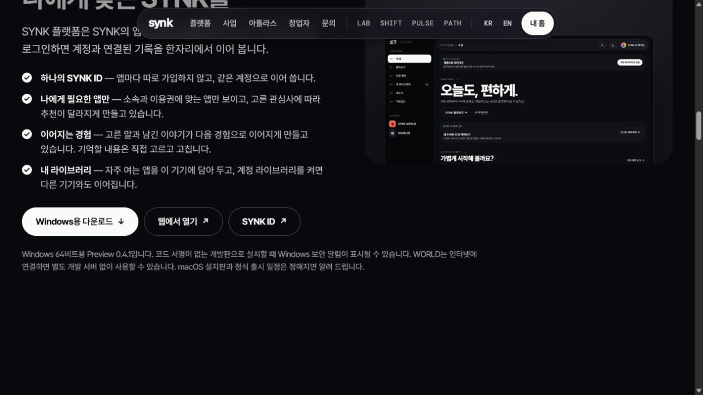
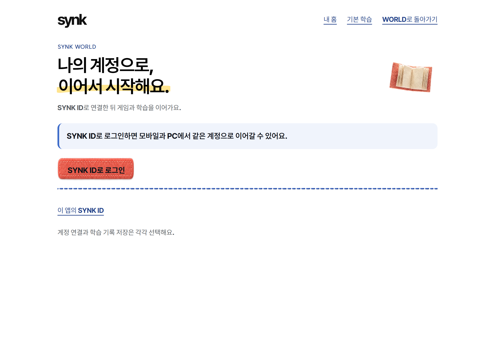

# WORLD 공개 연결 Windows Preview 0.4.1

2026-10-12. 사용자 요청: WORLD를 다른 PC에서 별도 개발 서버 없이 설치하고 바로 사용한다.

## 변경

- WORLD의 고정 실행 주소를 https://synk.im/account/client.html?product=world 로 연결했다. 명시적인 worldCloudPreview 설정이 있어야 개발판에서 이 주소를 허용한다. 개발용 localhost 실행은 별도 유지한다.
- 첫 화면의 기본 학습 링크와 공개 게임 경로, 허브에서 WORLD 계정으로 돌아오는 제한된 play 파라미터를 연결했다. 게임 문서·하위 프레임은 계정 IPC를 사용할 수 없다.
- 연결 실패 안내는 인터넷 확인과 다시 연결을 제공한다. Node.js·개발 서버 설치는 필요 없으며 인터넷 연결은 필요하다.
- WORLD와 Platform을 0.4.1로 올리고 Platform에 새 WORLD 설치 파일과 검증 해시를 포함했다. 기존 WORLD 0.4.0 실행 승인, Workspace 설치 파일, Platform 화면·PULSE 바이트, 계정 저장 경로를 보존했다.
- 이전 공개 0.4.0 payload를 동결 기준으로 사용했다. 현재 공유 작업본의 관련 없는 PULSE/renderer 변경을 새 공개 파일에 섞지 않았다.

## 검증

- 새 NSIS 설치 파일의 실제 재추출: WORLD74/74, Platform76/76 파일 바이트 일치. 세 ASAR 합계321파일 비밀·로그·개인 경로 검사0건. 두 설치 파일의 실제 Windows 버전0.4.1, NotSigned 확인.
- 실제 WORLD EXE·ASAR, 빈 임시 프로필, 숨김 Electron: 공개 HTTPS 진입, 네이티브 configured/signed-out, 학습 허브·바람길 시작과 경과, 허브·계정 복귀, 게임 IPC 거절 등16/16. 바람길 실제 time89·3D21frames·음성16개 로드. localhost4280/4191·인증 공급자 요청0, 콘솔 오류0.
- 합성 HTTPS 연결 실패를 주입한 실제 EXE: 인터넷 안내, 고정 재시도, IPC 거절, 실제 온라인 복귀10/10. OS 전체 네트워크를 끊은 시험은 아니다.
- 배포 전16검사는 기존 숨김 링크의 DOM 클릭으로 이동을 검증했다. 새 첫 화면의 표시된 기본 학습 CTA는 배포 후 별도로 확인한다.
- 관련 desktop 검사37/37, 공개 account 빌드 검사3/3, 홈페이지29/29 통과. 전체 desktop은533/535: 기존 PULSE 지원 전 기대값1건, 존재하지 않는 이전 native-logout fixture1건 실패를 별도로 기록했다. 이번 고정 후보의 변경 대상이 아니다.

## 범위

코드 서명이 없는 Windows x64 Preview다. NSIS 설치 프로그램 실행, 다른 물리 PC, 실제 사용자 OAuth 로그인·계정 저장 왕복은 이번에 검증하지 않았다. 실제 패키지 실행은 정상 프로필을 읽지 않는 빈 격리 프로필에서 수행했다. 기존 설치·계정·노트는 변경하지 않았다. 자동 업데이트·macOS 설치판은 추가하지 않았다.

## 공개 반영 완료

- [공개 0.4.1 릴리스](https://github.com/unmet23-lab/synk-policy/releases/tag/platform-preview-0.4.1-20261012). Platform397,413,716바이트·WORLD132,342,850바이트를 비로그인 HTTPS로 전부 다시 받고 원본 SHA와 대조했다. 두 파일 모두 일치한다. [다운로드 증거](public-downloads.json).
- 홈페이지 source d1e7ce8, 공개7e86605. 기존 최신 WORLD 튜터 공개 b21305b를 보존하고 관련19파일만 반영했다. Pages38151486340 성공, 공개19/19파일 HTTP200·SHA일치. [공개 파일](live-files.json).
- 공개 최종 EXE 검증18/18: 표시된 header 기본학습 링크59×44 → 실제클릭 → 학습 허브 → 바람길 시간89/Three.js20frames/동봉음성16 → 왼쪽버튼 차선0 → 일시정지·대기실 → 허브·계정 복귀. 개발 서버/인증공급자 요청0·콘솔오류0. [최종 보고서](online-public/report.json). 별도 연결실패·재시도10/10은 [offline-v3](offline-v3/report.json)가 최종이다.
- 구현 source88255ff43. 기존 개인 설치 및 프로필은 변경하지 않았다.

보관한 prepare.cjs/build.cjs/verify.cjs는 원래 .tmp/platform-world-cloud-20261012/package 실행 경로의 동결 증거다. 이 문서 폴더에서 그대로 실행하는 독립 명령이 아니다.

전체 공개 사이트 CI38151486533은 기록 시 실행 중이다. Pages 배포 성공과 이번19파일·실제 게임·다운로드 검증과 구분한다.
