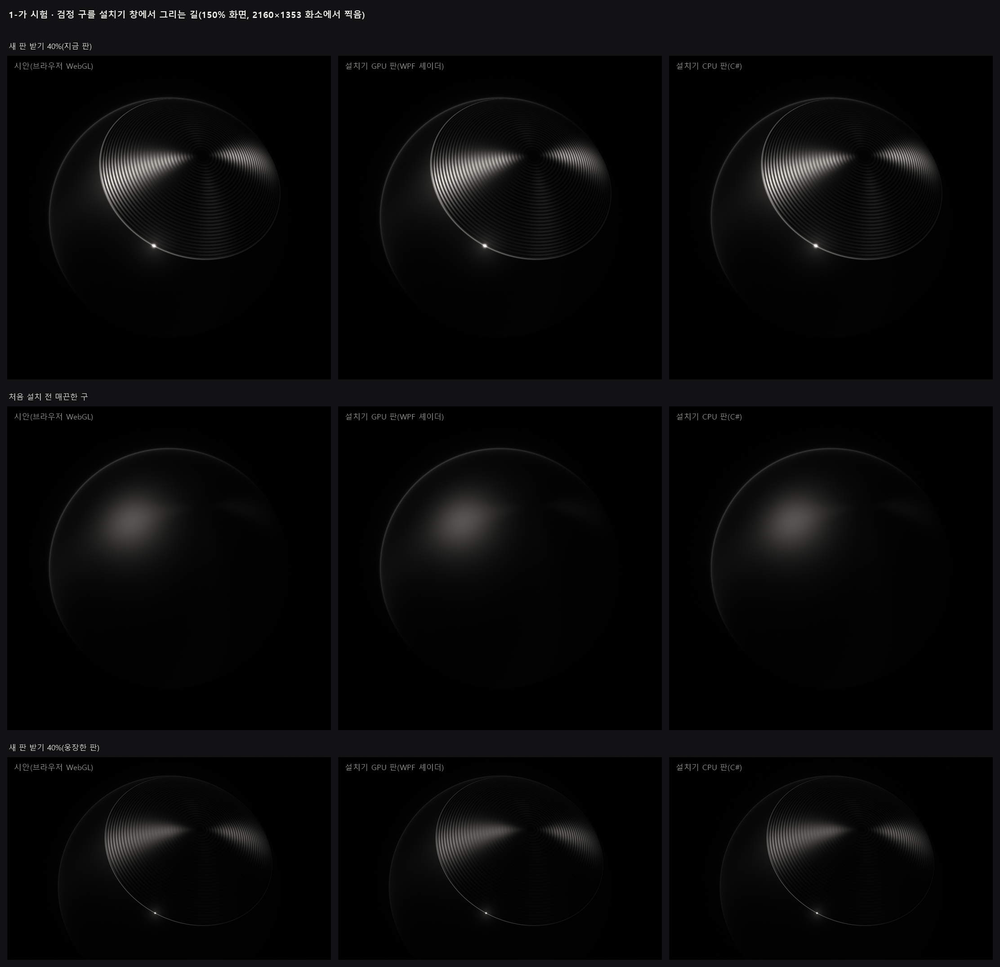

# 1-가 구현 설계 · 켜짐부터 열림까지 (2026-11-16, 검토 1~4차 반영 11-17, 4차 통과)

이 문서는 [옮기기 설계](PC앱_옮기기_설계.md)의 「켜짐부터 열림까지」 절을 PC 앱에 옮기는 방법이다. 화면과 움직임의 기준은 [시안](README.md)의 「담은 것」 11과 12, 「새 판 받기와 설치에서 정한 것과 까닭」, [결정 표](../../_ops/결정.md) 11-16 「켜짐부터 열림까지」 행이다. 11-17에 유호님이 「웅장한 판」을 고르셔서 구현을 시작했다. 7절의 ①과 ②, ③의 첫 조각과 둘째 조각(가림막과 쪽지)을 구현했다(결정 표 11-17 「1-가 ①과 ② 구현」, 「1-가 ③ 첫 조각」, 「1-가 ③ 가림막과 쪽지」). ③의 나머지(조용한 업데이트 따위)는 아직이다.

유호님은 11-16에 「이 화면 전에 구 나오는데 이거 gpt판이고 이 화면도 웅장함없는 예전판이야」, 「이것들도 시작부터 완료되고 앱이 켜질때까지도 웅장함 기대감을 줘야해」라고 하셨다. 이 설계의 목표는 켜는 순간부터 앱이 열릴 때까지 검정 구 하나만 보이게 하는 것이다.

11-17에 Fable 설계 검토를 네 번 받았다. 1차는 「고쳐서 다시 검토」(P0 없음, P1 다섯, P2 열둘, P3 열둘)였고, 처리는 [검토 처리 1차](1-가_설계검토_처리_1차.md)에 있다. 2차는 1차의 P1 다섯이 모두 풀렸다고 보고, 새로 들어온 「조용한 업데이트」에서 P1 한 건(두 갈래)과 P2 여섯, P3 열을 냈다. 2차의 처리는 [검토 처리 2차](1-가_설계검토_처리_2차.md)에 있다. 3차는 2차의 지적이 모두 풀렸다고 보고, 2차에 넣은 「바꾸는 중」 표시에서 P1 한 건과 P2 셋, P3 열둘을 냈다. 3차의 처리는 [검토 처리 3차](1-가_설계검토_처리_3차.md)에 있다. 4차는 「통과」였다(P0과 P1 없음). 설계 검토는 여기서 멈춘다. 4차가 남긴 P2 둘과 P3 열하나는 구현할 때 지킬 규칙으로 본문에 적었고, 처리는 [검토 처리 4차](1-가_설계검토_처리_4차.md)에 있다. 세 차례의 P1은 이 세션이 코드에서 다시 확인했고, 모두 검토의 말이 맞았다.

### 이 설계가 다루는 범위

11-16 밤에 유호님이 구에 눈을 넣는 방향(「먼저 저 구를 (눈을 넣자) 눈을 트렌디하거나 귀엽게 전시관의 명품느낌으로 만들고」)과 앱 아이콘을 구로 바꾸는 일을 말씀하셨고, 11-17 새벽에 눈을 점 눈으로 정하셨다(결정 표 11-17 「구의 눈은 점 눈」). 새 판 받기를 지금 판으로 갈지 웅장한 판으로 갈지는 아직 고르지 않으셨다(트랙 1절). 그래서 새 판 받기 장면의 겉모습은 아직 정해지지 않았다. 맡긴 세션의 조율에 따라 이 설계는 겉모습과 상관없는 것만 정한다. 화면을 굳히는 구현은 유호님이 시안을 보고 정하신 뒤에 시작한다.

- **겉모습과 상관없이 정한 것.** 설치기 창에서 셰이더를 그리는 길(1절), 관문이 도는 길과 창의 자리와 바뀌는 순서(2절), 진행을 받아 깎인 만큼으로 바꾸는 법(3절), 처음 설치 뒤 저절로 여는 것(4절), 실패 때 무엇이 열리는지(5절), 업데이트 뒤 도착을 알리는 법(6절), 시험과 검사기(8절), 앱 아이콘이 쓰이는 곳(11절)이다.
- **겉모습이 정해지면 채울 것.** 셰이더의 내용(눈이 들어갈지, 지금 판인지 웅장한 판인지), 깎는 모습, 실패 장면, 끝 장면, 움직임의 길이와 빠르기, 글의 굵기와 자리와 문장이다. 이 설계에서 이런 값이 나오는 곳은 모두 「채울 것」이라고 적었다. 5절의 「새 화면」 칸의 문장은 예시다.
- 11-16 밤 시안(origin `5422d54bf`)에는 눈이 생겼고, 셰이더에 `uEye`(종류, 보이는 정도, 뜬 정도, 표정), `uFace`, `uGaze`, `uSweep`이 늘었다. 11-17에 유호님이 점 눈으로 정하셨고, 틈 눈과 빛 눈은 시안에만 남는다. PC 앱과 설치기에는 점 눈만 옮긴다. 설치기의 셰이더는 앱과 같은 값을 실행 중에 받는다. 새 판을 받는 동안 눈이 무엇을 하는지(시안에서는 잠들어 있다)는 채울 것이다.
- **업데이트 장면의 끝은 「눈을 뜬다」로 바뀔 수 있다.** 지금 시안의 끝은 빛이 구를 한 바퀴 도는 것이다. 이 설계는 끝 장면의 내용을 정하지 않고 놓이는 자리만 정한다. 깎인 만큼이 100%가 되면 설치기가 새 앱을 켜고, 끝 장면은 새 앱의 첫 창이 보인다(6절). 설치기는 끝 장면을 그리지 않는다.
- 웅장한 판으로 가면 시작 창을 더 크게 띄울지 정해야 했다. 이 설계는 보이는 창을 모두 앱 창의 자리와 크기로 띄우므로(2절), 어느 판이든 시작 창은 앱 창과 같은 크기다.
- 옛 구독 관리 화면은 곧 통째로 다시 디자인될 수 있다. 이 설계는 그 화면을 건드리지 않는다. 0.4.95에 옮긴 1단계 얼굴(`orb-face*.mjs`, `solio-today.mjs`)도 새 시안이 정해진 뒤에 손본다.

## 한눈에

1. Windows 설치기 창의 구는 GPU 셰이더로 그린다. 시안의 셰이더를 HLSL로 옮겨 WPF 효과로 그렸더니 시안과 화소 차이가 평균 0.005단계 이하였다. 그래픽 가속이 없는 창에서는 이 효과가 그려지지 않으므로, 같은 셈을 C#으로 옮긴 CPU 판을 대비책으로 둔다.
2. 관문이 도는 길은 셋(처음 켤 때, 트레이에서 다시 열 때, 로그인 때 숨은 채 시작)이다. 길마다 무엇이 보이는지 정했다(2절의 표).
3. 앱이 끝나며 창이 모두 닫히는 동안 화면을 지키는 「가림막」 창을 따로 띄운다. 가림막은 받아 둔 설치 파일을 모양만 그리는 방식으로 켠 것이고, 설치는 하지 않는다. 설치기를 띄우는 차례(초안 보호가 끝난 뒤에만)는 지금 그대로 둔다.
4. 앱의 창이 하나도 화면에 보이지 않을 때(모두 트레이에 숨었거나 최소화)만 창을 띄우지 않고 조용히 업데이트한다. 조용한 업데이트가 창 없이 끝나는 것은 사람이 할 일이 없는 네 끝뿐이고(2절), 그 밖의 끝은 모두 설치기 창을 띄운다. 바꾸는 동안 사람이 앱을 켜면, 앱은 본체를 만들지 않고 설치기 창을 앞으로 부른 뒤 끝난다.
5. 도착(업데이트됨, 설치됨)과 창 자리는 인자가 아니라 작은 「모양 쪽지」 파일로 넘긴다. 자동 업데이트의 인자와 새 앱을 켤 때의 해시 확인은 지금 그대로다. 쪽지는 구의 시작 자세만 바꾸고 피드 확인을 건너뛰지 않는다.
6. 깎인 만큼은 시안대로 받기가 0~50%, 바꾸기가 50~100%다. 바꾸기 안은 설치기의 단계마다 몫을 나눈다.
7. 처음 설치가 끝나면 묻지 않고 앱을 연다. Platform 설치기만 바꾼다.
8. 실패하면 쓰던 판이 저절로 열린다. 막힌 상태와 사람이 해야 하는 일(Mac에서 손으로 옮기기)은 저절로 넘기지 않는다.
9. 앱 아이콘 파일 세 개가 쓰이는 곳은 11절에 모았다.

## 1. 설치기 창에서 구를 그리는 길

Windows 설치기는 WPF로 그린 창이라 앱의 WebGL 구를 그대로 쓸 수 없다. 옮기기 설계가 꼽은 길 셋을 작은 시험으로 견줬다.

### 시험한 방법

- 시안(`검정구.html`)의 새 판 받기 장면 넷을 desktop의 Electron으로 찍었다. 지금 판 40%, 처음 설치 전의 매끈한 구, 웅장한 판 40%, 100%다. 화면 배율 1(1440×900)과 이 PC의 실제 배율인 1.5(2160×1353)에서 찍었다. 시험한 시안은 눈이 생기기 전 판이다.
- 찍는 순간 시안이 셰이더에 넘긴 값(uniform)을 함께 적었다. 세 길 모두 그 값으로 같은 장면을 그려, 시안 캡처와 화소의 R·G·B 값마다 견줬다.
- 시안은 캔버스를 화면보다 촘촘하게(배율 2) 그리고 브라우저가 쌍선형으로 줄인다. GPU 판과 CPU 판도 같은 규칙으로 그렸다.
- 시험 도구와 결과 원문은 [1-가_시험](1-가_시험/) 폴더에 있다(`결과.txt`).

### 결과

| 길 | 시안과의 차이(0~255) | 속도 | 걸리는 것 |
|---|---|---|---|
| GPU 판: HLSL(ps_3_0)을 WPF 효과로 | 여덟 장면 모두 평균 0.001~0.005, 최대 3. 99.9%가 1 이내 | 깎인 만큼만 실행 중에 바꾸며 그렸을 때 1440×900 지금 판이 초당 133장, 1440×900 웅장한 판이 104장, 2160×1353 웅장한 판이 58장이었다 | 소프트웨어로 그리는 창에서는 화면이 모두 검정이었다(가장 밝은 화소 0) |
| CPU 판: C#으로 옮긴 셈 | 여덟 장면 평균 0.09~0.41, 최대 3 | 한 장을 통째로 그리는 데 4스레드로 0.4~1.8초, 24스레드로 0.11~0.51초가 걸렸다 | 매 프레임 통째로 다시 그릴 수 없다 |
| 미리 구운 그림 | JPEG 품질 97에서 평균 0.28~0.43, 최대 8 | 한 장이 81~314KB였다 | 창 크기와 배율마다 따로 구워야 한다. 불티가 화소 하나씩 움직이려면 한 조합에 약 560장이 들고, 150%에서는 약 135MB다 |

세 줄은 위에서부터 지금 판 40%, 처음 설치 전의 매끈한 구, 웅장한 판 40%다. 각 줄은 왼쪽부터 시안, GPU 판, CPU 판이다. 눈으로는 구별되지 않는다.

- **속도 값의 한계.** GPU 판의 속도는 셰이더 값을 컴파일할 때 상수로 구운 판으로 쟀다. 실행 중에 바뀐 값은 깎인 만큼 하나뿐이었다. 시험한 셰이더는 새 판 받기 장면만 옮겼고 새긴 자리와 눈이 없다. 실제 설치기는 사용자 PC에서 fxc를 돌릴 수 없으므로, 창 크기, 배율, 빛, 자세, 눈 값을 모두 실행 중에 넘긴다. 위 속도는 그 판으로 다시 잰다(확인 안 함).
- **함정 하나.** HLSL 컴파일러(fxc)의 `smoothstep`은 경계가 거꾸로인 호출(`smoothstep(60, 14, x)`)을 GLSL과 다르게 셈한다. 처음 판은 이 때문에 구의 둘레가 통째로 밝고 속이 어두웠다. 식을 직접 쓴 함수로 바꾸자 맞았다. 1단계 `orb-stage.mjs`의 B1 고침과 같은 자리다.

### 고른 것

- **GPU 판을 쓴다.** 시안과 구별되지 않는다.
- **CPU 판을 대비책으로 둔다.** 설치기는 창을 띄우기 전에 GPU 판을 쓸 수 있는지 본다. `RenderCapability.Tier >> 16`이 2보다 작거나, `RenderCapability.IsPixelShaderVersionSupported(3, 0)`이 거짓이거나, 창의 `HwndTarget.RenderMode`가 `SoftwareOnly`이거나, 원격 세션(`SystemParameters.IsRemoteSession`)이면 CPU 판으로 그린다. WPF는 효과를 그리지 못해도 알려 주지 않으므로 이 넷으로 미리 가른다. 도는 도중에 가속이 꺼지면(`RenderCapability.TierChanged`) 그 자리에서 CPU 판으로 바꾼다.
- **CPU 판은 사다리로 줄인다.** 첫째 단은 깎는 선 둘레의 띠만 다시 그리고 빛의 흔들림은 멈춘다. 그것도 느리면 둘째 단에서 구를 멈춘 그림으로 두고 백분율 글만 바꾼다. 글과 백분율은 셰이더와 따로 그리는 요소라 어느 단에서도 남는다. 가장 나쁜 경우가 「검정 바탕에 글만」이다. 띠만 그리는 속도는 아직 재지 않았다(확인 안 함).
- **GPU 판도 바닥을 둔다.** 깎는 선은 천천히 움직이므로 초당 30장이면 된다. 프레임이 이보다 느리면 안쪽 해상도를 배율 2에서 1.5, 1로 낮춘다. 이 PC의 숫자가 아니라 이 바닥으로 판단한다.
- **셰이더의 원본은 앱의 GLSL 하나다.** `desktop/renderer/orb-stage.mjs`의 셰이더를 원본으로 두고, 설치기의 HLSL과 C#은 그 원본에서 옮긴 판으로 둔다. 셋이 어긋나지 않게 8절의 「구 일치 검사」를 둔다. `orb-stage.mjs`에는 아직 깎기가 없다. 시안의 깎기와 눈은 겉모습이 정해진 뒤 옮긴다.
- **컴파일한 셰이더는 빌드할 때 만든다.** `build-signal.cjs`가 fxc로 컴파일해 설치기에 넣고, 그 바이트의 해시를 꾸러미 보고에 적는다. 공개 CI의 Windows 러너에 Windows SDK(fxc)가 있는지는 확인하지 않았다. 없으면 컴파일한 바이트를 저장소에 두고, CI는 다시 컴파일해 같은지만 본다.

## 2. 관문, 창의 자리, 창이 바뀌는 사이

### 지금 흐름

코드에서 다시 읽은 것이다(11-17).

- **켤 때.** 포장된 Windows 앱은 켜면 시작 관문을 거친다(`desktop/src/main.cjs`의 `beginPlatformStartup`). 시작 창(560×440, 창 옵션의 바탕 `#0B0D12`, 화면 가운데)이 뜨고 피드를 확인한다. 시작 창의 화면 바탕은 이미 `#000000`이고, 확인 중에는 글이 보이지 않는다(`startup-update.css`의 `opacity: 0`). 글은 화면 낭독기용으로 남아 있다. 새 판이 없으면 `proceed`가 앱 창을 만든 즉시 시작 창을 없앤다. 앱 창은 `ready-to-show`에서야 보이므로 그 사이가 빈다.
- **트레이에서 다시 열 때.** 「닫으면 트레이로」가 기본값이다. 앱 창이 숨어 있을 때 다시 열면 `requestPlatformWindow`가 관문을 다시 돈다. 시작 창이 다시 뜨고, 확인이 끝나면 숨어 있던 앱 창을 보인다.
- **로그인 때 숨은 채 시작할 때.** `--synk-autostart`로 켜지고 「숨은 채 시작」이 켜져 있으면 앱 창은 보이지 않는다. 그래도 시작 관문은 시작 창을 띄운다.
- **새 판을 설치할 때.** 앱은 받은 파일을 확인한 뒤 `requestQuit`으로 `app.quit()`을 부른다. Electron은 모든 창을 닫은 뒤에야 `will-quit`을 내고, 설치기를 띄우는 `completeInstall()`은 그 `will-quit` 안에서 돈다(`main.cjs` 171~182행). 창이 닫히는 동안 초안 보호가 물을 수 있고, 사람이 취소하면 끝내기가 멈춘다. 설치기는 초안 보호가 끝난 뒤에만 띄운다는 것이 지금 규칙이다(`desktop/LIFECYCLE.md`의 0.4.10 기록). 그러므로 설치기 프로세스가 생기기 전에 앱의 창은 이미 모두 닫혀 있다. 그 뒤에 받은 파일 해시(약 409MB), 되돌림 기록 준비, 설치기 켜기가 이어지는 동안 화면에는 창이 하나도 없다.
- **켜 둔 동안.** Windows 앱은 5분마다 피드를 확인하고, 새 판을 받으면 받자마자 위의 설치로 넘어간다(`platform-update.cjs`의 `checkInBackground`). 쓰던 앱 화면이 예고 없이 닫힌다. 얼굴은 업데이트 상태를 받지 않는다.
- **설치기에서 새 앱으로.** 설치기는 새 앱을 켠 뒤 2초 안에 실패로 끝나지 않으면 창을 닫는다. 새 앱의 창이 뜨기 전에 닫힌다.

### 관문이 도는 세 길

| 길 | 보이는 창 | 피드 확인 | 새 판이 있으면 |
|---|---|---|---|
| 처음 켤 때(보이는 시작) | 시작 창을 앱 창의 자리와 크기로 띄운다. 확인 중에는 구만 보인다 | 지금처럼 시작 창이 한다 | 시작 창에서 받기 장면 |
| 트레이에서 다시 열 때 | 숨어 있던 앱 창을 바로 보인다. 시작 창을 띄우지 않는다 | 미뤄 둔 판 목록을 비우고 곧바로 뒤에서 글 없이 한다. 아직 보이지 않은 실패 장면이 있으면 그 장면을 먼저 보이고, 그 판은 목록에서 비우지 않는다(아래) | 보이는 업데이트(아래)와 같다. 받은 뒤 앱 창 안에서 받기 끝 장면으로 들어가고 가림막으로 넘긴다 |
| 로그인 때 숨은 채 시작 | 창을 띄우지 않는다. 앱 창은 지금처럼 숨긴 채 만든다 | 뒤에서 한다. 확인, 받기, 넘기기 가운데 어느 단계에서 실패해도 쓰던 판을 숨은 채 두고, 실패 장면은 다음에 창을 열 때 보인다 | 조용한 업데이트(아래) |

- 다시 열 때 시작 창을 없애는 것은 지금 동작을 바꾸는 일이다. 다시 열 때의 관문은 사람이 앱으로 돌아오기 전에 새 판을 잡으려는 것이다. 그 일은 켜 둔 동안의 확인과 같은 길로 맡긴다. `platform-startup-update.test.cjs`의 다시 열기 시험을 고쳐 쓰고, 구현 판에서 결정 표에 올린다.
- 지금 다시 여는 관문은 미뤄 둔 판 목록(끝내기를 취소했거나 넘김에 실패한 판)을 비운다(`platform-update.cjs`의 `setStartupActive`). 5분 확인은 미뤄 둔 판을 건너뛴다. 관문을 없애도 다시 열 때 이 목록을 비우고 곧바로 확인한다. 그래서 「앱을 다시 열면 미뤄 둔 판을 다시 설치할 수 있다」(`desktop/LIFECYCLE.md`)는 그대로다.
- 다만 아직 보이지 않은 실패 장면이 있는 다시 열기에서는 그 판을 목록에서 비우지 않는다. 숨은 채 되돌려진 앱이나 숨은 채 넘김에 실패한 앱을 다시 여는 때다. 되돌린 판은 이미 그 목록에 있다(`platform-startup-update.cjs`가 되돌림 코드를 받으면 넣는다). 이때 목록을 비우면, 받아 둔 파일이 있어 확인이 몇 초 안에 설치로 넘어간다. 사람은 「바꾸지 못했습니다」를 본 직후 앱이 다시 닫히는 것을 보고, 실패가 되풀이되는 원인이면 그 자리에서 또 실패한다. 그 판은 실패 장면의 「다시 시도」로만 다시 건다. 지금도 되돌린 뒤의 첫 화면에서 사람이 다시 시도할지 쓰던 판을 열지 고른다(`LIFECYCLE.md` 「사용자가 거치는 단계」 4).
- 보이지 않은 실패 장면이 낡지 않게 한다. 확인 실패의 장면은 그 뒤의 확인이 성공하면 버린다. 되돌림과 넘김 실패의 장면은 그 판이 다시 시도되거나 더 새 판이 깔릴 때까지 둔다. 이미 지나간 확인 실패를 사람이 다음에 창을 열 때 보지 않게 하려는 것이다.
- 숨은 채 시작한 길에서 확인이 도는 동안 사람이 창을 부르면, 그때 시작 창을 앱 창 자리로 띄워 처음 켤 때의 길로 넘긴다. 지금은 이때 `startupWindow?.show()`만 도는데, 숨은 길에는 시작 창이 없기 때문이다. 트레이와 Care 알림은 지금처럼 관문이 풀린 뒤에 만든다.
- 업데이트 뒤 새 앱이 켜질 때, 도착 쪽지(6절)의 상태가 숨음이나 최소화면 시작 창을 띄우지 않고 숨은 채 시작한 길로 간다. 앞이나 다른 창 뒤면 처음 켤 때의 길로 가고, 6절의 첫 장면을 보인다.
- 다시 열 때와 숨은 채 시작할 때도 관문 시험에 넣는다(8절).

### 자리 하나

- 보이는 창은 모두 앱 창이 기억한 자리를 쓴다. 그 자리는 `window-placement.json`(앱 사용자 폴더)에 있고, 화면을 벗어나면 `fitPlacement`가 맞춘다(`desktop/src/window-placement.cjs`).
- 시작 창도 이 자리를 읽는다. 지금은 `createWindowPlacement`를 `initializeMain`에서 만든다. 이것을 `app.whenReady` 바로 뒤로 당긴다. 앱 창이 최대화였으면 시작 창도 최대화한다. 다만 최대화는 창을 보일 때만 한다(숨은 채 시작을 지키려고 지금 앱 창이 최대화를 미루는 것과 같다).
- 처음 설치할 때 설치기는 주 화면 작업 영역 가운데에 1440×940 DIP로 놓는다(앱의 `fitPlacement(null)`과 같은 셈). 설치기는 실제로 놓은 자리를 6절의 도착 쪽지에 적고, 새 앱의 첫 창은 그 자리를 쓴다. 두 프로그램이 따로 셈해 소수 배율에서 1화소 어긋나는 일을 막는다.

### 창의 종류와 닫기

세 창이 똑같이 보이게 되므로 닫기의 뜻을 정해 둔다.

| 창 | 테두리 | 닫기 단추를 누르면 | 그 밖 |
|---|---|---|---|
| 시작 창 | 없음(`frame: false`). 창 단추는 앱 창의 단추(`.portal-window-actions`, 44×32)와 같은 모양과 자리 | 앱이 끝난다. 설치기로 넘기는 중에는 닫을 수 없다(둘 다 지금과 같다) | 바탕 `#000000` |
| 앱 창 | 없음(지금과 같다) | 트레이로 간다(「닫으면 트레이로」가 켜져 있을 때) | 지금과 같다 |
| 가림막 | 없음. 단추 없음 | 닫을 수 없다. 사람이 누를 것이 없다. 대신 스스로 끝나는 상한이 있다(아래 가림막 10번) | 작업 표시줄에 보이지 않는다. 앞으로 나서지 않는다(활성화하지 않는다) |
| 설치기 창 | 없음. 창 단추는 같은 모양으로 그린다 | 준비 화면에서는 설치기가 끝난다. 설치 중에는 단추가 꺼져 있다(지금과 같다) | `AllowsTransparency`를 끈다(지금 창은 켜져 있다). 최대화할 때는 작업 영역 크기로 놓는다. 테두리 없는 WPF 창은 최대화하면 작업 표시줄을 덮기 때문이다 |

- Windows 11에서 Electron의 테두리 없는 창은 모서리가 둥글고 그림자가 있다. WPF 창은 `DwmSetWindowAttribute`의 모서리 값으로 둥근 모서리를 청한다. 실제로 같아 보이는지는 캡처로 확인한다(확인 안 함).
- 같은 문장이 창을 건너갈 때가 있다(앱 창의 「새 판으로 바꾸고 있습니다.」가 가림막과 설치기 창으로). 이때 뒤 창은 같은 글꼴, 같은 굵기, 같은 자리로 그린다. 설치기에 없는 굵기면 그 글꼴 파일을 더한다. 굵기와 자리 자체는 채울 것이다. 브라우저와 WPF는 글자를 조금 다르게 그릴 수 있으므로 캡처로 견준다.
- 작업 표시줄에서는 시작 창, 앱 창, 설치기 창이 다른 프로그램으로 보일 수 있다. 설치기 창의 제목과 AppUserModelID를 앱(`im.synk.platform.preview`)에 맞춰 같은 단추로 묶이게 한다. 고정한 단추에 다른 영향이 없는지는 확인하지 않았다.

### 앱에서 설치기로: 가림막

앱이 끝나며 창이 닫히는 동안 화면을 지키려면, 앱이 닫는 창과 다른 창이 있어야 한다. Electron 안의 창은 `app.quit()`이 함께 닫는다. 닫히지 않으려고 버티면 끝내기 자체가 취소된다. 그래서 앱 밖의 프로세스로 띄운다.

1. **띄우는 때.** Windows 자동 설치가 `opening`으로 넘어가 `requestQuit`을 부르기 바로 앞이다. 앱의 창(시작 창, 주 창, PULSE 창, 회사 창) 가운데 하나라도 화면에 보이면 띄운다. 그 창이 맨 앞에 있든 다른 프로그램의 창 뒤에 있든 같다. 모든 창이 숨었거나 최소화돼 있을 때만 조용한 업데이트로 간다(아래).
2. **켜는 것.** 앱이 받아서 이미 해시를 맞춘 새 판 설치 파일을 `--curtain` 방식으로 켠다. 가림막 방식은 설치 엔진을 쓰지 않는다. 설치된 앱, 설치 등록, 바로가기, 설치기의 뮤텍스를 건드리지 않는다. 그리는 것은 구와 그 위의 문장(앱 창의 「새 판으로 바꾸고 있습니다.」, 위 「창의 종류와 닫기」)이다. 글을 그리려면 글꼴 파일이 있어야 하므로, 지금 설치기처럼 개인 캐시 폴더(`InstallerEngine.CreatePrivateCache`)에 꺼냈다가 끝날 때 지운다. 가림막이 만드는 파일은 그 캐시뿐이다. 앱은 가림막의 표준 입력과 표준 출력을 쥔다. 가림막은 첫 장을 그리면 표준 출력에 `SYNK_CURTAIN_READY` 한 줄을 쓴다.
3. **자리.** 가림막은 앱이 쓴 넘김 쪽지(6절)에서 창 자리와 장면 값을 읽는다. 창은 활성화하지 않고, 앱 창 바로 아래로 놓는다(`SetWindowPos`에 앱 창의 핸들을 넣는다). 그래서 초안 보호가 묻는 대화 상자는 가림막보다 위에 남는다.
4. **앱이 보내는 말.** 앱은 가림막의 표준 입력으로 두 가지 말을 보낸다.
   - 끝내기가 취소되면 「cancel」 한 줄을 보낸다. 초안 보호에서 사람이 취소한 때이고, 주 창, PULSE 창, 회사 창의 세 자리가 모두 `cancelInstall`을 부르므로(`main.cjs`), 「cancel」은 그 함수 한 곳에서 보낸다. 가림막은 「cancel」을 받으면 바로 끝난다.
   - 마지막 창이 닫혀 `will-quit`에 들어서면 「closing」 한 줄을 보낸다. 그 뒤에는 앱이 끝나며 입력이 닫힌다. 가림막은 이때 끝나지 않고 설치기의 알림을 기다린다(6번).
   - 입력이 닫히는 것만으로는 앱이 끝났는지 취소했는지 가를 수 없다. 그래서 가림막은 닫힘이 아니라 이 두 말로 가른다.
5. **창이 닫히면.** 앱의 창이 닫히면서 그 아래의 가림막이 드러난다. 가림막은 같은 검정과 같은 구라서 바뀐 것이 보이지 않는다. 그 뒤의 차례는 지금 그대로다. `will-quit`에서 `completeInstall()`이 설치기를 지금과 같은 인자 셋으로 띄운다.
6. **설치기가 이어받으면.** 설치기는 앱이 쓴 넘김 쪽지에서 자리를 읽어 같은 자리에 창을 띄운다. 가림막에 끝나라고 알리는 것은 READY를 쓴 뒤 설치기 창이 첫 장을 그린 때다. 알림은 이름 있는 이벤트로 한다. 이벤트 이름은 앱이 정해 넘김 쪽지에 적고, 가림막이 그 이름으로 만든다. 설치기 창은 준비(설치 파일 해시)보다 먼저 뜬다(`Program.cs`). 그래서 READY 앞에서는 설치기 창이 떠 있어도 가림막이 그 아래에 남아 있고, READY 전에 설치기가 실패해도 가림막이 화면을 지킨다.
7. **READY 전에 실패하면.** 실패를 둘로 가른다.
   - 막힌 상태(`InstallFailure`이고 다시 시도할 수 없음, 지난 설치가 끝나지 않은 표시가 남은 경우)는 지금처럼 설치기 창에 기록과 함께 남긴다. 이 창은 맨 위에 두어 앱이 다시 만든 창에 가려지지 않게 한다.
   - 그 밖의 실패는 설치기 창을 닫는다.
   - 어느 쪽이든 앱은 지금처럼 `will-quit` 실패 갈래에서 창을 다시 만든다. 다시 만든 창은 넘김 쪽지에 적은 상태로 돌아온다. 보이던 창은 보이고, 숨어 있던 창은 숨은 채 두며 실패 장면은 다음에 창을 열 때 보인다. 지금처럼 「로그인 때 자동으로 켜진 프로세스인가」(`main.cjs`의 `ready-to-show`)로 정하지 않는다. 그렇게 정하면 로그인 때 숨은 채 켜졌다가 사람이 열어 쓰던 창이 숨어 버리고, 트레이에 숨어 있던 창은 화면에 나온다.
   - 앱은 다시 만든 창이 보이면, 또는 숨긴 채 두기로 정하면 바로 가림막에 「cancel」을 보낸다.
8. **가림막을 띄우지 못하면.** 1.5초 안에 `SYNK_CURTAIN_READY`가 오지 않으면, 앱은 그 프로세스를 끝내고 가림막 없이 지금처럼 넘긴다. 가림막 방식을 모르는 설치기는 조용히 끝나지 않는다. 인자를 확인하다 예외를 던지고 「설치 화면을 열지 못했어요」 알림 상자를 띄운다(`Program.cs`의 맨 바깥 `catch`). 앱이 그 프로세스를 끝내므로 이 상자는 화면에 남지 않는다. 가림막은 모양만 맡으므로, 실패해도 업데이트를 막지 않는다.
   - 1.5초는 첫 값이다. 가림막은 약 409MB인 설치 파일을 켜서 글꼴을 꺼내고 첫 장을 그려야 READY를 쓴다. 이 시간을 9절에서 재서 맞춘다.
   - 앱이 끝낸 가림막은 캐시 폴더를 지우지 못한다. 그래서 가림막 캐시 폴더 이름에 가림막의 프로세스 번호를 넣고, 가림막과 설치기는 시작할 때 `Installer\Cache` 아래에서 주인 프로세스가 없는 가림막 캐시를 지운다. 지우는 것은 가림막 캐시의 정해진 이름 꼴(`curtain-<프로세스 번호>-<무작위>`)과 꼭 맞는 폴더뿐이다. `Installer\Cache`에는 거래 폴더(끝나지 않은 표시가 가리키는 되돌릴 원본)가 같이 있으므로 그것은 건드리지 않는다.
9. **READY는 지금 그대로다.** 설치기는 첫 장을 기다리지 않고 지금처럼 준비가 끝나면 READY를 쓴다. 빈 틈은 가림막이 덮는다. 그래서 첫 장 때문에 앱의 30초 넘김 시간을 넘기는 일이 없다.
10. **상한.** 가림막은 닫을 수 없고 작업 표시줄에도 없으므로, 스스로 끝나는 상한을 둘 둔다. 하나는 넘김 쪽지의 앱 창이 닫힌 뒤 60초다(앱이 넘김을 기다리는 30초의 두 배). 다른 하나는 「closing」 없이 입력이 닫힌 뒤 10초다. 앱이 오류로 꺼진 때다. 앱이 다시 만든 창이 끝내 보이지 않아도 이 상한에서 끝난다.

**보이는 업데이트.** 앱의 창 가운데 하나라도 화면에 보이면(1번) 보이는 업데이트로 간다.
- 주 창이 숨어 있거나 최소화돼 있으면 먼저 주 창을 기억한 자리에 보인다. 활성화하지는 않는다. PULSE 창이나 회사 창을 쓰던 사람에게도 무슨 일이 일어나는지 보이게 하려는 것이다.
- 앱은 `requestQuit` 전에 얼굴에게 받기 끝 장면으로 들어가라고 알린다. 얼굴이 마쳤다고 답하거나 2초가 지나면 가림막을 띄우고 끝낸다. 얼굴이 이 장면을 어떻게 보일지는 채울 것이다. 지금 얼굴은 업데이트 상태를 받지 않으므로, 얼굴이 듣는 알림을 새로 둔다.
- 넘길 때 주 창의 보이는 상태(앞, 다른 창 뒤)를 넘김 쪽지에 적는다. 새 앱은 그 상태로 돌아온다. 다른 창 뒤에 있던 창은 새 앱에서도 앞으로 나서지 않는다.
- 다른 창 뒤에 있던 때는 그 사이의 설치기 창도 앞으로 나서지 않는다. 가림막처럼 활성화하지 않고, 가림막 바로 위에 놓는다.
- PULSE 창과 회사 창을 새 앱에서 다시 여는 일은 이 설계에 넣지 않는다.

**조용한 업데이트.** 앱의 모든 창이 숨었거나 최소화돼 있을 때만 한다. 트레이에 숨은 때, 최소화한 때, 숨은 채 시작한 때다. 다른 프로그램의 창 뒤에 있던 창은 화면에 보이던 창이고 작업 표시줄에 단추가 있던 창이라 조용히로 보내지 않는다. 앱은 가림막을 띄우지 않고, 넘김 쪽지에 「조용히」와 주 창의 상태(숨음, 최소화)를 적는다.
- **설치기가 일을 시작하는 자리.** 지금 자동 업데이트는 창의 `Loaded`에서 일을 시작한다(`Program.cs`). 조용한 방식에서는 창을 만들되 보이지 않으므로 `Loaded`가 오지 않는다. 그래서 `app.Run`에 창을 넘기지 않고 `Application.Startup`에서 같은 일을 시작한다. 일이 끝나면 `Shutdown`을 직접 부른다. 새 앱의 보이는 창을 기다리는 일(아래 「설치기에서 새 앱으로」)은 건너뛴다. 새 앱도 숨은 채 켜지기 때문이다.
- **새 앱.** 넘김 쪽지에 적힌 상태로 켠다. 숨음이면 숨은 채, 최소화면 최소화한 채다. 트레이가 없거나 「닫으면 트레이로」가 꺼져 있으면 숨음을 최소화로 바꾼다.
- **창 없이 끝나는 것은 사람이 할 일이 없는 네 끝뿐이다.** 새 앱을 켠 때, 되돌려 쓰던 앱을 켠 때, 사람이 켠 쓰던 앱이 켜져 있어 바꾸지 않고 끝낸 때(아래 장치 2), READY 전에 그 밖의 예외로 멈춘 때다. 마지막 것은 요청한 앱이 살아 있어 숨은 창을 다시 만든다(가림막 7번). 넷 모두 끝났을 때 앱이 켜져 있고, 설치기가 사람에게 알릴 것이 없다. 되돌렸거나 넘김에 실패한 쓰던 앱은 숨은 채 있다가, 사람이 창을 다시 열 때 실패 장면을 보인다. 줄마다의 값은 5절 설치기 표의 「조용한 방식에서」 칸에 있다.
- **그 밖의 끝은 모두 설치기 창을 보이고 앞으로 가져온다.** 앱이 켜져 있어도 사람이 알아야 할 것이 있으면 창을 보인다. 앱이 60초 안에 꺼지지 않은 때, 지난 설치가 끝나지 않은 표시가 남은 때, 되돌린 뒤 쓰던 앱을 켜지 못한 때, 되돌린 것을 확인하지 못한 때(`recovery-required`), 끝났는데 새 앱을 켜지 못한 때다. 단추를 누를 사람이 없는 채로 설치기가 숨어 남으면 뮤텍스를 쥐고 있게 된다. 그러면 다음 자동 업데이트의 설치기가 10초 기다린 뒤 「이미 SYNK 설치 화면이 열려 있어요」 알림 상자를 띄우고 끝나, 로그오프할 때까지 자동 업데이트가 끊긴다(`Program.cs`). 말없이 끝나면 앱이 꺼진 채 아무 안내가 없다. 창을 보이는 것은 이 둘을 막으려는 것이다. 창 없이 돌던 프로세스가 창을 앞으로 가져오는 것은 Windows가 막을 수 있다. 막히면 작업 표시줄 단추가 깜빡이는 데서 그친다(확인 안 함).
- **바꾸는 동안 사람이 앱을 켜면.** 조용한 동안에는 화면에 창도 트레이 아이콘도 없다. 그 사이 사람이 시작 메뉴나 작업 표시줄에서 SYNK를 켜면 옛 실행 파일이 켜진다. 엔진은 사전 점검에서 앱이 켜졌는지를 한 번 본다. 그 뒤 백업하는 동안 앱이 켜지면, `BeginTransaction`이 끝나지 않은 표시를 쓴 뒤 `InstallPayload`의 사전 점검이 예외를 던진다. 되돌리기는 앱이 켜져 있으면 거절하므로 `recovery-required`로 가고 표시가 남는다(`AutoUpdateEngine.cs`의 `RestorePrevious`, `InstallTransaction.cs`). 그 뒤로는 파일이 하나도 바뀌지 않았는데 자동 업데이트도 다시 설치도 막힌다. 이 성질은 지금 엔진에도 있지만, 지금은 그동안 설치기 창이 떠 있어 사람이 바꾸는 중임을 안다. 장치 셋으로 막는다.
  1. **「바꾸는 중」 표시.** 설치기는 READY를 쓴 뒤 앱이 꺼지기를 기다릴 때부터, 엔진이 끝 상태에 이를 때까지 `Handoff\<appId>.updating.json`을 쥔다. 보이는 업데이트에서도 같은 표시를 쥔다.
     - **놓는 때.** 엔진이 「이제 앱을 켜도 된다」에 이르면 표시 파일을 지운 뒤에 앱을 켠다. 새 판을 확정한 뒤(`EndTransaction`으로 「updated」를 닫은 다음, 새 앱을 켜기 앞), 되돌리고 옛 판을 확인한 뒤(되돌린 앱을 켜기 앞), 바꾸지 않고 끝내기로 정한 뒤(장치 2)가 그때다. 사람을 기다리는 끝(앱이 60초 안에 꺼지지 않음, `recovery-required` 따위)에서도 창을 보이기 전에 지운다. 표시는 어느 끝에서도 쥐지 않는다.
     - **놓는 차례.** 넷으로 한다. 첫째, 박동을 멈추고 돌던 박동이 끝난 것을 확인한다. 둘째, 표시 파일을 지운다. 셋째, 파일이 없는지 확인한다. 넷째, 앱을 켜거나 창을 보인다. 엔진 안에서는 지우는 때를 실행 파일 해시를 맞춘 뒤, 프로세스를 띄우기 바로 앞으로 둔다. 표시가 없는 틈을 짧게 하려는 것이다.
     - **지우지 못했을 때.** 0.2초 간격으로 다섯 번 다시 지운다. 그래도 남으면 파일 시각을 10초보다 앞으로 고친 뒤 바로 켠다. 시각도 고치지 못하면, 박동이 멈춘 채 파일 시각이 10초를 넘길 때까지 기다린 뒤 켠다. 앱은 시각이 10초를 넘긴 표시를 낡은 것으로 보므로, 어느 길이든 설치기가 켠 앱은 표시를 보지 않는다. 지우기에 실패한 것을 삼키고 그대로 켜면, 설치기가 켠 앱이 남은 표시를 보고 0으로 끝난다. 그러면 그 한 번의 업데이트는 끝났는데 앱이 켜져 있지 않게 된다.
     - **지우는 자리는 두 군데다.** 하나는 엔진이 앱을 켜기 바로 앞이다. 다른 하나는 `Program.cs`에서 엔진을 기다린 자리가 끝난 곳이다. 결과가 왔을 때와 예외가 났을 때 모두 지나는 자리에 둔다. 앱이 60초 안에 꺼지지 않은 끝은 엔진의 `try` 밖에서 던지므로(`AutoUpdateEngine.cs`의 앱 종료 기다림) 엔진의 `catch`를 타지 않기 때문이다. 두 자리 모두 위의 차례를 따른다.
     - **자기 표시만 다룬다.** 박동과 지우기는 자기 프로세스 번호가 담긴 표시에만 한다. 보이는 방식은 새 앱의 창을 기다리기 전에 뮤텍스를 놓으므로, 그 뒤 다음 설치기가 같은 이름의 표시를 쓸 수 있다. 앞 설치기가 끝나며 그 표시를 지우면 안 된다.
     - 새 앱은 빈 인자로 켜야 하므로(6절) 설치기가 켠 앱과 사람이 켠 앱을 인자로 가를 수 없다. 그래서 켜기 전에 표시를 지우는 차례로 가른다. 표시를 쥔 채 앱을 켜면, 설치기가 켠 앱이 표시를 보고 0으로 끝난다. 엔진은 2초 안에 0이 아닌 코드로 끝날 때만 실패로 보므로(`StartVerifiedProcess`) 이것을 모르고, 업데이트는 끝났는데 앱이 켜져 있지 않게 된다.
     - 이 차례를 지키면, 설치기 창이 떠 있는 동안 사람이 「열기」나 「쓰던 판 열기」를 누르거나, 설치기가 「한 번 더 켜 본다」로 앱을 켤 때도 표시는 이미 없다. 사람이 설치기 창을 닫기 전에도 앱을 켤 수 있고, 로그인 때의 자동 시작도 막히지 않는다. 앱이 60초 안에 꺼지지 않은 끝과 `recovery-required`에서 앱을 켜는 것은 지금도 막지 않으므로, 이것은 지금과 같다.
     - **내용과 박동.** 표시는 설치기 프로세스 번호와 제품을 담는다. 내용은 처음 한 번 임시 파일에 쓴 뒤 바꿔치기한다(되돌림 표시와 실패 기록이 쓰는 방식). 박동은 내용을 다시 쓰지 않고 2초마다 파일 시각만 고친다. 엔진의 쓰기 도우미(`AutoUpdateEngine.cs`의 `WriteJson`)는 공유 없이 파일을 열어, 이 방식으로 박동을 쓰면 앱이 읽는 순간 공유 위반이 나기 때문이다. 박동은 파일을 만들지 않는다. 파일이 없으면 박동은 그만둔다. 지운 직후에 돈 박동이 빈 파일을 만들면, 앱이 그 빈 파일도 표시로 보기 때문이다.
     - **앱이 보는 법.** 앱은 `main.cjs`의 맨 처음, 창과 서비스를 만들기 전에 이 파일을 본다. 파일 시각이 10초 안이고 그 번호의 설치기 프로세스가 살아 있으면 표시가 있는 것으로 본다. 내용을 읽다 틀리면 한 번 더 읽는다. 그래도 읽지 못했는데 파일 시각이 10초 안이면 표시가 있는 것으로 본다. 잘못 보더라도 그 틈은 10초를 넘지 않는다. 읽지 못한 것을 「표시 없음」으로 보면, 파일을 바꾸던 중에 본체가 그대로 켜져 장치 3이 기다려도 막히기 때문이다.
     - **표시를 보면.** 앱은 `Handoff\<appId>.show-request`에 그 설치기 번호를 담아 쓰고 `app.exit(0)`으로 끝난다. 표시의 내용을 읽지 못해 설치기 번호를 모르면, 번호 칸을 비운 요청을 쓴다.
       - 요청을 쓰지 못하면 0.2초 간격으로 다섯 번 다시 써 보고, 그래도 못 쓰면 조용히 끝난다. 알림 상자는 띄우지 않는다. 상자가 떠 있는 동안 그 앱 프로세스가 살아 있어서, 백업 중이면 장치 2가 업데이트를 그만두고, 파일을 바꾸는 중이면 장치 3이 기다려도 되돌리기가 거절돼 `recovery-required`로 막히기 때문이다. 장치 2와 3은 「표시를 본 앱은 곧 스스로 끝난다」를 전제로 한다. 앱을 켜는 바로 그 길에서는 표시를 본 앱이 어떤 창도 띄우지 않고 끝난다.
       - 설치기는 시작할 때 남은 요청 파일을 지운다. 0.5초마다 요청 파일을 보다가, 자기 번호가 담긴 요청이나 번호 칸이 빈 채 자기가 시작한 뒤에 생긴 요청(파일 시각으로 본다)이면 지운 뒤 창을 보이고 앞으로 가져온다. 요청 파일은 읽기 공유와 쓰기 공유와 지우기 공유로 열어, 앱이 쓰는 순간을 막지 않는다. 요청을 따른 뒤로는 보이는 업데이트와 같고 새 앱도 보이는 채로 켠다.
       - 조용한 설치기가 도는 동안 둘째 설치기가 켜졌을 때(5절 「설치 화면이 이미 열려 있음」)도 둘째 설치기가 표시에서 번호를 읽어 같은 요청을 쓰고 끝난다.
       - 설치기는 끝나기 직전에 요청을 한 번 더 본다. 있으면 앱을 한 번 더 켜서 창을 부르게 한다(두 번째 실행은 먼저 켜진 앱에 창을 부르라고 알리고 끝난다, `main.cjs`의 `second-instance`). 표시를 지우는 순간에 온 요청이 버려져, 사람이 앱을 켰는데 아무것도 보지 못하는 일을 막는다.
     - **실패는 결과를 바꾸지 않는다.** 표시와 요청을 쓰고 읽고 지우다 난 실패는 설치기도 앱도 모두 삼킨다. 다만 앱을 켜거나 창을 보이기 앞에서 표시를 지우지 못한 때는 삼키고 그대로 가지 않고 위 「지우지 못했을 때」를 따른다. 박동 타이머의 예외도 삼킨다. 타이머에서 난 예외로 설치기가 죽으면, 파일을 바꾸던 중일 때 끝나지 않은 표시가 남기 때문이다. 표시를 쓰지 못하면 장치 1만 꺼지고 장치 2와 3은 그대로 돈다.
  2. **엔진의 두 번째 확인.** 백업이 끝난 뒤 `BeginTransaction` 앞에서 `ApplicationProcessCount()`를 다시 본다. 켜져 있으면 앱 종료의 여유 시간만큼 기다린다. 장치 3과 같은 값(`ProcessExitGraceMilliseconds`, 20초)을 쓰고, 시험에서는 줄일 수 있다. 장치 1로 켜진 앱은 그 안에 스스로 끝나고, 그러면 그대로 간다. 여유 시간이 앱이 스스로 끝나는 시간보다 짧으면, 설치기는 「사람이 켠 앱이 있다」로 보고 끝낸 뒤 그 앱도 끝나서 아무것도 남지 않는다. 그래서 짧게 두지 않는다.
     - 그래도 켜져 있으면 파일을 바꾸기 전이므로 끝낸다. 되돌림 표시를 쓰지 않고, 쓰던 앱도 다시 켜지 않는다. 사람이 켠 앱이 이미 켜져 있기 때문이다. 실패 기록은 「unchanged」로 남긴다. 장치 1을 모르는 옛 앱이 켜진 때를 이 확인이 잡는다.
     - 장치 2로 끝낼 때도 백업 원본(깔린 앱 전체의 사본, `Installer\Cache` 아래)을 치운다. 자동 길의 다른 끝처럼 `TryCleanupBackupPayload`를 부른다. 손 설치에서 같은 확인으로 끝낼 때도 사본을 치운다. 지금 손 설치는 표시를 쓰기 전의 실패를 그대로 던져서 사본을 치우지 않는다(`InstallTransaction.cs`의 `InstallWithDeadline`).
     - 엔진 결과에는 새 값(사람이 켠 앱이 켜져 있음)을 둔다. 지금 `Program.cs`는 「되돌렸고 다시 켜지 않음」이면 실패 창을 남기므로, 이 값이면 창을 닫게 한다. 보이는 업데이트에서도 창을 닫는다. 사람이 켠 앱이 이미 앞에 있고, 그 판은 그 앱의 다음 확인에서 다시 받는다.
  3. **되돌리기의 기다림.** `RestorePrevious`는 앱이 켜져 있으면 거절하기 전에, 그 프로세스가 꺼지기를 앱 종료의 여유 시간(20초)만큼 기다린다. 파일을 바꾸는 중에 켜진 앱이 장치 1로 스스로 끝나는 사이의 틈을 덮는다.
  - 자동 업데이트는 Platform만 탄다(`AutoUpdateEngine.cs`의 `PrepareAutomaticUpdate`가 `platform`만 받는다). 그래서 자동 업데이트의 장치 2는 Platform에만 걸린다. 손 설치(`InstallTransaction.cs`의 `InstallWithDeadline`)의 같은 자리, 백업 뒤 `BeginTransaction` 앞에도 같은 확인을 넣는다. 그 끝은 표시를 쓰기 전의 다시 시도할 수 있는 실패(「앱이 켜져 있음」)다. 장치 3은 손 설치의 되돌리기에도 들어간다. 손 설치의 엔진은 WORLD와 Workspace 설치기도 같이 쓰지만, 둘 다 막히던 경우가 순하게 끝나는 쪽으로만 바뀐다. 장치 1은 Platform 앱과 Platform 설치기에만 넣는다.
- 지금은 끝낼 때 트레이가 숨은 앱 창을 잠깐 보인다(`platform-tray.cjs`의 `beforeQuit`). 초안 보호가 물을 창이 있어야 하기 때문이다. 조용한 업데이트는 쓰다 만 초안이 없을 때만 한다. 초안이 있으면 지금처럼 창을 보이고 묻고, 그때는 보이는 업데이트(가림막)로 간다. 본체가 초안이 있는지 미리 아는 길은 구현할 때 확인한다(확인 안 함). 그 길이 없으면 조용히 하지 않고 늘 보이는 업데이트로 간다.
- 조용한 설치 도중 PC를 끄거나 로그오프하면, 창이 없는 설치기는 경고 없이 끝날 수 있고 끝나지 않은 표시가 남을 수 있다. 바꾸는 동안 `ShutdownBlockReasonCreate`로 끄기를 잠시 미루는 길을 본다(확인 안 함).
- 밤사이 화면이 잠겼거나 원격 세션이 끊긴 때에도 설치기가 READY를 쓰고 설치를 마치는지는 확인하지 않았다(확인 안 함).

### 시작 창에서 앱 창으로

- 앱 창을 같은 자리에 숨긴 채 만든다. 얼굴이 첫 구를 그렸다고 알리면(앱 창 미리 불러오기의 새 IPC, 인자 없음) 앱 창을 보이고, 다음 프레임에 시작 창을 없앤다.
- 알림이 오지 않으면 `ready-to-show` 뒤 3초에 그냥 보인다. 얼굴 스크립트가 첫 장 전에 멈춰도 앱 창이 영영 안 보이는 일은 없다.
- 숨은 채 시작이면 알림이 와도 보이지 않는다(지금 `ready-to-show`의 숨김 판단을 그대로 따른다).
- 구가 드러나기 시작한 시각과 움직임 종류는 본체가 정해 두 창에 준다. 시작 창이 값을 만들어 넘기지 않는다. 시작 창의 다리(`startup-update-preload.cjs`)는 지금 인자 없는 다섯 동작으로 고정돼 있다. 더하는 것(창 단추, 첫 장 알림)도 인자 없는 동작으로만 두고, 시험과 설치본 검사기의 목록을 함께 고친다.

### 설치기에서 새 앱으로

- 설치기는 새 앱을 켠 뒤, 앱 실행 파일(경로로 맞춘다)의 프로세스 가운데 하나에 보이는 최상위 창이 생길 때까지 창을 둔다. 켠 그 프로세스로 한정하지 않는다. 표시를 지운 직후 사람이 켠 앱이 먼저 뜨면, 설치기가 켠 앱은 두 번째 실행이라 바로 끝나기 때문이다(`main.cjs`의 `requestSingleInstanceLock`). 창은 `EnumWindows`로 찾고, 20초가 지나면 그냥 닫는다.
- 기다리기 전에 설치기의 뮤텍스를 놓는다. 설치는 끝났고, 되돌려 켜진 앱이 다시 시도를 청하면 새 설치기가 10초만 기다리기 때문이다(`Program.cs` 36~41행).
- 뮤텍스는 한 곳에서 한 번만 놓는다. 지금은 `finally`의 `ReleaseMutex`가 놓으므로, 미리 놓으면 그 줄이 한 번 더 불려 예외가 난다. 놓았는지 기억해 두 번 부르지 않는다.
- 조용한 업데이트에서는 새 앱의 창을 기다리지 않는다(위 「조용한 업데이트」).

### 판 사이의 차례

- 자동 업데이트의 인자(`--auto-update`, `--wait-pid=`, `--handoff-token=`)와 손 업데이트의 인자(`--wait-pid=` 하나)는 바꾸지 않는다. 모양에 쓰는 값은 모두 6절의 쪽지로 넘긴다.
- 가림막 방식(`--curtain`)은 새 인자다. 앱은 새 판 설치 파일로 가림막을 켜므로, 가림막을 켜는 앱 판과 가림막을 받는 설치기 판을 같은 판에 싣는다. 그 판 뒤의 모든 설치기는 가림막 방식을 계속 받아야 한다(지우지 않는다). 받지 못하면 앱은 2절 8번처럼 가림막 없이 넘긴다.
- `--curtain`이 있으면 다른 인자가 무엇이든 설치하지 않고 가림막만 그린다. `--auto-update`가 함께 와도 같다. 그 밖의 인자는 버린다. 그 밖의 방식에서는 지금처럼 정해진 인자만 받는다.
- 가림막과 쪽지를 모르는 앱(0.4.95와 그 앞의 판)이 다음 판으로 넘길 때는 쪽지가 없다. 그때 설치기는 처음 설치의 자리(화면 가운데)에 뜨고, 가림막도 없다. 그 한 번은 지금처럼 보인다.

## 3. 깎인 만큼 나누기

### 잰 값

- **받기.** 0.4.95 Windows 설치 파일은 409,110,016바이트다. 11-16 20:34에 공개 주소에서 세 파일(1,352,721,533바이트)을 172초에 받았다. 초당 약 7.9MB(약 63Mbps)이고, 이 빠르기면 Windows 파일은 약 52초다. 한 번 잰 값이다.
- **바꾸기.** 이 PC의 실제 Platform 자동 업데이트 50번(10-19~11-16)을 설치기 기록으로 쟀다. 기록은 `%LOCALAPPDATA%\SYNK\Installer\Cache\<거래>\` 폴더가 생긴 때와 `transaction.json`이 「updated」로 닫힌 때다. 가운데 값이 21초, 가장 짧은 것이 12초, 가장 긴 것이 93초였다. 이 폴더는 깔린 파일을 모두 해시한 뒤에 생긴다(`AutoUpdateEngine.cs`의 `BackupPrevious`). 그래서 이 값에는 앞 판 확인과 깔린 파일 해시가 들어 있지 않다. 앱이 꺼지기를 기다리는 시간과 새 앱을 켜는 시간도 들어 있지 않다.
- 설치기 README의 10-14 측정(백업과 설치와 확인을 합쳐 220~551초)은 격리 식별자로 처음부터 다시 설치한 값이라 이 흐름과 다르다.
- 뒤에서 받은 판은 받자마자 설치로 넘어간다. 켤 때 이미 받아 둔 판이 있는 것은 지난번 끝내기가 취소됐거나 그 판이 미뤄진 때뿐이다.

### 나누는 자리

- 시안대로 받기를 0~50%, 바꾸기를 50~100%로 둔다. 받기(약 52초)와 바꾸기(가운데 21초에 앞뒤 몇 초)는 두 배 안쪽으로 비슷하다.
- 받기는 받은 바이트 비율을 그대로 쓴다. 이미 받아 둔 경우에는 0%에서 50%까지 짧게 깎는다. 그 길이는 채울 것이다.
- 자동 업데이트의 바꾸기는 설치기 단계마다 몫을 나눈다.

| 깎인 만큼 | 설치기 단계 | 나아가는 법 |
|---|---|---|
| 50~53% | 앱이 꺼지기를 기다림(`WaitingForApp`), 다른 프로세스를 기다림, 앞 판 확인, 사전 점검 | 시간에 따라 53% 가까이로 다가간다 |
| 53~70% | 백업(`BackingUp`). 깔린 파일 해시와 복사 | 설치기가 주는 백분율 |
| 70~78% | 설치 파일 준비(`Preparing`). 약 400MB를 꺼내고 해시한다 | 설치기가 주는 백분율 |
| 78~92% | 파일 바꾸기(`Installing`, 백분율 없음) | 92%에 점점 다가가는 시간 곡선 |
| 92~99% | 확인(`Verifying`) | 설치기가 주는 백분율 |
| 99~100% | 거래 닫기와 새 앱 켜기 직전 | 새 앱을 켜는 순간 100% |

- 처음 설치는 0~100%를 설치기 혼자 맡는다. 설치 파일 준비가 0~20%, 파일 넣기가 20~80%, 확인이 80~99%다.
- 다시 설치는 준비 앞에 백업(깔린 앱 전체 복사)이 있다. 백업이 0~25%, 준비가 25~40%, 파일 넣기가 40~85%, 확인이 85~99%다.
- 깎인 만큼은 뒤로 가지 않는다. 한 단계가 일찍 끝나면 다음 단계의 시작까지 정한 빠르기 이하로 따라간다. 그 빠르기와 시간 곡선의 모양은 채울 것이다.
- 단계마다 몫은 추정이다. 단계를 나눠 잰 값이 없다. 설치기가 성공할 때도 단계 시각을 작은 기록으로 남기게 하고(지금은 실패 때만 남긴다), 몇 판 뒤 그 값으로 몫을 다시 맞춘다.
- 느린 회선에서는 받기가 10분 제한에 걸리고 이어받지 못한다(`platform-update.cjs`). 지금도 같다. 받는 동안 단추가 없는 것은 시안 그대로 둔다. 제한에 걸리면 5절의 「받다가 끊김」으로 간다.

## 4. 처음 설치가 끝나면 묻지 않고 연다

### 지금 규칙의 까닭

지금 설치기는 끝나도 앱을 스스로 켜지 않는다. 「SYNK 열기」를 누르면 열고 「나중에 열기」를 누르면 닫는다(`desktop/installer/README.md` 「Installation behavior」). 까닭을 찾았지만 적힌 곳이 없었다. 이 규칙은 설치기를 처음 넣은 커밋(`df0ca97acc`, 10-12)에 설명 없이 들어왔다. 시그널 설계 문서(`docs/디자인/플랫폼_시그널/README.md`)는 「SYNK 열기 흐름」을 바뀌지 않은 것으로만 적었다. 결정 표, 트랙, 현장 노트에는 이 규칙을 다룬 줄이 없다(`node tools/기록찾기.js`로 찾음).

코드에서 읽히는 까닭은 넷이다.

1. 설치한 사람이 열지 말지 고르게 하는 설치기의 흔한 방식이다.
2. 열기 직전에 실행 파일을 다시 확인한다. `InstallerEngine.Launch`가 해시를 맞춘 뒤에 연다.
3. WORLD와 Workspace 설치기는 Platform 안에서 띄운다. 이 둘이 저절로 켜지면 Platform 위에 앱이 하나 더 뜬다.
4. 자동 업데이트는 이미 새 앱을 저절로 켠다(`AutoUpdateEngine.StartVerifiedProcess`, 해시 확인 뒤).

### 판단

Platform 설치기는 바꿔도 된다.

- 1은 준비 화면이 풀었다. 「설치」 위에 「끝나면 바로 열립니다.」를 먼저 보이므로, 설치를 누르는 것이 여는 것에 대한 동의다. 「다시 설치」 준비 화면에도 같은 문장을 둔다.
- 2는 그대로 지킨다. 저절로 열 때도 같은 `Launch`를 쓰고 인자를 붙이지 않는다. 도착은 6절의 쪽지로 알린다.
- 3은 WORLD와 Workspace 설치기에만 걸린다. 그 둘은 그대로 둔다(옮기기 설계 「정한 것」 8).
- 4가 보이듯 저절로 여는 것은 엔진이 이미 하는 일이다.
- 설치기는 권한을 올리지 않고 돈다(`app.manifest`의 `asInvoker`). 저절로 켜도 앱이 높은 권한으로 뜨지 않는다. 다만 사람이 설치 파일을 관리자 권한으로 열면 앱도 그 권한으로 켜진다. 지금의 「SYNK 열기」도 같지만, 묻지 않고 켜게 되므로 한 번 확인한다(확인 안 함).

고칠 것은 이렇다. 설치가 끝나면 설치기가 `Launch`로 앱을 켠다. 실행 파일 확인에 실패하면 설치기 창이 실패 장면을 보인다. README 「Installation behavior」의 그 줄은 Platform만 바뀐다고 고친다.

## 5. 실패와 갈림길에서 보이는 것

지금 `startup-update.mjs`와 `SignalWindow.cs`, `Program.cs`, 두 엔진이 다루는 경우를 모두 옮겼다.

### 공통 규칙

- **실패 장면의 모습은 시안을 따른다.** 지금 시안의 실패 장면은 온전한 구가 어두워진 그림 한 장이다(`검정구.html`의 `failed`). 새 시안의 실패 장면은 채울 것이다. 아래 표의 「새 화면」 칸은 문장과 단추만 적었고, 그 문장도 예시다.
- **저절로 여는 시간은 채울 것이다.** 아래 표는 「잠시 뒤」로 적었다. 그 시간 동안 사람이 단추에 손을 올리거나 초점을 옮기면 저절로 여는 것을 멈춘다. 남은 시간은 글로 세지 않는다.
- **조용히 넘기는 확인 실패는 인터넷 실패뿐이다.** 확인 단계의 `UPDATE_NETWORK_FAILED`와 `UPDATE_TIMEOUT`만 글 없이 쓰던 판을 연다. 서명 실패(`UPDATE_SIGNATURE_INVALID`), 피드 형식 오류(`UPDATE_INVALID_MANIFEST` 따위), 피드 주소 실패(`UPDATE_HTTP_FAILED`), 믿을 수 없는 주소(`UPDATE_UNTRUSTED_*`)는 실패 장면을 보인 뒤 쓰던 판을 연다. 어느 쪽이든 마지막 확인 실패를 설정의 업데이트 줄에 남긴다. 피드가 깨진 것을 알 수 있게 하려는 것이다.
- **`UPDATE_NETWORK_FAILED`는 기본값이기도 하다.** 코드가 붙지 않은 오류는 모두 이 코드가 된다(`platform-update.cjs`의 `errorResult`). 그래서 TLS 인증서 오류와 예상하지 못한 예외도 인터넷 실패처럼 조용히 넘어간다. 설정의 업데이트 줄에 남기는 것에 더해, 확인 실패가 사흘 넘게 이어지면 앱 안에 한 줄을 보인다. 그 줄의 자리는 채울 것이다.
- **확인이 늦으면 먼저 연다.** 피드 확인은 15초까지 걸릴 수 있다. 확인이 정한 시간 안에 답하지 않으면 쓰던 판을 먼저 열고, 확인은 뒤에서 마저 한다. 그 시간은 채울 것이다.
- **조용한 업데이트에서 창을 띄울지는 줄마다 정했다.** 아래 설치기 표의 「조용한 방식에서」 칸이다. 창 없이 끝나는 것은 사람이 할 일이 없는 네 끝뿐이다(2절 「조용한 업데이트」).
- **「바꾸는 중」 표시는 어느 끝에서도 쥐지 않는다.** 엔진이 끝 상태에 이르면 앱을 켜거나 창을 보이기 전에 표시를 지운다(2절 장치 1). 그래서 아래 표의 단추(「열기」, 「쓰던 판 열기」)와 「한 번 더 켜 본다」로 켜는 앱도 표시를 보지 않는다. 사람이 설치기 창을 닫기 전에도 앱을 켤 수 있다.
- **「쓰던 판 열기」와 「한 번 더 켜 본다」가 앱을 켜는 길.** 지금 설치기의 `Launch`는 새 판 실행 파일의 해시로만 확인한다(`InstallerEngine.cs`). 되돌린 옛 판을 켜는 함수를 새로 둔다. 엔진이 되돌릴 때 확인한 옛 판 해시로 확인한 뒤 켜고, 되돌림 인자를 붙인다. 켜기 바로 앞에 되돌림 표시를 새 만료 시각으로 다시 쓴다. 되돌림 표시는 10분 뒤 낡기 때문이다(`AutoUpdateEngine.cs`의 `WriteRecoveryMarker`, `platform-update-recovery.cjs`). 밤에 실패한 조용한 업데이트를 사람이 몇 시간 뒤 단추로 켜면, 낡은 표시 때문에 앱이 「되돌린 기록을 읽지 못함」으로 켜지고 그 판이 미뤄지지 않는다. 인자를 붙이지 않으면 앱이 켜지자마자 같은 판을 다시 설치하려 한다. 어느 쪽이든 켜기 전에 「바꾸는 중」 표시는 이미 없다.
- **사람이 해야 하는 일은 저절로 넘기지 않는다.** Mac에서 손으로 옮기기와 「이 앱은 저절로 새 판으로 바뀌지 않습니다」는 사람 차례다. 쓰던 판을 열더라도 앱 안에 한 줄이 남아야 한다. 그 줄의 자리는 새 얼굴 시안에서 정한다(채울 것).
- **설치기의 실패 기록은 조건이 맞을 때만 쓴다.** `last-update-failure.json`은 성공한 뒤에도 남는다. 기록의 판 번호와 시각이 이번 되돌림과 맞을 때만 읽는다. 기록의 문장과 경로를 그대로 보이지 않고, 단계 값으로 문장을 고른다(지금 시험이 날것의 글과 경로를 막는다).
- **엔진의 문장은 바꾸지 않는다.** 설치 엔진은 세 제품이 같이 쓴다. Platform 새 창은 실패 종류로 자기 문장을 고른다. 그러려면 엔진이 실패 종류 값을 내야 한다. 지금 `InstallFailure`에는 「다시 시도할 수 있음」과 「멈춤을 확인함」 둘뿐이다. 종류 값을 더한다.
- **단추와 문장의 말을 하나로 맞춘다.** 쓰던 판을 여는 단추는 모든 창에서 같은 이름이다. 아래 표는 「쓰던 판 열기」로 적었다. 「판」과 「버전」 가운데 어느 말을 쓸지는 유호님이 시안을 보실 때 정하시게 한다. 앱의 다른 화면은 「버전」을 쓴다.

### 시작 창과 앱 창(Electron)

| 경우 | 지금 | 새 화면(예시) | 저절로 열리는 것 |
|---|---|---|---|
| 새 판 확인 중 | 구만 보인다. 글은 화면 낭독기용으로만 있다 | 같다 | 새 판이 없으면 앱 |
| 새 판 없음, 업데이트 꺼짐 | 바로 앱 | 구가 그대로 앱 창으로 이어진다 | 앱 |
| 확인 중 인터넷 실패(`UPDATE_NETWORK_FAILED`, `UPDATE_TIMEOUT`) | 오류 화면에서 「지금 버전 열기」를 누를 때까지 기다린다 | 글 없이 새 판이 없을 때와 같이 간다 | 쓰던 판(바로). 5분 뒤 뒤에서 다시 확인한다 |
| 확인 중 그 밖의 실패(서명, 피드 형식, 피드 주소, 믿을 수 없는 주소) | 위와 같다 | 「새 판을 확인하지 못했습니다.」와 「잠시 뒤 쓰던 판을 엽니다.」, 「다시 시도」, 「쓰던 판 열기」 | 잠시 뒤 쓰던 판. 설정의 업데이트 줄에 남긴다 |
| 받는 중 | 막대와 백분율 | 0~50% 깎기, 「새 판을 받고 있습니다.」, 판 번호와 백분율 | 없음 |
| 설치기로 넘기는 중(Windows) | 「업데이트를 설치하고 있어요」 | 50%, 「새 판으로 바꾸고 있습니다.」와 「끝나면 저절로 열립니다.」 | 가림막과 설치기 창이 이어받는다 |
| 받다가 인터넷이 끊김, 10분 제한 | 「인터넷 연결을 확인한 뒤 다시 해 주세요. …」 | 「새 판을 받지 못했습니다.」와 「인터넷이 돌아오면 다시 받습니다. 잠시 뒤 쓰던 판을 엽니다.」, 「다시 시도」, 「쓰던 판 열기」 | 잠시 뒤 쓰던 판 |
| 저장 공간 모자람(`UPDATE_STORAGE_FAILED`) | 「PC 저장 공간을 비운 뒤 다시 해 주세요.」 | 「PC 저장 공간이 모자라 새 판을 받지 못했습니다.」와 「잠시 뒤 쓰던 판을 엽니다.」, 두 단추 | 잠시 뒤 쓰던 판 |
| 받은 파일이 온전하지 않음(`UPDATE_INTEGRITY_FAILED`, `UPDATE_INVALID_ARTIFACT`, `UPDATE_INVALID_CACHE`) | 「받은 업데이트 파일이 온전하지 않아요. …」 | 「받은 새 판이 온전하지 않아 쓰지 않았습니다.」와 「잠시 뒤 쓰던 판을 엽니다.」, 두 단추 | 잠시 뒤 쓰던 판 |
| 지금 앱과 올라온 판이 맞지 않음(`UPDATE_BUILD_MISMATCH`), 내려가는 판(`UPDATE_DOWNGRADE_REJECTED`) | synk.im에서 받으라는 글, 또는 「온전하지 않아요」 | 「이 앱은 저절로 새 판으로 바뀌지 않습니다. synk.im에서 설치 파일을 새로 받아 주세요.」, 「쓰던 판 열기」 | 잠시 뒤 쓰던 판. 앱 안에 한 줄이 남는다 |
| 설치기를 띄우지 못함(`UPDATE_OPEN_FAILED`, `UPDATE_HANDOFF_FAILED`, `UPDATE_HANDOFF_TIMEOUT`) | 「업데이트 설치를 마치지 못했어요. …」 | 「새 판으로 바꾸지 못했습니다.」와 「쓰던 판은 그대로입니다. 잠시 뒤 쓰던 판을 엽니다.」, 두 단추 | 잠시 뒤 쓰던 판 |
| 설치기가 READY 대신 실패를 씀(`UPDATE_HANDOFF_INVALID`) | `INVALID`에 먼저 걸려 「받은 업데이트 파일이 온전하지 않아요」가 나온다(코드 순서 탓) | 바로 위와 같다. 문장을 코드마다 다시 나눈다 | 잠시 뒤 쓰던 판. 막힌 상태면 설치기 창이 위에 남는다 |
| 설치기가 되돌리고 앱을 다시 켬(`UPDATE_RECOVERED`) | 「업데이트를 마치지 못해 이전 버전으로 돌아왔어요. …」 | 「새 판으로 바꾸지 못했습니다. 잠시 뒤 쓰던 판을 엽니다.」. 설치기 기록이 이번 되돌림과 맞고 단계가 저장 공간이면 「PC 저장 공간이 모자라 바꾸지 못했습니다.」 | 잠시 뒤 쓰던 판. 이 판은 다음에 켤 때까지 미룬다(지금 그대로) |
| 되돌린 기록을 읽지 못함(`UPDATE_RECOVERY_INVALID`) | 「업데이트를 되돌린 기록을 읽지 못했어요. …」 | 「새 판으로 바꾸지 못했습니다. 잠시 뒤 쓰던 판을 엽니다.」, 두 단추 | 잠시 뒤 쓰던 판 |
| 시작 창의 다리가 끊김(`UPDATE_BRIDGE_FAILED`) | 「업데이트 창을 불러오지 못했어요. 앱을 끈 뒤 다시 열어 주세요.」 | 시작 창 화면이 정한 시간 안에 준비를 알리지 않으면, 앱 본체가 쓰던 판을 연다 | 쓰던 판 |
| Mac, 받은 뒤 손으로 옮길 차례(`ready`) | 「Mac 업데이트 파일이 준비됐어요」와 옮기는 법 | 50%에서 멈춘 구, 「새 판을 받았습니다.」와 「설치 파일을 연 뒤 SYNK를 끄고, 앱을 Applications 폴더로 옮겨 바꿔 주세요.」, 「설치 파일 열기」, 「쓰던 판 열기」 | 없음. 사람 차례라 기다린다. 「쓰던 판 열기」로 넘어가면 앱 안에 한 줄이 남는다 |
| Mac, 설치 파일을 연 뒤(`UPDATE_MANUAL_INSTALL`) | 「설치 파일을 열었어요」와 옮기는 법 | 「설치 파일을 열었습니다. SYNK를 끈 뒤 앱을 Applications 폴더로 옮겨 바꿔 주세요.」, 「쓰던 판 열기」 | 없음. 사람이 옮기는 중이라 기다린다 |

### 설치기 창(WPF)

| 경우 | 지금 | 새 화면(예시) | 저절로 열리는 것 | 조용한 방식에서 |
|---|---|---|---| --- |
| 처음 설치 준비 | 포스터, 「SYNK를, 내 PC에.」, 설치 위치와 필요 공간, 「설치하기」와 「나중에」 | 매끈한 구, 「SYNK를 이 PC에 설치합니다.」와 「끝나면 바로 열립니다.」, 「설치」. 닫기는 창 단추로 한다 | 없음 | 해당 없음(손 설치) |
| 다시 설치 준비(이미 깔려 있음) | 「다시 설치해요」, 「다시 설치하기」 | 「SYNK를 같은 자리에 다시 설치합니다.」와 「계정과 기록은 그대로입니다. 끝나면 바로 열립니다.」, 「다시 설치」. 구의 모습은 채울 것 | 없음 | 해당 없음(손 설치) |
| 설치 중(백업, 준비, 파일 넣기, 확인) | 세 단계 표와 마디 막대, 경과 시간 | 깎기(3절의 몫), 「설치하고 있습니다.」와 「끝나면 바로 열립니다.」 | 없음 | 창 없음(진행 중) |
| 설치 끝 | 「설치가 끝났어요.」, 「SYNK 열기」와 「나중에 열기」 | 100%에서 앱을 켠다. 끝 장면은 앱의 첫 창이 보인다(6절) | 앱 | 해당 없음(손 설치) |
| 설치 실패, 다시 할 수 있음(64비트가 아님, 앱이 켜져 있음, 모든 사용자용 설치가 있음, 더 새 판이 깔려 있음, 공간 모자람, 설치 파일 손상, 설치 엔진 실패, 등록과 파일과 제거 프로그램과 바로가기 확인 실패) | 「설치를 마치지 못했어요.」, 엔진 문장, 「다시 시도」와 「닫기」 | 실패 장면, 실패 종류에 맞는 문장, 「다시 시도」, 「닫기」 | 없음. 열 앱이 없다 | 해당 없음(손 설치) |
| 제한 시간을 넘겨 멈추고 되돌림 | 실패 화면 | 「설치가 너무 오래 걸려 멈췄습니다.」와 「설치 전 상태로 되돌렸습니다.」, 두 단추 | 없음 | 해당 없음(손 설치) |
| 되돌리는 중 | 「이전 버전으로 되돌려요」 | 「설치 전 상태로 되돌리고 있습니다.」, 단추 없음. 구의 모습은 채울 것 | 없음 | 창 없음(진행 중) |
| 되돌린 것을 확인하지 못함(설치) | 「되돌리기 확인이 끝날 때까지 다시 설치하지 마세요.」, 남은 상태와 원본 위치, 「닫기」 | 같은 내용, 기록은 스크롤로 보인다, 「닫기」 | 없음. 지금처럼 막는다 | 해당 없음(손 설치) |
| 자동 업데이트, 지난 설치가 끝나지 않은 표시가 남음(READY 전, `CheckPendingTransaction`) | 「지난번 설치를 되돌렸는지 아직 확인하지 못했어요. …」가 설치기 창에 남는다 | 같은 내용을 설치기 창에 남긴다. 지금 글에 알릴 곳이 빠져 있으므로 알릴 곳(문의 주소)을 함께 적는다. 창을 맨 위에 둔다. 조용한 업데이트에서도 띄운다 | 없음. 지금처럼 막는다. 쓰던 앱은 그대로 켜져 있다 | 창을 보인다 |
| 자동 업데이트, 앱이 60초 안에 꺼지지 않음 | 엔진이 쓰던 앱을 다시 켜지 않는다. 「SYNK가 아직 켜져 있어요. …」 실패 창이 남는다 | 「쓰던 SYNK가 아직 켜져 있어 새 판으로 바꾸지 못했습니다.」, 「닫기」 | 없음. 쓰던 앱은 켜져 있다 | 창을 보인다 |
| 자동 업데이트, 파일을 바꾸기 전에 멈춤(앞 판 확인, 사전 점검, 백업) | 엔진이 쓰던 앱을 되돌림 표시와 함께 다시 켜고 창을 닫는다 | 같다. 쓰던 앱의 창이 보인 뒤 설치기 창을 닫는다 | 쓰던 판(앱이 실패 장면을 보인다) | 창 없음(되돌려 켠 앱이 숨은 채 있다가 다음에 열 때 실패 장면) |
| 자동 업데이트, 파일을 바꾼 뒤 실패해 되돌리고 쓰던 앱을 켬(설치, 확인 단계) | 「이전 버전으로 되돌려요」를 보인 뒤, 엔진이 쓰던 앱을 되돌림 표시와 함께 다시 켜고 창을 닫는다(앞 줄과 같은 자리) | 「설치 전 상태로 되돌리고 있습니다.」 뒤, 표시를 지우고 쓰던 앱을 켠다. 쓰던 앱의 창이 보인 뒤 설치기 창을 닫는다 | 쓰던 판(앱이 실패 장면을 보인다) | 창 없음(되돌려 켠 앱이 숨은 채 있다가 다음에 열 때 실패 장면) |
| 자동 업데이트, 백업 뒤 사람이 켠 앱이 켜져 있음(장치 2) | 없음. 지금은 백업 뒤에 켜진 앱 때문에 막힌 상태가 될 수 있다 | 되돌림 표시를 쓰지 않고, 쓰던 앱을 다시 켜지 않고, 실패 기록은 「unchanged」로 남긴다. 엔진 결과의 새 값으로 창을 닫는다. 보이는 업데이트에서도 닫는다 | 없음. 사람이 켠 앱이 이미 켜져 있다 | 창 없음(사람이 켠 앱이 있다) |
| 자동 업데이트, 되돌린 뒤 쓰던 앱을 켜지 못함 | 「업데이트를 마치지 못했어요.」, 「닫기」 | 「새 판으로 바꾸지 못했습니다. 쓰던 판은 그대로입니다.」, 「쓰던 판 열기」 | 잠시 뒤 한 번 더 켜 본다 | 창을 보인다 |
| 자동 업데이트, 되돌린 것을 확인하지 못함(`recovery-required`) | 「앱 파일이 어떤 상태인지 확인하지 못해 업데이트를 멈췄어요. …」, 「닫기」 | 「새 판으로 바꾸다 멈췄습니다.」와 「앱 파일이 어떤 상태인지 확인하지 못했습니다. 다시 설치하지 마세요.」, 기록, 「닫기」. 지금 글처럼 알릴 곳이 빠져 있으므로, 알릴 곳(문의 주소)을 함께 적는다 | 없음. 지금처럼 막는다 | 창을 보인다 |
| 자동 업데이트 끝, 새 앱을 켬 | 완료 화면을 보인 뒤 닫는다 | 100%에서 표시를 지우고 새 앱을 켠다. 보이는 업데이트에서는 새 앱의 창이 보일 때까지 둔다(2절 「설치기에서 새 앱으로」) | 새 앱 | 창 없음(새 앱이 쪽지의 상태로 켜진다) |
| 자동 업데이트는 끝났는데 새 앱을 켜지 못함 | 완료 화면과 「열기」 | 「새 판으로 바꿨습니다.」와 「앱을 열지 못했습니다.」, 「열기」 | 잠시 뒤 한 번 더 켜 본다 | 창을 보인다 |
| 자동 업데이트, READY 전에 그 밖의 예외(실행 정보 오류, 앱 위치나 판 확인 실패) | 「업데이트를 마치지 못했어요.」 창이 남는다 | 설치기 창을 닫는다. 가림막이 남아 있다가, 앱이 다시 만든 창이 보이면 사라진다(2절 가림막 7번). 그 창이 실패 장면을 보인다 | 잠시 뒤 쓰던 판 | 창 없음(요청한 앱이 숨은 창을 다시 만들고, 실패 장면은 다음에 열 때) |
| 설치 화면이 이미 열려 있음 | 「이미 … 설치 화면이 열려 있어요」 알림 상자 | 열린 설치기 창을 앞으로 가져온다. 조용한 설치기가 창 없이 돌고 있으면 그 창을 보인다 | 없음 | 돌던 조용한 설치기의 창을 보인다(2절 장치 1) |
| 바꾸는 동안 사람이 앱을 켬 | 옛 실행 파일이 켜진다. 백업 뒤면 막힌 상태가 될 수 있다 | 앱은 본체를 만들지 않고 끝나고, 설치기 창이 앞으로 나온다(2절 장치 1). 그 뒤로는 보이는 업데이트와 같다 | 새 앱(보이는 채로) | 창을 보인다. 그 뒤로는 보이는 업데이트 |
| 설치 화면을 열지 못함 | 알림 상자 | 그대로 둔다 | 없음 | 알림 상자(지금과 같다) |

Mac의 처음 설치에는 설치기 창이 없다. 사람이 DMG에서 옮긴 뒤 처음 켜면 지금처럼 구가 검정에서 드러난다.

## 6. 도착을 알리는 쪽지와 업데이트 뒤의 첫 장면

### 모양 쪽지

모양에 쓰는 값은 인자가 아니라 작은 JSON 파일로 넘긴다. 자동 업데이트 엔진은 새 앱을 켤 때 인자가 비었는지로 확인할 해시를 고른다(`AutoUpdateEngine.cs`의 `InstallAutomaticUpdate`). 설치기 시험은 성공한 업데이트의 인자가 빈 문자열인지 단언한다(`Tests.cs` 476행, 「Successful update used a startup bypass.」). 쪽지를 쓰면 이 둘을 건드리지 않는다.

| 쪽지 | 쓰는 쪽 | 읽는 쪽 | 담는 것 |
|---|---|---|---|
| 넘김 쪽지 | 앱(가림막을 띄우기 전) | 가림막, 설치기 | 앱 창의 핸들, 자리(화면 화소)와 크기 상태(보통, 최대화), 보이는 상태(앞, 다른 창 뒤, 최소화, 숨음), 보이는지 조용히인지, 장면 값(깎인 만큼과 셰이더 값), 가림막에 알릴 이벤트 이름, 앱 프로세스 번호, 판 번호, 쓴 시각 |
| 도착 쪽지 | 설치기(새 앱이나 되돌린 앱을 켜기 바로 앞) | 새 앱 | 도착 종류(업데이트됨, 설치됨, 되돌림), 창의 자리, 보이는 상태(넘김 쪽지에서 옮긴 것. 설치기 창이 한 번이라도 보였으면 앞이다. 바꾸는 동안 사람이 앱을 켠 때와 실패 뒤 「열기」로 켤 때가 그렇다), 마지막 장의 장면 값, 판 번호, 쓴 시각 |

- 자리는 `%LOCALAPPDATA%\SYNK\Installer\Handoff\` 아래 제품별 파일이다. 크기는 4KB 이하다.
- 도착 쪽지는 쓴 지 5분이 넘었거나, 판 번호나 프로세스 번호가 맞지 않거나, 읽다가 틀리면 버린다. 그때는 쪽지가 없을 때처럼 간다.
- 넘김 쪽지는 시각으로 버리지 않는다. 앱 프로세스 번호(설치기가 받은 `--wait-pid`와 같은지), 판 번호, 넘김 토큰으로 맞추고, 읽다가 틀리면 버린다. 넘김 토큰은 지금 설치기를 띄울 때 만든다(`platform-update.cjs`의 `completeInstall`). 이것을 `opening`으로 넘어갈 때 미리 만들어 쪽지에 담고, 같은 토큰을 `--handoff-token`으로 넘긴다. 설치기는 받은 토큰과 같은 쪽지만 읽는다. 앞선 넘김이 취소되거나 실패해 같은 프로세스의 옛 쪽지가 남았을 때, 새 쪽지를 쓰다 실패한 설치기가 그 옛 쪽지(「조용히」였을 수 있다)를 읽지 않게 하려는 것이다. 앱은 새 쪽지를 쓰기 전에 옛 쪽지를 지우고, 넘김이 취소되거나 실패하면 쪽지를 지운다. 앱은 끝내기 전에 쪽지를 쓰고 설치기는 초안 물음이 끝난 뒤에 읽는데, 사람이 그 물음에 5분 넘게 답하지 않을 수 있기 때문이다. 시각으로 버리면 설치기가 화면 가운데에 뜨고 가림막에 알리지 못해, 가림막이 앱 창 자리에 60초 남는다.
- 쪽지는 모양만 바꾼다. 누가 쪽지를 만들어 둬도 생기는 일은 구의 시작 자세, 창의 자리, 창을 보일지가 바뀌는 것뿐이다. 피드 확인은 언제나 돈다.
- 도착 쪽지는 새 앱이 읽은 뒤 지운다.
- 도착 쪽지의 창 자리도 새 앱이 `fitPlacement`를 거쳐 화면 안에 놓는다. 쪽지를 쓴 뒤 모니터가 빠졌을 수 있다.
- **쪽지는 업데이트 결과를 바꾸지 않는다.** 설치기가 쪽지와 단계 시각 기록을 쓰다 실패해도, 예외를 삼키고 하던 일을 계속한다. 도착 쪽지를 쓰는 자리는 엔진에서 가장 약한 곳이다(새 판을 확정한 뒤, 되돌린 뒤). 여기서 예외가 바깥으로 나가면 엔진이 옛 판 확인에 실패해 `recovery-required`로 가고, 업데이트는 끝났는데 막힌 상태가 된다. 실패 기록에는 이미 같은 규칙과 시험이 있다(`Tests.cs`의 「an unwritable failure record never changes the update outcome」). 쪽지와 단계 기록에도 같은 규칙과 시험을 둔다. 「바꾸는 중」 표시와 `show-request`도 같다(2절 장치 1).
- 앱이 넘김 쪽지를 쓰다 실패하면 가림막 없이 지금처럼 넘긴다. 쪽지가 없으면 설치기는 조용히로 가지 않고, 지금처럼 창을 보이며 화면 가운데에 뜬다.

### 업데이트 뒤의 첫 장면

- 새 앱은 도착 쪽지가 있으면, 쪽지에 적힌 마지막 장의 장면 값에서 구를 그리기 시작한다. 검정에서 드러나는 장면은 없다. 웅장한 판처럼 깎는 동안 어둡던 구도, 마지막 장의 밝기에서 이어진다.
- 끝 장면(지금 시안은 빛 한 바퀴, 눈이 들어가면 눈을 뜨는 것일 수 있다)은 새 앱의 첫 창이 보인다. 시작 창은 끝 장면을 도는 동안 지금처럼 피드를 확인한다. 확인하는 동안에는 원래 글이 없으므로, 끝 장면 사이에 확인이 끝난다.
- 확인이 끝나면 앱 창으로 이어진다. 로그인돼 있으면 시안의 새 판 받기 끝처럼 솔리오로 들어가고, 처음 설치 뒤(로그인 전)에는 로그인을 묻는 자리로 간다. 어떻게 들어가는지는 채울 것이다.
- Mac은 설치기가 없다. 마지막으로 켠 판 번호를 앱 사용자 폴더에 적어 두고, 다른 판으로 처음 켜졌으면 도착으로 본다. 옛 판으로 내려간 경우도 같이 잡히지만, 쪽지처럼 자세만 바꾸므로 괜찮다.
- 얼굴(`orb-face.mjs`)에 도착 시작을 넣는 일은 새 시안을 유호님이 보고 정하신 뒤에 한다.

## 7. 나눠 내는 순서

| 조각 | 하는 일 | 낼 수 있는 때 |
|---|---|---|
| ① 시작 창의 구와 창 옵션 | 시작 창의 옛 구(`portal-orb.mjs`, 웹과 같이 쓰는 파일)를 새 구(`orb-stage.mjs`)로 바꾸고, 창 옵션의 바탕 `#0B0D12`를 `#000000`으로 바꾼다. 화면의 바탕은 이미 검정이고 확인 중의 글은 이미 보이지 않는다. 화면 낭독기용 글은 남긴다. 창 크기와 자리, 흐름은 그대로 둔다 | 구의 겉모습이 정해진 뒤. 그때의 다음 PC 판에, 이미 master에 있는 고침(`fea9a24ed`, `54a5290e8`, `996c6d470`)과 함께 싣기를 제안한다 |
| ② 관문의 세 길과 앱 쪽 흐름 | 시작 창을 앱 창 자리와 크기로 띄우고, 앱 창으로 겹쳐 넘긴다. 다시 열 때와 숨은 채 시작의 길을 2절의 표대로 바꾼다. 받기 장면과 실패 장면, 실패 때 저절로 열기를 넣는다. 도착 쪽지를 읽는다 | ① 뒤. 설치기는 아직 옛 모습이다 |
| ③ Windows 설치기 창과 가림막 | Platform용 새 창(GPU 판과 CPU 판), 가림막 방식, 넘김 쪽지와 도착 쪽지, 새 앱 창을 기다려 닫기, 단계 몫, 단계 시각 기록. 앱 쪽에서 가림막을 띄우고 넘김 쪽지를 쓰는 일, 조용한 업데이트, 「바꾸는 중」 표시, 엔진의 두 고침(두 번째 확인, 되돌리기의 기다림)도 이 조각에 넣는다 | 가림막을 켜는 앱 쪽과 받는 설치기 쪽은 반드시 같은 판에 싣는다(2절 「판 사이의 차례」) |
| ④ 처음 설치 | 매끈한 구와 「설치」, 끝나면 저절로 열기, 다시 설치 | ③과 같은 판에 실을 수 있다 |

- ②만 나간 판에서는 2절 표의 「보이는 업데이트」와 「조용한 업데이트」가 아직 없다. 다시 열 때 새 판이 있으면 지금처럼 앱이 끝나고 설치기 창이 화면 가운데에 뜬다. 숨은 채 시작한 앱도 지금처럼 설치기 창을 보인다. 가림막과 조용한 업데이트는 ③에서 들어온다.

### ①과 ②에서 채운 값(11-17 구현)

- **먼저 열기 4초.** 확인 단계가 4초 안에 답하지 않으면 지금 판을 열고, 확인은 뒤에서 마저 한다. 늦게 새 판이 오면 뒤에서 받는 길(`checkInBackground`)로 넘긴다. 피드 확인 상한 15초보다 짧게 잡아 켤 때의 기다림을 줄였다.
- **저절로 열기 8초.** 실패 장면을 보인 뒤 8초가 지나면 지금 판을 연다. 실패 문장 두 줄을 읽을 시간이다. 단추에 손을 올리거나 자판을 누르면 멈춘다.
- **깎는 빠르기.** 받기는 깎기의 0~50%를 쓴다. 깎인 만큼은 받은 값을 따라가되 초당 16%보다 빨리 가지 않고, 뒤로 가지 않는다.
- **조용히 넘기는 실패.** 확인 단계의 인터넷 실패(`UPDATE_NETWORK_FAILED`, `UPDATE_TIMEOUT`)는 실패 장면 없이 지금 판을 연다. 서명과 피드 주소의 실패, 받는 중의 실패는 실패 장면을 보인다.
- **창이 바뀌는 사이.** 시작 창이 그리던 드러남은 앱 창이 같은 시각에서 이어 그린다(`synk:orb-boot`). 앱 창은 첫 장을 그린 뒤(`synk:orb-first-frame`) 보이고, 시작 창은 그 50ms 뒤에 닫는다.
- **앱 창 얼굴의 점 눈.** 앱 창의 구(1단계 얼굴)에도 점 눈을 넣었다(`desktop/renderer/orb-face.mjs`의 `ORB_LOOK.eyes`). 시안처럼 처음 켤 때는 2.2초쯤 잠든 눈이 떠오르고 3.3초쯤 뜨며, 다시 켤 때는 0.9초와 1.2초다. 묻는 장면에서는 시안처럼 눈이 없다. 맡긴 세션(시안 세션)이 「앱 창의 구에도 점 눈을 함께 넣는다」로 답했다. 눈이 보이는 자세는 시안의 자세 값을 그대로 따른다(켜졌을 때의 구, 새 판 받기, 솔리오 왼쪽 위의 작은 구). 로그인을 묻는 큰 구와 자리로 들어가는 동안에는 눈이 없다. 눈이 있는 자세에는 구 위의 자리가 켜지지 않는다. 처음 로그인해 들어온 때는 작은 구가 자리를 잡은 뒤 잠깐 웃는다. 점 로고를 끈 판에서도 같다. 화면 확인은 구 무대의 `data-eyes`로 표정을 읽는다(`tools/orb-face-browser-qa.cjs`). 앱 창에서 빼려면 이 값을 false로 바꾼다.
- **시안과 견준 결과.** 시안의 셰이더(깎기와 점 눈)를 `orb-stage.mjs`에 옮겼다. 시안과 PC 구를 같은 크기로 그려 견주는 `desktop/tools/orb-parity.cjs`로 장면 일곱(웅장한 판의 0%, 40%, 80%, 100%, 실패, 쉼, 웃음)을 견주었고 화소 차이가 0이었다.
- **이 PC의 속도.** 1440×940 창, 화면 배율 1.5에서 웅장한 판을 2880×1884 캔버스로 이어 그렸다(`orb-parity.cjs --speed`). 장 사이 간격은 가운데 8.3ms, 95%가 12.6ms, 가장 긴 것이 58.2ms였다. 이 PC 화면은 약 120Hz다. 다른 PC는 확인 안 함.
- **시험.** desktop 시험 1481개와 얼굴 브라우저 검사 세 방식 117개가 통과했다. 시작 창 장면은 `desktop/tools/startup-scenes.cjs`(가짜 관문으로 장면을 찍는 도구)로 찍어 보았다. 실기 시험 `platform-startup-window-native-smoke.cjs`는 이 PC에서 고치기 전 판에서도 시간 초과로 끝난다([현장 노트](../../현장노트/시험_화면확인.md)).

### ③에서 채운 것(11-17 첫 조각)

- **올린 것.** Platform 설치기의 검정 구 창(`desktop/installer/OrbWindow.cs`, `OrbStage.cs`, `orb/orb.hlsl`), 실패 종류(`FailureKind`), 처음 설치가 끝나면 묻지 않고 여는 것(4절)이다. 새 앱을 켠 뒤 뮤텍스를 한 번만 놓고, 그 앱의 보이는 창이 생길 때까지(20초까지) 창을 둔다(2절 「설치기에서 새 앱으로」). 그 실행 파일의 프로세스가 1초 넘게 하나도 없으면 기다리지 않는다. 앱이 이미 끝났으면 기다릴 창이 없고, 설치기 시험의 가짜 앱이 그렇게 끝난다. 자동 업데이트에서 READY 전에 난 실패는 막힌 상태만 창을 맨 위에 남기고 나머지는 창을 닫는다. 가림막과 쪽지가 없는 이 판에서는 설치기 창이 화면 가운데에 뜬다(2절 「판 사이의 차례」의 마지막 줄과 같다).
- **촘촘하게 그리는 법.** 1절의 시험은 셰이더 안에서 화면 화소마다 캔버스 화소 넷을 셈했다. 값을 모두 실행 중에 받는 판에서는 이 방식이 임시 레지스터가 모자라 컴파일되지 않았다. 그래서 셰이더는 그리는 면의 화소마다 한 번만 셈하고, 구를 그리는 판을 `BitmapCache`의 `RenderAtScale`로 화면보다 촘촘하게 그린 뒤 줄인다. 셰이더는 약 946개의 명령 자리를 쓰고, 장치가 1024개 아래면 CPU 판으로 그린다.
- **시안과 견준 결과.** GPU 판은 웅장한 판 40% 장면에서 평균 0.002단계, 최대 1단계였다(창 구석에 겹친 다른 창 자리는 뺐다). 이 PC에서 2880×1884 캔버스를 초당 45장(장 사이 가운데 16.7ms)으로 그렸다. CPU 판은 시안 장면 일곱 모두 평균 0.10단계 안, 99.9%가 2단계 안, 최대 4단계였다(`desktop/tools/orb-parity.cjs --installer-cpu`). 한 장에 98~539ms가 걸린다.
- **글꼴.** 문장 300은 앱이 쓰는 SUIT 가변 글꼴에서 뽑은 `fonts/SYNKText-Light.ttf`다. SUIT의 이용 허락(OFL)이 고친 글꼴에 원래 이름을 쓰지 못하게 해서 가족 이름을 「SYNK Text」로 바꿨다. 400은 공식 `SUIT-Regular.otf`, 500은 원래 있던 `SUIT-Medium.otf`다. 판 번호의 자간 .22em은 지금 창의 `TrackedText`로 그린다.
- **실패 문장.** 5절의 예시 문장을 한 줄씩으로 줄였다. 긴 문장은 글 묶음을 위로 키워 구의 눈과 겹쳤기 때문이다. 막힌 상태의 알릴 곳(hello@synk.im)과 엔진 기록은 단추 아래의 작은 기록 칸에 두고, 그 높이만큼 글 묶음을 아래 여백으로 내려 문장의 자리를 지킨다.
- **창 검사.** `tests/ui-check.cs`가 Platform 새 창의 장면 열다섯을 100%, 150%, 200%에서 CPU 판으로 그린다. 깎인 만큼이 어떤 단계 순서에서도 뒤로 가지 않는지, 세 글꼴 밖으로 대체되지 않는지, 단추가 알림을 보내는지도 본다. 창은 화면에 띄우지 않는다.
- **화면에 띄우는 확인은 판을 낼 때만 한다.** `tests/orb-preview.cs`는 실제 창을 띄워 GPU 판을 찍는다. 11-17에 이 도구로 장면을 찍다가, 일하시던 다른 앱 화면이 한 장 찍혀 그 자리에서 지웠다. 화면 찍기는 그 위의 다른 창까지 찍으므로 판을 낼 때 이 PC에서만 쓴다(관문 표).
- **남은 것.** 둘째 조각(아래 절)에서 가림막과 쪽지를 채웠다. 그 뒤에 남은 것은 아래 절의 「남은 것」에 있다.
- **확인 안 함.** 실제 설치 파일로 지나가 보는 처음 설치와 자동 업데이트, 다른 PC의 GPU 판 속도, 가속을 끈 창과 원격 세션에서 CPU 판으로 가는지, Windows 11의 둥근 모서리가 앱 창과 같아 보이는지.

### ③에서 채운 것(11-17 둘째 조각 · 가림막과 쪽지)

- **올린 것.** 가림막 방식(`--curtain`, `desktop/installer/Program.cs`의 `Curtain`), 넘김 쪽지와 도착 쪽지(`desktop/installer/Handoff.cs`, `desktop/src/platform-update-handoff.cjs`), 앱이 끝나기 앞에 가림막을 띄우는 길(`desktop/src/main.cjs`의 `prepareUpdateHandoff`), 업데이트 뒤 새 앱의 첫 장면(`desktop/renderer/startup-update.mjs`의 `arrive`)이다.
- **넘김 토큰.** 자동 설치가 `opening`으로 넘어갈 때 토큰을 만들고, 넘김 쪽지, 되돌림 기록, 설치기의 `--handoff-token`에 같은 토큰을 쓴다(`platform-update.cjs`). 끝내기가 취소되거나 넘김이 실패하면 앱이 가림막에 「cancel」을 보내고 쪽지를 지운다.
- **보이는 업데이트의 받기 끝 장면(채울 것을 채움).** 얼굴(`orb-face.mjs`)은 로그인 뒤에는 화면에 없을 수 있어, 얼굴 대신 시작 창을 앱 창과 같은 자리에 0.42초 동안 투명에서 덮어 띄운다. 덮는 창은 받기가 끝난 절반 깎인 구와 「새 판으로 바꾸고 있습니다.」를 떠오르기 없이 바로 보인다. 가림막은 이 창 바로 아래에 깔린다. 앱 창이 다른 창 뒤에 있던 때는 덮지 않고 그 창 바로 아래에 가림막만 깐다. 이때 쪽지에 「뒤」로 적어, 설치기 창과 새 앱이 앞으로 나서지 않게 한다. 덮는 창이 앞에 있어도 초안 보호의 물음 상자는 활성화되며 맨 위로 올라온다(확인 안 함).
- **설치기 쪽.** 자동 업데이트 설치기는 토큰, 앱 프로세스 번호(`--wait-pid`), 판 번호가 모두 맞는 넘김 쪽지만 읽는다. 쪽지가 있으면 그 자리(화면 화소)에, 가림막 창 바로 아래에, 앞으로 나서지 않고 뜬다. READY를 쓰고 첫 장을 그린 뒤 이름 있는 이벤트로 가림막에 끝나라고 알린다. 가림막이 걷히면 같은 모습의 설치기 창이 그 자리에 드러난다. 앞에 있던 업데이트만 그때 설치기 창을 활성화한다. 쪽지에서 이어받을 때는 글을 떠오르게 하지 않고 바로 놓는다.
- **가림막의 상한.** 앱 창이 닫힌 뒤 60초, 「closing」 없이 입력이 닫힌 뒤 10초다. 쪽지를 읽지 못하면 READY 없이 끝나 앱이 가림막 없이 넘긴다. 가림막과 설치기는 시작할 때 주인 프로세스가 없는 `curtain-<번호>-<무작위>` 캐시를 지운다.
- **도착 쪽지.** 설치기는 새 앱이나 되돌린 앱을 켜기 바로 앞에(엔진의 `BeforeLaunch`), 처음 설치와 「열기」에서는 `Launch` 앞에 쓴다. 쓰다 난 실패는 결과를 바꾸지 않는다. 새 앱은 이 앱을 켠 프로세스(`process.ppid`)가 쪽지를 쓴 설치기이고, 판 번호가 같고, 쓴 지 5분 안일 때만 쓰고, 읽은 쪽지는 쓰든 버리든 지운다. 창 자리는 `window-placement.cjs`의 `adopt`로 받아 화면 안으로 맞춘다.
- **업데이트 뒤의 첫 장면(채울 것을 채움).** 시안 `forgeDone`의 웅장한 판 그대로다. 시작 창이 설치기 창의 마지막 장(다 깎인 구와 그 빛)에서 이어, 글 없이 결을 거두고 빛줄기와 함께 2.8초 동안 한 바퀴 돈다. 빛은 1.1까지 올랐다가 1로 놓인다. 0.9초에 눈을 뜨고 2.15초에 잠깐 웃는다. 0.28초 뒤 1.05초 동안 쉬는 자리로 간다. 본체는 이 4.13초가 지난 뒤 앱 창으로 넘기고, 앱 창의 얼굴은 다 드러난 쉬는 구에서 잇는다. 얼굴 자체에 도착 장면을 넣는 일은 6절대로 시안을 보신 뒤에 한다. 되돌려 켠 앱은 실패 장면을 보이므로 이 장면을 그리지 않는다.
- **잰 값.** 시험 설치기(`.tmp/signal-installer-test-*`의 `SYNKAutoUpdateSuccess.exe`)를 가림막 방식으로 화면 밖 자리에 켜 보았다. 첫 장을 그리고 READY를 쓰기까지 0.67초, 0.74초, 0.86초였다(상한 1.5초). 「cancel」을 받으면 0.18~0.22초 안에 끝났고 캐시가 남지 않았다. 「closing」 뒤 입력이 닫혀도 남아 있다가, 이벤트를 켜자 0.71초 안에 끝났다(PowerShell을 켜는 시간 포함). 입력만 닫히면 10.3초 뒤 끝났고, 쪽지가 없으면 READY 없이 0.39초에 끝났다. 실제 설치 파일(약 409MB)로 잰 값은 확인 안 함이다.
- **시험.** 설치기 엔진 시험 32개(쪽지 읽기의 맞춤, 도착 쪽지의 바꿔치기와 실패 삼킴, 주인 없는 가림막 캐시만 지우기, 도착 쪽지 고리의 예외가 결과를 바꾸지 않음), desktop 시험 1496개(넘김 쪽지와 가림막 모듈 7개, 업데이트의 넘김 토큰 3개, 시작 창의 넘김 장면과 도착 장면 3개, 창 자리 받기, 미리 만든 토큰으로 되돌림 준비), 창 검사의 가림막 장면과 쪽지에서 이어받는 장면이 통과했다. 전체를 함께 돌릴 때 `ai-tokens.test.cjs`의 일꾼 스레드 시험이 한 번 시간에 걸렸고 따로 돌리면 통과했다.
- **남은 것.** 조용한 업데이트와 장치 1~3(「바꾸는 중」 표시와 박동, `show-request`, 엔진의 두 번째 확인 20초, 되돌리기의 기다림), 「쓰던 판 열기」와 「한 번 더 켜 본다」, 성공 때의 단계 시각 기록, 설치기 창의 AppUserModelID, 공개 CI 사본(synk-policy)의 창 검사 목록이다. 모든 창이 숨었거나 최소화된 때는 아직 조용히 가지 않고, 가림막 없이 설치기 창이 앱 창이 기억한 자리에 지금처럼 앞으로 뜬다.
- **확인 안 함.** 실제 설치 파일과 포장된 앱으로 지나가 보는 보이는 업데이트(덮는 창, 가림막, 설치기 창, 새 앱이 한 자리에서 이어지는지), 화면 배율이 다른 여러 모니터에서 쪽지의 화면 화소 자리가 맞는지(설치기는 시스템 DPI 인식이다), `showInactive`로 보인 새 앱 창이 다른 창 뒤에 남는지, 초안 보호 물음이 덮는 창 위로 오는지.

## 8. 시험과 검사기

- **시작 창 화면 시험**(`desktop/tests/startup-update-view.test.cjs`): 확인 중에 보이는 글이 없고 화면 낭독기 글은 있는지, 새 문장, 저절로 여는 것과 손을 올리면 멈추는 것, 새 구를 쓰는지 본다.
- **시작 관문 시험**(`desktop/tests/platform-startup-update.test.cjs`)
  - 관문의 세 길(처음 켤 때, 다시 열 때, 숨은 채 시작)마다 어느 창이 보이는지 본다.
  - 확인 중 인터넷 실패만 조용히 넘어가고 그 밖의 실패는 실패 장면을 보이는지 본다.
  - 지금 시험 두 개가 반대 동작(「explicit choice」, 「never opens main automatically」)을 지키고 있다. 동작을 바꾸므로 고쳐 쓴다.
  - 첫 장 알림이 오지 않을 때 3초 뒤 보이는지, 숨은 채 시작이면 알림이 와도 보이지 않는지 본다.
  - 도착 쪽지가 있어도 피드 확인이 도는지 본다.
  - 숨은 채 시작한 길에서 확인, 받기, 넘기기가 실패하면 쓰던 판이 숨은 채 열리고, 실패 장면이 다음에 창을 열 때 보이는지 본다. 확인 중 사람이 창을 부르면 시작 창이 앱 창 자리로 뜨는지 본다.
  - 다시 열 때 미뤄 둔 판 목록을 비우고 곧바로 확인하는지 본다. 아직 보이지 않은 실패 장면(되돌림, 넘김 실패)이 있으면 그 장면을 먼저 보이고 그 판을 비우지 않는지 본다.
  - 도착 쪽지가 숨음이나 최소화면 시작 창을 띄우지 않는지 본다.
- **본체 끝내기 시험(새로 만든다)**: `main.cjs`의 끝내기 처리에서 다음을 단위 시험으로 본다. LIFECYCLE이 말하는 격리 검사(정상 시작, 초안 취소, 넘김 실패 뒤 다시 시도)와 같은 꼴이다.
  - 다른 창이 모두 닫히고 초안 보호가 끝난 뒤에만 설치기를 띄우는지
  - 가림막은 끝내기 전에 뜨는지
  - 끝내기가 취소되면 가림막에 「cancel」을 보내는지, `will-quit`에 들어서면 「closing」을 보내는지
  - READY 전에 실패하면 다시 만든 창이 보인 뒤에 「cancel」을 보내는지
  - 창 상태 표: 주 창, PULSE 창, 회사 창이 각각 앞, 다른 창 뒤, 최소화, 숨음일 때 보이는 업데이트와 조용한 업데이트 가운데 어디로 가는지, 넘김 쪽지에 어떤 상태가 적히는지. 넘김이 실패해 창을 다시 만들 때 쪽지의 상태로 돌아오는지도 이 표에 넣는다(로그인 때 숨은 채 켜졌다가 사람이 열어 쓰던 창은 보이고, 트레이에 숨었던 창은 숨는다)
  - 넘김 쪽지를 쓰지 못하면 가림막 없이 지금처럼 넘기는지
  - 「바꾸는 중」 표시가 살아 있을 때 켜진 앱이 창과 서비스를 만들지 않고 `show-request`를 쓰고 끝나는지. 박동이 낡았거나 그 번호의 프로세스가 없으면 표시를 무시하고 그냥 켜지는지. 내용을 읽다 틀리면 한 번 더 읽고, 파일 시각이 새것이면 표시가 있는 것으로 보는지. `show-request`를 쓰지 못하면 다섯 번 다시 써 본 뒤 알림 상자 없이 조용히 끝나는지. 표시의 내용을 읽지 못했을 때 번호 칸이 빈 요청을 쓰는지
- **가림막 시험(새로 만든다)**: 「cancel」을 받으면 바로 끝나는지, 「closing」 뒤에는 설치기의 알림을 받거나 앱 창이 닫힌 뒤 60초에 끝나는지, 「closing」 없이 입력이 닫히면 10초에 끝나는지 본다. 설치 폴더, 설치 등록, 바로가기, 설치기의 뮤텍스를 건드리지 않고, 끝날 때 캐시 폴더를 지우는지 본다. 첫 장을 그린 뒤 `SYNK_CURTAIN_READY`를 쓰는지 본다. `--auto-update`가 함께 와도 설치하지 않는지, 앱이 끝낸 가림막의 캐시를 다음 가림막이나 설치기가 지우는지, 그때 거래 폴더와 이름 꼴이 다른 폴더는 남는지 본다.
- **창 실기 시험**(`desktop/tests/platform-startup-window-native-smoke.cjs`, `platform-startup-native-smoke.cjs`): 시작 창의 옵션(테두리 없음, 검정, 자리)과 다리의 동작 목록을 본다.
- **업데이트 넘김 시험**(`desktop/tests/platform-update.test.cjs`): 자동 업데이트 인자가 셋 그대로인지, 넘김 쪽지가 쓰이는지, 가림막을 띄우지 못해도 넘김이 되는지 본다. 가림막을 모르는 가짜 설치기가 알림 상자를 띄운 채 멈춰 있을 때, 앱이 1.5초 뒤 그 프로세스를 끝내고 넘기는지 본다. 되돌림 시험(`platform-update-recovery.test.cjs`)은 도착 쪽지와 되돌림 표시가 겹치지 않는지 본다.
- **설치기 시험**(`desktop/installer/tests/Tests.cs`, `test.cjs`)
  - 성공한 업데이트의 인자는 지금처럼 빈 문자열이다(476행을 그대로 둔다). 새 앱 해시 확인도 지금 갈래 그대로다.
  - 도착 쪽지는 쓰이고, 쪽지로 관문이 건너뛰어지지 않는다(앱 쪽 관문 시험과 짝).
  - 인자 호환: 옛 앱의 인자 셋은 새 설치기가 받는다. 손 업데이트 길(`--wait-pid=` 하나)도 받는다. 가림막 방식에서 모르는 인자는 버린다. 가림막 방식을 모르는 설치기를 가짜로 만들어, 앱이 가림막 없이 넘기는지 본다. 그 설치기는 「설치 화면을 열지 못했어요」 알림 상자를 띄운다는 것을 가짜에도 넣는다.
  - 조용한 방식: 창의 `Loaded` 없이 일이 시작되고, 끝나면 스스로 끝나는지 본다. 끝 상태마다 창이 뜨는지 5절 표의 「조용한 방식에서」 칸과 줄마다 맞춰 본다. 창이 뜨지 않는 것은 네 끝뿐이다.
  - 조용한 설치 도중 앱을 켜도 끝나지 않은 표시가 남지 않는지 본다. 백업 중과 파일을 바꾸는 중에 가짜 앱을 켜서, 엔진의 두 번째 확인이 여유 시간 안에 앱이 끝나면 그대로 가는지, 끝나지 않으면 새 결과 값으로 끝나고 창을 닫는지, 되돌리기가 앱이 꺼지기를 기다리는지 본다. 손 설치에서는 같은 확인이 다시 시도할 수 있는 실패로 끝나는지 본다. 엔진은 세 제품이 같이 쓰므로 WORLD와 Workspace 설치기 시험도 같이 돌린다.
  - 「바꾸는 중」 표시를 쥐고 박동을 고치는지, 박동이 파일을 만들지 않는지, 자기 번호가 담긴 표시만 고치고 지우는지 본다. 자기 번호가 담긴 요청과 번호 칸이 빈 새 요청만 따르는지, 시작할 때 남은 요청을 지우는지, 끝나기 직전에 온 요청에 앱을 한 번 더 켜는지 본다. 요청을 읽는 동안 앱의 쓰기를 막지 않는지 본다.
  - 장치 2로 끝낼 때 백업 원본을 치우는지 본다. 손 설치도 같다.
  - 「쓰던 판 열기」와 「한 번 더 켜 본다」가 옛 판 해시로 확인하고, 되돌림 인자를 붙이고, 되돌림 표시를 새 만료 시각으로 다시 쓴 뒤 켜는지 본다. 10분이 지난 뒤에 눌러도 앱이 「되돌린 기록을 읽지 못함」으로 켜지지 않는지 본다.
  - **표시와 진짜 본체를 이은 시험.** 설치기가 표시를 쥔 채 일한 뒤, 본체의 진짜 첫 확인 코드(`main.cjs`가 맨 처음 부르는 모듈)를 거치는 가짜 앱을 켠다. 새 앱, 되돌린 앱, 「열기」와 「쓰던 판 열기」와 「한 번 더 켜 본다」로 켠 앱이 모두 끝나지 않고 켜져 있는지 본다. 표시를 지운 직후 사람이 켠 앱이 먼저 떴을 때, 설치기가 그 창을 보고 닫히는지도 본다. 설치기 시험의 가짜 앱은 표시를 읽지 않고 본체 시험은 가짜 표시만 쓰므로, 이 시험이 없으면 둘을 이은 잘못을 잡지 못한다.
    - 표시 파일을 지우지 못하게 잡아 둔 채로도, 설치기가 켠 앱이 끝나지 않고 켜지는지 본다(시각을 앞으로 고치는 길과 10초를 기다리는 길 둘 다).
    - 도는 곳: 설치기 시험의 가짜 앱은 C#으로 컴파일한 실행 파일이다(`desktop/installer/tests/test.cjs`). 그 가짜 앱이 `node`로 본체의 첫 확인 모듈을 실제로 돌리고, 그 끝 코드를 그대로 돌려주게 한다. 모듈을 C#으로 옮겨 적으면 이 시험의 뜻이 없어진다. 대역 판으로 도는 설치본 시험에서도 한 번 본다.
  - 쪽지와 단계 시각 기록을 쓰지 못해도 업데이트 결과가 바뀌지 않는지 본다(`Tests.cs` 353행과 같은 꼴). 표시와 `show-request`를 쓰지 못할 때, 앱이 읽는 순간에 박동을 고칠 때도 결과가 바뀌지 않는지 본다.
  - 막힌 상태가 READY 전에 걸리면 설치기 창에 안내가 남는지 본다.
  - Platform만 저절로 여는지, `Launch`의 해시 확인이 그대로인지, 새 앱 창을 기다려 닫는지(가짜 앱), 기다리기 전에 뮤텍스를 놓되 한 번만 놓는지 본다.
  - 깎인 만큼이 어떤 단계 순서에서도 뒤로 가지 않는지 본다.
  - `Tests.cs`는 엔진 문장의 일부를 `Message.Contains`로 맞춘다. 엔진 문장은 바꾸지 않으므로 그대로다. 새 실패 종류 값은 따로 단언한다.
- **설치기 창 검사**(`desktop/installer/tests/ui-check.cs`): Platform 새 창의 상태를 5절 표대로 100%, 150%, 200%에서 그리고 글꼴 대체가 없는지 본다. 이 검사는 `RenderTargetBitmap`으로 그림을 뽑아 소프트웨어로 그리므로 GPU 판이 찍히지 않는다. 같은 셈의 CPU 판으로 그린다. WORLD와 Workspace는 지금 창 그대로 검사한다.
- **구 일치 검사(새로 만든다)**: `desktop/tools/orb-parity.cjs`. 앱의 WebGL 구, 설치기의 CPU 판, 설치기의 GPU 판을 같은 셰이더 값으로 그려 견준다.
  - 장면: 깎인 만큼의 양 끝과 가운데(0.01, 0.5, 0.99, 1), 처음 설치의 매끈한 구, 웅장한 판, 눈이 들어간 판, 배율 셋.
  - 기준: 이번 시험의 값(평균 0.5 이하, 99.9%가 2 이하, 최대 8 이하)에서 시작한다. CI의 SwiftShader 그림은 실제 그래픽 장치와 다를 수 있으니, CI의 기준은 CI에서 한 번 재서 정한다.
  - 공개 CI의 Windows 러너에는 그래픽 장치가 없다. CI에서는 fxc 컴파일과 WebGL(SwiftShader) 대 CPU 판만 본다.
  - GPU 판은 판을 낼 때 이 PC에서 대역 빌드처럼 돌린다. 이것을 [관문 · 자동화 한 장](../../_ops/관문_자동화.md)에 손 관문으로 적는다. 가속을 끈 창과 원격 세션에서 CPU 판으로 가는지도 그 점검에 넣는다.
- **설치본 검사기**(`desktop/tools/verify-windows-startup-native.cjs`)
  - 시작 창의 제목과 기대 글(「최신 버전을 확인하고 있어요」, 지금은 화면 낭독기용 글로 읽는다)을 고친다.
  - 다리 동작 목록(86행)을 글자 그대로 보므로 그것도 고친다.
  - 시작 창이 앱 창 자리로 뜨는지, 앱 창이 보이기 전까지 시작 창이 남는지 본다.
- **공개 CI 사본**: synk-policy `.github/desktop-preview`의 Windows 검사기 사본과 Mac 검사기 사본(`qa/native-smoke.cjs`), 설치기 시험과 창 검사를 돌리는 `desktop-platform-unified.yml`을 같은 판에 맞춘다. Mac 사본에는 도착 판단(마지막으로 켠 판 번호)과 바뀐 기대 글을 넣는다.
- 구 일치 검사와 GPU 판 손 관문이 새 관문이 되면 관문 표도 같은 커밋에서 고친다.
- **`desktop/LIFECYCLE.md`**: 「사용자가 거치는 단계」의 1(다시 열 때도 업데이트 창을 거친다)과 6(사용 중 업데이트)을 같은 판에서 고친다. 다시 열 때 시작 창이 없어지는 것과 조용한 업데이트를 적는다. 6의 「앱 재열기는 다시 설치할 수 있다」는 그대로 지킨다(2절). 다만 2절의 예외 한 줄(아직 보이지 않은 실패 장면이 있는 첫 다시 열기는 그 판을 다시 걸지 않는다)을 같이 적는다.

## 9. 캡처 계획

- **장면마다 한 장.** 100%, 150%, 200%에서, 지금 판과 웅장한 판으로 찍는다.
  - 시작 창: 확인 중, 받기 25%, 넘기기 50%, 5절 표의 실패 장면 모두.
  - 설치기 창: 처음 설치 준비, 설치 40%, 다시 설치 준비, 실패 장면 모두, 막힌 상태 둘, 조용한 업데이트에서 띄운 창.
  - 앱 창: 도착 쪽지(업데이트됨, 설치됨)로 켠 첫 장.
- **시안과 나란히.** 이번 시험 도구(`1-가_시험`)로 같은 장면의 시안 캡처와 붙인다.
- **가림막이 뜨는 시간.** 앱이 가림막을 켠 때부터 `SYNK_CURTAIN_READY`가 올 때까지를 이 PC에서 열 번 재서, 2절 가림막 8번의 1.5초를 맞춘다.
- **창이 바뀌는 사이.** 화면을 초당 60장 찍으면서 이 PC에서 지나간다.
  - 지나갈 곳: 시작 창에서 앱 창, 앱 창에서 가림막, 가림막에서 설치기, 설치기에서 새 앱
  - 모든 장에서 창 안쪽의 구 둘레 밖 바탕 화소가 검정(8 이하)인지 본다. 둥근 모서리 밖은 원래 바탕화면이므로 가린다. 창 가장자리 한 줄이 어긋나는지도 본다.
  - 자동 업데이트는 같은 원천에 판 번호만 올린 대역 판 둘로, 격리한 설치 식별자에서 돌린다. 실제 이 PC의 업데이트는 판을 낼 때 본다.
- **유호님께 보일 것.** 받기 시작부터 솔리오에 들어갈 때까지 한 번에 찍은 영상 하나를 지금 판과 웅장한 판으로 하나씩 만든다.

## 10. 검토에서 정한 것

1차와 2차 검토의 의견을 받아 다섯을 정했다. 모두 지금 동작을 바꾸므로, 구현 판에서 결정 표에 올리고 시험을 고쳐 쓴다.

1. **앱의 창이 보이지 않을 때의 업데이트.** 모든 창이 숨었거나 최소화됐을 때만 조용히 한다. 트레이에 숨은 때, 최소화한 때, 숨은 채 시작한 때다. 1차 반영에서는 다른 창 뒤에 있는 때도 넣었으나 2차 검토를 받아 뺐다. 조용한 업데이트에서는 설치기 창을 띄우지 않고 새 앱도 쪽지에 적힌 상태로 켠다. 창 없이 끝나는 것은 사람이 할 일이 없는 네 끝뿐이고, 그 밖의 끝은 모두 설치기 창을 띄운다. 바꾸는 동안 켜진 앱은 본체를 만들지 않고 설치기 창을 부른 뒤 끝난다(2절 「조용한 업데이트」).
2. **확인 실패 때 조용히 여는 것.** 인터넷 실패만 조용히 넘기고, 마지막 확인 실패를 설정의 업데이트 줄에 남긴다. 확인이 늦으면 먼저 연다(5절 공통 규칙).
3. **CPU 판의 움직임.** 사다리로 줄이고, 최악은 「검정 바탕에 글만」이다(1절). 가림막이 빈 틈을 덮으므로 CPU 판의 첫 장이 넘김을 늦추지 않는다.
4. **웅장한 판의 GPU 비용.** 이 PC의 숫자로 고르지 않고, 초당 30장을 바닥으로 두고 안쪽 해상도를 낮춘다(1절). 속도는 실행 중에 값을 받는 판으로 다시 잰다.
5. **설치 엔진의 두 고침.** 백업 뒤에 앱이 켜졌는지 한 번 더 보는 것과, 되돌리기 전에 앱이 꺼지기를 기다리는 것이다(2절 「조용한 업데이트」의 장치 2와 3). 자동 업데이트는 Platform만 타고, 손 설치의 같은 자리에도 넣는다. 손 설치의 엔진은 세 제품이 같이 쓰지만, 막히던 경우가 순하게 끝나는 쪽으로만 바뀐다.

## 11. 앱 아이콘

유호님이 11-16 밤에 「이걸 아이콘도 지금 바꿔보자」라고 하셨고, 11-17 새벽에 구의 눈을 점 눈으로 정하셨다(「오케이. 점눈으로 하자. 그래도 나중에 마음이 바뀔수있으니 시안은 버리지 마」, 결정 표 11-17 「구의 눈은 점 눈」). 시안 세션이 점 눈 구의 아이콘 그림을 크기마다 그려 넘겼고(`아이콘/`, origin `0a7efa472`), 이 세션이 11-17에 PC 앱의 아이콘 파일로 묶어 master에 올렸다. 다음 PC 판에 실린다. 유호님은 아이콘 그림을 아직 보지 않으셨다.

### 11-17에 묶은 것

- 그림은 투명 바탕에 구를 원으로 오린 PNG다. 바탕은 검정이 아니라 투명이다. 다시 구우려면 `node docs/디자인/플랫폼_클라이언트_검정구_20261116/아이콘만들기.cjs [나갈 폴더]`를 돌린다.
- `desktop/tools/icons.cjs`가 Platform 아이콘을 이 그림에서 묶는다. WORLD와 Workspace는 예전 방식 그대로이고, 묶은 뒤에도 두 제품의 파일은 바이트가 같다.
  - `platform.ico`에는 `synk-16`, `24`, `32`, `48`, `64`, `128`, `256` 일곱 장을 그대로 넣는다. 작은 크기는 테두리와 눈을 그 크기에 맞게 따로 그린 것이라, 큰 그림을 줄여 만들지 않는다. 256까지는 눈이 둥근 점 둘이다.
  - `platform.png`(1024)는 `synk-1024-둥근점.png`다. 운영체제가 1024 한 장을 16~32로 줄여 쓰는 곳에서 점 묶음 눈은 흐려지기 때문이다.
  - `platform.icns`의 256, 512, 1024에는 `synk-256`, `synk-512`, `synk-1024`를 쓴다. 다른 앱 아이콘과 같은 크기로 보이게, 그림의 원판(투명하지 않은 둘레)을 1024 가운데의 824 칸에 꼭 맞도록 줄여 투명 바탕 가운데에 놓는다. 구는 원이라 둥근 사각형으로 깎지 않는다. WORLD와 Workspace의 타일과 같은 칸이다.
  - 만든 내역과 그림마다의 해시는 `desktop/assets/sources.json`(판 3)의 platform 줄에 있다.
- `desktop/installer/platform.ico`(설치기 실행 파일과 설치 엔진의 아이콘)도 같은 바이트로 바꿨다.
- Windows의 앱 창 아이콘은 `platform.png` 대신 `platform.ico`를 쓰게 바꿨다(`desktop/src/main.cjs`의 `BrowserWindow`). 작업 표시줄과 제목 줄의 작은 아이콘에 따로 그린 작은 크기가 쓰인다. Platform만 바꿨고 Mac과 다른 제품은 그대로다.
- `desktop/tools/verify-mac-icons.cjs`에 Platform의 규칙을 넣었다. 원판이 824 칸 가운데에 있는지(줄일 때 생기는 알파 8 이하의 옅은 가장자리는 빼고 잰다), 모서리가 투명한지, 각 장이 승인된 그림에서 만드는 것과 화소까지 같은지 본다. 11-17에 통과했다(원판 경계 256에서 24~231, 512에서 50~461, 1024에서 101~922).
- 웹의 `experiences/synk-account/assets/app-platform.png`는 바꾸지 않았다. 웹도 바꿀지는 유호님께 여쭙지 않았다.

### 쓰이는 곳

| 쓰이는 곳 | 파일 | 읽는 코드 |
|---|---|---|
| Windows 앱 실행 파일의 아이콘. 시작 메뉴와 바탕 화면 바로가기, 작업 표시줄에 고정한 아이콘, 파일 탐색기가 이 아이콘을 보인다 | `platform.ico` | 빌드 설정의 `win.icon`(`desktop/tools/build-platform-release.cjs` 80행, `desktop/tools/package.cjs` 84행, `desktop/installer/build-platform-children.cjs` 53행). 바로가기는 설치 엔진(NSIS)이 앱 실행 파일을 가리켜 만들므로 실행 파일의 아이콘을 따른다 |
| 앱 창의 아이콘. 작업 표시줄의 창 단추와 Alt+Tab에 보인다 | Windows는 `platform.ico`(11-17부터), 그 밖은 `platform.png` | `desktop/src/main.cjs` 308행 `BrowserWindow`의 `icon` |
| 트레이 아이콘 | `platform.ico` | `desktop/src/main.cjs` 245행 `createPlatformTray` |
| Care 알림의 아이콘 | `platform.ico` | `desktop/src/main.cjs` 260행 `createCareNotifications` |
| 제품 미리 보기 창(PATH, Care, 운세)의 아이콘 | `platform.png` | `desktop/src/product-main.cjs` 58행 |
| Windows 설치기(Signal) 실행 파일의 아이콘 | `desktop/installer/platform.ico` | `desktop/installer/build-signal.cjs` 18행과 97행(`/win32icon`). 이 파일은 `desktop/assets/platform.ico`와 바이트가 같은 별도 사본이다. 아이콘을 바꾸면 둘 다 바꾼다 |
| 설치 엔진(NSIS)과 제거 프로그램의 아이콘 | `desktop/installer/platform.ico` | `desktop/installer/build-signal.cjs` 80행 |
| Mac 앱 묶음의 아이콘(Dock, Finder, Launchpad) | `platform.icns` | 빌드 설정의 `mac.icon`(`build-platform-release.cjs` 84행, `package.cjs` 86행) |
| Mac DMG 볼륨 아이콘 | `platform.icns` | `build-platform-release.cjs` 85행의 `dmg.icon`. DMG를 다시 쌀 때는 `desktop/mac-dmg/repackage.cjs`가 원래 볼륨 아이콘을 옮긴다 |
| WORLD와 Workspace 묶음 빌드 | `platform.icns` | `desktop/tools/build-child-release.cjs` 38행과 64행이 세 제품의 icns를 함께 싣는다 |
| 웹(synk.im 플랫폼 페이지의 앱 아이콘) | `experiences/synk-account/assets/app-platform.png` | `platform.webmanifest`. 옛 `platform.png`와 해시가 같은 별도 사본이다. 11-17에는 PC 아이콘만 바꿨다 |

시작할 때 뜨는 업데이트 창은 `icon`을 주지 않아 실행 파일의 아이콘을 쓴다.

### 아이콘을 검사하는 곳

- `desktop/tests/desktop.test.cjs` 99행이 ICO와 ICNS의 머리와, 모든 빌드 설정이 이 파일을 쓰는지 본다. ICO가 꼭 일곱 장인지도 본다. 새 아이콘도 일곱 크기로 만든다.
- `desktop/tools/verify-mac-icons.cjs`는 ICNS의 세 크기와 해시, Platform 구의 자리를, `desktop/tools/mac-icon-native-qa.cjs`는 공개 CI의 Mac 러너에서 DMG 안 앱 아이콘이 원본과 같은지 본다.
- `desktop/tests/platform-tray.test.cjs`는 트레이가 받은 아이콘 경로를 본다.

### 바꿀 때 걸리는 것

- PC 판 원천 후보는 `desktop/assets/`도 견준다(0.4.95 판 폴더의 `prepare.cjs` 82행. 공용 작업본 `.tmp/pc-client-orb-pc-release-0495-20261116/`에 있고 저장소에는 없다). 다음 PC 판은 `desktop/assets/`의 아이콘 세 파일과 `sources.json`, `desktop/src/main.cjs`의 창 아이콘 줄을 함께 싣는다. 설치기 아이콘(`desktop/installer/platform.ico`)은 설치기를 다시 빌드할 때 들어간다.
- Mac의 Dock과 Finder에서의 모습은 아직 보지 않았다. 공개 CI의 Mac 아이콘 실기 검사(`mac-icon-native-qa.cjs`)가 다음 판에서 찍는다.
- Windows는 아이콘을 따로 저장해 둔다. 업데이트로 실행 파일의 아이콘이 바뀌어도, 바로가기와 작업 표시줄에 고정한 아이콘이 한동안 옛 모습일 수 있다. 확인 안 함이다. 판을 낸 뒤 이 PC에서 본다.

## 확인 안 함

- 창이 바뀌는 사이에 바탕화면이 한 장도 비치지 않는지. 가림막을 포함해 시험하지 않았다. 9절의 연속 캡처로 확인한다.
- GPU 판을 실행 중에 값을 받는 판으로 잰 속도. 이번 값은 상수로 구운 줄인 셰이더의 것이다.
- 다른 PC에서의 GPU 판 속도. 이 PC는 Intel 내장 그래픽이 WPF를 그렸다.
- CPU 판에서 깎는 선 둘레의 띠만 다시 그리는 속도.
- 설치 단계별 시간. 백업, 준비, 파일 바꾸기, 확인을 나눠 재지 않았다. 앞 판 확인과 깔린 파일 해시의 시간도 재지 않았다.
- 받기 속도. 한 번 잰 값이다.
- 브라우저와 WPF의 글자 그리기 차이. Windows 11에서 두 창의 둥근 모서리가 같아 보이는지.
- 화면이 잠겼거나 원격 세션이 끊긴 때 설치기가 READY를 쓰고 설치를 마치는지.
- 본체가 초안이 있는지 미리 아는 길.
- 설치기를 관리자 권한으로 열었을 때 저절로 켜진 앱의 권한.
- 설치기의 AppUserModelID를 앱에 맞출 때 고정한 단추에 생기는 일.
- 다른 프로세스의 창을 앱 창 바로 아래에 놓는 것(`SetWindowPos`에 다른 프로세스의 창 핸들을 넣는 것).
- 앱이 끝날 때 가림막의 표준 입력이 언제 닫히는지(마지막 창이 닫힐 때인지, 프로세스가 끝날 때인지).
- 창을 보이지 않고 `Application.Startup`에서 일하는 WPF 설치기가 그대로 끝까지 도는지.
- 조용한 설치 도중 PC를 끄거나 로그오프할 때 설치기가 어떻게 끝나는지, `ShutdownBlockReasonCreate`가 창을 보이지 않은 설치기에서 먹는지.
- 파일을 바꾸는 한가운데에 사람이 실행 파일을 켜면 무엇이 켜지는지. 지금 엔진에도 같은 틈이 있다.
- 「바꾸는 중」 표시를 쓰는 순간에 앱이 읽을 때의 공유 위반과 깨진 읽기. 파일 시각만 고치는 박동이 그것을 피하는지.
- 창 없이 돌던 설치기가 창을 앞으로 가져올 수 있는지. 막히면 작업 표시줄 단추만 깜빡인다. 사람이 켠 앱이 끝나기 전에 설치기에 앞으로 나설 권한을 넘기는 길(`AllowSetForegroundWindow`)과, Electron에서 그것을 부르는 길.
- 가림막이 1.5초 안에 첫 장을 그리는지.
- `app.exit(0)`으로 끝나는 앱이 프로세스로 남아 있는 시간. 장치 2의 여유 시간 안에 끝나는지.
- 되돌린 뒤 표시를 지운 직후 사람이 켠 앱이 먼저 뜨면, 설치기가 켠 되돌린 앱은 두 번째 실행이라 끝나고 되돌림 인자가 쓰이지 않는다. 그 판은 미뤄지지 않는다. 밟으면 자동 재시도가 한 번 더 돌 뿐이고 막히지 않는다(4차 검토도 같은 판단). 드문 틈이라 그대로 둔다. 표시를 지우는 때를 프로세스를 띄우기 바로 앞으로 둔 것이 이 틈을 줄인다.
- 두 번째 실행이 0으로 끝나는지. 표시를 지운 뒤 설치기가 켠 앱이 단일 실행 잠금을 잡기까지 걸리는 시간.
- 박동이 파일 시각을 고치는 순간에 지우기가 실패하는지. 박동이 파일 시각을 고칠 때 파일을 어떤 공유로 여는지.
- 요청 파일을 쓰는 순간에 설치기가 읽으면 쓰기가 실패하는지.
- WPF 4.8의 모니터별 DPI. 설치기는 실행 파일 하나라 `.exe.config`를 둘 수 없으니, `Main` 맨 앞에서 `AppContext.SetSwitch`로 켜는 길을 본다.
- 공개 CI 러너에 fxc가 있는지.
- Mac 실제 기기.

## 시험 자료

[1-가_시험](1-가_시험/) 폴더에 있다. 모두 이 PC에서 돌린 것이다.

- `capture.cjs`, `capture-preload.cjs`: 시안의 장면을 찍고 셰이더 값을 적는다. 저장소 뿌리에서 `desktop\node_modules\.bin\electron docs/디자인/플랫폼_클라이언트_검정구_20261116/1-가_시험/capture.cjs --scale=1.5 --out=<폴더>`로 돌린다.
- `OrbCpu.cs`: CPU 판. 그린 뒤 시안 캡처와 견준다.
- `OrbGpu.cs`, `orb.hlsl`: GPU 판. 셰이더 값을 상수로 구워 Windows SDK의 fxc(`C:\Program Files (x86)\Windows Kits\10\bin\10.0.22621.0\x64\fxc.exe`)로 장면마다 컴파일한다. 창을 화면 왼쪽 위에 잠깐 띄워 찍는다. 다섯째 인자에 `soft`를 주면 소프트웨어 그리기로 띄운다.
- `OrbGpuAnim.cs`: GPU 판이 깎인 만큼을 매 프레임 바꿀 때의 속도를 잰다. 실행 중에 바뀌는 값은 깎인 만큼 하나다.
- `Compare.cs`, `Compose.cs`: 두 그림을 견주고, 나란히 그림을 만든다.
- C# 파일은 .NET Framework의 `csc.exe`로 컴파일한다. 참조는 `System.Drawing.dll`이고, WPF를 쓰는 둘은 `PresentationFramework`, `PresentationCore`, `WindowsBase`, `System.Xaml`을 더한다.
- `결과.txt`: 위 표의 원래 숫자다.
