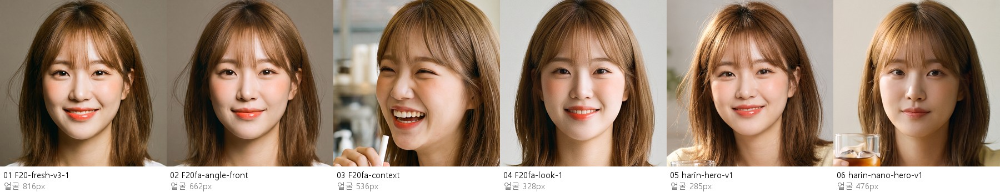
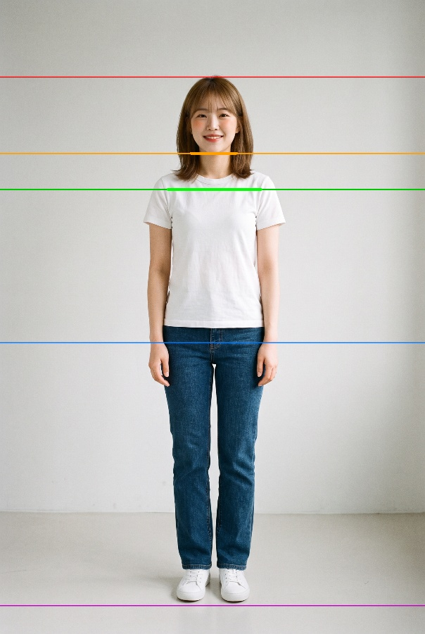
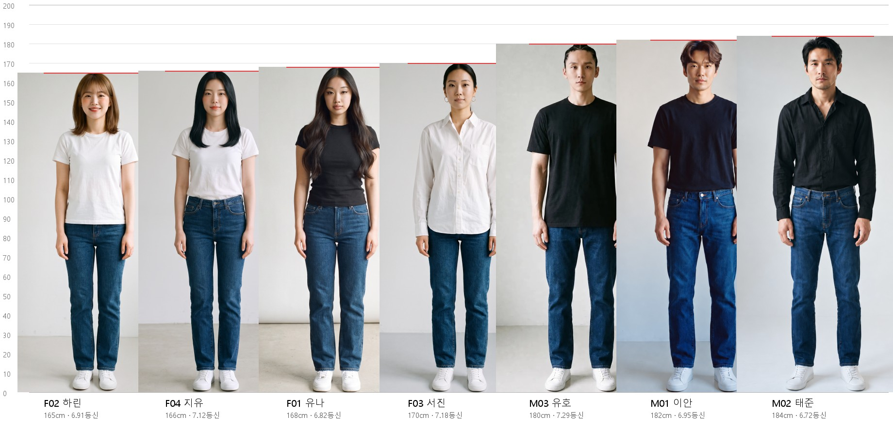
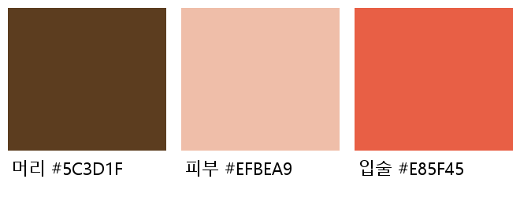
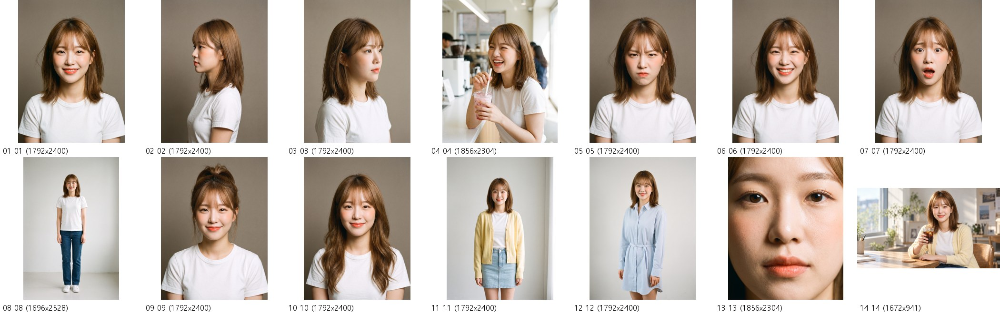
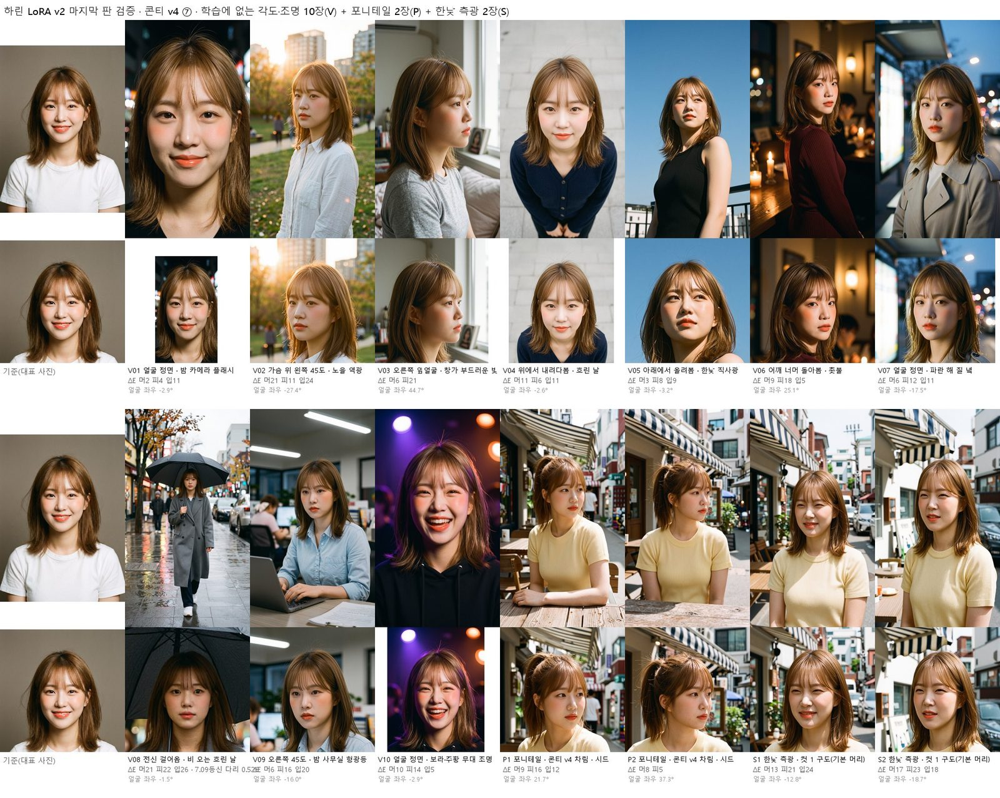
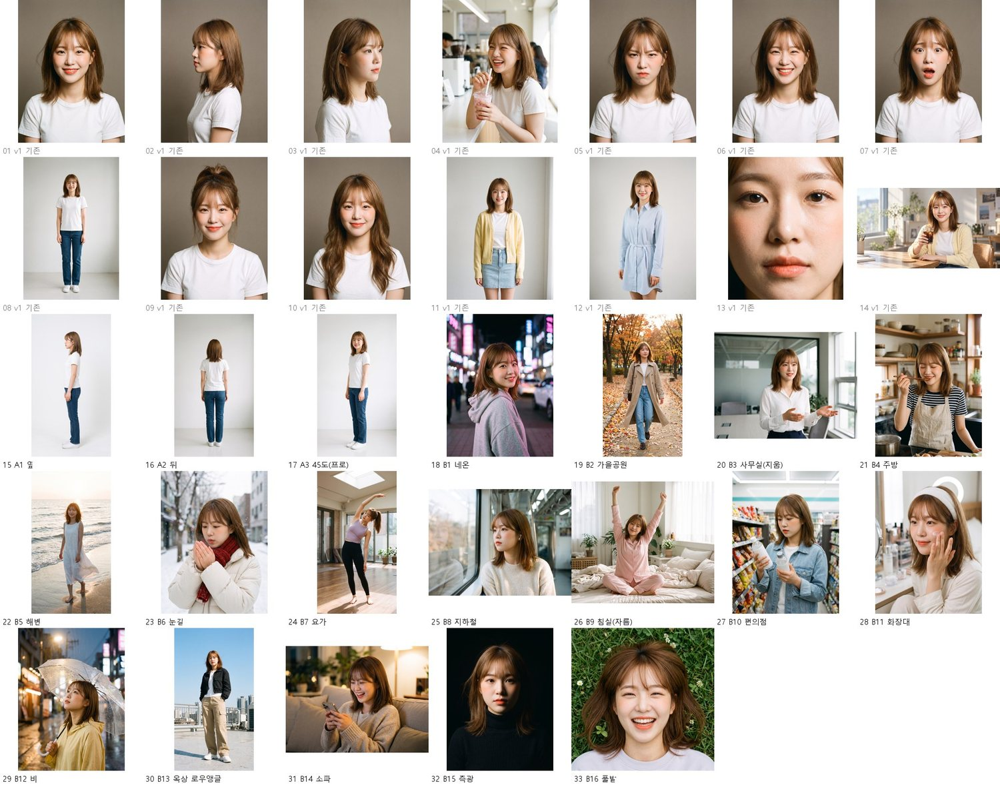

# F02 하린 모델 명세서 v1

작성 2026-10-17 · 수치 원본 [F02_하린.json](F02_하린.json) · 명단 원본 [roster-v2.json](../roster-v2.json)

PULSE 모델 한 명을 "광고에 바로 쓸 수 있게" 완성하는 표준 틀의 첫 판이다. 다른 모델도 같은 순서(얼굴 → 몸 → 스타일 → 연기·목소리 → 데이터셋)로 채운다.

## 0. 한눈에

| 항목 | 값 |
|---|---|
| 코드·이름 | F02 하린 (`F20fa`) |
| 나이·콘셉트 | 20대 초반 여 · 상큼한, 발랄한, 친근한 |
| 어울리는 업종 | 음료·디저트, 스킨케어, 캐주얼 패션, 앱·게임 |
| 키·몸무게·체형 | 165cm · 50kg(가상 설정, 10-12 확정) · 슬림 |
| 옷 사이즈 | 상의 55(S) · 하의 25 · 신발 235 |
| LoRA 트리거 | `pls_f02` |
| 기준 파일 | 대표 사진 `raw/F20-fresh-v3-1.png` · 전신 `pulse-app/assets/casting/fullbody/f02-fullbody-v1.webp` |

## 1. 얼굴 — 바뀌면 안 되는 것

- **눈**: 흑갈색, 쌍꺼풀, 애교살. 웃으면 눈꼬리가 내려가며 반달이 된다.
- **얼굴**: 둥글고 부드러운 얼굴선, 작은 턱, 둥근 코끝.
- **피부**: 밝은 웜톤, 볼에 은은한 홍조. 점·주근깨·흉터 없음(만들 때 "참조에 없는 점을 더하지 말 것").
- **기본 머리**: 밝은 갈색 어깨 길이 레이어드 + 시스루뱅.
- **기본 메이크업**: 코랄 립, 자연스러운 윤기 피부.
- **기준 사진**: 대표·정면·옆(왼쪽 90도)·45도(오른쪽)·뒤·표정 3(활짝 웃음·화남·놀람)·피부 근접 → `raw/F20fa-*.png`
- 같은 사람인지 볼 때는 `C:\SYNK-LoRA\tools\face_strip.py`로 얼굴만 잘라 대표 사진 옆에 놓는다. 10-13 TV 광고용 나노바나나 히어로(`harin-nano-hero-v1.png`)는 얼굴이 길고 입술이 얇아 다른 사람으로 판정했다.

## 2. 몸

전신 기준 사진을 `C:\SYNK-LoRA\tools\measure\measure_body.py`로 쟀다(정수리는 머리카락 꼭대기, 바닥은 신발 바닥).

| 항목 | 하린 | 검사 허용 범위 | 여자 모델 4명 범위 |
|---|---|---|---|
| 등신(머리카락 포함) | 6.91 | 6.6 ~ 7.2 | 6.82 ~ 7.18 |
| 어깨너비 / 얼굴폭 | 2.04 | 1.9 ~ 2.2 | 2.04 ~ 2.27 |
| 다리(골반 관절~바닥) / 키 | 0.497 | 0.48 ~ 0.52 | 0.497 ~ 0.523 |
| 몸통(어깨~골반) / 키 | 0.29 | — | 0.272 ~ 0.29 |

- 7명 중 키가 가장 작고, 여자 모델 중 어깨가 가장 좁고 다리 비율이 가장 짧다. **아담하고 친근한 체형**이 콘셉트와 맞는다. 늘씬한 모델 비율로 바꾸지 않는다.
- 새로 만든 정면 전신 사진이 허용 범위 밖이면 눈으로 다시 본다. 자세·옷·카메라 높이에 따라 몇 % 흔들리므로 숫자만으로 버리지 않는다.

### 키 관계 (7명)

- 지유(166cm)와 거의 같다. 남자 모델 옆에 서면 정수리가 남자의 코 높이쯤이다.
- 두 사람이 함께 나오는 장면은 이 표를 참조 그림으로 같이 넣어 키 차이를 맞춘다.
- 다시 만들기: `C:\SYNK-LoRA\tools\measure\lineup.py` (모델을 더하면 목록에 한 줄 추가).

## 3. 스타일

| 항목 | 값 |
|---|---|
| 머리색 | #5C3D1F (사진 4장 범위 #5C3D1F ~ #654327, 따뜻한 중간 갈색) |
| 피부색 | #EFBEA9 (범위 #EFB9A5 ~ #F0BDA8) |
| 입술색 | #E85F45 (범위 #E36044 ~ #EB684E, 코랄) |
| 헤어 1 | 기본 · 어깨 길이 레이어드 + 시스루뱅 |
| 헤어 2 | 하이 포니테일(잔머리, 시스루뱅 유지) |
| 헤어 3 | 긴 웨이브(어깨 아래, 시스루뱅 유지) |
| 기본 옷 | 흰 크루넥 티셔츠 · 진청 스트레이트 청바지 · 흰 운동화 |
| 룩 1 파스텔 캐주얼 | 노란 니트 카디건 + 흰 티 + 연청 미니스커트 |
| 룩 2 스트라이프 원피스 | 하늘색·흰색 줄무늬 셔츠 원피스 + 얇은 벨트 |

색은 `C:\SYNK-LoRA\tools\measure\colors.py`로 다시 잴 수 있다. 새 사진의 머리·피부·입술 색이 범위에서 크게 벗어나면 색이 바뀐 것이다.

## 4. 연기·목소리

- **기본 표정(있음)**: 기본 미소, 활짝 웃음, 화남, 놀람
- **광고용 표정(추가할 것)**: 한 입 맛보고 눈 감으며 미소, 제품을 보고 눈이 커지며 감탄, 휴대폰을 보며 소리 내 웃음, 고개 갸웃하며 고민, 카메라 보며 윙크, 손 흔들며 인사. 장면 컷(6절)에 나눠 넣는다.
- **목소리(Gemini TTS)**: 1 Leda 맑고 발랄한 · 2 Aoede 산뜻하고 가벼운 · 3 Laomedeia 신나고 생기 있는 (`voices.json`, `voice/`)
- 콘셉트가 상큼·친근이라 섹시·무게 있는 연출은 쓰지 않는다.

## 5. 데이터셋·LoRA

- **v1(14장)**: `C:\SYNK-LoRA\datasets\F02_harin\v1` — 캐스팅북 13장 + TV 광고 히어로 1장. 원본 대조표 `_원래이름.tsv`, 만드는 스크립트 `C:\SYNK-LoRA\validation\F02_harin\make_dataset_v1.py`.
- **캡션 원칙**: 바뀌는 것(구도·표정·옷·배경·조명·헤어 변형)만 적고 얼굴과 기본 머리는 적지 않는다.
- **약점**: 14장 중 10장이 같은 회갈색 배경·흰 티셔츠·스튜디오 조명이고 전신은 1장뿐이다. 그대로 학습하면 배경과 옷까지 외울 수 있어 6절의 컷을 더해 v2로 학습한다.
- **v2(33장)**: `C:\SYNK-LoRA\datasets\F02_harin\v2` — v1 14장(01~14) + 10-17에 만든 19장(15~33). 만드는 스크립트 `C:\SYNK-LoRA\validation\F02_harin\make_dataset_v2.py`, 컷마다 고른 판과 까닭은 `v2_check\선택.json`. 로우앵글처럼 몸 비율이 달라 보이는 컷은 캡션에 각도를 적었다.
- **학습 기준(10-17 시험 결과)**: 이미지 수 × 100스텝, 250스텝마다 저장하고 ComfyUI로 뽑아 고른다.
- **LoRA v2(10-17 학습)**: 트리거 `pls_f02`, 33장, 3,300스텝, 12:27~16:33(약 4시간, 스텝당 2~7초). 설정 `C:\SYNK-LoRA\validation\F02_harin\job_config_v2.json`, 결과 `C:\SYNK-LoRA\outputs\f02_harin_v2\`.
  - **쓸 판: 마지막 `f02_harin_v2.safetensors`**, 예비 3,000스텝(`f02_harin_v2_000003000`). 학습에 없던 장면 6개(얼굴 정면·45도 웃음·전신 정면·옆얼굴 측광·허리 위·전신 앉음) × 시드 2개로 비교했다. 1,000스텝부터 하린으로 나오고 2,500스텝부터 홍조·코랄 입술까지 안정적이다. 마지막 판이 머리색이 기준과 가장 가깝고(ΔE 중앙값 5.8, 3,000스텝 10.2, LoRA 없음 23), 옷·배경·옆얼굴 방향은 프롬프트대로 따른다. 전신 정면은 6.7~7.1등신, 다리 0.49~0.50으로 범위 안이다.
  - 프롬프트는 학습 캡션 꼴로 쓴다: `pls_f02, a young Korean woman, <구도·표정·옷·배경·조명>`. ComfyUI 설정은 Z-Image Turbo 8스텝·cfg 1·res_multistep·shift 3(`C:\SYNK-LoRA\tools\comfy_run.py` 기본값).
  - **주의**: 트리거 없는 「a young Korean woman」에도 하린이 새어 나온다(캡션마다 그 문구를 넣은 탓). 한 화면에 다른 여자를 같이 넣지 않는다. 머리 모양을 바꿀 때 기본 단발로 돌아가면 예비 판이나 세기 0.8로 비교한다.
  - 비교표 `C:\SYNK-LoRA\validation\F02_harin\v2_validate\`(체크포인트별 얼굴 `00_얼굴_체크포인트별.jpg`, 장면별 01~07), 만드는 스크립트 `validate_v2.py`·`validate_v2_faces.py`.
  - **검증 통과(10-17, 콘티 v4 ⑦)**: 학습에 없던 각도·조명 10장(밤 플래시·노을 역광·오른쪽 옆얼굴 창가·위에서·아래에서 한낮·어깨 너머 촛불·파란 해 질 녘·전신 비·밤 사무실 형광등·무대 조명)이 모두 하린으로 보인다. V05(아래에서 한낮)·V07(파란 해 질 녘)은 조금 성숙해 보인다. 포니테일 2장은 묶어도 얼굴이 유지됐다(높이는 하이보다 조금 낮음). 한낮 측광 2장도 얼굴은 하린이지만 한쪽만 강하게 비추는 햇빛은 약하게 나와, 키프레임 지시문에서 빛을 더 세게 써야 한다. 전신(V08)은 7.09등신·다리 0.52.

  - 검증 작업 목록 `C:\SYNK-LoRA\validation\F02_harin\verify_v4_jobs.json`, 그림 `C:\SYNK-LoRA\tools\ComfyUI\output\f02_harin_v2\verify_v4\`, 수치 `v2_validate\verify_v4_수치.json`.

## 6. 더 만든 컷 (10-17 생성, 유호님 확인 대기)

참조: 대표 사진 · 옆 · 45도 · 전신 4장. 도구: Gemini Ultra(77yuhbs) 「4 Argon」 + 사고 수준 「최고」 = 나노바나나 2.1. 힉스필드 크레딧은 영상 전용.

**A. 전신 기준 시트(3장)** — 기본 옷, 흰 스튜디오, 허리 높이 카메라, 머리부터 발끝까지 여백 있게
- A1 옆(왼쪽을 보는 90도) · A2 뒤 · A3 45도

**B. 장면(16장)** — 장소·조명·옷·거리를 겹치지 않게

| 번호 | 장소 | 옷 | 거리 | 빛 | 표정·동작 |
|---|---|---|---|---|---|
| B1 | 밤 네온 거리 | 오버사이즈 후드티 | 상반신 | 분홍·파랑 네온 측광 | 뒤돌아보며 미소 |
| B2 | 가을 공원 | 베이지 트렌치코트 | 전신, 걷기 | 오후 역광 | 바람에 머리 날림 |
| B3 | 사무실 회의실 | 흰 블라우스 + 슬랙스 | 허리 위 | 창가 측광 | 설명하는 손짓 |
| B4 | 집 주방 | 앞치마 | 상반신 | 따뜻한 실내등 | 한 입 맛보고 눈 감은 미소 |
| B5 | 해변 노을 | 흰 린넨 원피스 | 전신 | 골든아워 역광 | 맨발로 걷기 |
| B6 | 눈 오는 거리 | 패딩 + 목도리 | 상반신 | 흐린 날 부드러운 빛 | 손을 입김으로 녹임 |
| B7 | 요가 스튜디오 | 운동복 | 전신 | 위에서 떨어지는 강한 빛 | 스트레칭 |
| B8 | 지하철 안 | 니트 + 청바지, 이어폰 | 상반신 | 형광등 | 창밖 보기 |
| B9 | 침실 아침 | 파자마 | 전신(앉음) | 아침 햇살 | 침대에서 기지개 |
| B10 | 편의점 | 캐주얼 | 허리 위 | 차가운 형광등 | 음료 고르며 고민 |
| B11 | 화장대 | 헤어밴드 | 얼굴 근접 | 링라이트 | 스킨케어 바르기 |
| B12 | 비 오는 저녁 거리 | 레인코트, 투명 우산 | 상반신 | 가로등 | 하늘 올려다보기 |
| B13 | 옥상 | 크롭 재킷 스트리트 룩 | 전신 로우앵글 | 맑은 한낮 | 당당하게 서기 |
| B14 | 거실 소파 | 니트 카디건 | 상반신 | 따뜻한 조명 | 휴대폰 보며 소리 내 웃음 |
| B15 | 스튜디오 | 검은 터틀넥 | 얼굴 근접 | 강한 측광(렘브란트) | 차분한 정면 |
| B16 | 풀밭 | 캐주얼 | 얼굴 근접, 위에서 | 자연광 | 누워서 웃음 |

- 합계 19장, 생성 26번(프로 비교 5번, 고치기 2번 포함). 고친 것 3장: B3 앞쪽에 들어온 남자만 지움, B9 스피커의 상표 글씨를 잘라 냄, B15 고르게 나온 조명만 측광으로 고침(그림자는 약하게 들어감).
- **2.1과 프로**: A1·A2·A3·B1·B14를 같은 대화에서 「Pro로 다시 실행」으로 나란히 뽑았다. 2.1이 A1·A2·B1에서 더 가까웠고, A3은 프로가 조금 나았으며, B14는 비슷했다. 프로는 입술을 빨갛게, 머리를 밝고 길게 그리거나 네온 빛에 얼굴과 머리가 물들었다. 그래서 2.1을 기본으로 쓰고, 닮음이 약할 때만 프로를 함께 본다.
- **약한 컷**: B5(역광으로 볼이 덜 둥글어 보임), B7(몸·고개를 기울여 비율 측정 불가, 아래에서 찍어 다리가 길어 보임), B13(로우앵글이라 등신 7.61·다리 0.544로 범위 밖, 캡션에 low-angle). 학습 결과에서 다리가 길어지면 이 셋부터 뺀다.
- **만드는 순서(다른 모델도 같게)**: ① 대화마다 새로 열고 참조 4장 붙이기, 비율은 9:16·3:4·4:3·1:1 중 가까운 것 ② 프롬프트는 공통_얼굴 + 공통_사진 + 장면(`C:\SYNK-LoRA\validation\F02_harin\shots_v2.json`). 머리색은 hex로 못 박고 "혼자 나오게"를 넣는다. 둘 다 처음엔 없어서 A1 머리가 밝게, B3에 다른 사람이 들어갔다. ③ 원본 크기로 받아 `C:\SYNK-LoRA\tools\measure\inspect_shot.py`로 얼굴 확대·몸 비율·색을 한 장에 검사 ④ 다른 사람·상표·조명 문제는 같은 대화에서 그 부분만 고치거나 잘라 낸다.
- 검사 그림과 원본: `C:\SYNK-LoRA\validation\F02_harin\v2_check\`(컷별 `*_검사.jpg`·`*_비교.jpg`), `v2_raw\`.
