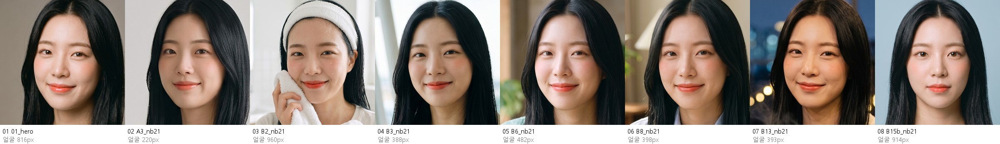
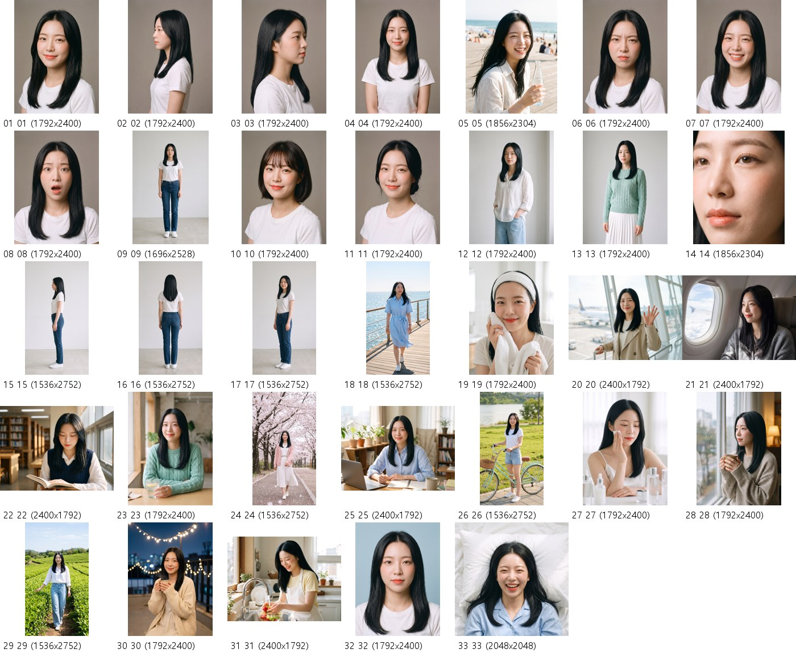

# F04 지유 모델 명세서 v1

작성 2026-10-18 · 수치 원본 [F04_지유.json](F04_지유.json) · 명단 원본 [roster-v2.json](../roster-v2.json) · 틀 [F02 하린](F02_하린.md)

하린 다음으로 같은 틀(얼굴 → 몸 → 스타일 → 연기·목소리 → 데이터셋)을 채운 두 번째 모델이다. 유호님이 「한 명 먼저 해 보고 결정」하기로 해서, 남은 모델은 이 판을 보고 정한다.

## 0. 한눈에

| 항목 | 값 |
|---|---|
| 코드·이름 | F04 지유 (`F20fb`) |
| 나이·콘셉트 | 20대 초반 여 · 청순한, 상큼한, 싱그러운 |
| 어울리는 업종 | 스킨케어·클렌징, 음료, 여행·항공, 교육·앱 |
| 키·체형 | 166cm · 슬림 |
| 옷 사이즈 | 상의 55(S) · 하의 25 · 신발 240 |
| LoRA 트리거 | `pls_f04` |
| 기준 파일 | 대표 사진 `raw/F20-fresh-v3-2-hairA.png` · 전신 `pulse-app/assets/casting/fullbody/f04-fullbody-v1.webp` |

## 1. 얼굴 — 바뀌면 안 되는 것

- **눈**: 흑갈색, 속쌍꺼풀, 애교살. 웃으면 반달눈이 된다.
- **얼굴**: 둥글고 부드러운 얼굴, 작은 턱, 작고 곧은 코.
- **피부**: 밝은 웜톤, 볼에 은은한 홍조. 점·주근깨·흉터 없음.
- **기본 머리**: 가운데 가르마 긴 흑발 생머리, 앞머리 없음. 머리색은 밝은 빛에서도 흑발(#191C1A)이다. 갈색·푸른 기가 돌면 다른 사람처럼 보인다.
- **기본 메이크업**: 선명한 코랄 레드 립(진한 빨강·분홍이 아님).
- **기준 사진**: 대표·정면·옆(왼쪽 90도)·45도(오른쪽)·뒤·표정 3(활짝 웃음·화남·놀람)·피부 근접 → `raw/F20fb-*.png`. 그림 생성 참조는 그중 4장(대표·옆·45도·전신)을 1600px JPEG로 줄인 `C:\SYNK-LoRA\validation\F04_jiyu\refs\`.
- 위 띠는 대표 사진(01)과 10-18에 새로 만든 장면 7장의 얼굴을 같은 크기로 자른 것이다(`C:\SYNK-LoRA\tools\face_strip.py`).

## 2. 몸

전신 기준 사진을 `C:\SYNK-LoRA\tools\measure\measure_body.py`로 쟀다(정수리는 머리카락 꼭대기, 바닥은 신발 바닥).

| 항목 | 지유 | 검사 허용 범위 | 여자 모델 4명 범위 |
|---|---|---|---|
| 등신(머리카락 포함) | 7.12 | 6.8 ~ 7.45 | 6.82 ~ 7.18 |
| 어깨너비 / 얼굴폭 | 2.26 | 2.1 ~ 2.4 | 2.04 ~ 2.27 |
| 다리(골반 관절~바닥) / 키 | 0.523 | 0.5 ~ 0.545 | 0.497 ~ 0.523 |
| 몸통(어깨~골반) / 키 | 0.272 | — | 0.272 ~ 0.29 |

- 하린(165cm)과 키가 거의 같지만 **여자 모델 가운데 다리 비율이 가장 길고** 어깨선이 반듯하다. 곧고 단정한 체형이라 청순한 인상과 맞는다. 광고에서도 이 비율을 지킨다.
- 10-18 새 전신 컷 검사: A1 옆 6.95·다리 0.528, A3 45도 7.08·0.519, B1 6.90·0.522, B7 7.46·0.505, B9 7.18·0.531, B12 6.79·0.525. B7·B12가 범위 끝에서 0.01씩 벗어났지만 재는 오차 안으로 봤다.

## 3. 스타일

| 항목 | 값 |
|---|---|
| 머리색 | #191C1A (사진 4장 범위 #181918 ~ #212324, 흑발) |
| 피부색 | #E7B6A5 (범위 #E6B3A4 ~ #E7B6A5) |
| 입술색 | #E1705D (범위 #DC705F ~ #DF7364, 코랄 레드) |
| 헤어 1 | 기본 · 가운데 가르마 긴 흑발 생머리 |
| 헤어 2 | 턱선 단발 + 풀뱅(어두운 갈색) |
| 헤어 3 | 낮게 묶은 번 + 잔머리 |
| 기본 옷 | 흰 티셔츠 · 청바지 · 흰 운동화 |
| 룩 1 | 흰 린넨 블라우스 + 연청 와이드 청바지 |
| 룩 2 | 민트 케이블 니트 + 흰 플리츠 미디스커트 |

색은 `C:\SYNK-LoRA\tools\measure\colors.py`로 다시 잴 수 있다. 장면 사진은 빛 때문에 피부·입술 색차가 크게 나오므로(실내 조명 컷 피부 ΔE 4~18), 같은 빛의 정면 컷끼리 비교한다.

## 4. 연기·목소리

- **어울리는 연출**: 바닷바람에 머리를 날리며 웃기, 세안 뒤 개운한 표정, 물 한 모금 뒤 미소, 창가에서 책 읽기, 손 흔들며 인사, 화장솜으로 토너 바르기, 창밖을 보며 차분한 미소. 장면 컷(6절)에 나눠 넣었다.
- **목소리(타입캐스트 유라, 10-18 측정으로 고름)**: 1 맑고 산뜻한(normal) · 2 차분하고 부드러운(tonedown, 0.95배) · 3 가까이 속삭이는(whisper, 0.95배). 류은은 10대 후반처럼 들려 뺐다. 고른 과정 `.tmp/voice-pick-20261018/README.md`, 설정 `voices.json`.
- 콘셉트가 청순·싱그러움이라 섹시하거나 무게 있는 연출은 쓰지 않는다.

## 5. 데이터셋·LoRA

- **v1(14장)**: `C:\SYNK-LoRA\datasets\F04_jiyu\v1` — 캐스팅북 원본 14장(01~14). 원본은 10-18 Drive 백업에서 되살린 raw PNG(sha256 확인). 스크립트 `C:\SYNK-LoRA\validation\F04_jiyu\make_dataset_v1.py`.
- **v2(33장)**: `C:\SYNK-LoRA\datasets\F04_jiyu\v2` — v1 14장 + 10-18에 만든 19장(15~33). 스크립트 `make_dataset_v2.py`, 컷마다 고른 판과 까닭은 `v2_check\선택.json`.
- **캡션 원칙**: 바뀌는 것(구도·표정·동작·옷·배경·조명·헤어 변형)만 적고 얼굴·기본 머리·머리색은 적지 않는다. 그림이 프롬프트와 다르게 나온 컷(B6 물잔을 잡고 정면 미소, B9 자전거 뒤에 서기 등)은 그림대로 적었다.
- **LoRA v2**: 트리거 `pls_f04`, 33장 × 100 = 3,300스텝, 250스텝마다 저장. 설정 `C:\SYNK-LoRA\validation\F04_jiyu\job_config_v2.json`. 10-18 16:50 기준 다른 세션의 ComfyUI 작업과 블렌더 굽기가 GPU를 꽉 쓰고 있어(23.4/24.5GB, 99%) 비는 대로 시작한다(`wait_gpu_free.py`). 학습·검증 결과는 끝나면 여기에 적는다.

## 6. 더 만든 컷 (10-18 생성, 유호님 확인 대기)

참조: 대표 사진 · 옆 · 45도 · 전신 4장. 도구: Gemini Ultra(77yuhbs) 「4 Argon」 + 사고 수준 「최고가」 = 나노바나나 2.1. 프롬프트는 공통_얼굴 + 장면 + 공통_사진(`C:\SYNK-LoRA\validation\F04_jiyu\shots_v2.json`). 머리색은 hex로, 「혼자 나오게」는 처음부터 넣었다.

**A. 전신 기준 시트(3장)** — 기본 옷, 흰 스튜디오, 허리 높이 카메라: A1 옆(왼쪽 90도) · A2 뒤 · A3 45도

**B. 장면(16장)**

| 번호 | 장소 | 옷 | 거리 | 빛 | 표정·동작 |
|---|---|---|---|---|---|
| B1 | 바닷가 산책로 | 하늘색 셔츠 원피스 | 전신 | 맑은 아침 해 | 바람 맞으며 웃기 |
| B2 | 아침 욕실 | 헤어밴드 · 흰 티 | 얼굴 근접 | 창가 아침 빛 | 세안 뒤 수건으로 두드리기 |
| B3 | 공항 탑승구 | 트렌치코트 + 크림 니트 | 허리 위 | 낮 창가 빛 | 캐리어 잡고 손 흔들기 |
| B4 | 비행기 창가 | 회색 카디건 | 상반신 | 창밖 햇빛 | 구름 보며 미소 |
| B5 | 도서관 창가 | 흰 블라우스 + 남색 니트 조끼 | 허리 위 | 오후 측광 | 책 읽기 |
| B6 | 카페 | 민트 케이블 니트 | 상반신 | 부드러운 창가 빛 | 레몬 물잔 잡고 미소 |
| B7 | 벚꽃길 | 분홍 카디건 + 흰 플리츠 스커트 | 전신, 걷기 | 흐린 날 | 꽃잎 사이 걷기 |
| B8 | 공부방 | 하늘색 옥스퍼드 셔츠 | 허리 위 | 밝은 창가 빛 | 노트북·필기, 격려하는 미소 |
| B9 | 강변 공원 | 흰 티 + 데님 반바지 | 전신 | 맑은 오후 | 민트 자전거 핸들 잡기 |
| B10 | 화장대 | 흰 실크 캐미솔 | 얼굴 근접 | 부드러운 창가 빛 | 화장솜으로 토너 |
| B11 | 비 오는 창가 | 오트밀 니트 | 상반신 | 흐린 빛 + 뒤쪽 스탠드 | 차 한 잔 들고 창밖 보기 |
| B12 | 녹차밭 | 린넨 셔츠 + 와이드 청바지 | 전신, 걷기 | 한낮 햇빛 | 잎에 손 대며 걷기 |
| B13 | 밤 옥상 | 크림 카디건 + 원피스 | 상반신 | 전구 줄 + 파란 밤하늘 | 따뜻한 음료 들고 미소 |
| B14 | 집 주방 | 흰 앞치마 + 연노랑 티 | 허리 위 | 아침 창가 빛 | 딸기·청포도 씻기 |
| B15 | 스튜디오 | 흰 티 | 얼굴 근접 | 정면 버터플라이 | 하늘색 배경, 차분한 정면 |
| B16 | 아침 침대 | 하늘색 파자마 | 얼굴 근접, 위에서 | 아침 햇빛 | 베개에 누워 웃기 |

- 합계 19장, 생성 21번: A3 첫 시도는 글 없이 참조 사진만 보내져 엉뚱한 카페 사진이 나와 다시 보냈고, B15는 첫 판의 머리결이 거칠게 뭉쳐 「매끈하고 윤기 있는 머리」를 보태 다시 뽑았다(입술 색차 7.1 → 3.4). 고친 컷은 없다.
- **약한 컷**: B9(자전거 뒤에 선 자세가 조금 어색), B1(신발 앞에 아주 작은 글씨, 손목 팔찌는 캡션에 적음). 학습 결과에서 자세나 소품이 새어 나오면 이 둘부터 뺀다.
- 검사 그림과 원본: `C:\SYNK-LoRA\validation\F04_jiyu\v2_check\`(컷별 `*_검사.jpg`), `v2_raw\`. 만드는 순서·함정은 하린 6절과 [현장 노트 Gemini 사진](../../../현장노트/gemini_사진.md).
