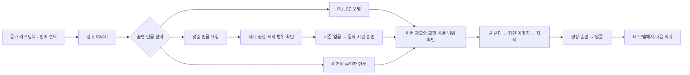

# PULSE 다국어와 고객 전용 인물 기획안

> 2026-11-08. 기존 모델 유지, 글로벌 모델 4명 추가, 다국어와 고객 전용 인물 등록·승인·재사용을 함께 기획한다. 이번 결과는 기획이며 이미지 생성·LoRA 학습·앱 구현·운영 데이터 변경을 포함하지 않는다. 네 인물의 최종 외모·이름과 이 기획의 세부 화면·운영값은 구현 전에 확정할 제안이다.

## 1. 제품 방향과 범위

고객이 자기 언어로 모델을 고르고 의뢰한 뒤, 한 고객 방에서 인물과 광고를 확인하며, 다음 의뢰에서 승인된 인물을 다시 쓸 수 있게 한다. PULSE는 유호님과 제작팀이 검토·연출하는 제작 서비스로 유지한다. 고객의 사진 등록은 제작 가능성 검토 요청이며 생성·학습·과금의 시작 버튼이 아니다.

| 구분 | 이번 기획의 기준 |
|---|---|
| 기존 캐스팅 | 현재 명단 21명의 코드·이름·얼굴·소속·공유 링크를 유지한다. 기존 모델을 글로벌 인물로 교체하지 않는다 |
| 글로벌 캐스팅 | 백인 여성·남성, 흑인 여성·남성 각 1명 추가. 최종 승인 후 기본 명단은 25명 |
| 첫 공개 언어 | 한국어·영어의 고객 흐름 전체. 일본어는 같은 구조로 준비해 현지어 검수 후 다음 공개 |
| 후속 언어 | 몽골어는 실제 파일럿 고객에 맞춰, 번체중문은 다음 시장 진입에 맞춰 추가 |
| 고객 전용 인물 | 새 가상 인물과 사용 권한이 확인된 실존 인물을 등록·검토·승인하고, 해당 고객의 후속 프로젝트에서 재사용 |
| 기존 화면 | 시사실 디자인, 추천 모델 4명 먼저 보기, 고객 방 하나, 대화 일지 하나, 영상 확인과 납품의 연결을 유지 |
| 이번 범위 밖 | 이미지·영상 생성, 실제 학습, 코드·계정·권한 변경, 신규 결제 연동, 해외 가격 확정, 고객에게 연락·발송 |

첫 공개에는 영어로 의뢰부터 납품까지 사용할 수 있는 흐름과 전용 인물의 재사용까지 넣는다. 여러 언어로 첫 화면만 번역한 상태를 해당 언어 지원 완료로 표시하지 않는다.

## 2. 현재 구조에서 이어받을 것

2026-11-08 작업본을 기준으로 확인했다. 아래는 코드·문서 기준이며 설치본과 공개 서버를 다시 시험한 결과가 아니다.

| 확인한 현재 구조 | 이번 설계에 반영 |
|---|---|
| 캐스팅 원본 `roster-v2.json`에 21명, 고객 앱 `casting-catalog.mjs`와 의뢰서 `MODEL_LINES / MODEL_PICKS`에 별도 매핑 | 인물 원본은 하나로 두고 공개용·고객 앱용 카탈로그와 언어별 설명을 같은 코드로 연결한다 |
| 의뢰서는 기존 9개 화면, 모델은 추천 4명 후 전체 보기 | 모델 단계 안에서 선택 방식을 바꾼다. 맞춤 제작을 고른 경우에만 관련 질문을 펼친다 |
| 캐스팅북은 한국어 분류 문구와 낱말로 추천하고, 문의글의 한국어 구획을 앱이 읽는 연결이 있다 | 언어별 낱말을 공통 분류 ID로 변환하고 모델·헤어 전달은 구조화된 데이터로 바꾼다. 옛 링크·한국어 문의글도 계속 읽는다 |
| 서버 의뢰 필드는 허용 목록으로 검사하며 일부 선택값이 한국어 문구다 | 새 필드와 언어 독립적인 선택 ID를 서버와 화면에 함께 추가한다. 번역된 문장을 저장값으로 쓰지 않는다 |
| `propose_model / answer_model`과 고객 방의 모델 확인이 있다 | 카탈로그 모델 선택과 전용 인물 버전 선택을 공통 모델 확인 화면으로 잇는다 |
| 고객 접근은 프로젝트별 초대 링크·세션. `clientProjects.ownerId`는 직원 담당자 | 고객 브랜드의 소유권과 회원 연결을 별도로 둔다. 직원 담당자나 동일 이메일을 고객 자산의 소유자로 간주하지 않는다 |
| 자료 사용 조건 기록은 별도 암호화 저장, 자료 지문·기간·범위를 관리한다 | 기존 사용 조건 기록을 활용하되, 인물 본인의 동의·브랜드 이용 범위·인물 버전을 연결하는 새 기록을 추가한다 |
| 기본 캐스팅의 고정 목소리 샘플은 제거된 상태 | 언어별 견본 목소리 목록을 다시 만들지 않는다. 광고 장면의 목소리는 시안에서 확인한다 |

원문: [의뢰 흐름](README.md), [고객 방 하나로](판3_설계.md), [캐스팅북](../PULSE_AI모델_캐스팅_20260930/README.md), [제작 규칙](../제작양식/AI광고영상_제작규칙.md).

## 3. 글로벌 모델 네 명

아래 구분은 제작 브리프용 임시명이다. 고객에게 공개할 이름과 최종 외형은 이후 시안에서 고른다. 코드 후보는 현재 명단과 충돌하지 않지만 실제 추가 시 다시 대조한다.

| 임시 구분 | 코드 후보 | 나이 설정 제안 | 표현 방향 |
|---|---|---|---|
| 백인 여성 A | F12 | 20대 후반~30대 초반 | 자연스러운 표정과 패션 연출을 모두 소화. 생활·뷰티·브랜드 장면으로 확인 |
| 백인 남성 B | M11 | 30대 후반~40대 초반 | 일상적인 친근함과 단정한 인상. 생활·서비스 소개·패션 장면으로 확인 |
| 흑인 여성 C | F13 | 30대 후반~40대 초반 | 다양한 표정과 차분한 연출. 생활·서비스 소개·패션 장면으로 확인 |
| 흑인 남성 D | M12 | 20대 후반~30대 초반 | 자연스러운 표정과 패션 연출을 모두 소화. 생활·뷰티·브랜드 장면으로 확인 |

피부 톤·헤어·체형·얼굴형이 서로 다른 선택지를 만들되, 인종에 특정 업종·성격·능력을 고정하지 않는다. K-pop·패션·생활·비즈니스는 연출 스타일로 다룬다. 외모로 국적·사용 언어를 부여하거나 고객 국가만으로 특정 인종을 자동 추천하지 않는다.

공개 카드에는 대표 사진, 이름, 나이대, 실제로 확인한 인상과 장면 사진을 넣는다. 인종별 별도 앱이나 국가별 복제 명단을 만들지 않는다. 모델 단계의 처음 네 자리는 광고 목적·고객이 명시한 취향·검증된 장면을 근거로 구성하고, 전체 보기에서 기존 21명과 새 4명을 함께 찾는다.

네 명 각각의 제작 준비 순서는 기준 얼굴 선택 → 각도·표정·전신 기준 확정 → 장면 일관성 검증 → 실제 동작에서 얼굴 유지 확인 → 공개 승인이다. 정면·45도·옆모습과 학습에 사용하지 않은 각도·조명을 검증하는 기존 제작 기준을 적용한다. 내부 동작 검증을 기본 캐스팅의 새 견본 영상 탭으로 자동 공개하지 않는다. 사진·학습 파일·공개 자산은 이 기획 단계에서 만들지 않는다.

## 4. 고객이 이동하는 화면

### 전체 흐름

모델을 맡기거나 인물 없이 제작하는 기존 선택도 유지한다. 얼굴 제작과 광고 제작의 상태는 연결하되 별도로 저장한다.

### 공개 캐스팅북

- 오른쪽 위에 언어 선택을 둔다. 첫 공개는 한국어·English이며 준비 중인 언어를 선택 가능한 메뉴로 내지 않는다.
- 현재 모델·작품·헤어·선택 상태를 언어 변경 전후에 유지한다.
- 기존 후보 담기와 함께 「원하는 인물이 없나요? 맞춤 인물 요청」 입구를 둔다.
- 버튼은 선택한 모델 코드·헤어·광고 메모·화면 언어를 의뢰서로 전달한다. 얼굴 사진·개인정보·비공개 인물 ID를 공개 URL에 넣지 않는다.
- 기존 `#p-` 공유 링크와 한국어 문의글 가져오기는 호환 경로로 유지한다.

### 의뢰서의 모델 단계

처음에는 다음 세 가지 선택지를 보여 준다. 「모델을 추천받을게요」와 「인물 없이 만들어요」는 보조 선택으로 유지한다.

| 선택 | 그 자리에서 하는 일 |
|---|---|
| PULSE 모델에서 고르기 | 추천 4명 → 전체 보기 → 사진과 헤어 확인 → 후보 선택 |
| 맞춤 인물 요청하기 | 「새로운 가상 인물」 또는 「실제 인물 출연」을 고르고 필요한 자료만 등록 |
| 내 모델 다시 쓰기 | 권한이 확인된 고객의 사용 가능한 인물 선택. 첫 방문에는 목록 대신 연결 안내 |

맞춤 요청의 처음 질문은 인물 유형, 사진·참고 자료, 원하는 쓰임, 이번만 사용/후속 사용 희망이다. 가상 인물에는 원하는 인상·나이대·헤어와 참고할 점을 받고, 실존 인물에는 본인/소속 모델 등 관계와 당사자 동의 확인 방법을 받는다. 국적·신체 치수·학습 설정을 일괄 필수 입력으로 요구하지 않는다.

사진마다 「이 인물을 재현」 또는 「분위기 참고」 목적을 명시한다. 초기 대표 사진 1~3장으로 상담을 시작할 수 있게 하되, 그 수가 학습·고유 얼굴 재현에 충분하다고 약속하지 않는다. 필요한 정면·좌우·표정 자료는 검토 후 고객 방에서 추가로 요청한다. 다른 사람의 얼굴이 함께 들어간 자료는 사용 대상을 확인한다.

등록 후 접수 상태는 「인물 제작 검토 중」이다. 기존 제작 가격에 맞춤 인물 비용·기간이 포함됐다고 표시하지 않는다. 초기 인물 제작·검증, 해당 광고 제작, 추가 언어판 비용은 견적에서 구분한다. 금액과 납기는 담당자가 제작 범위를 확인해 제안한다.

### 고객 방의 모델 확인

고객 방의 현재 차례 카드에 「인물 확인」을 넣고, 상세 자료와 의사결정은 그 카드 안에서 끝낸다. 댓글·되묻기는 기존 일지에 모으고 새 채팅방을 만들지 않는다.

| 고객이 확인할 때 | 보여 주는 것 | 주요 버튼 |
|---|---|---|
| 자료 보완 | 필요한 사진·이유·예시 설명, 현재 제출 자료 | 자료 추가하기 |
| 기준 얼굴 확인 | 정면·측면 등 같은 판의 기준 이미지, 담당자 설명 | 이 얼굴로 진행 / 고칠 점 보내기 |
| 동작 확인 | 해당 얼굴로 만든 짧은 비공개 동작 시안, 가능한 표현과 제한 | 이 인물로 진행 / 수정 요청 |
| 이번 광고 사용 확인 | 인물·브랜드·광고 목적·매체·지역·기간, 합의한 비용·일정 | 이번 광고에 사용 |
| 재사용 준비 완료 | 승인된 대표 이미지·사용 범위·마지막 사용·만료일 | 다음 광고에 사용 |

의견을 작성 중이면 그 의견을 보낼 수 있게 하고, 작성 중인 의견을 남긴 채 승인이 처리되지 않도록 한다. 승인 시 무엇을 확인하는지 한 문장으로 설명하며 최종 영상 승인과 혼동되는 「모두 승인」 버튼을 두지 않는다.

### 내 모델과 재주문

고객 앱에 「내 모델」 입구를 추가한다. 프로젝트를 보는 동안에는 고객 방의 모델 카드와 납품 화면에서 접근하고, 로그인한 고객의 시작 화면에서는 새 의뢰 옆에서 접근한다.

카드는 대표 이미지·이름·준비 상태·사용 가능 범위·만료일·「이 모델로 의뢰」만 먼저 보인다. 상세에서 승인 이력, 사용 프로젝트, 헤어·착장 변형, 사용 중지 요청을 확인한다. 데이터셋·학습 파일 경로·내부 실패 시안은 고객 카드에 노출하지 않는다.

재주문은 인물 ID와 승인 버전을 새 의뢰에 연결하고, 새 제품·목적·매체·지역·기간·출력 언어만 다시 확인한다. 이전 사진 전체를 복사 업로드하지 않는다. 범위가 같고 권한·버전이 유효하면 얼굴 제작을 반복하지 않는다. 새 얼굴·나이·얼굴 구조 등 정체성이 달라지는 요청은 새 버전과 승인을 만들고, 이전 프로젝트는 이전 버전을 계속 참조한다.

## 5. 승인과 상태

### 서로 다른 세 가지 확인

| 구분 | 확인하는 주체 | 기록할 내용 |
|---|---|---|
| 인물 이용 동의 | 실존 인물 본인 또는 권한 증빙의 적법한 주체, 담당자 확인 | AI 제작·학습·외부 처리 범위, 광고 이용 범위, 재사용·보관 조건, 근거와 판 |
| 인물 품질 승인 | 해당 프로젝트의 지정 고객 승인자 | 기준 얼굴 판, 동작 시안 판, 수정 의견, 승인 시각·언어 |
| 광고별 사용과 영상 승인 | 해당 프로젝트의 지정 고객 승인자 | 이번 광고 사용 범위 및 기존 콘티·장면·영상 각각의 승인 |

인물 본인의 동의와 고객 담당자의 디자인 승인은 대체 관계가 아니다. 얼굴 동의가 목소리 복제 동의를 포함하지 않는다. 목소리는 기존처럼 장면 시안에서 확인하며 별도 복제 요청은 별도 범위로 처리한다.

동의 확인은 당사자에게 한정된 확인 링크 또는 담당자가 검증한 서류로 받는다. 해당 링크로 프로젝트나 고객의 인물 목록을 열 수 없게 한다. 체크박스만으로 당사자 확인이 끝났다고 기록하지 않는다. 도구별 처리 조건과 실제 사용할 외부 서비스는 자료를 외부로 보내기 전에 확인한다.

### 내부 상태와 고객 표시

| 내부 상태 | 고객 표시 | 다음 진행 조건 |
|---|---|---|
| draft / submitted | 작성 중 / 접수 완료 | 고객 제출 |
| needs_materials / rights_pending | 자료 또는 동의 확인이 필요해요 | 담당자가 보완과 권한 확인 |
| reviewing | 제작 방법을 검토하고 있어요 | 범위·견적 합의 |
| reference_review | 기준 얼굴을 확인해 주세요 | 고객의 해당 이미지 판 승인 |
| building | 인물을 준비하고 있어요 | 내부 방식 결정, 필요한 학습과 검증 |
| motion_review | 움직이는 모습을 확인해 주세요 | 고객의 해당 동작 시안 승인 |
| ready | 사용할 준비가 됐어요 | 이번 프로젝트 사용 범위도 유효 |
| paused / expired / retired | 사용 확인 필요 / 기간 종료 / 사용 종료 | 해소된 조건에 맞는 재검토 |

상태가 ready여도 다른 브랜드·새 지역·새 업종 등에 대한 사용 권한이 자동으로 생기지 않는다. 실패·보완은 해당 단계로 돌아가며, 공개하지 않은 내부 실패 판을 고객 승인 대상에 섞지 않는다.

승인은 인물 버전·보여 준 이미지/영상 판·사용 조건 판·동의 판에 묶는다. 같은 판의 재전송이나 중복 클릭은 같은 처리 결과를 돌려준다. 직원이 새 판을 공개한 사이 고객이 옛 판을 승인하면 최신 판을 확인하도록 안내한다. 자동 번역·일반 댓글·담당자의 내부 확인은 고객 승인으로 처리하지 않는다.

## 6. 다국어 동작

### 언어와 시장을 분리

| 값 | 정하는 위치 | 예 |
|---|---|---|
| 화면 언어 | 개인 언어 설정 | 한국어 / English / 이후 日本語 |
| 고객 소통 언어 | 의뢰서 연락·확인 단계에서 기본값 제안 후 변경 | 고객 안내·알림은 영어, 내부 검토는 한국어 |
| 광고 출력 언어 | 의뢰서의 납품 요구와 콘티 | 일본어 내레이션, 영어 자막판 추가 |
| 광고 대상 시장 | 의뢰서의 대상 고객 | 호주·일본 |
| 견적 통화 | 합의한 견적 | KRW 또는 별도 합의 통화 |

한국어 화면으로 일본 시장용 일본어 광고를 주문할 수 있고, 한 프로젝트에서 여러 언어 납품물을 요청할 수 있다. 화면 언어 변경으로 모델 선택·광고 언어·대상 시장·견적 금액을 바꾸지 않는다. 첫 공개에서 해외 통화 결제를 자동 지원한다고 표시하지 않으며 기존 가격·결제 계약을 유지한다.

### 번역할 범위

- 공개 소개와 캐스팅북: 모델 설명, 업종·분위기, 검색·추천 이유, 버튼, 공유 카드의 설명.
- 의뢰·제작 흐름: 질문과 예시, 업로드와 오류 안내, 저장·재접속, 방향·모델·콘티·영상 승인, 수정·납품.
- 고객 전용 인물: 요청 유형, 자료 보완, 동의·사용 범위, 승인·만료·재사용 안내.
- 알림과 접근: 메일·푸시·만료된 초대·권한 부족·빈 화면·접속 실패까지 같은 언어로 제공.
- 날짜·시간·숫자·통화: 언어에 맞춰 표시하고 납기에는 합의한 시간대를 명시. 날짜만 있는 납기와 시각이 있는 승인 기록을 구분.

우선순위는 고객이 명시한 언어 → 초대·공유 링크의 언어 → 브라우저 언어 → 기본 언어다. 저장된 고객 선택을 국가 IP로 덮지 않는다. 공개 링크의 lang에는 지원하는 언어 코드만 허용하고, 비공개 접근 권한은 별도로 검사한다.

### 고정 문구와 고객 글

고정 문구는 검수된 언어 사전으로 제공한다. 승인·동의·가격·납기 문구는 검수한 번역 판만 공개한다. 언어별 문구가 빠지면 개발 검사가 잡고, 해당 흐름의 필수 문구가 준비되지 않은 언어는 공개 언어 목록에 넣지 않는다.

고객 자유 입력은 원문·원문 언어·수정 판을 보존한다. 내부 한국어 번역과 고객에게 보낼 번역은 원문 판에 연결하고, 원문을 수정하면 이전 번역을 낡은 것으로 표시한다. 기계 번역에는 원문 보기와 번역 표시를 두며, 제작 지시·권리·금액·일정에 영향을 주는 문장은 담당자가 확인한다. 번역 실패가 원문 저장을 막지 않게 하고 확인되지 않은 중요한 문구로 승인받지 않는다.

언어별 광고 납품물은 각각의 파일·대본·자막 판을 가진다. 하나의 영상 승인을 다른 언어판 승인으로 복사하지 않는다. 최종 승인 화면에는 실제 납품 언어·화면비·파일 목록을 보여 준다.

## 7. 고객 소유권과 보관

### 프로젝트와 고객 브랜드 연결

첫 의뢰는 현재처럼 비회원으로 시작할 수 있다. 제출한 전용 인물 자료는 그 프로젝트에서만 확인한다. 프로젝트를 넘는 「내 모델」은 기존 SYNK ID의 검증된 로그인과 담당자가 확인한 브랜드 연결을 거친 고객에게만 연다. 이 연결이 준비되지 않았으면 고객은 기존 프로젝트에서 재사용을 요청하고 담당자가 새 프로젝트에 필요한 인물만 연결한다. 이메일이나 회사명 일치만으로 자산을 합치지 않는다.

고객 브랜드에는 안정적인 ID와 허용 회원·역할을 두고, 인물에는 해당 브랜드 소유자 ID를 둔다. 대행사가 여러 고객을 맡는 경우 고객 브랜드별로 나누며 브랜드 간 이동은 별도 사용 권한 확인을 거친다. 현재 프로젝트의 직원 ownerId와 이 소유자 ID를 구분한다. 이 소유자 ID는 앱의 접근·관리 범위를 뜻하며 독점 이용과 결과물의 권리 조건은 견적·계약에서 정한다. 고객 전용 인물을 다른 고객의 광고에 임의로 재사용하지 않는다.

프로젝트 초대 링크는 그 프로젝트에 공개한 인물 판만 읽고 승인한다. 고객 브랜드의 전체 목록·원본 사진·다른 프로젝트에는 접근하지 못한다. 승인자 인증 방식도 기록하며 초대 링크 접근을 본인 신원 검증으로 표현하지 않는다.

### 보관과 사용 중지

- 기본은 이번 프로젝트 사용이다. 「다음 광고에도 사용」을 선택한 고객에게 보관 자료·목적·기간을 보여 주고 별도 동의를 받는다.
- 재사용 보관 기간의 운영 제안은 마지막 납품 후 12개월이며 계약에서 확정한다. 마지막 사용 기록만으로 동의 기간을 무기한 연장하지 않고 연장 동의를 받는다.
- 견적 검토에서 끝난 의뢰는 기존 90일 비활성 보존 규칙과 연결하되, 승인된 재사용 자산을 프로젝트 정리 과정에서 함께 지우지 않는다.
- 원본 사진·동의 자료·학습 파일은 비공개 저장소에서 고객과 자료 종류별 접근을 검사한다. 공개 저장소·캐스팅북 빌드·공개 CDN·공용 브라우저 캐시에 넣지 않는다.
- 승인된 자료 재사용은 참조로 연결한다. 프로젝트의 삭제가 공통 인물 파일을 지우지 않도록 사용처를 확인하고, 보관 종료 시 원본·파생 이미지·학습 파일·외부 처리본·백업의 삭제 범위를 함께 처리한다.
- 사용 중지·기간 만료 시 신규 선택과 제작 시작을 서버에서 막고 진행 중 프로젝트는 담당자 확인으로 보낸다. 이미 납품된 영상의 처리는 계약과 사용 범위에 따라 별도로 확인하며 앱에서 사후 광고 집행까지 자동 취소했다고 표시하지 않는다.
- 공개 캐스팅북 등재와 고객 전용 보관은 별도다. 전용 인물을 공개 모델로 자동 전환하지 않는다.

12개월 보관값과 동의 문안은 운영 제안이며 이번 기획 저장으로 기존 보존 정책이나 고객 계약을 변경하지 않는다.

## 8. 제작팀 운영

직원 작업실에는 기존 프로젝트의 모델 카드 옆에 「전용 인물」 작업을 붙인다. 한 명의 담당자가 자료·권한·견적·시안·사용 가능 상태를 확인하고 유호님이 제작 품질을 판단한다.

| 순서 | 담당자가 처리할 일 | 남길 결과 |
|---|---|---|
| 접수 검토 | 동일 인물 재현인지 분위기 참고인지, 자료 품질과 이용 권한 확인 | 보완 요청 또는 제작 범위 |
| 방식 선택 | 참조 이미지로 가능한지, 반복 사용을 위해 LoRA가 필요한지 판단 | 내부 제작 방식·예상 작업량 |
| 견적 | 초기 인물 제작·검증비, 광고 제작비, 언어판·독점 조건을 구분 | 고객이 확인한 범위·납기·수정 조건 |
| 기준 얼굴 | 고객에게 보여 줄 판만 공개 | 얼굴 승인 기록 |
| 제작 준비 | 필요한 학습·내부 검증과 짧은 동작 시안 | 학습/참조 버전·검증 결과·고객 승인 |
| 광고 제작 | 선택된 인물 버전과 실제 사용 조건 대조 | 해당 프로젝트의 사용 기록 |
| 후속 관리 | 보관·기간·재사용 요청, 교체 또는 중지 처리 | 내 모델 상태와 이력 |

자료 업로드·고객 승인 이벤트가 GPU 학습이나 유료 생성 API를 자동 호출하지 않는다. 초기 구현은 작업 큐·파일 전달·상태·승인 기록을 관리하고 제작은 기존 도구와 유호님 확인 절차로 진행한다. AI 초안 검토와 번역을 추가할 때는 기존 호출·비용 통로를 재사용한다.

학습 파일은 사용하는 기반 모델·버전과 함께 관리한다. LoRA 준비 완료를 모든 영상 도구에서 직접 사용할 수 있다는 뜻으로 표시하지 않는다. 실제 광고에 쓸 기준 컷과 움직임을 검증한 후 본편을 만든다.

## 9. 구현을 위한 데이터와 연결

아래 이름은 신규 설계 제안이며 생성된 테이블·API가 아니다. 기존 store·프로젝트 서비스·자료 보관·승인·알림 경로를 확장한다.

| 대상 | 주요 정보 |
|---|---|
| 고객 브랜드 | customerWorkspaceId, 확인된 회원과 역할, 연결 근거, 소통 언어 |
| 인물 | personaId, 소유 고객 브랜드, 실존/가상 구분, 표시 이름, 상태 |
| 인물 버전 | personaRevisionId, 기준 이미지·동작 시안 ID, 내부 제작 방식·학습 버전, 검증 기록 |
| 동의와 사용 범위 | 인물/버전, 당사자 확인, 사용 브랜드·매체·지역·기간, 학습·보관·재사용 범위, 증빙과 문안 판 |
| 품질 승인 | 인물 버전, 실제로 본 자료 판, 승인자·인증 방식·시각·화면 언어, 승인/수정 요청 |
| 프로젝트 인물 연결 | projectId, 카탈로그 모델 또는 전용 인물 버전, 이번 광고 사용 범위와 확인 |
| 번역 | 원문 ID·판·언어, 대상 언어, 번역문·검수 상태·문구 버전 |
| 작업·사용 이력 | 검토·보완·준비·공개·승인·재사용·중지의 주체와 시각 |

프로젝트 선택값은 공개 카탈로그 모델과 전용 인물 참조를 구분한다. 고객이 보낸 personaId만으로 선택을 허용하지 않고 소유권·공개 범위·해당 버전·사용 기간을 서버에서 다시 확인한다. 카탈로그의 MODEL_IDS 허용 목록에 비공개 인물을 섞지 않는다.

기존 모델 코드·프로젝트 답·캐스팅 링크는 유지한다. 새 답 구조에 schemaVersion과 인물 선택 종류를 추가하고, 기존 models/modelChoice는 호환 변환으로 읽는다. 서버가 새 필드를 이해하기 전에 화면만 먼저 보내지 않으며, 선택 문구를 안정적인 ID로 옮길 때 옛 한국어 저장값도 변환한다. 서버는 오류 코드와 표시 문구를 분리해 새 화면에서 번역하고 옛 화면의 오류 안내도 유지한다.

승인과 사용 시작은 현재 판 번호를 검사하는 저장으로 처리한다. 자료 판·동의 범위가 바뀌면 관련 승인만 다시 받는다. 재사용 후보 화면과 실제 제작 시작 사이에 기간이 끝나거나 사용이 중지된 경우도 시작 시점에서 다시 검사한다.

### 변경할 위치

| 위치 | 예정 변경 |
|---|---|
| 캐스팅북 roster-v2.json · catalog.json · site-src · build-site.cjs | 승인 후 글로벌 4명, 언어별 문구·낱말, 공통 분류 ID, 언어 유지와 구조화된 의뢰 전달 |
| public/pulse-app/casting-catalog.mjs · request-data.mjs · request-flow.mjs | 25명 카탈로그와 맞춤/재사용 선택, 조건부 자료 입력, 언어별 질문·예시 |
| public/pulse-app/room-view.mjs · views.mjs · app.mjs 및 새 인물 화면 모듈 | 고객 방 인물 확인, 내 모델, 버전별 승인·재사용, 언어 설정 |
| public/pulse-app/film-views.mjs · film-review.mjs · 납품 화면 | 실제 영상·납품 언어 표시와 승인 대상 연결 |
| pulse-requests.mjs · client-projects.mjs · pulse-strategy.mjs | 답 검증, 인물 참조, 프로젝트 권한·상태·버전, 고객 공개 데이터 |
| 새 인물 서비스와 기존 client-rights.mjs · 자료 서비스 | 고객 소유권, 동의·보관·버전·작업 이력, 기존 내부 권리 기록과 연결 |
| pulse-mail.mjs · client-notifications.mjs · push와 서비스워커 | 고객별 언어·인물 검토 알림, 권한 재검사, 비공개 자료 캐시 제외 |
| synk.im PULSE 소개와 PC 앱 진입 | 선택 언어·초대·캐스팅 상태 전달. 설치본의 언어·접속 상태도 확인 |

기존 자료 사용 조건 서비스는 직원의 확인 기록이므로 고객 본인의 동의 증빙과 같은 데이터로 간주하지 않는다. 인물별 암호화 증빙은 고객 공개 스냅샷에서 분리한다.

## 10. 개발 순서와 공개 조건

| 순서 | 묶음 | 완료 조건 |
|---|---|---|
| 1 | 공통 데이터·언어 구조 | 기존 21명·프로젝트·공유 링크 유지, 고객 소유권·인물 버전·선택 ID·번역 구조 확정 |
| 2 | 한국어·영어 전체 흐름 | 공개 캐스팅 → 의뢰 → 접수·재접속 → 수정·승인 → 납품·알림까지 언어가 이어짐 |
| 3 | 전용 인물 접수·직원 검토·승인 | 실존/가상 요청, 보완·동의·견적, 얼굴·동작 승인과 제작 연결을 합성 자료로 확인 |
| 4 | 고객 소유권과 내 모델 재사용 | 회원·브랜드 연결, 같은 고객의 새 프로젝트 선택, 타 고객 차단, 만료·중지·새 버전 처리 |
| 5 | 글로벌 4명 편성 | 이후 별도 제작 단계에서 외형·이름·자료·동작 검증을 승인받아 25명으로 공개 |
| 6 | 첫 공개와 일본어 확장 | 한국어·영어·맞춤·재사용을 통합 검수 후 공개. 일본어 전체 문구·응대를 검수해 다음 공개 |

단계 2~4의 개발은 새 얼굴 이미지 없이 텍스트와 합성 테스트 자료로 진행할 수 있다. 글로벌 모델 네 명은 실제 자산이 승인되기 전에는 공개 명단의 선택 가능한 모델로 노출하지 않는다. 현재 요청은 이 순서를 정하는 기획까지이며 이미지 제작·구현 착수 지시로 넘기지 않는다.

### 출시 전에 확인할 시나리오

1. 기존 21명의 링크·헤어·고객 선택·과거 승인 자료가 그대로 열린다.
2. 영어로 광고를 입력해 모델을 찾고 의뢰서를 보낸 뒤, 같은 언어의 접수·메일·수정·승인·납품을 사용한다.
3. 작성 중 언어를 바꾸고 새로고침해도 사진·모델·댓글 초안·현재 단계가 유지된다.
4. 한국어 화면에서 일본어 광고를 요청해도 화면 언어·광고 언어·대상 시장·통화가 섞이지 않는다.
5. 고객 A의 프로젝트 링크·회원·사진 URL로 고객 B의 인물·동의 자료·학습 파일에 접근할 수 없다.
6. 가상 인물 참고 사진과 실존 인물 재현 요청이 올바른 확인 절차로 간다.
7. 직원이 새 얼굴 판을 올린 뒤 고객이 옛 판을 승인하면 새 판 확인을 요청한다. 중복 승인·동시 수정도 이력을 훼손하지 않는다.
8. 승인한 인물을 같은 고객의 새 광고에 다시 쓰고, 원본 재업로드·불필요한 재학습을 요구하지 않는다.
9. 사용 기간이 끝났거나 중지된 인물은 새 선택·제작 시작이 막히고, 이전 납품 이력은 보존된다.
10. 프로젝트 정리·비활성 의뢰 정리·초대 링크 폐기로 다른 프로젝트의 재사용 인물까지 삭제되거나 공개되지 않는다.
11. 번역 실패·낡은 번역·필수 문구 누락이 원문 또는 승인 의미를 바꾸지 않는다.
12. 휴대폰·큰 화면에서 긴 영어·일본어 문구, 국제 전화번호, 시간대, 파일 업로드 실패, 느린 연결, 설치 앱과 PWA 재접속을 확인한다.

고객 화면·개인정보·권한·승인 기능의 구현 전 설계 검토와 배포 검수는 [AI 운영 원칙](../../AI_운영원칙.md)을 따른다. 이번 기획은 해당 구현 검수의 통과를 뜻하지 않는다.

공개 후에는 언어별 의뢰 완료율, 인물 요청의 보완 횟수, 기준 얼굴 승인까지의 시간, 담당자 작업시간, 재사용 주문 비율을 측정한다. 정의는 각각 시작 대비 제출, 요청당 자료 보완 왕복, 자료·범위가 갖춰진 시점부터 승인, 검토·제작·수정의 실제 작업시간, 전용 인물을 사용한 재주문/전용 인물을 사용한 전체 주문이다. 효과 목표치는 첫 유료 주문에서 기준값을 얻은 뒤 정한다.

## 11. 근거와 후속 결정

기존 PULSE의 Casting Networks·Milanote·Vimeo·Frame.io·Filestage 비교는 [PULSE 정본](../PULSE.md)의 고객 제작 도구 조사와 연결한다. 이번에는 기존 흐름에 추가되는 언어·인물 동의·승인 동작의 원문을 2026-11-08에 다시 확인했다.

| 근거 | 채택할 점 | 확인할 결과 |
|---|---|---|
| [W3C 언어 선택](https://www.w3.org/International/questions/qa-site-conneg) | 브라우저 언어를 제안하되 직접 선택과 선택 기억을 제공 | 국가와 언어가 다른 고객도 원하는 언어로 전체 흐름 사용 |
| [HeyGen 영상 기반 Digital Twin 동의](https://help.heygen.com/en/articles/12092609-recording-your-consent-video) | 자료 제출자와 인물 당사자의 동의 확인을 분리하는 제품 사례 | 고객 담당자의 사진 업로드만으로 학습·광고 사용이 시작되지 않음 |
| [Filestage 검토 결정](https://help.filestage.io/en/articles/2562896-submit-your-review-decision) | 특정 버전의 승인과 수정 요청을 별도 동작으로 제공 | 일반 댓글·다른 판의 승인과 혼동하지 않음 |
| [Frame.io 제작자 대화](https://www.reddit.com/r/editors/comments/1rw7un5/client_not_using_frame_io_correctly_frustrating/) | 시간에 붙는 의견은 편리하지만 고객에게 별도 사용법 학습이 부담이라는 사례 | 기존 고객 방에 모델 확인을 붙이고, 결정과 의견을 바로 찾게 함 |

공식 도움말 3개와 커뮤니티 스레드 1개를 추가 확인한 범위다. 경쟁 제품 전체 평가나 해외 고객의 사용성 실험으로 일반화하지 않는다. 동의 방식은 제품 설계 참고이며 모든 국가의 법적 요건을 대신하지 않는다.

이미 정한 범위는 기존 모델 유지·글로벌 4명·다국어·고객 전용 인물 등록/승인/재사용·이번에는 기획만이다. 이후 이미지 제작 단계에서 외모와 이름을 고르고, 출시 준비에서 맞춤 비용·보관 12개월 제안·동의 문안·일본어 공개 시점을 확정한다.

