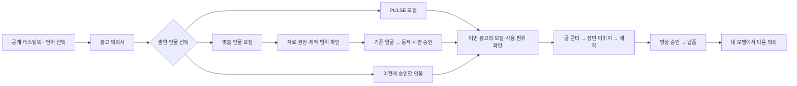

# PULSE 다국어와 고객 전용 인물 기획안

> 2026-11-08. 기존 모델 유지, 글로벌 모델 4명 추가, 다국어와 고객 전용 인물 등록·승인·재사용을 함께 기획한다. 이번 결과는 기획이며 이미지 생성·LoRA 학습·앱 구현·운영 데이터 변경을 포함하지 않는다. 네 인물의 최종 외모·이름과 이 기획의 세부 화면·운영값은 구현 전에 확정할 제안이다. **2026-11-09 구현 착수 — [12절 구현 설계](#12-구현-설계2026-11-09--이-절이-9·10절보다-앞선다)가 9·10절보다 앞선다.**

## 1. 제품 방향과 범위

고객이 자기 언어로 모델을 고르고 의뢰한 뒤, 한 고객 방에서 인물과 광고를 확인하며, 다음 의뢰에서 승인된 인물을 다시 쓸 수 있게 한다. PULSE는 유호님과 제작팀이 검토·연출하는 제작 서비스로 유지한다. 고객의 사진 등록은 제작 가능성 검토 요청이며 생성·학습·과금의 시작 버튼이 아니다.

| 구분 | 이번 기획의 기준 |
|---|---|
| 기존 캐스팅 | 현재 명단 21명의 코드·이름·얼굴·소속·공유 링크를 유지한다. 기존 모델을 글로벌 인물로 교체하지 않는다 |
| 글로벌 캐스팅 | 백인 여성·남성, 흑인 여성·남성 각 1명 추가. 최종 승인 후 기본 명단은 25명 |
| 첫 공개 언어 | 한국어·영어의 고객 흐름 전체. 일본어는 같은 구조로 준비해 현지어 검수 후 다음 공개 |
| 후속 언어 | 몽골어는 실제 파일럿 고객에 맞춰, 번체중문은 다음 시장 진입에 맞춰 추가 |
| 고객 전용 인물 | 새 가상 인물과 사용 권한이 확인된 실존 인물을 등록·검토·승인하고, 해당 고객의 후속 프로젝트에서 재사용 |
| 기존 화면 | 시사실 디자인, 추천 모델 4명 먼저 보기, 고객 방 하나, 대화 일지 하나, 영상 확인과 납품의 연결을 유지 |
| 이번 범위 밖 | 이미지·영상 생성, 실제 학습, 코드·계정·권한 변경, 신규 결제 연동, 해외 가격 확정, 고객에게 연락·발송 |

첫 공개에는 영어로 의뢰부터 납품까지 사용할 수 있는 흐름과 전용 인물의 재사용까지 넣는다. 여러 언어로 첫 화면만 번역한 상태를 해당 언어 지원 완료로 표시하지 않는다.

## 2. 현재 구조에서 이어받을 것

2026-11-08 작업본을 기준으로 확인했다. 아래는 코드·문서 기준이며 설치본과 공개 서버를 다시 시험한 결과가 아니다.

| 확인한 현재 구조 | 이번 설계에 반영 |
|---|---|
| 캐스팅 원본 `roster-v2.json`에 21명, 고객 앱 `casting-catalog.mjs`와 의뢰서 `MODEL_LINES / MODEL_PICKS`에 별도 매핑 | 인물 원본은 하나로 두고 공개용·고객 앱용 카탈로그와 언어별 설명을 같은 코드로 연결한다 |
| 의뢰서는 기존 9개 화면, 모델은 추천 4명 후 전체 보기 | 모델 단계 안에서 선택 방식을 바꾼다. 맞춤 제작을 고른 경우에만 관련 질문을 펼친다 |
| 캐스팅북은 한국어 분류 문구와 낱말로 추천하고, 문의글의 한국어 구획을 앱이 읽는 연결이 있다 | 언어별 낱말을 공통 분류 ID로 변환하고 모델·헤어 전달은 구조화된 데이터로 바꾼다. 옛 링크·한국어 문의글도 계속 읽는다 |
| 서버 의뢰 필드는 허용 목록으로 검사하며 일부 선택값이 한국어 문구다 | 새 필드와 언어 독립적인 선택 ID를 서버와 화면에 함께 추가한다. 번역된 문장을 저장값으로 쓰지 않는다 |
| `propose_model / answer_model`과 고객 방의 모델 확인이 있다 | 카탈로그 모델 선택과 전용 인물 버전 선택을 공통 모델 확인 화면으로 잇는다 |
| 고객 접근은 프로젝트별 초대 링크·세션. `clientProjects.ownerId`는 직원 담당자 | 고객 브랜드의 소유권과 회원 연결을 별도로 둔다. 직원 담당자나 동일 이메일을 고객 자산의 소유자로 간주하지 않는다 |
| 자료 사용 조건 기록은 별도 암호화 저장, 자료 지문·기간·범위를 관리한다 | 기존 사용 조건 기록을 활용하되, 인물 본인의 동의·브랜드 이용 범위·인물 버전을 연결하는 새 기록을 추가한다 |
| 기본 캐스팅의 고정 목소리 샘플은 제거된 상태 | 언어별 견본 목소리 목록을 다시 만들지 않는다. 광고 장면의 목소리는 시안에서 확인한다 |

원문: [의뢰 흐름](README.md), [고객 방 하나로](판3_설계.md), [캐스팅북](../PULSE_AI모델_캐스팅_20260930/README.md), [제작 규칙](../제작양식/AI광고영상_제작규칙.md).

## 3. 글로벌 모델 네 명

아래 구분은 제작 브리프용 임시명이다. 고객에게 공개할 이름과 최종 외형은 이후 시안에서 고른다. 코드 후보는 현재 명단과 충돌하지 않지만 실제 추가 시 다시 대조한다.

| 임시 구분 | 코드 후보 | 나이 설정 제안 | 표현 방향 |
|---|---|---|---|
| 백인 여성 A | F12 | 20대 후반~30대 초반 | 자연스러운 표정과 패션 연출을 모두 소화. 생활·뷰티·브랜드 장면으로 확인 |
| 백인 남성 B | M11 | 30대 후반~40대 초반 | 일상적인 친근함과 단정한 인상. 생활·서비스 소개·패션 장면으로 확인 |
| 흑인 여성 C | F13 | 30대 후반~40대 초반 | 다양한 표정과 차분한 연출. 생활·서비스 소개·패션 장면으로 확인 |
| 흑인 남성 D | M12 | 20대 후반~30대 초반 | 자연스러운 표정과 패션 연출을 모두 소화. 생활·뷰티·브랜드 장면으로 확인 |

피부 톤·헤어·체형·얼굴형이 서로 다른 선택지를 만들되, 인종에 특정 업종·성격·능력을 고정하지 않는다. K-pop·패션·생활·비즈니스는 연출 스타일로 다룬다. 외모로 국적·사용 언어를 부여하거나 고객 국가만으로 특정 인종을 자동 추천하지 않는다.

공개 카드에는 대표 사진, 이름, 나이대, 실제로 확인한 인상과 장면 사진을 넣는다. 인종별 별도 앱이나 국가별 복제 명단을 만들지 않는다. 모델 단계의 처음 네 자리는 광고 목적·고객이 명시한 취향·검증된 장면을 근거로 구성하고, 전체 보기에서 기존 21명과 새 4명을 함께 찾는다.

네 명 각각의 제작 준비 순서는 기준 얼굴 선택 → 각도·표정·전신 기준 확정 → 장면 일관성 검증 → 실제 동작에서 얼굴 유지 확인 → 공개 승인이다. 정면·45도·옆모습과 학습에 사용하지 않은 각도·조명을 검증하는 기존 제작 기준을 적용한다. 내부 동작 검증을 기본 캐스팅의 새 견본 영상 탭으로 자동 공개하지 않는다. 사진·학습 파일·공개 자산은 이 기획 단계에서 만들지 않는다.

## 4. 고객이 이동하는 화면

### 전체 흐름

모델을 맡기거나 인물 없이 제작하는 기존 선택도 유지한다. 얼굴 제작과 광고 제작의 상태는 연결하되 별도로 저장한다.

### 공개 캐스팅북

- 오른쪽 위에 언어 선택을 둔다. 첫 공개는 한국어·English이며 준비 중인 언어를 선택 가능한 메뉴로 내지 않는다.
- 현재 모델·작품·헤어·선택 상태를 언어 변경 전후에 유지한다.
- 기존 후보 담기와 함께 「원하는 인물이 없나요? 맞춤 인물 요청」 입구를 둔다.
- 버튼은 선택한 모델 코드·헤어·광고 메모·화면 언어를 의뢰서로 전달한다. 얼굴 사진·개인정보·비공개 인물 ID를 공개 URL에 넣지 않는다.
- 기존 `#p-` 공유 링크와 한국어 문의글 가져오기는 호환 경로로 유지한다.

### 의뢰서의 모델 단계

처음에는 다음 세 가지 선택지를 보여 준다. 「모델을 추천받을게요」와 「인물 없이 만들어요」는 보조 선택으로 유지한다.

| 선택 | 그 자리에서 하는 일 |
|---|---|
| PULSE 모델에서 고르기 | 추천 4명 → 전체 보기 → 사진과 헤어 확인 → 후보 선택 |
| 맞춤 인물 요청하기 | 「새로운 가상 인물」 또는 「실제 인물 출연」을 고르고 필요한 자료만 등록 |
| 내 모델 다시 쓰기 | 권한이 확인된 고객의 사용 가능한 인물 선택. 첫 방문에는 목록 대신 연결 안내 |

맞춤 요청의 처음 질문은 인물 유형, 사진·참고 자료, 원하는 쓰임, 이번만 사용/후속 사용 희망이다. 가상 인물에는 원하는 인상·나이대·헤어와 참고할 점을 받고, 실존 인물에는 본인/소속 모델 등 관계와 당사자 동의 확인 방법을 받는다. 국적·신체 치수·학습 설정을 일괄 필수 입력으로 요구하지 않는다.

사진마다 「이 인물을 재현」 또는 「분위기 참고」 목적을 명시한다. 초기 대표 사진 1~3장으로 상담을 시작할 수 있게 하되, 그 수가 학습·고유 얼굴 재현에 충분하다고 약속하지 않는다. 필요한 정면·좌우·표정 자료는 검토 후 고객 방에서 추가로 요청한다. 다른 사람의 얼굴이 함께 들어간 자료는 사용 대상을 확인한다.

등록 후 접수 상태는 「인물 제작 검토 중」이다. 기존 제작 가격에 맞춤 인물 비용·기간이 포함됐다고 표시하지 않는다. 초기 인물 제작·검증, 해당 광고 제작, 추가 언어판 비용은 견적에서 구분한다. 금액과 납기는 담당자가 제작 범위를 확인해 제안한다.

### 고객 방의 모델 확인

고객 방의 현재 차례 카드에 「인물 확인」을 넣고, 상세 자료와 의사결정은 그 카드 안에서 끝낸다. 댓글·되묻기는 기존 일지에 모으고 새 채팅방을 만들지 않는다.

| 고객이 확인할 때 | 보여 주는 것 | 주요 버튼 |
|---|---|---|
| 자료 보완 | 필요한 사진·이유·예시 설명, 현재 제출 자료 | 자료 추가하기 |
| 기준 얼굴 확인 | 정면·측면 등 같은 판의 기준 이미지, 담당자 설명 | 이 얼굴로 진행 / 고칠 점 보내기 |
| 동작 확인 | 해당 얼굴로 만든 짧은 비공개 동작 시안, 가능한 표현과 제한 | 이 인물로 진행 / 수정 요청 |
| 이번 광고 사용 확인 | 인물·브랜드·광고 목적·매체·지역·기간, 합의한 비용·일정 | 이번 광고에 사용 |
| 재사용 준비 완료 | 승인된 대표 이미지·사용 범위·마지막 사용·만료일 | 다음 광고에 사용 |

의견을 작성 중이면 그 의견을 보낼 수 있게 하고, 작성 중인 의견을 남긴 채 승인이 처리되지 않도록 한다. 승인 시 무엇을 확인하는지 한 문장으로 설명하며 최종 영상 승인과 혼동되는 「모두 승인」 버튼을 두지 않는다.

### 내 모델과 재주문

고객 앱에 「내 모델」 입구를 추가한다. 프로젝트를 보는 동안에는 고객 방의 모델 카드와 납품 화면에서 접근하고, 로그인한 고객의 시작 화면에서는 새 의뢰 옆에서 접근한다.

카드는 대표 이미지·이름·준비 상태·사용 가능 범위·만료일·「이 모델로 의뢰」만 먼저 보인다. 상세에서 승인 이력, 사용 프로젝트, 헤어·착장 변형, 사용 중지 요청을 확인한다. 데이터셋·학습 파일 경로·내부 실패 시안은 고객 카드에 노출하지 않는다.

재주문은 인물 ID와 승인 버전을 새 의뢰에 연결하고, 새 제품·목적·매체·지역·기간·출력 언어만 다시 확인한다. 이전 사진 전체를 복사 업로드하지 않는다. 범위가 같고 권한·버전이 유효하면 얼굴 제작을 반복하지 않는다. 새 얼굴·나이·얼굴 구조 등 정체성이 달라지는 요청은 새 버전과 승인을 만들고, 이전 프로젝트는 이전 버전을 계속 참조한다.

## 5. 승인과 상태

### 서로 다른 세 가지 확인

| 구분 | 확인하는 주체 | 기록할 내용 |
|---|---|---|
| 인물 이용 동의 | 실존 인물 본인 또는 권한 증빙의 적법한 주체, 담당자 확인 | AI 제작·학습·외부 처리 범위, 광고 이용 범위, 재사용·보관 조건, 근거와 판 |
| 인물 품질 승인 | 해당 프로젝트의 지정 고객 승인자 | 기준 얼굴 판, 동작 시안 판, 수정 의견, 승인 시각·언어 |
| 광고별 사용과 영상 승인 | 해당 프로젝트의 지정 고객 승인자 | 이번 광고 사용 범위 및 기존 콘티·장면·영상 각각의 승인 |

인물 본인의 동의와 고객 담당자의 디자인 승인은 대체 관계가 아니다. 얼굴 동의가 목소리 복제 동의를 포함하지 않는다. 목소리는 기존처럼 장면 시안에서 확인하며 별도 복제 요청은 별도 범위로 처리한다.

동의 확인은 당사자에게 한정된 확인 링크 또는 담당자가 검증한 서류로 받는다. 해당 링크로 프로젝트나 고객의 인물 목록을 열 수 없게 한다. 체크박스만으로 당사자 확인이 끝났다고 기록하지 않는다. 도구별 처리 조건과 실제 사용할 외부 서비스는 자료를 외부로 보내기 전에 확인한다.

### 내부 상태와 고객 표시

| 내부 상태 | 고객 표시 | 다음 진행 조건 |
|---|---|---|
| draft / submitted | 작성 중 / 접수 완료 | 고객 제출 |
| needs_materials / rights_pending | 자료 또는 동의 확인이 필요해요 | 담당자가 보완과 권한 확인 |
| reviewing | 제작 방법을 검토하고 있어요 | 범위·견적 합의 |
| reference_review | 기준 얼굴을 확인해 주세요 | 고객의 해당 이미지 판 승인 |
| building | 인물을 준비하고 있어요 | 내부 방식 결정, 필요한 학습과 검증 |
| motion_review | 움직이는 모습을 확인해 주세요 | 고객의 해당 동작 시안 승인 |
| ready | 사용할 준비가 됐어요 | 이번 프로젝트 사용 범위도 유효 |
| paused / expired / retired | 사용 확인 필요 / 기간 종료 / 사용 종료 | 해소된 조건에 맞는 재검토 |

상태가 ready여도 다른 브랜드·새 지역·새 업종 등에 대한 사용 권한이 자동으로 생기지 않는다. 실패·보완은 해당 단계로 돌아가며, 공개하지 않은 내부 실패 판을 고객 승인 대상에 섞지 않는다.

승인은 인물 버전·보여 준 이미지/영상 판·사용 조건 판·동의 판에 묶는다. 같은 판의 재전송이나 중복 클릭은 같은 처리 결과를 돌려준다. 직원이 새 판을 공개한 사이 고객이 옛 판을 승인하면 최신 판을 확인하도록 안내한다. 자동 번역·일반 댓글·담당자의 내부 확인은 고객 승인으로 처리하지 않는다.

## 6. 다국어 동작

### 언어와 시장을 분리

| 값 | 정하는 위치 | 예 |
|---|---|---|
| 화면 언어 | 개인 언어 설정 | 한국어 / English / 이후 日本語 |
| 고객 소통 언어 | 의뢰서 연락·확인 단계에서 기본값 제안 후 변경 | 고객 안내·알림은 영어, 내부 검토는 한국어 |
| 광고 출력 언어 | 의뢰서의 납품 요구와 콘티 | 일본어 내레이션, 영어 자막판 추가 |
| 광고 대상 시장 | 의뢰서의 대상 고객 | 호주·일본 |
| 견적 통화 | 합의한 견적 | KRW 또는 별도 합의 통화 |

한국어 화면으로 일본 시장용 일본어 광고를 주문할 수 있고, 한 프로젝트에서 여러 언어 납품물을 요청할 수 있다. 화면 언어 변경으로 모델 선택·광고 언어·대상 시장·견적 금액을 바꾸지 않는다. 첫 공개에서 해외 통화 결제를 자동 지원한다고 표시하지 않으며 기존 가격·결제 계약을 유지한다.

### 번역할 범위

- 공개 소개와 캐스팅북: 모델 설명, 업종·분위기, 검색·추천 이유, 버튼, 공유 카드의 설명.
- 의뢰·제작 흐름: 질문과 예시, 업로드와 오류 안내, 저장·재접속, 방향·모델·콘티·영상 승인, 수정·납품.
- 고객 전용 인물: 요청 유형, 자료 보완, 동의·사용 범위, 승인·만료·재사용 안내.
- 알림과 접근: 메일·푸시·만료된 초대·권한 부족·빈 화면·접속 실패까지 같은 언어로 제공.
- 날짜·시간·숫자·통화: 언어에 맞춰 표시하고 납기에는 합의한 시간대를 명시. 날짜만 있는 납기와 시각이 있는 승인 기록을 구분.

우선순위는 고객이 명시한 언어 → 초대·공유 링크의 언어 → 브라우저 언어 → 기본 언어다. 저장된 고객 선택을 국가 IP로 덮지 않는다. 공개 링크의 lang에는 지원하는 언어 코드만 허용하고, 비공개 접근 권한은 별도로 검사한다.

### 고정 문구와 고객 글

고정 문구는 검수된 언어 사전으로 제공한다. 승인·동의·가격·납기 문구는 검수한 번역 판만 공개한다. 언어별 문구가 빠지면 개발 검사가 잡고, 해당 흐름의 필수 문구가 준비되지 않은 언어는 공개 언어 목록에 넣지 않는다.

고객 자유 입력은 원문·원문 언어·수정 판을 보존한다. 내부 한국어 번역과 고객에게 보낼 번역은 원문 판에 연결하고, 원문을 수정하면 이전 번역을 낡은 것으로 표시한다. 기계 번역에는 원문 보기와 번역 표시를 두며, 제작 지시·권리·금액·일정에 영향을 주는 문장은 담당자가 확인한다. 번역 실패가 원문 저장을 막지 않게 하고 확인되지 않은 중요한 문구로 승인받지 않는다.

언어별 광고 납품물은 각각의 파일·대본·자막 판을 가진다. 하나의 영상 승인을 다른 언어판 승인으로 복사하지 않는다. 최종 승인 화면에는 실제 납품 언어·화면비·파일 목록을 보여 준다.

## 7. 고객 소유권과 보관

### 프로젝트와 고객 브랜드 연결

첫 의뢰는 현재처럼 비회원으로 시작할 수 있다. 제출한 전용 인물 자료는 그 프로젝트에서만 확인한다. 프로젝트를 넘는 「내 모델」은 기존 SYNK ID의 검증된 로그인과 담당자가 확인한 브랜드 연결을 거친 고객에게만 연다. 이 연결이 준비되지 않았으면 고객은 기존 프로젝트에서 재사용을 요청하고 담당자가 새 프로젝트에 필요한 인물만 연결한다. 이메일이나 회사명 일치만으로 자산을 합치지 않는다.

고객 브랜드에는 안정적인 ID와 허용 회원·역할을 두고, 인물에는 해당 브랜드 소유자 ID를 둔다. 대행사가 여러 고객을 맡는 경우 고객 브랜드별로 나누며 브랜드 간 이동은 별도 사용 권한 확인을 거친다. 현재 프로젝트의 직원 ownerId와 이 소유자 ID를 구분한다. 이 소유자 ID는 앱의 접근·관리 범위를 뜻하며 독점 이용과 결과물의 권리 조건은 견적·계약에서 정한다. 고객 전용 인물을 다른 고객의 광고에 임의로 재사용하지 않는다.

프로젝트 초대 링크는 그 프로젝트에 공개한 인물 판만 읽고 승인한다. 고객 브랜드의 전체 목록·원본 사진·다른 프로젝트에는 접근하지 못한다. 승인자 인증 방식도 기록하며 초대 링크 접근을 본인 신원 검증으로 표현하지 않는다.

### 보관과 사용 중지

- 기본은 이번 프로젝트 사용이다. 「다음 광고에도 사용」을 선택한 고객에게 보관 자료·목적·기간을 보여 주고 별도 동의를 받는다.
- 재사용 보관 기간의 운영 제안은 마지막 납품 후 12개월이며 계약에서 확정한다. 마지막 사용 기록만으로 동의 기간을 무기한 연장하지 않고 연장 동의를 받는다.
- 견적 검토에서 끝난 의뢰는 기존 90일 비활성 보존 규칙과 연결하되, 승인된 재사용 자산을 프로젝트 정리 과정에서 함께 지우지 않는다.
- 원본 사진·동의 자료·학습 파일은 비공개 저장소에서 고객과 자료 종류별 접근을 검사한다. 공개 저장소·캐스팅북 빌드·공개 CDN·공용 브라우저 캐시에 넣지 않는다.
- 승인된 자료 재사용은 참조로 연결한다. 프로젝트의 삭제가 공통 인물 파일을 지우지 않도록 사용처를 확인하고, 보관 종료 시 원본·파생 이미지·학습 파일·외부 처리본·백업의 삭제 범위를 함께 처리한다.
- 사용 중지·기간 만료 시 신규 선택과 제작 시작을 서버에서 막고 진행 중 프로젝트는 담당자 확인으로 보낸다. 이미 납품된 영상의 처리는 계약과 사용 범위에 따라 별도로 확인하며 앱에서 사후 광고 집행까지 자동 취소했다고 표시하지 않는다.
- 공개 캐스팅북 등재와 고객 전용 보관은 별도다. 전용 인물을 공개 모델로 자동 전환하지 않는다.

12개월 보관값과 동의 문안은 운영 제안이며 이번 기획 저장으로 기존 보존 정책이나 고객 계약을 변경하지 않는다.

## 8. 제작팀 운영

직원 작업실에는 기존 프로젝트의 모델 카드 옆에 「전용 인물」 작업을 붙인다. 한 명의 담당자가 자료·권한·견적·시안·사용 가능 상태를 확인하고 유호님이 제작 품질을 판단한다.

| 순서 | 담당자가 처리할 일 | 남길 결과 |
|---|---|---|
| 접수 검토 | 동일 인물 재현인지 분위기 참고인지, 자료 품질과 이용 권한 확인 | 보완 요청 또는 제작 범위 |
| 방식 선택 | 참조 이미지로 가능한지, 반복 사용을 위해 LoRA가 필요한지 판단 | 내부 제작 방식·예상 작업량 |
| 견적 | 초기 인물 제작·검증비, 광고 제작비, 언어판·독점 조건을 구분 | 고객이 확인한 범위·납기·수정 조건 |
| 기준 얼굴 | 고객에게 보여 줄 판만 공개 | 얼굴 승인 기록 |
| 제작 준비 | 필요한 학습·내부 검증과 짧은 동작 시안 | 학습/참조 버전·검증 결과·고객 승인 |
| 광고 제작 | 선택된 인물 버전과 실제 사용 조건 대조 | 해당 프로젝트의 사용 기록 |
| 후속 관리 | 보관·기간·재사용 요청, 교체 또는 중지 처리 | 내 모델 상태와 이력 |

자료 업로드·고객 승인 이벤트가 GPU 학습이나 유료 생성 API를 자동 호출하지 않는다. 초기 구현은 작업 큐·파일 전달·상태·승인 기록을 관리하고 제작은 기존 도구와 유호님 확인 절차로 진행한다. AI 초안 검토와 번역을 추가할 때는 기존 호출·비용 통로를 재사용한다.

학습 파일은 사용하는 기반 모델·버전과 함께 관리한다. LoRA 준비 완료를 모든 영상 도구에서 직접 사용할 수 있다는 뜻으로 표시하지 않는다. 실제 광고에 쓸 기준 컷과 움직임을 검증한 후 본편을 만든다.

## 9. 구현을 위한 데이터와 연결

아래 이름은 신규 설계 제안이며 생성된 테이블·API가 아니다. 기존 store·프로젝트 서비스·자료 보관·승인·알림 경로를 확장한다.

| 대상 | 주요 정보 |
|---|---|
| 고객 브랜드 | customerWorkspaceId, 확인된 회원과 역할, 연결 근거, 소통 언어 |
| 인물 | personaId, 소유 고객 브랜드, 실존/가상 구분, 표시 이름, 상태 |
| 인물 버전 | personaRevisionId, 기준 이미지·동작 시안 ID, 내부 제작 방식·학습 버전, 검증 기록 |
| 동의와 사용 범위 | 인물/버전, 당사자 확인, 사용 브랜드·매체·지역·기간, 학습·보관·재사용 범위, 증빙과 문안 판 |
| 품질 승인 | 인물 버전, 실제로 본 자료 판, 승인자·인증 방식·시각·화면 언어, 승인/수정 요청 |
| 프로젝트 인물 연결 | projectId, 카탈로그 모델 또는 전용 인물 버전, 이번 광고 사용 범위와 확인 |
| 번역 | 원문 ID·판·언어, 대상 언어, 번역문·검수 상태·문구 버전 |
| 작업·사용 이력 | 검토·보완·준비·공개·승인·재사용·중지의 주체와 시각 |

프로젝트 선택값은 공개 카탈로그 모델과 전용 인물 참조를 구분한다. 고객이 보낸 personaId만으로 선택을 허용하지 않고 소유권·공개 범위·해당 버전·사용 기간을 서버에서 다시 확인한다. 카탈로그의 MODEL_IDS 허용 목록에 비공개 인물을 섞지 않는다.

기존 모델 코드·프로젝트 답·캐스팅 링크는 유지한다. 새 답 구조에 schemaVersion과 인물 선택 종류를 추가하고, 기존 models/modelChoice는 호환 변환으로 읽는다. 서버가 새 필드를 이해하기 전에 화면만 먼저 보내지 않으며, 선택 문구를 안정적인 ID로 옮길 때 옛 한국어 저장값도 변환한다. 서버는 오류 코드와 표시 문구를 분리해 새 화면에서 번역하고 옛 화면의 오류 안내도 유지한다.

승인과 사용 시작은 현재 판 번호를 검사하는 저장으로 처리한다. 자료 판·동의 범위가 바뀌면 관련 승인만 다시 받는다. 재사용 후보 화면과 실제 제작 시작 사이에 기간이 끝나거나 사용이 중지된 경우도 시작 시점에서 다시 검사한다.

### 변경할 위치

| 위치 | 예정 변경 |
|---|---|
| 캐스팅북 roster-v2.json · catalog.json · site-src · build-site.cjs | 승인 후 글로벌 4명, 언어별 문구·낱말, 공통 분류 ID, 언어 유지와 구조화된 의뢰 전달 |
| public/pulse-app/casting-catalog.mjs · request-data.mjs · request-flow.mjs | 25명 카탈로그와 맞춤/재사용 선택, 조건부 자료 입력, 언어별 질문·예시 |
| public/pulse-app/room-view.mjs · views.mjs · app.mjs 및 새 인물 화면 모듈 | 고객 방 인물 확인, 내 모델, 버전별 승인·재사용, 언어 설정 |
| public/pulse-app/film-views.mjs · film-review.mjs · 납품 화면 | 실제 영상·납품 언어 표시와 승인 대상 연결 |
| pulse-requests.mjs · client-projects.mjs · pulse-strategy.mjs | 답 검증, 인물 참조, 프로젝트 권한·상태·버전, 고객 공개 데이터 |
| 새 인물 서비스와 기존 client-rights.mjs · 자료 서비스 | 고객 소유권, 동의·보관·버전·작업 이력, 기존 내부 권리 기록과 연결 |
| pulse-mail.mjs · client-notifications.mjs · push와 서비스워커 | 고객별 언어·인물 검토 알림, 권한 재검사, 비공개 자료 캐시 제외 |
| synk.im PULSE 소개와 PC 앱 진입 | 선택 언어·초대·캐스팅 상태 전달. 설치본의 언어·접속 상태도 확인 |

기존 자료 사용 조건 서비스는 직원의 확인 기록이므로 고객 본인의 동의 증빙과 같은 데이터로 간주하지 않는다. 인물별 암호화 증빙은 고객 공개 스냅샷에서 분리한다.

## 10. 개발 순서와 공개 조건

| 순서 | 묶음 | 완료 조건 |
|---|---|---|
| 1 | 공통 데이터·언어 구조 | 기존 21명·프로젝트·공유 링크 유지, 고객 소유권·인물 버전·선택 ID·번역 구조 확정 |
| 2 | 한국어·영어 전체 흐름 | 공개 캐스팅 → 의뢰 → 접수·재접속 → 수정·승인 → 납품·알림까지 언어가 이어짐 |
| 3 | 전용 인물 접수·직원 검토·승인 | 실존/가상 요청, 보완·동의·견적, 얼굴·동작 승인과 제작 연결을 합성 자료로 확인 |
| 4 | 고객 소유권과 내 모델 재사용 | 회원·브랜드 연결, 같은 고객의 새 프로젝트 선택, 타 고객 차단, 만료·중지·새 버전 처리 |
| 5 | 글로벌 4명 편성 | 이후 별도 제작 단계에서 외형·이름·자료·동작 검증을 승인받아 25명으로 공개 |
| 6 | 첫 공개와 일본어 확장 | 한국어·영어·맞춤·재사용을 통합 검수 후 공개. 일본어 전체 문구·응대를 검수해 다음 공개 |

단계 2~4의 개발은 새 얼굴 이미지 없이 텍스트와 합성 테스트 자료로 진행할 수 있다. 글로벌 모델 네 명은 실제 자산이 승인되기 전에는 공개 명단의 선택 가능한 모델로 노출하지 않는다. 현재 요청은 이 순서를 정하는 기획까지이며 이미지 제작·구현 착수 지시로 넘기지 않는다.

### 출시 전에 확인할 시나리오

1. 기존 21명의 링크·헤어·고객 선택·과거 승인 자료가 그대로 열린다.
2. 영어로 광고를 입력해 모델을 찾고 의뢰서를 보낸 뒤, 같은 언어의 접수·메일·수정·승인·납품을 사용한다.
3. 작성 중 언어를 바꾸고 새로고침해도 사진·모델·댓글 초안·현재 단계가 유지된다.
4. 한국어 화면에서 일본어 광고를 요청해도 화면 언어·광고 언어·대상 시장·통화가 섞이지 않는다.
5. 고객 A의 프로젝트 링크·회원·사진 URL로 고객 B의 인물·동의 자료·학습 파일에 접근할 수 없다.
6. 가상 인물 참고 사진과 실존 인물 재현 요청이 올바른 확인 절차로 간다.
7. 직원이 새 얼굴 판을 올린 뒤 고객이 옛 판을 승인하면 새 판 확인을 요청한다. 중복 승인·동시 수정도 이력을 훼손하지 않는다.
8. 승인한 인물을 같은 고객의 새 광고에 다시 쓰고, 원본 재업로드·불필요한 재학습을 요구하지 않는다.
9. 사용 기간이 끝났거나 중지된 인물은 새 선택·제작 시작이 막히고, 이전 납품 이력은 보존된다.
10. 프로젝트 정리·비활성 의뢰 정리·초대 링크 폐기로 다른 프로젝트의 재사용 인물까지 삭제되거나 공개되지 않는다.
11. 번역 실패·낡은 번역·필수 문구 누락이 원문 또는 승인 의미를 바꾸지 않는다.
12. 휴대폰·큰 화면에서 긴 영어·일본어 문구, 국제 전화번호, 시간대, 파일 업로드 실패, 느린 연결, 설치 앱과 PWA 재접속을 확인한다.

고객 화면·개인정보·권한·승인 기능의 구현 전 설계 검토와 배포 검수는 [AI 운영 원칙](../../AI_운영원칙.md)을 따른다. 이번 기획은 해당 구현 검수의 통과를 뜻하지 않는다.

공개 후에는 언어별 의뢰 완료율, 인물 요청의 보완 횟수, 기준 얼굴 승인까지의 시간, 담당자 작업시간, 재사용 주문 비율을 측정한다. 정의는 각각 시작 대비 제출, 요청당 자료 보완 왕복, 자료·범위가 갖춰진 시점부터 승인, 검토·제작·수정의 실제 작업시간, 전용 인물을 사용한 재주문/전용 인물을 사용한 전체 주문이다. 효과 목표치는 첫 유료 주문에서 기준값을 얻은 뒤 정한다.

## 11. 근거와 후속 결정

기존 PULSE의 Casting Networks·Milanote·Vimeo·Frame.io·Filestage 비교는 [PULSE 정본](../PULSE.md)의 고객 제작 도구 조사와 연결한다. 이번에는 기존 흐름에 추가되는 언어·인물 동의·승인 동작의 원문을 2026-11-08에 다시 확인했다.

| 근거 | 채택할 점 | 확인할 결과 |
|---|---|---|
| [W3C 언어 선택](https://www.w3.org/International/questions/qa-site-conneg) | 브라우저 언어를 제안하되 직접 선택과 선택 기억을 제공 | 국가와 언어가 다른 고객도 원하는 언어로 전체 흐름 사용 |
| [HeyGen 영상 기반 Digital Twin 동의](https://help.heygen.com/en/articles/12092609-recording-your-consent-video) | 자료 제출자와 인물 당사자의 동의 확인을 분리하는 제품 사례 | 고객 담당자의 사진 업로드만으로 학습·광고 사용이 시작되지 않음 |
| [Filestage 검토 결정](https://help.filestage.io/en/articles/2562896-submit-your-review-decision) | 특정 버전의 승인과 수정 요청을 별도 동작으로 제공 | 일반 댓글·다른 판의 승인과 혼동하지 않음 |
| [Frame.io 제작자 대화](https://www.reddit.com/r/editors/comments/1rw7un5/client_not_using_frame_io_correctly_frustrating/) | 시간에 붙는 의견은 편리하지만 고객에게 별도 사용법 학습이 부담이라는 사례 | 기존 고객 방에 모델 확인을 붙이고, 결정과 의견을 바로 찾게 함 |

공식 도움말 3개와 커뮤니티 스레드 1개를 추가 확인한 범위다. 경쟁 제품 전체 평가나 해외 고객의 사용성 실험으로 일반화하지 않는다. 동의 방식은 제품 설계 참고이며 모든 국가의 법적 요건을 대신하지 않는다.

이미 정한 범위는 기존 모델 유지·글로벌 4명·다국어·고객 전용 인물 등록/승인/재사용·이번에는 기획만이다. 이후 이미지 제작 단계에서 외모와 이름을 고르고, 출시 준비에서 맞춤 비용·보관 12개월 제안·동의 문안·일본어 공개 시점을 확정한다.

**판 0 보강(2026-11-09, ego 브라우저 · 로그인 없음).** 맞춤 아바타 다섯 곳(HeyGen Trustpilot 4.2 · 5,201건, Synthesia 3.8 · 1,830건, D-ID 3.7 · 40건 · 앱스토어 3,443건, Captions 앱스토어 39,042건, Argil 4건)의 공식 동의 도움말과 Trustpilot 별 1·2 첫 쪽(서비스마다 5~11건) · 앱스토어 최신 리뷰(HeyGen 50 · Captions 100 · D-ID 50) · Reddit 글 7편, 검토 도구 넷(Frame.io · Filestage · Ziflow · Vimeo 검토 링크)의 언어 도움말을 읽었다. 불만 쪽 필터라 불만이 과대표집돼 있고, G2 · Capterra는 막혀 못 읽었다. 검토 도구의 언어 불만 원문은 찾지 못해 「언어 부족 불만이 크다」고 결론 내지 않는다. 원자료(URL · 날짜 · 표본)는 공용 작업본 `.tmp/pulse-i18n-persona-20261109/research/벤치마킹-원자료.md`.

| 원문에서 본 것 | 채택할 점 | SYNK 적용 · 확인할 결과 |
|---|---|---|
| 동의는 모두 「동의 영상 + 동일인 확인」(HeyGen · Synthesia · D-ID · Tavus 공식 글). HeyGen은 남의 아바타면 그 사람이 QR로 자기 폰에서 찍게 하고, 거부 사유를 아바타 카드에 바로 보인다. 동의 절차 자체를 탓한 리뷰는 없고 「심사 기준이 들쭉날쭉」(Synthesia 2025-12) · 「AI 생성 사진이 유명인으로 거부」(D-ID 2025-03)가 나왔다 | 올리는 사람과 당사자 확인을 나누는 지금 설계 유지, 보완 · 보류 이유를 인물 카드에 그대로 | 실제 인물 구조의 당사자 확인 토큰(12-2). 보완 요청 카드에 「왜」 한 줄 — 판 3에서 확인 |
| 재현 불만이 모든 곳에서 같다: 안 닮음 · 과장된 몸짓 · 입 어긋남, 「2~3분 영상으로는 말버릇이 안 담긴다」(HeyGen Reddit · Trustpilot 10월, D-ID · Synthesia) | 쓰기 전에 기준 얼굴 → 동작 시안을 승인받는 지금 순서, 사진 몇 장으로 재현을 약속하지 않기 | 동작 확인 카드에 「가능한 표현과 제한」을 보이는지(4절 표) — 판 3 |
| 가장 거센 불만은 돈: 「고치려면 또 낸다」「뽑고 나서야 비용이 보인다」「공지 없이 단가가 오른다」「해지하면 크레딧이 사라진다」, 앱에서 해지 버튼을 못 찾음(HeyGen 앱스토어 최신 50건 중 6건 안팎) | 비용이 생기는 때를 먼저 보이고, 견적 전에는 아무것도 청구되지 않음을 말하기. 사용 중지 길을 눈에 보이게 | 인물 요청 접수 글에 「견적을 확인하시기 전에는 비용이 생기지 않아요」, 내 모델 카드에서 사용 중지 요청이 한 번에 보이는지 — 판 3 · 4 |
| HeyGen의 Avatar · Digital Twin · Look 용어가 헷갈려 몇 시간 썼다(Trustpilot 10-31) | 두 언어에서 용어를 하나씩 고정 | 용어 표: 인물(persona) · 기준 얼굴(reference look) · 동작 시안(motion test) · 사용 범위(usage) — 영어 사전 검수에 넣는다 |
| 검토 도구의 언어: Frame.io는 개인 설정이 웹 · 메일에 함께 적용되고 사용자 입력 · 자동 생성 문구는 번역하지 않는다. Filestage는 브라우저 언어를 따르고 지원 밖이면 영어, 가입 없는 손님은 브라우저 언어만. Ziflow는 관리자 기본 + 개인 | 고른 언어를 메일에도, 사용자 글은 원문 그대로, 지원 밖 브라우저는 영어 | 언어 고르기에 「브라우저 목록에 한국어가 없고 영어가 열려 있으면 영어」를 더한다(12-2). 프로젝트 `contactLocale`이 메일 · 알림까지 — 판 2 |
| 외국 고객에게 검토 링크를 보낼 때 언어보다 사용 난도(r/videography)와 데이터 · AI 학습 안내(유럽 고객사 법무 거절, r/MotionDesign)가 먼저 걸렸다 | 영어 화면은 번역과 함께 「사진이 어디에 쓰이는지」 한 줄 | 인물 사진 칸 옆 안내 한 줄(법률 문구 아님) — 판 3 |

## 12. 구현 설계(2026-11-09 · 이 절이 9·10절보다 앞선다)

유호님 11-09 「페이블로 검수 한번 받고 진행하자」. Opus 평가 → Fable 독립 설계 검토(P0 0 · P1 4 · P2 4 · P3 6, 판정 「고치고 시작」) → 이 절에 반영했다. 파일·줄 근거와 확인 사실 F1~F27은 [Fable 설계 검토](설계검토_Fable_20261109.md)에 있다. 코드 뿌리는 `docs/마케팅/온라인마케팅지도/engagement/company/`.

### 12-1. 공개 방식과 판

구조는 전부 심고, 손님에게 켜는 것은 따로 한다. 동의 문안·가격·보관이 정해지기 전에는 실제 얼굴 사진을 받는 입구를 열지 않는다. 판매 전이라(결정 11-05 「판매보다 준비 먼저」) 늦게 켜도 잃는 주문이 없다. 화면이 답의 모든 키를 보내고 서버는 허용 목록 밖 키를 400으로 거절하므로 서버 코드가 먼저 나간다.

| 판 | 내용 | 올리는 길 | 손님에게 |
|---|---|---|---|
| 0 | 벤치마킹 보강, 작은 시험(의뢰서 모델 단계·고객 방 승인 카드 영어 두 화면을 1440·390으로 보고 깨지는 시험 수와 화면 인상을 잰다) | 없음 | 없음 |
| 1 | 공통 구조: 번역 틀(ko 동작 불변), 답 구조 더하기, `castingOf`·`personaRef`, 오류 code 통로, `pulseFeatures`, 인물 파일 소유 목록(백업)·정리 제외 | 회사 이미지(57 뒤) → 화면 묶음 | 변화 없음 |
| 2 | 영어 손님 길(앱), 담당자 글 번역 지도, 메일·알림 언어 | 서버 → 화면 | 시험 프로젝트만 |
| 2b | 캐스팅북 영어, 캐스팅북 → 의뢰서 전달(지금 링크가 없어 새 기능), 의뢰서 헤어 칸 | `tools/공개.js` | 언어 메뉴 꺼 둠 |
| 3 | 인물 접수·직원 검토·승인. 가상 인물 먼저, 실제 인물은 구조만 | 서버 → 화면 | 꺼 둠 |
| 4 | 브랜드 연결·SYNK ID 경로·내 모델·재사용·만료. **별도 설계 검토 묶음** | 서버 → 화면 | 꺼 둠 |
| 5 | 글로벌 4명 준비 목록, 공개 전환 검사 | 저장소 | 비공개 |
| 6 | 통합 검증(10절 시나리오), 켤 것을 유호님과 결정 | 스위치 | 결정 뒤 |

### 12-2. 정한 설계

**언어**

- **범위:** `usesRoom`이 참인 프로젝트의 손님 길만 — 첫 화면·의뢰서·고객 방·방향·글 콘티·영상 확인·납품·일지·알림·메일·오류·설치·푸시. 옛 탭과 직원 화면은 한국어로 둔다. 체험(`?demo=film`)은 영어에서 숨긴다.
- **번역 틀:** `public/pulse-app/i18n.mjs`(서버도 가져오는 순수 모듈)의 `t('한국어 문장',{name})`. 한국어 문장이 곧 키다. 자리표는 이름 있는 것만 쓰고, 값을 조각으로 잇는 자리는 문장 단위로 다시 쓴다. `esc(t())` 순서를 지킨다. 문맥이 갈리는 낱말(확인·모델·보내기·열기·다음)은 처음부터 `ctx`를 붙인다. 표 상수는 한국어로 두고 그리는 자리에서 번역한다.
- **사전:** `i18n/en.mjs`를 지연 로드한다(`sw.js` 목록·판, `server.mjs` 정적 목록에 추가). 일본어는 틀만 두고 사전은 만들지 않는다. 문안 검수는 운영 원칙 현지어 줄의 세 겹이다.
- **사전 검사:** `node --test`로 손님 길 모듈의 `t(` 전수와 사전을 대조한다. 빠진 키 0·죽은 키 0, `t()` 없는 한글 찾기(직원 전용 블록은 표시해 제외).
- **저장값:** 번역문은 저장하지 않는다. 한국어 저장값(`POINTS`·`avoid`)은 그대로 키로 쓰고 일괄 변환하지 않는다.
- **언어 결정:** 명시 선택(localStorage, 실패해도 동작) → 프로젝트 `contactLocale`·링크 `lang` → `navigator.languages` → 브라우저 목록에 한국어가 없고 영어가 열려 있으면 en(판 0 벤치마킹, Filestage 방식) → ko. 링크 `lang`은 `app.mjs:41`의 주소 지우기 앞에서 읽는다. 바꿔도 다시 그리기만 한다. `app.mjs` 맨 위에서 `await`하지 않는다(판 0: vm으로 `app.mjs`를 읽는 시험 아홉 파일이 맨 위 `await`에서 깨짐) — 사전은 시작 흐름 안에서 불러 첫 그리기 전에 끝낸다.
- **복수형 · 글꼴(판 0):** 사전 값은 문자열 또는 `{one,other}`이고 `{count}`가 있으면 `Intl.PluralRules`로 고른다(「1 files」). 영어 제목은 `SX Latin`(SUIT)으로 그려 명조가 아니다 — 영어 화면만 자간을 줄이지 않고, 둥근 따옴표 · 줄표가 명조로 떨어지지 않게 `html[lang=en]`의 라틴 글꼴 범위를 넓힌다. 라틴 명조를 새로 들일지는 영어 첫 화면 시안에서 유호님이 고른다.
- **날짜·가격:** 포맷터가 언어를 받는다(`api.mjs:23·25`). ko는 지금 그대로, en은 「KRW 390,000」. 통화 변환·결제 변경은 없다.
- **서버 오류:** throw 문장은 그대로 둔다. 고정 문장은 응답 경계의 정확 일치 사전으로, 동적 문장은 `SYNK_PULSE_…` code로(서버가 내리는 접두 규칙) 옮기고 `api.mjs`가 code를 먼저 본다. 런타임 패턴 매칭은 쓰지 않고, 손님 경로의 `fail`·`httpError` 리터럴과 사전을 정적으로 대조하는 시험을 둔다. 언어는 프로젝트 세션이면 `contactLocale`이 우선이다.
- **서버가 만드는 문구:** stageLabel·기본 nextStep·customerBodies·알림 제목·메일은 고객 보기와 메일 조립 때 언어를 입힌다. 언어별 납품은 기존 `pulse-deliverables.mjs`의 `language`·`subtitles`·버전 연결을 쓴다.
- **담당자 글:** 번역 지도 `studio.translations[sourceKey]={sourceHash,sourceLocale,targetLocale,text,status,by,at}`를 더하고 고객 보기에서 치환한다. 원문이 바뀌면 낡음으로 표시한다. 직원이 영어를 직접 적어 reviewed로 둘 수 있다. 방향 제안(lead·sentence·flow·why)·글 콘티(oneLine·note)·사용 안내(guide)·되묻기(label·why)·값·납기는 reviewed가 아니면 보내지 못한다. 내부 메모는 묻지 않는다. 번역문 길이는 원문의 두 배까지다(studio 1.5MB 상한). 고객 글의 한국어 번역도 같은 지도에 두고 원문은 늘 보존한다. 초안은 실시간 API 없이 Claude 세션이 넣는다. 자동 안내는 `contactLocale`이 ko가 아니면 보내지 않는다.

**인물**

- **답 구조:** 더하기만 한다 — `contactLocale`·`outputLocales`·`targetMarket`(나라 코드)·`quoteCurrency`(표시용)·`hair`, `modelChoice`에 `custom`·`persona`. 새 키는 서버 허용 목록·기본값·화면 빈 답에 같은 이름으로 넣는다.
- **선택 값:** `castingOf(request)` 하나로 catalog·persona·custom·ask·none을 판단한다. 쓰는 자리는 `pulse-requests.mjs`의 435(방향 제안)·476(글 콘티 보내기)·421(모델 답)·542(방향 고름)·562(제작 설계로 옮김)와 `room-view.mjs:121`·직원 화면이다. 인물 참조는 `castingSelection.personaRef={personaId,revisionId}`로 두고 `normalizeCastingSelection`·`safeCastingSelection`을 함께 고친다. `modelChoice:''` 덮어쓰기는 인물이면 유지하고 카탈로그로 바꿀 때만 교체한다. 서버 재검사는 첨부·방향 제안 보낼 때·제작 시작(`approve_draft`) 때 한다.
- **저장:** 문서 `customerWorkspaces`·`pulsePersonas`(`workspaceId|null`·`originProjectId`·`kind`)·`pulsePersonaRevisions`·`pulsePersonaSources`(`purpose:identity|mood`)·`pulsePersonaConsents`(인물당 암호문)·`pulsePersonaApprovals`(추가만). 실제 인물 칸(`kind`·당사자 확인 방법·토큰 목적)은 지금 넣고 입구만 끈다. 프로젝트에는 참조와 `usage`만 둔다.
- **파일과 백업:** `studio-media/`와 기존 이름 규칙을 그대로 쓰고 확장자를 늘리지 않는다. 소유 목록에 새 종류를 더한다 — `workspace-media.mjs`·`deploy/ha/node-host.py:233`·`workspace-restore-acceptance.mjs`·DR 시험. `visibleAssetIds`에 넣지 않는다.
- **초안 사진:** 칸 `persona-identity`·`persona-mood`를 더하고 `submit`에서 갈라 인물 문서로 보낸다. 파일을 앞으로만 옮기는 규약은 유지한다. HEIC·WebP는 내려받기 전용으로 받히므로 JPG·PNG를 안내하고, 직원이 변환해 공개 판으로 올린다.
- **90일 정리:** `retireRequest`는 인물 파일을 돌려주지 않는다. 인물 변경은 `commitWorkflow`로 프로젝트 기록에 한 줄 남겨 시계를 돌리고, 열린 인물 요청이 있으면 건너뛴다. 프로젝트를 지우는 길은 없다(보관과 90일 정리뿐).
- **권한 경계:** 길을 섞지 않는다.
  - `/pulse/api/request/*` 초안 토큰: 자기 초안 파일만.
  - `/pulse/api/persona/*` 초대 세션: 이 프로젝트에 공개한 판의 자산만. 원본·동의·목록 없음.
  - `/api/customer/pulse/*` 고객 SYNK ID 세션(`customer-routes.mjs` 알려진 경로에 추가): 요청마다 브랜드 회원 재확인. 지금 고객 로그인은 상담 전용(쿠키 경로 `/api/customer`)이라 재료만 있는 상태다.
  - `/api/personas/*` 직원: `originProjectId`의 `allowed()` 또는 관리자. 동의 복호화는 편집 권한만.
  - 동의 확인 토큰: 목적·검증 함수까지만 만들고 화면은 실제 인물을 켤 때 만든다.
- **승인:** 전이표는 순수 함수 하나다. 서버가 `viewedHash`(내려준 공개 자산 id + termsHash)를 계산해 응답에 싣고 승인 때 비교한다. 옛 판은 409와 최신 판, 같은 `idempotencyKey`는 같은 결과다(새 승인에만 적용, 기존 승인 액션 규약은 그대로). 동의·품질·사용·최종 영상 승인은 서로 대체하지 않는다.
- **소유권:** 인물은 처음에 프로젝트에 묶이고(`workspaceId` 없음), 연결은 직원의 명시적 행동이다. 초대 세션의 승인을 나중에 회원 승인으로 바꿔 적지 않는다.
- **보관·삭제:** 기본은 프로젝트 사용이고 재사용은 `retention`을 둔다. 만료는 상태만 바꿔 새 선택을 막는다. 자동 영구 삭제는 보관 기간이 정해질 때까지 끈다. 삭제는 직원 확인 → 참조 확인 → 파일 → 묘비 문서 순서다. 동의 문안 초안에 백업 잔존 기간을 사실대로 적는다.
- **담당자 몫:** 직원 화면은 다음 행동 한 줄을 먼저 보인다. 자료 점검·번역 초안·상태 정리는 Claude 세션, 실제 인물 권리 예외와 첫 몇 건의 품질은 유호님 몫으로 나눈다.

**스위치와 글로벌 4명**

- **스위치:** 설정 문서 `pulseFeatures={publicLocales:['ko'],projectLocales:['ko'],personaRequest:false,personaReal:false,myModels:false}`. 서버에서 강제하고, 변경은 관리자·CSRF·감사 기록을 거치며, 화면은 응답 값만 믿는다. 판 2 시험은 `projectLocales`에 en을 더하고 합성 프로젝트의 `contactLocale`을 en으로 두어 초대 링크로 본다.
- **글로벌 4명:** `roster-global-draft.json`(코드 후보·임시 구분·상태만, 빌더가 읽지 않음). 시험은 준비 코드가 `CASTING_MODELS`·`catalog.json`·site·`sw.js`·`server.mjs` 정적 목록에 없음을 본다. 공개 전환 검사는 자산·`MODEL_LINES`·`MODEL_PICKS`·「21명」 글까지 본다. 9절의 「25명 카탈로그」는 공개 전환 때의 일이다.

### 12-3. 유호님이 정할 것(구현을 막지 않고, 스위치를 켤 때 필요하다)

| 항목 | 선택안 | 추천 |
|---|---|---|
| 고객 인물과 금고 규칙(운영 원칙 보존 규칙은 데이터셋·가중치·얼굴 세트를 영구 보관) | 가. 금고 제외, 보관 기간 뒤 삭제 / 나. 고객 동의 범위 안에서만 금고 / 다. 학습 파일은 금고, 원본 사진은 제외 | 가 |
| 영어 일반 공개 시점(법인 전 결제는 크몽 경유, 크몽 해외 결제 가능 여부는 미확인) | 가. 구조가 끝나면 초대 링크 손님만, 공개 메뉴는 결제 길이 정해진 뒤 / 나. 구조가 끝나면 바로 공개 | 가 |
| 실제 인물 공개 조건 | 가. 내부 리허설 한 건 통과 뒤(크레딧이 들어 따로 승인) / 나. 구조가 끝나면 상담 요청만 받기 | 가 |
| 맞춤 인물 가격·보관 기간·동의 문안 | Claude가 초안, 가격은 리허설 원가를 본 뒤 | — |
| 일본어 공개 시점, 새 인물 이름·외형 | 영어 뒤 / 이미지 단계 | — |

**11-11 정함(유호님 「추천대로」, [결정 표](../../_ops/결정.md) 11-11 행):** 금고는 가(넣지 않고 보관 기간 뒤 삭제) · 영어는 가(초대 링크 손님 먼저, 공개 메뉴는 결제 길 뒤) · 실제 인물은 가(리허설 한 건 뒤) · 다시 쓰기 보관 12개월 · 프로젝트 전용 인물은 원 프로젝트 정리 때 함께 삭제 · 동의 문안은 Claude 초안(백업 잔존 최대 1년)과 리허설 뒤 가격 · 일본어는 영어 뒤 · 새 인물은 이미지 단계. 영어 첫 화면은 제목 「AI models can look real. We make them act.」 · 글꼴 B.

### 12-4. 시험과 검수

- 10절 시나리오 대응: 1은 판 1, 2·3·4·11은 판 2, 6·7은 판 3, 5·8·9·10은 판 4, 12는 판 6. 실물 휴대폰은 기기 흉내까지 보고, 실물은 끝 보고에 미확인으로 적는다.
- 서버는 GPT, 화면은 아르곤 → Fable 최종. 영어 첫 화면 문구는 시안을 보이고 고르시게 한다.
- 다른 세션의 미추적 시험 파일(`pulse-customer-copy.test.mjs` 등)은 건드리지 않는다. 벤치마킹 보강(판 0)은 유사 서비스의 맞춤 아바타 동의·재현 품질·가격 불만 원문과 다국어 B2B 포털을 본다.

### 12-5. 판 0 결과(2026-11-09)

- **벤치마킹:** 11절 끝 「판 0 보강」 표. 설계에 더한 것은 브라우저 언어 영어 대체, 비용 · 사용 중지 안내, 용어 표, 사진 쓰임 한 줄이다.
- **작은 시험:** 번역 틀(`public/pulse-app/i18n.mjs`의 `t` · `tl` · `pickLocale`, 사전 `i18n/en.mjs` — 문장 키 81과 표 상수 172, 모두 253)을 의뢰서 모델 단계 · 고객 방 모델 확인 카드(머리 · 일지 · 아래 의뢰서 쪽 포함)에 끼우고, 이 작업본 회사 서버(CSP · 합성 프로젝트)에서 ko · en × 1440 · 390을 찍었다. 도구 · 그림은 워크트리 `.tmp/pulse-i18n-persona-20261109/`(`tools/probe-en.mjs`, `shots/probe-1/`).
- **깨지는 시험:** 1,397개 중 19개. ① 원문 글자를 그대로 대조하는 시험 2개(`pulse-film-screens.test.mjs` — 「21명 모두 보기」 · 미리 보기 이름 줄) ② `app.mjs`를 vm으로 읽는 시험 17개(네 파일) — 시험판의 맨 위 `await setLocale()` 탓이고 문구 때문이 아니다. 화면 HTML을 대조하는 나머지 1,376은 한국어 바이트가 그대로라 통과했다. 판 2에서 `app.mjs` 문구를 옮기면 vm 시험 아홉 파일에 번역 함수를 넣어 줘야 하고, 원문 대조 시험은 `t()` 꼴로 고친다 — 감당할 크기다.
- **영어 화면 인상:** 넘침 0 · 잘린 단추 0, 오류는 한국어와 같은 401 하나(비로그인 의뢰서가 프로젝트를 한 번 묻는 것). 줄 길이는 의뢰서 리드 53자 · 방 리드 47자로 읽기 좋은 범위다(한국어 31 · 26자). 짚을 것 다섯: 제목이 명조가 아니라 SUIT Light라 시사실의 명조 느낌이 빠지고(깔끔하지만 다른 결) 자간 −0.04em이 큰 영어 제목에서 조금 빽빽하다, 「Who’s」의 둥근 따옴표만 명조로 떨어져 글꼴이 섞인다, 방 제목 「Shall we go with this model?」이 1440 · 390 모두 두 줄(한국어 한 줄), 「1 files」 복수형, 머리 단추 셋(나눈 말 · 앱 설치 · 알림) · 기기 기억 띠 · 로고 이름표와 일지의 직원 이름(한글)이 남았다.
- **판정:** 나쁘지 않아 판 2 규모는 그대로다. 판 2 화면 일에 영어 제목 글꼴 시안(A SUIT Light 자간 조정 / B 라틴 명조 새로), 짧은 영어 제목 후보, 복수형, 직원 영문 표시 이름(없으면 「Your producer」)을 더한다. 시험판 코드(맨 위 `await`)는 판 1에서 시작 흐름 안으로 옮긴다.

### 12-6. 판 1 구현(2026-11-09)

- **서버(회사 이미지):**
  - **답 구조:** `hair`·`contactLocale`·`outputLocales`·`targetMarket`(ISO 두 글자, 여덟까지)·`quoteCurrency`(KRW·USD·JPY·EUR, 표시만)를 `ANSWER_FIELDS`·`emptyRequestAnswers`·`normalizeRequestAnswers`에 같은 이름으로, `modelChoice`에 `custom`·`persona`. 확인 때 헤어는 그 모델이 제작 설계의 모델일 때만 옮긴다.
  - **모델 판단:** `public/pulse-app/casting-choice.mjs`의 `castingOf(request, castingSelection)` → `{kind, modelId, personaRef, agreed}`. `agreed`는 옛 「글 콘티 보내기」 조건과 같은 뜻이다(직원이 제작 설계에만 넣은 모델은 손님 확인 전). 방향 제안은 사람 없이 · 새 인물 · 이미 있는 인물이면 모델 없이 보낸다. 글 콘티 보내기 · 고객 방 1차안 카드 · 직원 점검이 같은 판단을 쓴다.
  - **인물 참조:** `castingSelection.personaRef`는 서버만 붙인다(판 3의 사용 승인). 제작 설계 저장은 이 칸을 받아도 쓰지 않고 지금 값을 지킨다 — 옛 화면이 안 보내도 지워지지 않는다. 비면 키가 없다(옛 프로젝트 모양 그대로). 카탈로그 모델로 바꾸면(모델 제안 받기 · 방향 고르기) 참조를 뗀다. 모델 없이 보내는 방향 제안과 제작 시작(이미지 판 확인) 때 `pulse-personas.mjs`의 `createPersonaGuard`가 인물 · 판을 다시 본다. 판 1에는 통과하는 인물이 없다(붙이는 길도 없다).
  - **오류:** `fail(message,status,code)`. 주소 오류는 칸마다 고정 문장이고(「제품 페이지 주소를 확인해 주세요.」 — 한국어 글자 그대로), 손님 파일 이름이 끼는 문장만 `SYNK_PULSE_FILE_MISSING`을 붙인다. 화면 `api.mjs`의 `errorText`가 코드 → 고정 문장 키 → 원문 차례로 번역하고, 한국어는 받은 문장 그대로다.
  - **스위치:** `pulse-features.mjs`, 문서 `pulseFeatureSettings/main`. `GET·POST /api/settings/pulse-features`(관리자 · 공통 CSRF · 감사 `pulse-features-settings`). 언어는 사전이 있는 ko · en만, 한국어는 늘 들어 있고, 공개 메뉴 ⊆ 프로젝트 언어, 실제 인물은 인물 접수를 켠 뒤에만. 저장 문서가 이상하면 끈 쪽으로 읽는다. `/pulse/api/request`에 `features{locales,personaRequest,personaReal}`, `/pulse/api/project`·`/pulse/api/open`에 `features{locales,locale,personaRequest,personaReal,myModels}`(locale은 허락된 contactLocale, 아니면 ko).
  - **인물 파일:** `workspace-media.mjs`의 `PERSONA_MEDIA_KINDS` — `pulsePersonaSources`(사진 하나에 문서 하나, `diskName`)와 `pulsePersonaRevisions`(`assets[].diskName`). 묘비(`deletedAt`)는 건너뛰고 모르는 꼴은 백업을 멈춘다. 백업 · 작업실 백업 · 복원 수락 · HA 데이터 대조가 모두 이 함수를 쓴다. `deploy/ha/node-host.py`의 고정 목록은 옛 릴리스용 합집합이라 바꾸지 않았다 — 정본은 릴리스의 이 함수이고, 판 1이 인물 문서보다 먼저 운영에 올라 한 판 되돌려도 센다(HA 런타임 고정 해시를 건드리지 않는다). `retireRequest`는 인물 문서가 가진 파일을 돌려주지 않고, `retireUnconfirmed`는 열린 인물(상태가 ready · retired · expired · withdrawn 밖, 모르는 값 포함) 프로젝트를 건너뛴다.
  - **정적 묶음:** `i18n.mjs`·`casting-choice.mjs`는 서버가 읽으므로 이미지 전용(`deploy/static/policy.json` exclude)이다. `i18n/en.mjs`는 서버가 읽기 전까지 묶음에 남는다(판 2에서 메일 언어를 조립하면 옮긴다 — 정적 묶음 시험이 잡는다).
- **화면(같은 이미지로만 — 서버보다 먼저 나가면 안 된다):** `app.mjs` 맨 위 `await`를 걷고 시작 흐름 안의 `applyLocale(features)`로 옮겼다(손님 화면만, 서버가 허락한 목록 안에서 — 지금은 늘 ko). 링크 `?lang=`은 주소를 지우기 전에 읽는다. 사전 값 `{one,other}` 복수형, 한국어 없는 브라우저 → 영어(허락될 때). 화면 빈 답에 같은 다섯 칸을 두고, 비어 있으면 보내지 않는다(옛 서버도 자동 저장을 거절하지 않게). `sw.js` v31(i18n · en · casting-choice). 판 0의 원문 대조 시험 둘은 `t()` 꼴로 고쳤다.
- **시험:** 서버 셋(`pulse-casting-choice` · `pulse-i18n-persona` · `pulse-i18n-persona-server`)과 화면 하나(`pulse-i18n-screen` — 영어 사전은 **리터럴 `t()` 기준** 빠진 키 0 · 죽은 키 0, 영어에만 있는 자리표는 부르는 자리가 넘김. 표 상수 · 분기 문장은 아직 세지 않는다 — 판 2). 서버 오류 문장 영어는 판 2 todo.
- **검수:** 서버 GPT 1건(반영 1 — P1 GA1: 새 인물 · 이미 있는 인물을 고르고 인물이 붙기 전에는 제작 시작(이미지 판 확인)을 409로 막음, 방향 · 글 콘티는 먼저 맞춤) → 다시 0건, 사슬 `pulse-i18n-pan1-backend-20261109-b`. 서비스 백엔드 끝판 아르곤 2건(P1 B1 재현 안 됨 — 방향은 확인 뒤에만 생겨 confirmedAt이 늘 있음, P2 A1 후속). 화면 아르곤 0건 → Fable 4건(P2 2 · P3 2, 모두 스위치를 켜야 드러나는 영어 길 — 후속), 사슬 `pulse-i18n-pan1-screen-20261109`. 두 사슬 배포 조건 충족.
- **판 2 · 3으로 넘긴 것:** 판 2 — 서버 오류 문장 영어(손님 길 `fail` 리터럴 대조, todo 시험), 프로젝트 언어에서 빈 contactLocale이면 서버가 locale을 비워 링크 · 브라우저가 닿게(Fable F1), 사전 대조를 상수 표 · copyBase · chip() 문장까지(F2), `t(null)`은 빈 글자(F3), 영어 흐름을 닫거나 401로 닫힐 때 한국어 · `html lang` 되돌리기(F4). 판 3 — 직원 방향 대화상자의 전용 인물 안내(지금은 「사람 없이」만 모델 없이 그린다), `openPersonaProjectIds`가 묘비를 건너뛰게(아르곤 A1), `chooseDirection`의 참조 떼기 조건을 `answer_model`과 같게(B1 정리).

### 12-7. 판 2 구현(2026-11-09)

- **서버(회사 이미지):** 프로젝트 소통 언어 `createProjectLocale`(스위치가 허락한 contactLocale, 아니면 ko)을 다섯 서비스와 납품이 함께 쓴다. 알림 · 묶은 제목 · 단계 이름 · 기본 nextStep · 메일은 보기 · 조립 때 입히고 저장하지 않는다(서버 사전 `pulse-locale.mjs` — 화면 사전과 따로). 담당자 글 번역 지도 `pulse-translations.mjs`: 영어 프로젝트는 되묻기 · 모델 메모 · 방향 제안 · 글 콘티(보낼 장면의 제목 · 설명 포함) · 최종본 사용 안내를 번역 없이 못 보내고(409), 손님 보기는 reviewed · 같은 원문일 때만 번역을 쓴다. 자동 안내는 한국어 프로젝트만. 직원 글의 작성자 이름은 저장된 이름이 직원 한 사람만 가리킬 때만 그 사람의 표시 이름(담당자면 nameEn 또는 Your producer), 겹치거나 모르면 PULSE team. 파일로 올린 시안 · 최종본은 머리글 `X-Version-Translation`, 장면 번역은 보낸 칸만 바꾼다(한국어만 고치면 옛 영어는 낡음으로 남는다), 납품 보기는 `customerLocale` · 점검 `guideTranslation`.
- **화면(서버 뒤 같은 이미지):** 손님 길 20모듈 번역 배선(틀 밖 한글 0 · 빠진 키 0 · 죽은 키 0을 시험이 잠근다), 사전 약 1,450줄, 언어 메뉴 `locale-menu.mjs`(허락 언어가 둘 이상일 때만, 휴대폰 머리는 바꿀 언어 하나), 연락 단계 안내 · 메일 언어, 체험 숨김, 영어 제목 A안, 기기 알림 대신 글은 한 언어(영어 화면에서 등록할 때만 `lang=en`), 셸 v33. 직원 화면 영어 칸은 `project.translation`이 있을 때만 생긴다(대화상자 · 장면 · 시안 올리기 · 납품 안내 · 데스크 「손님에게 보일 영어」). 판 5 글로벌 4명 준비 목록 · 공개 전환 검사.
- **영어 문안 세 겹:** Opus 맹검 역번역 1,505줄(높음 7 · 중간 51 · 낮음 80) → Fable 교정 129건(기각 18) → 아르곤 문법 22묶음(지적 63, 고침 100줄, 다시 채점 4줄). 용어: 컷은 shot(영어의 cut은 편집본으로 읽힌다), 영상 전 확인은 Pre-film check(촬영이 없다), 단계 줄은 Brief · Review · Draft · Production · Film, 납품 규격표 「영상」은 Film. 자료 공용 `.tmp/pulse-i18n-persona-20261109/pan2/copy-review/`.
- **검수:** 서버 GPT 1건(반영 1 — P1 작성자 이름, 같은 곳 두 회차라 규칙을 다시 정함) → 0 → 0, 사슬 `pulse-i18n-pan2-backend-20261109`(끝 `-d`), 끝판 아르곤 0건. 화면 아르곤 15묶음 0건 → Fable P2 1 · P3 1(F1 반영, F2 후속) → 고친 자리 재확인 P2 1(후속), 사슬 `pulse-i18n-pan2-screen-20261109`(끝 `-b`). 직원 화면은 내부 도구라 자기 점검(한국어 프로젝트 바이트 대조 17가지, 합성 영어 의뢰를 브라우저로 끝까지 14항목).
- **캡처(실제 서버 · 합성 의뢰, 1440 · 390, 공용 `.tmp/pulse-i18n-persona-20261109/shots/pan2/`):** 스위치 끔(한국어 · 영어 브라우저) 68장씩 — 전부 한국어, 언어 메뉴 없음, 화면 글은 판 2 직전과 같다(136쌍 중 다른 6쌍은 쇼릴 재생 위치의 작품 이름과 알림 묶음 수). 켬(영어 프로젝트) 68장 — 넘침 0, 남은 한글은 언어 이름뿐, 오류는 세션 없는 첫 화면의 401뿐. 1440 방향 화면 「02」 단추 넘침 1px은 판 2 전에도 있다. 실물 휴대폰은 미확인.
- **유호님이 고를 것:** [시안](https://claude.ai/artifact/Dn1MfME4gZb5QqmxkxHwgg) — 영어 제목(맹검 표), 제목 글꼴 A · B · C, 앱 한국어 제목을 사이트 11-07 판과 맞출지, 사이트 영어 제목을 맞출지, 담당자 영문 이름.
- **넘긴 것:** 회사 고객 프로젝트 화면(`client-projects.js`)의 시안 · 최종본 올리기에는 영어 칸이 없다(영어 프로젝트 최종본은 서버가 409로 막고 납품 화면 · PULSE 직원 화면으로 보낸다). 납품 「고객에게 보낼 글」은 한국어. 기기 알림 payload의 언어(지금은 빈 tickle)와 처음 켠 때로 굳는 알림 글 언어(Fable FA1), 첫 화면에서 언어를 바꾸면 1쪽으로 돌아가는 것(Fable F2), 광고 문구 참고 번역, 고객 글의 한국어 번역, 원문 손질 후보(「과한 표정」이 표현 오타인지, 「자료 확인일」을 자료 마감일로). 판 3 후속은 12-6 그대로.

### 12-8. 판 3 구현(2026-11-10)

- **서버(회사 이미지):** 설계 정본은 [판 3 설계](인물판3_설계_20261110.md). `pulse-personas.mjs` — 상태 12개와 전이 표 `PERSONA_FLOW` · 손님 승인 표 `PERSONA_APPROVAL_FLOW`(scope · reference · motion · usage, 서로 대신하지 않음), 초안 길 접수 · 프로젝트 길 `afterProjectSubmit`, 승인(서버가 계산한 viewedHash · 요청 키 · 옛 판 409 `SYNK_PULSE_PERSONA_STALE`), 사진 더 받기, 직원 보기 · 전이 · 판 파일 올리기, 실제 인물 동의 암호문 · 당사자 확인 토큰, 사용 확인 뒤 제작 설계에 인물 참조를 붙이는 가드. 스위치(`personaRequest` · `personaReal`)가 꺼져 있으면 인물 문서를 만들지 않고 손님 · 직원 보기에 키가 없다. 서버 GPT P1 셋을 고쳤다 — 손님에게 한 번이라도 보낸 판 파일은 지우지 않음(판 `sent` · 확인 기록 `shown`), 다시 낸 의뢰서의 인물 요청은 접수 단계에서만 반영 · 검토 뒤 409, 같은 요청 키는 본문 전체가 같을 때만 「이미 받음」.
- **화면(서버 뒤 같은 이미지, 셸 v39):** 의뢰서 모델 단계의 「맞춤 인물 요청하기」(인물 종류는 `personaReal`일 때만 · 인상 · 쓰임 · 다음 광고에도 · 사진 칸은 공개 의뢰서만 · 같은 사람 재현 사진은 실제 인물만 · 견적 승인 전 비용 없음), 고객 방 새 모듈 `persona-view.mjs`(카드 다섯 — 자료 보완 · 견적 · 기준 얼굴 · 동작 시안 · 이번 광고 사용, 카드마다 승인 하나 · 확인 문장 하나 · 고칠 점이 남아 있으면 승인 흐림, 영상 쪽이 손님 차례가 아니면 「맞춤 인물 확인 n/4」가 지금 차례를 대신함, 일지 · 1차안의 인물 기준 얼굴), 직원 데스크 인물 칸(다음 행동 · 손님 글 · 사진 · 견적 · 판 · 확인 기록 · 사용 범위 · 서버가 허락한 전이 · 영어 프로젝트의 영어 칸, 보낸 적 있는 파일은 지우기 단추 없음). 원문 손질: 사진을 보는 사람을 「PULSE 제작팀」으로(실제 열람과 맞춤), 쓰임 질문을 답 칩에 맞춤, 사용 범위 표의 「사용 기간」 전용 키, 「{count}일」 복수형.
- **영어 문안 세 겹:** 142줄 — Opus 맹검 역번역(높음 0 · 중간 10 · 낮음 18, 모두 반영 + 새 줄 다섯 따로 역번역 · 셋 다듬음) → Fable 교정 13건(반영 12 · 기각 1 — 사용 조건의 「Fee」는 견적 「Price」와 다른 말이라 둠, 원문 지적 셋 중 고객 방 사진 형식 1 반영 · 서버 문장 둘은 후속, 칩 값의 관사를 빼 접수증 줄을 맞춤) → 아르곤 문법 9건 반영(「make it」 · 「make the reference look」 · 홀로 쓴 「usage」 → usage terms) → 다시 채점 142/142 통과. 용어: 1~3단계 approve · 4단계 confirm, 고칠 점은 change request, usage(사용 조건) ≠ scope(견적 범위), 의뢰서 = brief.
- **검수:** 서버 GPT 3건(반영 3) → 다시 GPT 0 → 끝판 아르곤 0, 사슬 `pulse-persona-pan3-backend-20261110`(끝 `-b`). 화면 아르곤 4묶음 0건 → Fable 최종 P2 3 · P3 1(모두 후속) → 아르곤 뒤 고친 diff 다시 Fable 0건, 사슬 `pulse-persona-pan3-screen-20261110`(끝 `-b`). 손님 돈 표시 고침(만 원 반올림 → 원 단위)은 따로 `pulse-won-display-20261110`(아르곤 0 · Fable 생략, master `c855a9e71`).
- **캡처(실제 서버 · 합성 의뢰, 1440 · 390, 공용 `.tmp/pulse-persona-pan3-20261110/shots/`):** 스위치 끔 66장 — 판 3 직전과 화면 HTML · 글이 모두 같다. 켬(한국어 · 영어 프로젝트) 30장씩 — 접수부터 사용 확인 · 끝까지, 넘침 · 잘림 · 깨진 그림 0, 영어 손님 화면 한글 0(직원 데스크만 한국어), 오류는 공개 의뢰서 첫 화면 401뿐.
- **시험:** 판 3 서버 · 화면 · 사전 · 다국어 묶음 통과, 회사 폴더 전체 4,718 중 실패 4는 판 3과 무관(작업본에 없는 git 밖 문서 1 · 배포 백업 감시 bash 10초 한도 3).
- **넘긴 것:** Fable 후속 넷(이름 없는 인물의 카드 머리 줄 「맞춤 인물 · 맞춤 인물 확인 1/4」 중복, 접수증에 인물 사진 줄 없음, 스위치를 끈 뒤 프로젝트 길 의뢰서가 저장된 맞춤 인물을 비움 — 지금은 스위치 끔이라 안 걸림, 거둔 뒤 직원 데스크 점검 문구 — 판 4 화면에서), 서버 원문 손질 둘(「확인 요청을 확인해 주세요.」 · 「같은 요청으로 다른 확인이 왔어요.」를 손님 말로 — 서버 문장이라 다음 서버 판), 인물 알림 · 메일 순간(지금은 프로젝트 기록 한 줄만), 판 4(고객 브랜드 · 내 모델 · 다시 쓰기 · 삭제 — [설계](판4_설계_20261110.md) 10절 끝 「판 3 실물과 다른 점」 일곱).

### 12-9. 판 4 구현(2026-11-10)

- **서버(회사 이미지):** 설계 정본은 [판 4 설계](판4_설계_20261110.md) 5판(10절 끝 D1~D19). 새 `pulse-workspaces.mjs`(고객 브랜드 · 연결 요청 · 5분 한 번 목적 하나 증표 · 회원/직원 서비스 · 문서 먼저 파일 나중 삭제) · `pulse-workspace-routes.mjs`(`/api/customer/pulse/*`, 스위치 `myModels`가 꺼져 있으면 모두 404), `pulse-personas.mjs` 상태 paused · deleting · deleted · 읽을 때 계산하는 만료 · 가드 두 길(원 프로젝트 · 연결 확인된 다시 쓰기) · 고객 방 인물 `roomPersona`, 고객 로그인 `/pulse-app/` 돌아오기(실패도 `?login=failed`), 직원 `/api/customer-workspaces/*`(스위치와 상관없이 열림), 서버 시작 때 삭제 이어 하기.
- **화면(셸 v40):** 손님 「내 모델」 새 모듈 `my-models.mjs`(의뢰서와 같은 덮개 — 로그인 칸 · 브랜드별 카드 · 회색 카드와 까닭 한 줄 · 보관 대기 · 보관 동의 · 기한 연장 · 다시 쓰기 끄기 · 사용 멈추기 · 삭제 요청, 회원 경로의 401은 로그인 칸으로), 첫 화면 입구(공개 스위치가 켜졌을 때만 붙임), 「이 모델로 의뢰」(초안 → 초안 증표 → 붙이기 → 의뢰서 모델 단계 「내 모델 · 이름」 칩), 고객 방 「내 모델로 모아 두기」(로그인 전 · 요청 전 · 요청 뒤 · 회원, 누가 보게 되는지 한 줄)와 다시 쓰기 방 「내 모델 열기」, `?login=failed`와 돌아올 곳은 주소 지우기 전에, 상태 줄 판 4 몫, 직원 「고객 브랜드」 데스크 새 모듈 `brand-desk-view.mjs`(연결 요청 · 다시 쓰기 확인 · 브랜드 — 다음 행동 한 줄 먼저 · 다시 요청 표시 · 근거 한 줄 필수). 판 3 화면 검수 후속 넷(F1 머리 줄 중복 · F2 접수증 인물 사진 줄 · F3 꺼진 스위치로 비우는 것은 공개 초안만 · F4 거둔 뒤 직원 점검)과 서버 원문 손질 둘도 함께.
- **영어 세 겹:** 127줄 — Opus 맹검 역번역(높음 2 · 중간 6 · 낮음 26, 모두 반영) → Fable 교정 13 · 원문 확인 4(모두 반영) → 아르곤 문법 10(반영 — 「the person appearing」은 사전의 정해진 말이라 두고 문장만 고침) → 다시 채점 127/127. 원문이 약속을 넘던 두 곳은 한국어도 고쳤다 — 「사용 멈추기」는 진행 중인 제작까지 멈춘다고 읽혔다(실제는 새 의뢰 · 사용 확인 · 제작 시작만 막음), 「보관 끝」은 보관이 끝난다고 읽혔다(실제는 다시 쓰기 기한 — 기한 뒤 파일은 남고 새 광고만 막힘). 용어: keep(보관) · reuse(다시 쓰기) · Reusable until · consent again · 고객 방은 persona · 내 모델 화면과 다시 쓰기 의뢰서는 model · 새 광고는 order.
- **검수:** 서버 `pulse-persona-pan4-backend-20261110-b`(아르곤 0 → Fable 독립 P2 2 · P3 4 반영 · 끝판 아르곤 0) → 화면 단계 서버 손질 `pulse-persona-pan4-backend-20261110-c`(아르곤 0 · GPT는 본 계정 주간 한도로 막혀 기록 · 끝판 시험 아르곤 0). 화면 `pulse-persona-pan4-screen-20261110` 아르곤 8묶음 P1 1 · P2 4 — A1(직원 사용 범위 폼의 「메모」와 근거 한 줄이 같은 칸 이름이라 근거가 손님에게 보이는 메모로 나가던 것) · A2(로그인에서 돌아온 직후 방의 읽기가 모아 두기 요청 중 상태를 덮던 것) · C1(이어 쓰는 초안의 「내 모델 · 내 모델」 칩) · H1(직원 「보관 끝」) 반영, F1(「동작 시안」 용어)은 판 3과 함께 맞출 후속 → Fable 최종 P0 · P1 0, P2 5(붙인 칩을 다시 누르면 붙임이 풀림 · 프로젝트 잇기의 낡은 판 · 로그아웃 실패를 성공처럼 · 내 모델 머리 언어 메뉴 밑줄 · 브랜드 데스크 목록 줄 구분)와 P3 1(직원 expired 말) 모두 반영 → 다시 `pulse-persona-pan4-screen-20261111-b`(Fable — P3 1 후속: 다른 탭에서 다시 로그인한 뒤의 로그아웃 403 안내). 다시 찍은 켬 캡처(한국어 · 영어 37장씩)도 넘침 · 잘림 0.
- **캡처(실제 서버 · 가짜 중앙 SYNK ID · 합성 의뢰, 1440 · 390, 공용 `.tmp/pulse-persona-pan4-20261110/shots/`):** 스위치 끔 — 판 4 직전(origin/master 회사 폴더)과 판 3 캡처 도구로 같은 33장면을 찍어 정규화 HTML · 화면 글 66 중 64 같음(그림 차이는 실행마다 다른 접수 번호 · 분 표시뿐), 다른 둘은 직원 머리의 새 「고객 브랜드」 단추(직원 경로는 스위치와 상관없음). 켬 한국어 · 영어 42장씩(17장면 × 1440 · 390 + 직원 3 + 덮개 끝 5, 넘침 · 잘림 · 깨진 그림 0, 영어 손님 화면 한글 0) — 첫 화면 입구 → 로그인 · 실패 → 모아 두기 넷 → 보관 대기 · 동의 · 목록 · 멈추기 확인 → 「이 모델로 의뢰」 의뢰서 → 직원 브랜드 셋 → 다시 쓰기 방 → 사용 중지 카드.
- **시험:** 판 4 서버 · 화면(새 `pulse-persona-pan4-screen.test.mjs` 15 · 서버 시험의 화면 끝까지 1) · 사전 · 서버 오류(회원 경로 모듈 MODULES에 넣고 exclude 두 줄 지움) 통과, 회사 PULSE · 고객 · 손님 시험 1,596 중 실패 3은 git 밖 작품 mp4(판 4와 무관).
- **넘긴 것:** 설치 앱(PC 앱 창)의 SYNK ID 로그인 돌아오기 · 실물 휴대폰은 미확인, 스위치는 끈 채(켜기 전 9절 셋 — 보관 기간 · 금고 · 백업 잔존 기간 — 을 정한다), 사용 중지 · 기한이 지나 다시 쓰기 방에서 인물이 닫히면 그 방에서 「내 모델 열기」도 사라진다(첫 화면 · 원 프로젝트 방으로 간다), 보관 동의 화면의 「동작 시안」과 판 3 고객 방의 「움직이는 모습」 · 「1판 동작 시안」 용어를 두 판 함께 맞추기(화면 검수 아르곤 F1 — 영어는 둘 다 motion test로 같다), 다른 탭에서 다시 로그인한 뒤 내 모델의 로그아웃이 403을 되풀이하면 세션을 다시 읽고 서버 글을 보이기(다시 검수 Fable P3).

### 12-10. 판 5 확인 · 판 6 통합 확인(2026-11-11)

- **판 5:** 글로벌 4명 준비 목록(`docs/마케팅/PULSE_AI모델_캐스팅_20260930/roster-global-draft.json` — F12 · M11 · F13 · M12 모두 preparing, 단계 다섯 모두 안 끝남, 사진 · 이름 · 프롬프트 없음)과 공개 차단 시험(회사 `pulse-global-roster.test.mjs` 여섯 — 공개 명단 · 빌더 · 화면 · 서버에 준비 코드 0, 공개 전환 검사가 준비 코드마다 막음)이 판 2 커밋(`c166549d7d`)에 들어 있다. 공개는 실제 자산이 승인된 뒤의 일이고 지금은 비공개다.
- **통합:** 시나리오 1~11은 판 1~4가 각자 확인했고(12-4 대응표), master에 함께 오른 뒤에도 판마다 검수 증명 `확인`이 최종 바이트로 통과한다(판 3 서버 `server.mjs`의 차이는 AI 마켓 `ec165be50a` 9줄뿐임을 해시로 확인). 시나리오 12는 판 1~4 · 의뢰서 4초 · 배율 · 손님 돈 표시가 함께 있는 판(`e3d948c51d`)을 127.0.0.1 임시 서버 · 합성 자료로 쟀다(스위치는 그 서버 안에서만 켬 — 도구 · 캡처 공용 `.tmp/pulse-persona-pan6-20261111/`).
  - **긴 글:** 영어(긴 제품명 · 회사명 · 이메일 · 영국 번호)와 한국어 화면의 일본어 광고 글로 의뢰서 첫 화면 → 접수증 열한 단계를 390 · 2560에서 걸었다 — 넘침 · 화면 밖 · 잘린 단추 · 깨진 그림 0, 접수 저장됨. 영어 화면의 한글은 언어 메뉴 「한국어」뿐이다. 고객 방(직원 영어 번역 · 일본어 의뢰서)도 390 · 1440 · 2560에서 0이다.
  - **국제 전화번호:** +1 (415) · +81 · +44 · +82 · 010 꼴은 받고 점 표기(+1 415.555.0134 · 010.1234.5678)만 「휴대폰 번호를 확인해 주세요.」(영어 「Check your phone number.」)로 거절했다 — 이메일 없이 휴대폰만 적은 손님은 보내지 못했다 → 고침.
  - **시간대:** 같은 영어 프로젝트를 LA · 도쿄 · 서울에서 열면 날짜만 있는 납기(Nov 25)는 셋이 같고, 시각은 보는 사람의 시간대로 바뀐다(LA November 10 8:10 AM = 서울 November 11 1:10 AM).
  - **업로드 실패:** 서버 오류 → 「Couldn't upload. Try again.」, 연결 끊김 → 「…Check your internet connection and try again.」, 내용과 형식이 다른 파일 → 415 안내, 다시 고르면 올라간다. 실패한 파일 줄에는 「Remove」만 있다(다시 올리기는 새로 고름).
  - **느린 연결(지연 400ms · 내려받기 50KB/s, 첫 방문):** 의뢰서를 쓸 수 있기까지 34초(그동안 약 1MB), 같은 탭의 고객 방은 2.3초. 첫 방문에 받는 양은 의뢰서 3.0MB(글꼴 0.9MB — SUIT 610KB · 명조 292KB, 그림 1.75MB), 첫 화면은 쇼릴 영상 6.9MB를 더해 9.8MB다 → 성능 후속.
  - **설치 앱 · PWA:** 매니페스트(start_url · scope `/pulse-app/`, standalone), 서비스 워커 셸 v40 캐시, 끊긴 채 다시 열면 캐시로 열려 끊김 안내가 뜨고, 다시 이어지면 같은 방으로 돌아온다. 끊김 안내와 알림이 같은 자리에 겹치던 것 → 고침. 실물 휴대폰과 PC 앱(설치 창)의 SYNK ID 로그인 돌아오기는 미확인이다(기기 흉내까지).
- **고침 둘(master, 운영은 회사 판 61):** 의뢰서 휴대폰 칸이 점 표기를 받는다(`pulse-requests.mjs` 허용 글자에 `.`, 새 시험 `pulse-request-phone.test.mjs`) — 검수 `pulse-pan6-phone-dot-20261111`(GPT 주간 한도 막힘 기록 → 아르곤 0, 끝판 아르곤 0). 끊김 안내가 보이는 동안 알림을 아래로 내린다(`film.css` 한 줄, `pulse-film-screens.test.mjs` 시험 하나) — 검수 `pulse-pan6-offline-notice-20261111`(아르곤 0, Fable 생략 — CSS 한 줄). 고친 판의 390 · 1440 캡처는 `shots-after/F-pwa-offline-*`.
- **켜기 전 후속(스위치 뒤라 지금 손님에게 안 보임):** 영어 손님이 끊긴 채 앱을 다시 열면 한국어 첫 화면 · 안내가 나온다(프로젝트 · 스위치를 못 읽어 ko로 떨어짐 — 마지막으로 정한 언어를 기억해 끊긴 때 쓰기), 느린 연결의 첫 기다림 글 「프로젝트를 확인하고 있어요.」가 영어 브라우저에도 한국어다(`index.html` 고정 글), 판 3 · 4가 넘긴 것(「동작 시안」 용어 · 다른 탭 재로그인 뒤 로그아웃 403 · 인물 알림 · 메일 순간 · 닫힌 인물의 다시 쓰기 방 「내 모델 열기」).
- **백업 잔존(12-3 금고 규칙 · 판 4 설계 9절):** 지운 인물 파일은 서버 캐시에 약 3일(최근 압축본 3벌), GCS `company/production/`에 30일, 77yuhbs 재해 복구 묶음에 최대 1년(30일 하루 · 90일 주 · 1년 달) 남고, unmet23 금고에는 끝난 주 · 달의 마지막 판이 남는다(`deploy/backup-retention/README.md` — 11-11 보관 규칙 구현 때 다시 보니 금고의 서버 백업 사본은 주 판 90일 · 달 판 1년이 지나면 빠지고 휴지통 30일이라 「기한 없이」는 아니었다, [판 4 설계 11-1](판4_설계_20261110.md#retention-rules-20261111)). 「가. 금고 제외」를 고르면 인물 파일을 금고 사본에서 빼는 작업과 동의 문안의 「백업에서 최대 1년」이 함께 필요하다.
- **켤 것 결정:** 11-11 유호님 「추천대로」로 정했다(12-3 끝 줄). 운영 시험을 위해 `personaRequest` · `myModels`와 초대 링크 영어를 켜고(`personaReal` · `publicLocales` 영어는 끈 채), 금고 제외 · 프로젝트 정리 때 인물 삭제 · 동의 문안은 보관 규칙 구현에서 넣는다 — 실제 손님을 받기 전에 끝낸다.

### 12-11. 운영 스위치 켜기 · 운영 시험(2026-11-11)

- **켬(17:53 KST, 유호님 「켜서 하자」 · 「승인, 켜」, 관리자 창에서 `POST /api/settings/pulse-features` — 감사 기록):** `personaRequest` · `myModels` 켬, `projectLocales` `['ko','en']`. `publicLocales` `['ko']` · `personaReal` 끈 채. 익명 `/pulse/api/features`에 그대로 보이고 `/api/customer/pulse/session`은 404 → 200(로그인 전 `authenticated:false`). 실제 손님을 받기 전까지 시험용이다(금고 제외 · 정리 때 인물 삭제 · 동의 문안은 보관 규칙 구현 몫).
- **운영에서 끝까지 걸음(18:08~18:21, 브라우저 칸 — 손님 탭 · 직원 탭, 시험 그림 · 영상은 단색 자리 파일, 생성 · 학습 0):**
  1. 첫 화면에 「내 모델」 입구, 의뢰서 모델 단계에 「맞춤 인물 요청하기」 → 새 가상 인물 · 「다음 광고에도」로 보냄(P-1111-6715, 연락처는 회사 주소).
  2. 고객 방 「내 모델로 모아 두기」 → SYNK ID(브라우저에 남은 로그인으로 바로 돌아옴) → 「모아 두기를 요청했어요」 → 직원 「고객 브랜드」 연결 요청(줄에 프로젝트 이름 · 시각) → 새 브랜드 「SYNK 내부 시험 브랜드」 · 관리자로 승인 → 고객 방 「브랜드에 연결돼 있어요 · 내 모델 열기」.
  3. 판 3 흐름: 검토 시작 → 견적(0원 · 3일 · 1회) → 손님 승인 → 새 판 · 기준 얼굴 올려 보냄 → 손님 승인 → 동작 시안 올려 보냄 → 손님 승인 → 7/7.
  4. 「내 모델」: 보관 대기 1 → 보관 동의(다시 쓰기 기한 2027-11-11 · 백업 최대 30일) → 「새 광고에 쓸 수 있어요」 → 「이 모델로 의뢰」 → 새 의뢰서 모델 단계에 「내 모델」이 골라져 붙음 → 보냄(P-1111-E52F, 접수증 모델 「내 모델」).
  5. 직원 「다시 쓰기 확인」 1(브랜드 · 인물 · 붙인 때) → 사용 범위 적어 연결 확인 → 손님 새 방 「이번 광고에 쓸지 확인해 주세요」 → 「이번 광고에 사용」 → 직원 자동 점검 「전용 인물이 붙었어요」, 「내 모델」 마지막 사용 표시. 사진 다시 올리기 · 학습 요청 0(시나리오 8의 앞 길). 「내 모델」 영어 전환도 사전대로(Models kept for your brand · Order with this model …).
- **찾은 것(고치지 않고 넘김 — 같은 화면 파일을 판 6 후속 세션이 다루므로 조율 세션에 알림):**
  - P2 — 연결 요청의 「요청한 SYNK ID」가 SYNK ID 프로필에 표시 이름이 없으면 「고객」뿐이다(`customer-identity.mjs`가 빈 이름을 「고객」으로 채움). 담당자가 앱 밖에서 승인자 · 연락처인지 확인할 단서가 없다 — 가린 이메일이나 ID 끝자리 같은 단서가 필요하다. 브랜드 회원 줄 · 손님 「내 모델」 머리도 「고객」. 시험 계정이 그랬다.
  - P3 — 이름을 정하지 않은 인물은 손님에게 「내 모델의 모델」(의뢰서 모델 단계 제목 · 사용 확인 카드 · 고객 방)과 「이름 없는 모델」로 보인다. 판 3 직원 흐름에 이름을 정하라는 안내가 없다.
  - P3 — 직원 인물 칸 「다음 단계」에 기준 얼굴을 올리고 손님이 승인한 뒤에도 「기준 얼굴 그림을 판에 먼저 올려 주세요」가 남는다(5/7 · 동작 시안 올린 뒤).
  - P3 — 값 0원이 「0만원」으로 보인다(직원 · 손님 견적).
  - 참고 — 숨겨진 브라우저 칸에서는 의뢰서 「다음」이 넘어가지 않는다(단계 넘김이 애니메이션 끝을 기다림). 보이는 탭에서는 정상. 「인터넷 연결이 끊겼어요」는 화면에 뜬 적이 없다 — 숨겨 둔 끊김 칸(`connection-banner`, hidden)의 글을 시험 쪽이 읽은 것이고 실시간 표시는 내내 「실시간 반영 중」(is-connected)이었다(18:5x 두 탭 모두 확인, 앞 보고의 참고를 바로잡음). 「그사이 인물 내용이 바뀌었어요」 한 번은 손님 승인 직후 직원 화면이 아직 새로 불러오기 전에 누른 것 — 다시 누르면 된다.
- **이어서 본 것(18:4x~18:5x, 조율 세션 부탁):**
  - 영어 초대 링크: 직원이 새 프로젝트 「[Internal test] Pan 4 English invite」를 만들고 「새 초대 링크 만들기」 → 손님 탭에서 열면 언어 메뉴(한국어 · English) → English로 바꾸면 고객 방 · 방 안 의뢰서 9단계 · 안내 · 메일 언어(기본 English) · 접수증(P-1111-5D67) · 다시 불러온 기다림 화면까지 한국어 0(언어 메뉴의 「한국어」 글자만). 방 안 의뢰서 모델 단계에 「내 모델」은 없다(설계 5-4 「방 안 의뢰서는 persona 거절」대로). 메일 함은 열어 보지 않았다(보낸 곳은 회사 주소). 접수증 직후 첫 기다림 글은 다시 불러오기 전 장면을 놓쳐 못 봤다(알려진 한국어 꼴은 후속 세션 몫).
  - 공개 첫 화면: 예시 주소로 연 첫 화면은 한국어만 · 언어 메뉴 0(`publicLocales` ko 그대로).
  - 사용 멈추기 → 되돌리기: 손님 「내 모델」 영어 화면 「Pause use」(까닭 칸 · 진행 중 광고는 담당자가 본다는 안내) → 「Use paused」, 「Order with this model」 사라짐 → 직원 브랜드 칸 할 일 1(「사용 중지된 인물을 쓰는 진행 중 다시 쓰기」) · 「사용 중지 풀기」(근거 필수) → 「다시 쓰기 꺼짐」 → 손님 「Turn on reuse」 → 보관 동의 다시 → 「Ready for new ads」 · 「Order with this model」 돌아옴. 시험 모델은 원래 상태로 되돌렸다.
  - 390 폭: 「내 모델」 · 영어 고객 방 모두 가로 넘침 0, 카드 그림은 늦게 불러와 잠깐 검은 칸이었다가 뜬다(lazy).
  - P3 — 이 브라우저에 보통 프로젝트(인물 없음) 방이 열려 있으면 「내 모델」 입구가 없다: 「PULSE home」은 그 방으로 돌아가고, 첫 화면의 「내 모델」은 프로젝트가 없을 때만 붙는다(예시 주소에서는 일부러 뺌). 이번 시험은 로그인 돌아오기 주소(`?login=failed`)로 열었다. 같은 브랜드 회원이 다른 광고 방을 쓰는 중이면 내 모델에 닿을 길이 없다.
- **만료 · 삭제 시험(23:40~23:55 KST, 유호님 「지금 해」):**
  - 만료: 운영에서는 일으킬 길이 없다 — 만료는 저장하지 않고 읽을 때 다시 쓰기 기한(시험 인물 2027-11-11)으로 계산하고, 기한을 당기는 화면 · 경로가 없다. 운영 자료를 손으로 고치는 것은 하지 않았다. 대신 같은 서버 코드를 시계만 옮겨 도는 판 4 시험 둘(`pulse-persona-pan4.test.mjs` · `pulse-persona-pan4-screen.test.mjs`)을 돌려 31/31 — 기한 지남 표시, 붙이기 · 보내기 · 연결 확인 막힘, 30일 안 연장, 30일 뒤 지움, 쓰는 의뢰가 있으면 미룸. 운영 셸은 아직 v40이라 「기한 + 30일 뒤 지움」(12-12)은 운영에 없다.
  - 삭제: 손님 「내 모델」 「삭제 요청」(까닭 칸 · 「지운 뒤에는 되돌릴 수 없어요」) → 「삭제 요청을 보냈어요」, 카드에 「삭제 요청을 받았어요」 → 직원 브랜드 데스크 할 일 「손님이 삭제를 요청했어요 — 아래 참조를 정리한 뒤 관리자가 지워요」와 끝나지 않은 참조 둘 → 관리자 「삭제」는 「이 인물을 쓰는 끝나지 않은 프로젝트나 의뢰가 있어요」로 막힘(관문 통과) → 시험 프로젝트 둘을 회사 작업실 프로젝트 기록에서 「보관」 → 참조 0 → 「지우기」 → 「인물을 지웠어요」, 데스크 할 일 0 · 인물 0 → 손님 「내 모델」 「아직 보관한 모델이 없어요」, 지운 인물의 그림 주소 · 상세 주소 404, 브랜드 기록 `model_deletion_requested` → `model_deleting`.
  - P3 — 삭제를 요청한 뒤에도 손님 카드는 「새 광고에 쓸 수 있어요」 · 「이 모델로 의뢰」를 그대로 보인다(요청은 직원 할 일만 만든다). 지우기 전까지 쓸 수 있다는 한 줄이 필요한지 판단.
  - P3 — 참조를 다 정리한 뒤에도 할 일 줄이 「아래 참조를 정리한 뒤 관리자가 지워요」 그대로다(참조가 0이면 「관리자가 지우면 돼요」).
  - P3 — 회사 작업실에서 프로젝트 진행 상태를 「보관」으로 저장하면 두 번 다 「이 프로젝트에서 초안을 쓸 권한이 없어요」 알림이 뜬다(보관은 됨 — 보관된 프로젝트에 초안 자동 저장을 시도하는 것으로 보임).
  - 참고 — PULSE 직원 화면에는 프로젝트를 보관하는 길이 없어 회사 작업실로 가야 한다. 삭제 요청 줄의 요청자도 「고객」뿐(위 P2와 같은 원인).
- **안 본 것:** 제작 시작 · 영어 메일 내용 · 설치 앱 · 실물 휴대폰.
- **운영에 남긴 시험 자료:** 인물은 지움(묘비만). 프로젝트 둘(P-1111-6715 · P-1111-E52F)은 삭제 관문 때문에 「보관」(초대 링크 끝남). 영어 프로젝트 P-1111-5D67(초대 링크 열림)과 브랜드 「SYNK 내부 시험 브랜드」(회원 1 · 인물 0)는 유호님 「그대로 두기」(11-11)대로 둔다.

### 12-12. 보관 규칙 구현(2026-11-11 — 결정 표 11-11 ① · ④ · ⑤ · ⑥)

- **정본:** [판 4 설계 11절](판4_설계_20261110.md#retention-rules-20261111). 금고 제외(백업 `media-retention.json` → 서버 직접 백업 영수증 `vault:false` → PC 보존규칙, 지운 인물은 묘비 해시로 계속 빠짐 · 해시 없는 묘비면 분류 미완) · 보관 기간 뒤 지움(브랜드 인물은 마지막 보관 동의의 기한 + 30일, 브랜드 없는 인물은 원 프로젝트 90일 정리 때 — 참조가 남으면 미룸) · 12개월 확정 · 동의 문안(백업 최대 13개월 · 오래 두는 별도 보관 사본 제외).
- **운영:** 회사 서버는 다음 회사 이미지 판(62), 서버 직접 백업 두 파일은 62 운영 창에서 깐다. PC 보존규칙 판(`보존규칙.py.candidate-20261111-persona-vault`)은 Fable 5.2 설계 검토대로 입구 규칙(금고 제외 표시는 새 복사만 막고 이미 든 사본은 그 판의 기한으로만 뺌)으로 다시 짜 검수가 닫혔다(`pulse-retention-pc-20261111-f`) — 유호님 11-11 밤 「깔아 줘」로 23:27 KST에 깖(세 파일 sha = 검수한 후보 · 옛 판 `.bak-20261111-persona-vault` · 제자리 시험 105 · 같은 시각 옛 판과 견줘 치울 것 4 = 4 · 휴지통으로 가는 금고 사본 0 = 0 · 금고 계획 182 = 182 · 표시로 뺀 것 없음, 11-12 05:30 매일 백업부터 새 판)(11-11에 앞 판을 먼저 넣었다가 검수 전이라 되돌렸다 — 조율 세션 지적).
- **Fable 5.2 검수 셋(11-11 밤):** 화면 최종 P1 1(의뢰서 안내 「제작으로 이어지지 않고 의뢰가 정리되면 함께 지우고」가 서버 실물보다 넓음 — 정리는 공개 의뢰서로 접수돼 담당자 확인 전에 멈춘 의뢰에만 돈다) · P2 2 → 글을 실물대로 고치고 다시 검수 P0 · P1 0. PC 설계 관문 「고쳐서 진행」(입구 규칙). 영어 교정 `may remain` → `remain` · `request` → `brief` 뒤 세 겹 닫음.
- **서버 한 곳 더(11-11 밤):** 인물은 두고 초안 판 파일 하나만 뺄 때(`remove_asset`)도 그 본문 해시를 인물 문서에 남겨 백업이 계속 표시한다(검수 `pulse-retention-removed-20261111`) — PC가 「뒤의 분류된 실행」을 믿는 근거에 예외가 없게.
- **남은 것:** 직원 프로젝트 화면의 브랜드 없는 인물 삭제 단추(다음 판). 유호님이 정할 것 — 제작으로 이어지지 않은 채 멈춘 프로젝트(확인 뒤 멈춤 · 담당자가 만든 프로젝트 · 인물 검토가 열린 채 멈춤)와 제작한 프로젝트의 브랜드 없는 인물은 지우는 시계가 없다(프로젝트 기록과 함께 둠 — 문안도 그렇게 적음), 같은 의뢰서의 옛 동의 줄 「제작으로 이어지지 않으면 90일 뒤 지워요」도 그 범위에서 실물보다 넓다 — 시계를 둘지 · 그 줄을 고칠지.
