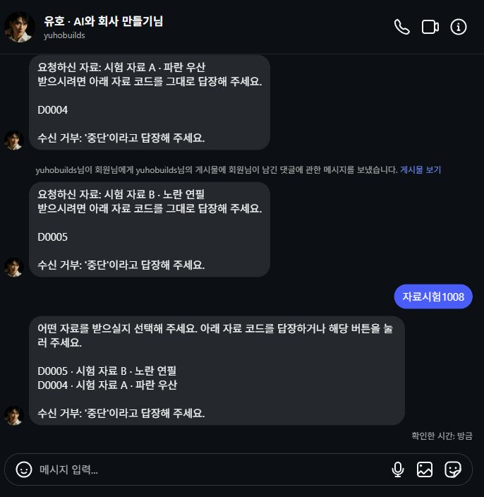
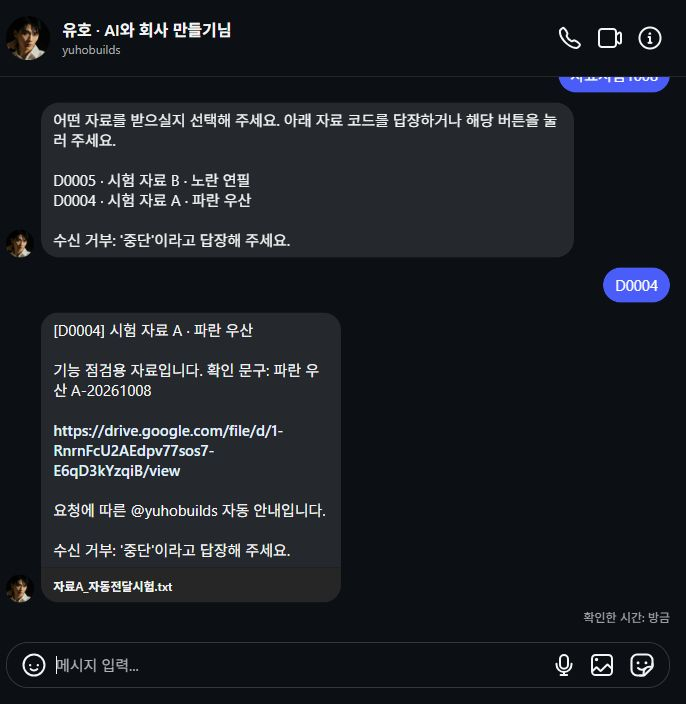
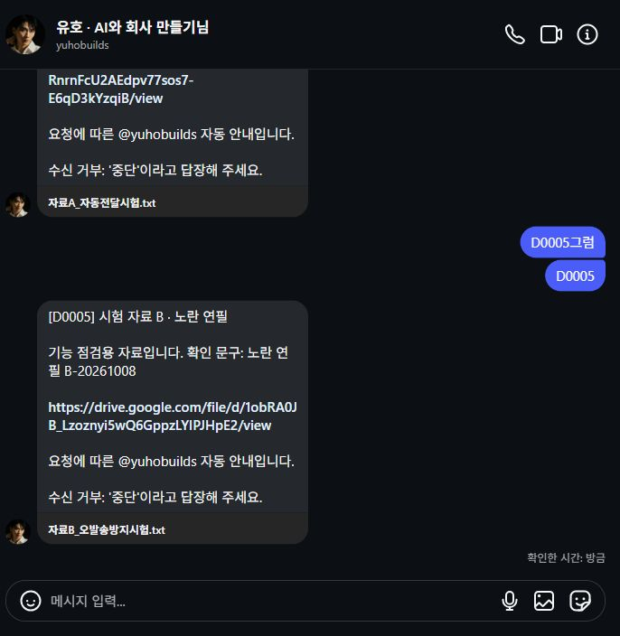
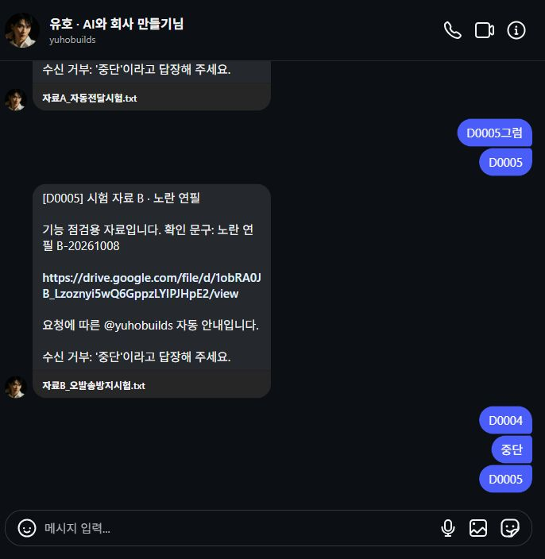
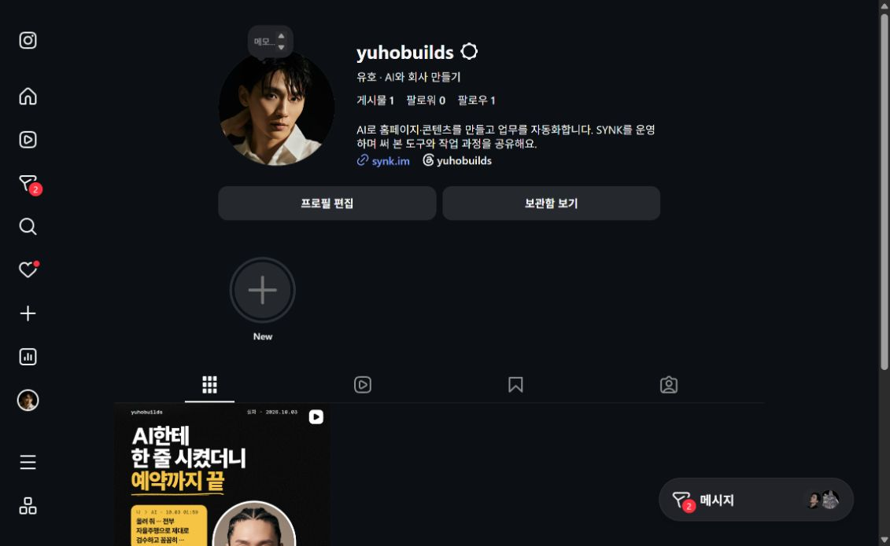

# 게시물별 Drive 자료 전달 실제 시험

2026-10-09 00:07–00:18 KST, 승인된 공개 시험과 정리를 완료했다.

00:20 자동 동기화는 SQL 성공·HTTP200·오류0으로 정상 회복했다. 00:23 최종 조회는 발송11·과거 unknown2·억제11·운영 캠페인1·대기/암호문0이다. 공유 해제 중 00:15 동기화의 자료 검증 오류2건은 그대로 기록하며, 과거 unknown 경보를 새 시험의 실패나 완전 해소로 바꾸지 않는다.

| 항목 | 실제 결과 |
|---|---|
| 댓글 | @1101yuh가 @yuhobuilds 시험 A·B에 `자료시험1008` 각각 1개 |
| 첫 안내 | A=`D0004`, B=`D0005`로 구분해 각 1통 수신 |
| 모호한 답장 | `자료시험1008` 답장에 A·B 선택 안내 1통 수신 |
| 자료 선택 | `D0004`에는 파란 우산 A 파일, `D0005`에는 노란 연필 B 파일 링크 각각 1통 수신 |
| 중복·중단 | A 중복 요청, `중단`, 중단 후 B 재요청 뒤 추가 발송 0. 서버에서 시험 세션 2개 수신 거부 확인 |
| 전체 발송 | 정확히 5통, 모두 HTTP200·큐 시도1회, 처리 후 대기·잔여 암호문0 |
| 정리 | 시험 캠페인2개 OFF, 기존 수신 거부3행 원복, 파일2개 공유 해제·비공개 보관, 게시물2개 보관 |
| 기존 운영 | D0003 원래 릴스·계정 한도·과거 발송과 unknown2 유지. 종료 후 프로필 게시물1개·API 미디어1개 확인 |

웹 Instagram에는 자료 선택 버튼이 표시되지 않아 실제 시험은 코드 답장으로 했다. 버튼 경로는 별도 로컬 시험 결과와 구분한다. 무시된 답장의 본문별 웹훅 수신 기록은 저장하지 않으므로, 중복·중단 뒤 검증은 실제 UI 송신·수신 거부 상태·추가 발송0 관측 근거다. 수백 개 게시물의 합성 검증을 이번 두 게시물의 실수신 결과로 확대하지 않는다.

자료 등록 중 `drive.file` 범위로 읽을 수 없는 외부 앱 생성 manifest 문제를 발견했다. 권한을 넓히지 않고 서버와 같은 OAuth 앱으로 비공개 manifest를 만드는 업로더를 추가해 실제 본문 읽기까지 검증했다. [운영 방법](../../../../SYNK-talk/docs/synkbrief_DM.md), [서버 증거](../../../../SYNK-talk/qa/synkbrief-drive-20261008/instagram-e2e-verification.json), [자료 등록 양식](../댓글DM_자료등록양식.txt)을 따른다.

## 수신 및 정리 화면

파일 공유 해제는 [A](공유해제_A.png)·[B](공유해제_B.png)와 Drive 권한 조회에서 소유자 unmet23@gmail.com만 남은 것으로 확인했다. 시험 파일과 게시물은 삭제하지 않고 비공개 보관했다.
