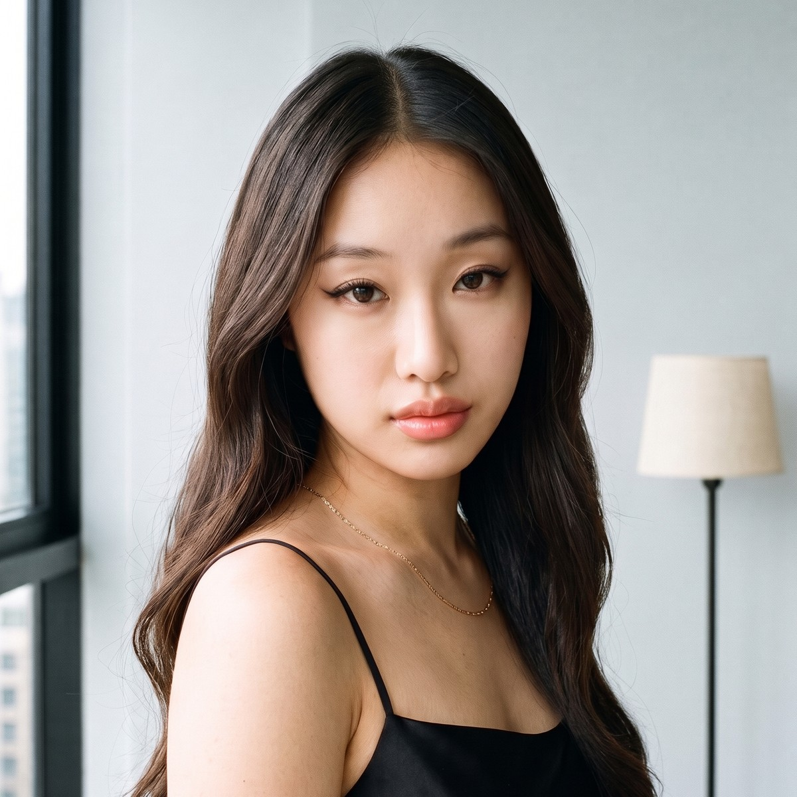
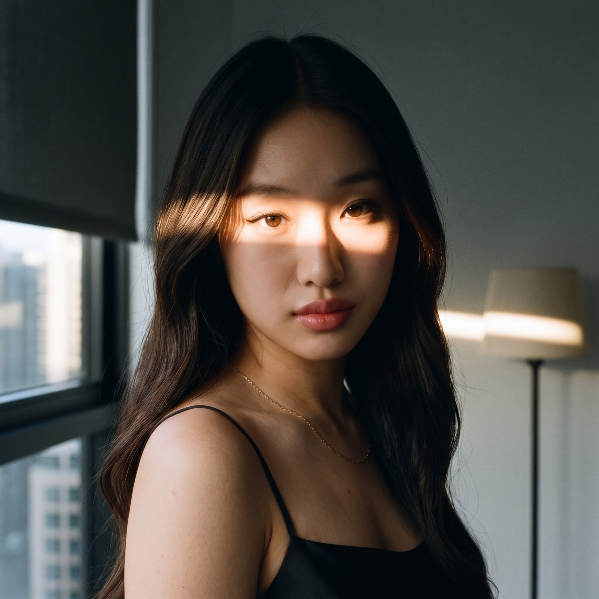
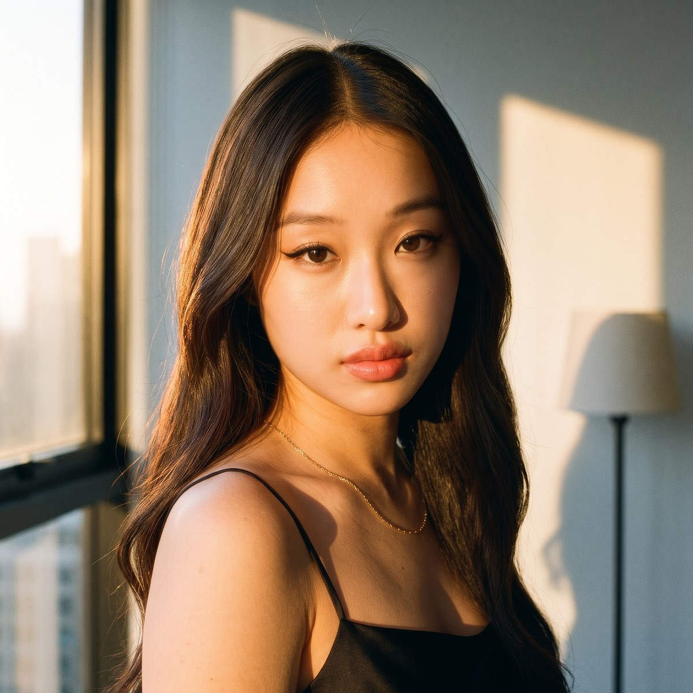
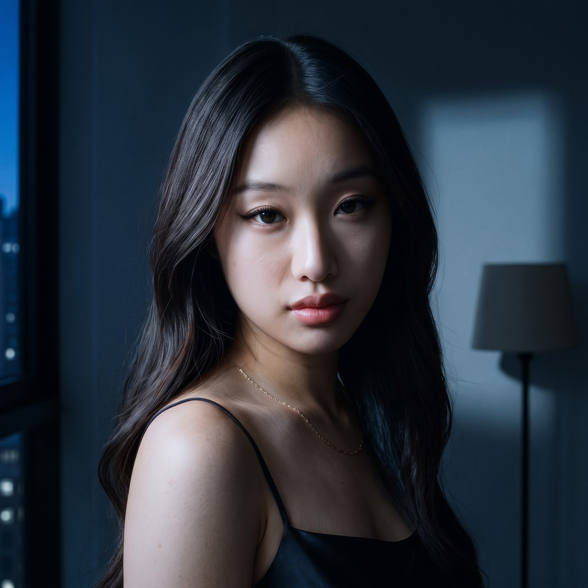
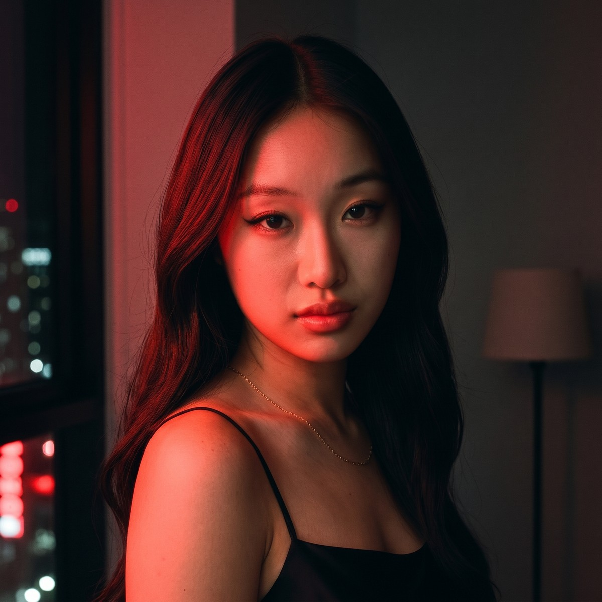
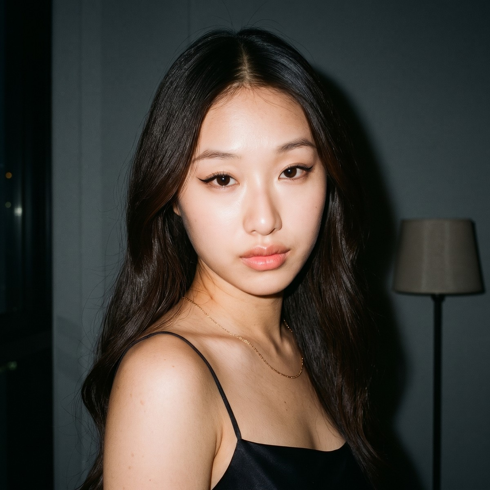

# 빛 견본 — 유나, 같은 방에서 빛만 바꾼 여섯 장

> 2026-11-13. 패션 필름 · 향수 · 뷰티 편의 빛을 정할 때, 손님 방향 제안에서 「이 빛으로 갑니다」를 그림으로 보일 때 꺼내 쓴다 — 유호님 11-13 「패션필름같은거하면 지금 이 경험이 도움이 되지않을까 생각해」. 빛 이름은 [빛 이름 표](../빛이름.json)의 이름 그대로이고, 장마다 그 빛을 세운 문장은 [빛문장.json](빛문장.json)에 있다.

PULSE 모델 유나(F01)를 같은 방 · 같은 자세 · 같은 옷에 두고 빛만 바꿔 구웠다. Gemini 웹(카본 · 사고 수준 높음), 정사각, 후보정 없음.

| | 그림 | 빛 이름 | 보이는 것 | 얼굴 좌우 차이 | 눈가림 심사(5 · 6회차) |
|---|---|---|---|---|---|
| **A** |  | 밝은 창빛 High key + Window light | 통유리로 드는 밝고 부드러운 낮빛. 방 전체가 환하고 그림자가 옅다. | 0.35 | 6.5 · 6.5 — 둘 다 그대로 냄 |
| **B** |  | 블라인드 틈 햇살 한 줄 Hard light + Window light(로 키) | 내린 블라인드 틈으로 든 낮은 해 한 줄이 눈을 가로지른다. 나머지는 그늘. | 0.63 | 8 그대로 냄 · 7.5 고쳐서 냄 |
| **C** |  | 해 질 녘 직사광 Golden hour + Hard light | 낮고 따뜻한 해가 창으로 곧게 든다. 얼굴에 금빛과 또렷한 그림자, 벽에 햇빛 조각. | 0.43 | 7 고쳐서 냄 · 7.5 그대로 냄 |
| **D** |  | 달빛 Low key + Moonlight | 한밤, 창으로 든 차고 푸른 빛이 옆에서 비춘다. 먼 쪽 얼굴과 방은 어둠, 벽에 창 모양의 빛. | 0.86 | 7 그대로 냄 · 7 고쳐서 냄 |
| **E** |  | 네온 한 색(붉은) Neon light + Monochrome red | 거리의 붉은 네온이 얼굴 한쪽을 물들이고 반대쪽은 어둠. 다른 색의 빛은 없다. | 0.55 | 7.5 · 8 — 둘 다 그대로 냄 |
| **F** |  | 정면 플래시 Hard light (direct flash) | 카메라에서 터뜨린 센 빛. 얼굴이 또렷하게 뜨고 방은 어둠으로 떨어진다. | 0.13 | 8 · 7 — 둘 다 그대로 냄 |

얼굴 좌우 차이는 얼굴 왼쪽 반과 오른쪽 반의 밝기 차다. 작을수록 앞에서 고르게 비춘 빛이고, 1에 가까우면 얼굴의 반만 밝다([빛 이름 표](../빛이름.json) 「잣대뜻」).

## 유호님 판정

아직 없다. [보기 쪽](https://claude.ai/artifact/LmVa4mxzVGMyUpBsWSBYSN)에서 고르시면 여기와 [빛문장.json](빛문장.json)의 `유호님판정`에 말씀 그대로 적고, 고르신 빛을 [참고 카드](../../../../참고카드/카드/2026-11-07_조명34_빛이름.md)의 기본값 가설에 올린다. 심사의 고름 예측은 [고르심 장부](../../../../_ops/고르심기록.jsonl) 묶음 `빛견본-유나-R6-20261113`에 먼저 적어 두었다.

## 꺼내 쓰는 법

1. 컷표 장면의 `빛이름`에 위 표의 이름을 적는다(옆빛이면 빛 문장에 키 빛이 오는 쪽도).
2. 그 빛의 시작 그림을 구울 때 [빛문장.json](빛문장.json)에서 그 장의 `빛문장`을 뼈대로 쓴다. 방 · 사람 대목은 그 편의 것으로 바꾼다.
3. 한 사람을 같은 자리에 두고 빛만 바꿔 여러 장이 필요하면, 바탕 한 장을 먼저 굽고 나머지는 「Recreate Image 5 exactly … CHANGE ONLY THE LIGHT, and nothing else」 꼴로 굽는다. 빛 낱말만 바꾼 새 지시문은 얼굴 크기와 구도까지 끌고 간다([현장 노트 · Gemini 사진](../../../../현장노트/gemini_사진.md)).
4. 손님 방향 제안에는 그림만 가져간다. 심사 점수와 아래 「알고 쓸 것」은 우리 쪽 기록이다.

## 알고 쓸 것

- **여섯 장 모두 대표 사진과 얼굴이 조금 다르다.** 아랫얼굴이 갸름하고 눈꼬리가 올라가 있으며 입을 살짝 내민 꼴이다. 빛이 아니라 바탕 장에서 온 차이라 여섯 장 사이에서는 한결같다. 대표 사진을 바로 옆에 붙여 보일 때만 드러난다.
- **구도는 어깨 너머로 돌아보는 3/4 가슴 위 컷이다.** 캐스팅북이 유나의 장점으로 적은 「카메라를 곧게 보는 클로즈업」이 아니다.
- **왼쪽 창의 폭이 장마다 다르다.** A · D · F는 창틀이 가로 10%쯤에서 끝나고, E 17% · C 18% · B 19%(B는 롤 블라인드가 더해짐). 나란히 놓으면 잘 안 띄고 한 장씩 넘겨 보면 보인다.
- 장마다: B 콧등이 하얗게 날아가고 눈동자가 호박색으로 뜸 · C 스탠드 갓 왼쪽 위에 볕이 걸치고 정수리에 볕 받은 잔머리 · D 이마에 잔 살결이 올라옴 · E 얼굴 먼 쪽 그늘이 살짝 잿빛 · F 목걸이 한쪽 가닥이 머리 옆에서 끊겨 보이고 표정이 굳음.
- **한 회차의 심사 판정으로 다시 굽지 않는다.** 같은 그림을 같은 질문지로 두 번 물었을 때 아홉 장 가운데 다섯 장의 판정(그대로 냄 ↔ 고쳐서 냄)이 바뀌었다. 점수는 ±1 안에서 흔들렸다.
- **고쳐 굽기가 첫 벌을 넘지 못할 수 있다.** 해 질 녘은 네 번을 더 구웠는데 마지막 심사가 고른 것은 맨 처음 벌(C)이었다.

## 이 방식으로 서지 않은 빛

햇살 역광(Rim light + Bounce light) · 켜진 스탠드 + 푸른 저녁(Practical light + Blue hour) · 천장 핀 조명 · 등 뒤 불빛. 까닭은 [빛 이름 표](../빛이름.json)의 그 이름 「조심」과 [참고 카드](../../../../참고카드/카드/2026-11-07_조명34_빛이름.md) 「견본 굽기 실측」에 있다. 방과 자세를 그 빛에 맞게 새로 짜면 설 수 있다 — 이 견본의 방(왼쪽 끝 창 · 오른쪽 뒤 스탠드)에서만 서지 않았다.

## 든 것

- 2026-11-11 ~ 11-13. 판을 다섯 번 다시 짰고, 마지막 정사각 판에서만 굽기 40번(받은 것 36장 · 실패 4번) · 눈가림 심사 여섯 번(Fable 5.2 하위 에이전트, 한 번에 25분 · 30만 토큰쯤).
- 취향을 한 번 여쭙는 견본에 비해 많이 들었다. 다음에는 첫 판에서 고르심을 받고, 고르신 빛만 다듬는다.
- 원본(2048px)과 굽기 목록 · 심사 기록은 git 밖 `synk-vendor/light-samples-20261111/`(`받음/` · `jobs.json` · `맹검/`)에 있다. 여기 그림은 1200px 사본이다.
