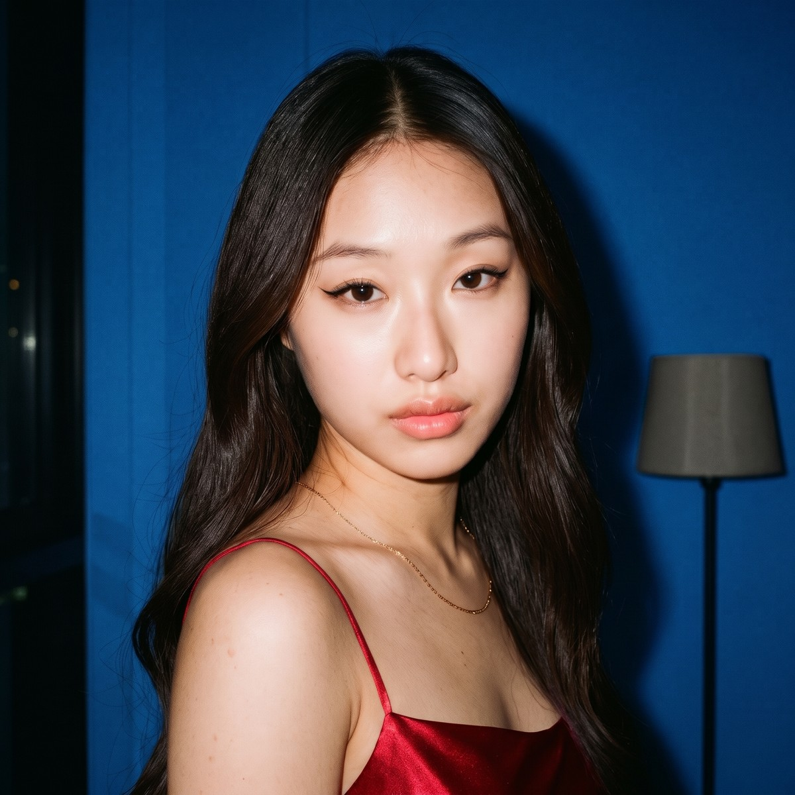

# 색감 견본 — 유나, 같은 방에서 색감 넷

> 2026-11-19. 편 기획에서 [색감 이름 표](../색감이름.json)의 넷 가운데 하나를 고를 때, 손님 방향 제안에서 「이 색감으로 갑니다」를 그림으로 보일 때 꺼내 쓴다 — 유호님 11-19 「견본 만들어줘」.

PULSE 모델 유나(F01)를 [빛 견본](../빛견본_유나_20261113/README.md)과 같은 방 · 같은 자세에 두었다. 색감마다 어울리는 빛 견본 한 장을 바탕으로 넣고, 지시문의 GRADE 줄에 그 색감의 「뼈대」를 글자 그대로 넣어 구웠다. Gemini 웹(카본 · 사고 수준 높음), 정사각, 후보정 없음.

| | 그림 | 바탕 빛 | 보이는 것 |
|---|---|---|---|
| **아련** |  | C 해 질 녘 직사광 | 검정이 우유처럼 뜨고 대비가 낮다. 밝은 곳은 살구색, 그늘은 옅은 청록이다. 햇빛 조각이 번진다. |
| **맑음** |  | A 밝은 창빛 | 실제 색 그대로 밝고 깨끗하다. 바탕 장과 거의 같다 — 바탕 낮빛이 이미 맑음의 결이다. |
| **시네마** |  | B 블라인드 틈 햇살 한 줄 | 방은 깊은 그늘이고 눈을 가로지르는 호박빛 한 줄만 밝다. 바탕 장보다 검정이 더 내려갔다. |
| **팝** |  | F 정면 플래시 | 플래시의 단단한 그림자, 빨간 새틴 옷과 코발트 파란 벽 두 색이다. |

값(검정 · 밝음 · 대비 · 채도 · 따뜻함 · 나눔)은 그림 아래와 [값.json](값.json)에 있다. 재는 법은 [색감 이름 표](../색감이름.json) 「잣대뜻」이다.

## 알고 쓸 것

- **색감 줄만 바꾸면 맑음 · 팝은 거의 안 바뀐다.** 첫 판은 밝은 창빛 한 장에 「CHANGE ONLY THE COLOUR GRADE」로 넷을 구웠다([같은빛_나란히.jpg](같은빛_나란히.jpg)). 아련은 검정이 뜨고(1.7 → 9.8) 시네마는 어두워졌지만, 맑음 · 팝은 바탕과 값이 거의 같았다(팝 채도 8.5 → 8.7). 흰 벽 · 검은 옷 방에는 색감이 키울 색이 없다. 그래서 둘째 판은 색감마다 어울빛을 바탕으로 쓰고, 팝은 옷 · 벽 색까지 정했다(채도 21.1).
- 그러니 편에서는 색감을 고를 때 어울빛과 옷 · 소품 · 벽 색을 같이 정한다. GRADE 줄 하나로 색감이 서지 않는다.
- 아련의 바탕(해 질 녘 직사광)은 「Hard light」를 품어 검사가 어긋빛 주의를 낸다. 시티팝 사진은 센 해를 확산 필터로 번지게 한 것이 많아 이 견본에서는 그대로 두었다.
- 시네마는 바탕 장(B)이 이미 깊은 영화 결이라 둘의 차이가 작다. 콧등의 밝은 점도 남았다.
- 팝은 플래시라 얼굴이 평평하고 스탠드 갓이 어두워졌다. 원색을 셋 넘게 쓰면 싸 보인다는 「조심」대로 두 색에서 멈췄다.
- 얼굴 생김새의 한계(대표 사진보다 갸름한 아랫얼굴 · 올라간 눈꼬리)는 빛 견본 바탕 장에서 온 것이라 네 장 모두 같다.

## 유호님 판정

아직 없다. 고르시거나 말씀하시면 여기와 [색감 이름 표](../색감이름.json)에 말씀 그대로 적는다. Claude의 예측은 [고르심 장부](../../../../_ops/고르심기록.jsonl) 묶음 `색감견본-유나-20261119`에 먼저 적었다.

## 든 것

- 2026-11-19 00:10 ~ 02:13. 굽기 일곱 번(첫 판 넷 · 둘째 판 셋, 첫 판 맑음은 한 번 다시)이었다. 둘째 판 둘은 실행기가 늦게 그려진 그림을 글 답으로 보고 끊어 대화 주소로 회수했다([현장 노트](../../../../현장노트/gemini_사진.md) 11-19 절).
- 원본(2048px)과 굽기 목록 · 지시문은 git 밖 `synk-vendor/look-samples-20261119/`(`받음/` · `jobs.json` · `지시문/`)에 있다. 여기 그림은 1200px 사본이다.
