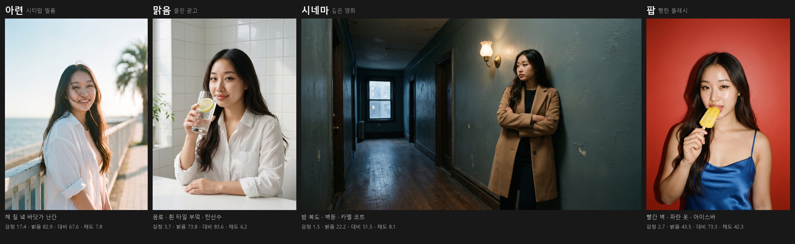
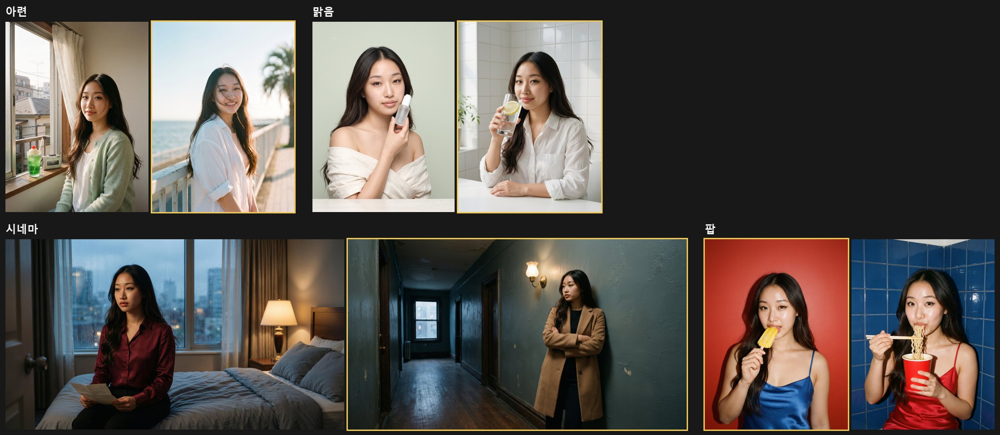

# 색감 견본 — 유나, 색감 넷

> 2026-11-19. 편 기획에서 [색감 이름 표](../색감이름.json)의 넷 가운데 하나를 고를 때, 손님 방향 제안에서 「이 색감으로 갑니다」를 그림으로 보일 때 꺼내 쓴다 — 유호님 11-19 「견본 만들어줘」.

지금 견본은 다섯째 판이다 — 넷째 판 지시문을 그대로 두고 엔진만 Seedream 5.5로 구웠다. 유호님 11-19 「앞으로 영상제작할때 시드림을 고정하자. 제미나이는 빼자」로 영상 제작의 그림 엔진이 Seedream 5.5로 고정됐다(결정 11-19 · 제작 규칙 순서 4).

## 다섯째 판 — 같은 지시문, 엔진만 Seedream 5.5 (11-19)

넷째 판에 유호님 「아직 아련 빼고 부족해 … 뭔가 획기적인 다른 방법이 필요할것같은데」. 드리미나 unmet23 CLI(`--model seedream_5.5 --mode i2i --resolution 2K`)로 유나 대표 사진 넷을 참고로 넣었고 장당 9크레딧이다(열 장 90크레딧). 같은 굽기를 `tools/시드림그림.py`로 옮겼다.

- 맑음 · 시네마 · 팝: [엔진비교_맑음시네마팝.jpg](엔진비교_맑음시네마팝.jpg) — 줄마다 왼쪽이 Gemini, 오른쪽 둘이 Seedream. 유호님 「시드림 s2 시네마 1,2 둘다 좋다. 굿굿」, 「전체적으로 확실히 시드림이 좋네」(만족 사례 S59).
- 아련: [엔진비교_아련.jpg](엔진비교_아련.jpg) — 유호님 「아련바다 1,2 아련창가 1,2 둘다 너무 좋네」(만족 사례 S60). Claude 예측(창가 1)은 맞았다.
- 견본 넷(1_아련 · 2_맑음 · 3_시네마 · 4_팝)은 Seedream 판 가운데 첫째 장이다. 맑음 · 팝은 「전체적으로」 말씀 안에 들지만 한 장씩 따로 고르시지는 않았다.

## 넷째 판

넷째 판([넷째판_나란히.jpg](넷째판_나란히.jpg))은 아래와 같다. PULSE 모델 유나(F01)의 대표 사진 넷만 참고로 넣고, 색감마다 그 색감이 쓰이는 장면을 새로 지었다. 지시문은 [인기 자료 조사](../색감_인기자료조사_20261119.md)대로 항목별로 썼다. 첫 문장에 필름 · 카메라, 이어서 장면 · 순간 · 옷과 색 · 카메라 숫자 · 빛(광원 · 방향 · 그림자) · GRADE(색감 뼈대 그대로) · 피부결 순서다. Gemini 웹(카본 · 사고 수준 높음), 후보정 없음.

| | 두 벌 | 맹검이 고른 쪽 |
|---|---|---|
| **아련** | K14 80년대 도쿄 아파트 창가(크림소다 · 카세트) · K15 해 질 녘 바닷가 난간 | K15 |
| **맑음** | K16 스킨케어(세이지 벽 · 클램셸 조명 · 세럼 병) · K17 음료(흰 타일 부엌 · 탄산수) | K17 |
| **시네마** | K18 비 온 뒤 호텔 방(켜진 스탠드 · 창밖 블루아워 · 편지) · K19 밤 복도(벽등 · 카멜 코트), 둘 다 16:9 | K19 |
| **팝** | K20 빨간 벽 · 파란 옷 · 노란 아이스바 · K21 파란 타일 · 빨간 옷 · 컵라면 | K20 |

값(검정 · 밝음 · 대비 · 채도 · 따뜻함 · 나눔)은 [값.json](값.json)에 있다.

## 유호님 판정

- 둘째 판(같은 방 · 빛만 맞춤): 「팝은 좋아보이는데 나머지는 좀 퀄리티가 떨어져보이네」([둘째판_나란히.jpg](둘째판_나란히.jpg)). 팝만 옷 · 벽 색을 정했었다.
- 셋째 판(같은 방 · 옷 · 벽 색까지 정함): 「아련,팝은 괜찮은데 아직 뭔가 느낌이 좀 부족하네」([셋째판_나란히.jpg](셋째판_나란히.jpg) · [셋째판_두벌.jpg](셋째판_두벌.jpg)). 이어서 「인터넷에 제대로 조사해서 … 적용」을 말씀하셔서 조사하고 넷째 판을 지었다.
- 넷째 판: 「아직 아련 빼고 부족해. 흠 . . 뭔가 획기적인 다른 방법이 필요할것같은데 아마 또 시켜도 비슷할것같은데」(고르심 장부 `색감견본4-유나-20261119` — 맹검 K15 맞힘, Claude K20 빗나감).
- 다섯째 판(Seedream): 「시드림 s2 시네마 1,2 둘다 좋다. 굿굿」, 「전체적으로 확실히 시드림이 좋네」, 「아련바다 1,2 아련창가 1,2 둘다 너무 좋네」, 「앞으로 영상제작할때 시드림을 고정하자. 제미나이는 빼자」.

## 알고 쓸 것

- **판마다 바뀐 것.** 첫 판은 밝은 창빛 한 장에 색감 줄만 바꿔 맑음 · 팝이 바탕과 거의 같았다([같은빛_나란히.jpg](같은빛_나란히.jpg)). 둘째 판은 빛을, 셋째 판은 옷 · 벽 색을 더 맞췄다. 넷째 판은 같은 방 · 같은 자세를 버리고 장면 · 순간 · 카메라까지 새로 지었다.
- **맹검(카본)은 넷째 판 여덟 장 가운데 여섯 장을 기각했다.** 이 눈은 셋째 판에서 유호님이 좋다고 하신 팝도 3점으로 기각했다. 그래서 고름은 참고로만 쓰고 판정은 유호님 눈으로 한다. 맹검이 짚은 흠 가운데 확인할 것은 이렇다. K14 창틀 위 소품 둘이 억지로 놓인 느낌, K18 스탠드와 반대쪽에서 오는 따뜻한 빛, K21 젓가락이 면을 들지 않고 얹혀만 있는 모양, K16 무지 벽 앞 정면의 평평한 빛이다.
- **얼굴 닮음(SFace)은 0.42~0.65다.** 유나 대표 사진 넷끼리 잰 값(0.41~0.66) 안에 든다. 가장 낮은 K15(0.42) · K18(0.47)은 셋째 판 팝(0.49)과 비슷하다.
- 아련 K15는 검정이 17.4로 떠 있다. 시티팝 필름의 우유 같은 검정이다. 시네마 둘은 16:9로 구웠다(조사의 「넓은 화면비」).

## 든 것

- 2026-11-19 00:10 ~ 06:15. 굽기 스물한 번(첫 판 넷 · 둘째 판 셋 · 셋째 판 여섯 · 넷째 판 여덟)이었고, 맹검 두 번(카본), 조사 하위 에이전트 셋을 썼다.
- 둘째 판 둘은 실행기가 늦게 그려진 그림을 글 답으로 보고 끊어 대화 주소로 회수했다([현장 노트](../../../../현장노트/gemini_사진.md) 11-19 절).
- 원본과 굽기 목록 · 지시문은 git 밖 `synk-vendor/look-samples-20261119/`(`받음/` · `jobs.json` · `지시문/K1~K21.txt`)에 있다. 여기 그림은 사본이다. 맹검 기록은 공용 작업본 `.tmp/미학맹검/색감견본3-20261119/` · `색감견본4-20261119/`에 있다.
