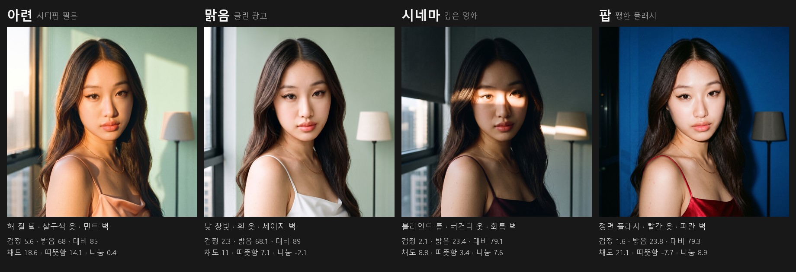

# 색감 견본 — 유나, 같은 방에서 색감 넷

> 2026-11-19. 편 기획에서 [색감 이름 표](../색감이름.json)의 넷 가운데 하나를 고를 때, 손님 방향 제안에서 「이 색감으로 갑니다」를 그림으로 보일 때 꺼내 쓴다 — 유호님 11-19 「견본 만들어줘」.

PULSE 모델 유나(F01)를 [빛 견본](../빛견본_유나_20261113/README.md)과 같은 방 · 같은 자세에 두었다. 색감마다 어울리는 빛 견본 한 장을 바탕으로 넣고 세 가지를 바꿨다. 지시문의 GRADE 줄에는 그 색감의 「뼈대」를 글자 그대로 넣었고, 옷 색과 벽 색은 그 색감의 「세트」로 정했다. Gemini 웹(카본 · 사고 수준 높음), 정사각, 후보정 없음.

| | 그림 | 빛 · 세트 | 보이는 것 |
|---|---|---|---|
| **아련** |  | 해 질 녘 직사광 · 살구색 옷 · 민트 벽 | 낮은 해가 얼굴과 벽에 금빛 조각을 남긴다. 살구색과 민트의 파스텔 두 색이다. |
| **맑음** |  | 밝은 창빛 · 흰 옷 · 세이지 초록 벽 | 실제 색 그대로 밝고 깨끗하다. 흰 옷이 차분한 초록 벽에서 떨어진다. |
| **시네마** |  | 블라인드 틈 햇살 한 줄 · 버건디 옷 · 짙은 회록 벽 | 방은 깊은 그늘이고 눈을 가로지르는 호박빛 한 줄만 밝다. |
| **팝** |  | 정면 플래시 · 빨간 새틴 옷 · 코발트 파란 벽 | 플래시의 단단한 그림자와 원색 두 개다. |

값(검정 · 밝음 · 대비 · 채도 · 따뜻함 · 나눔)은 그림 아래와 [값.json](값.json)에 있다. 재는 법은 [색감 이름 표](../색감이름.json) 「잣대뜻」이다.

## 유호님 판정

- 11-19 둘째 판을 보시고 「팝은 좋아보이는데 나머지는 좀 퀄리티가 떨어져보이네」([둘째판_나란히.jpg](둘째판_나란히.jpg)). 둘째 판의 아련 · 맑음 · 시네마는 흰 · 회색 벽과 검은 옷 방을 그대로 두고 빛과 색감 줄만 바꾼 것이었다. 팝만 옷 · 벽 색을 정했다. 그래서 셋을 옷 · 벽 색까지 짜서 다시 구웠다(위 표 — 셋째 판).
- 셋째 판에 대한 판정은 아직 없다. 심사와 Claude의 예측은 [고르심 장부](../../../../_ops/고르심기록.jsonl) 묶음 `색감견본3-유나-20261119`에 먼저 적었다.

## 알고 쓸 것

- **색감은 GRADE 줄 하나로 서지 않는다. 빛과 세트 색을 같이 정한다.** 첫 판은 밝은 창빛 한 장에 색감 줄만 바꿨는데 맑음 · 팝이 바탕과 거의 같았다([같은빛_나란히.jpg](같은빛_나란히.jpg)). 둘째 판은 빛만 맞췄고 셋이 싸 보였다. 셋째 판은 빛과 옷 · 벽 색을 모두 정했다.
- **셋째 판은 색감마다 세트를 두 벌 구워 맹검(카본)으로 골랐다**([셋째판_두벌.jpg](셋째판_두벌.jpg), 노란 테가 고른 것). 아련은 크림 · 연보라 분홍보다 살구 · 민트를, 맑음은 하늘색보다 세이지를, 시네마는 남색 · 호두색보다 버건디 · 회록을 골랐다. 호두색 벽은 갈색 머리 · 따뜻한 빛과 한 계열로 뭉개진다는 까닭이었다.
- **맹검은 유호님이 좋다고 하신 팝을 기각했다(3점).** 정면 플래시를 「평평한 빛」(슬롭 점검표 60)으로 읽었다. 그래서 60번 줄에 「팝의 정면 플래시는 이 줄로 치지 않는다」를 적었다. 이 견본에서는 맹검이 유호님 눈을 대신하지 못한다.
- 맹검은 일곱 장 모두에 「모공 없는 매끈한 피부」와 「화면 가운데 정면 응시」를 짚었다. 둘 다 빛 견본 바탕 장의 자세와 얼굴에서 온 것이라 색감 비교에서는 그대로 두었다. 실제 편에서는 그 편의 구도와 얼굴로 다시 굽는다.
- 아련은 해 질 녘 직사광(Hard light)을 품어 검사가 어긋빛 주의를 낸다. 둘째 판 아련은 검정이 23.7까지 떠서 화면 전체가 탁했다. 셋째 판은 5.6이다.
- 시네마는 여전히 넷 가운데 가장 어둡다(밝음 23.4). 휴대폰에서는 더 어두워 보이니 실제 편에서는 얼굴을 화면에서 가장 밝은 쪽에 둔다.

## 든 것

- 2026-11-19 00:10 ~ 04:05. 굽기 열세 번(첫 판 넷 · 둘째 판 셋 · 셋째 판 여섯)이었고 맹검 한 번(카본, 대화 둘)을 했다. 둘째 판 둘은 실행기가 늦게 그려진 그림을 글 답으로 보고 끊어 대화 주소로 회수했다([현장 노트](../../../../현장노트/gemini_사진.md) 11-19 절).
- 원본(2048px)과 굽기 목록 · 지시문은 git 밖 `synk-vendor/look-samples-20261119/`(`받음/` · `jobs.json` · `지시문/`)에 있다. 여기 그림은 1200px 사본이다. 맹검 기록은 공용 작업본 `.tmp/미학맹검/색감견본3-20261119/`에 있다.
