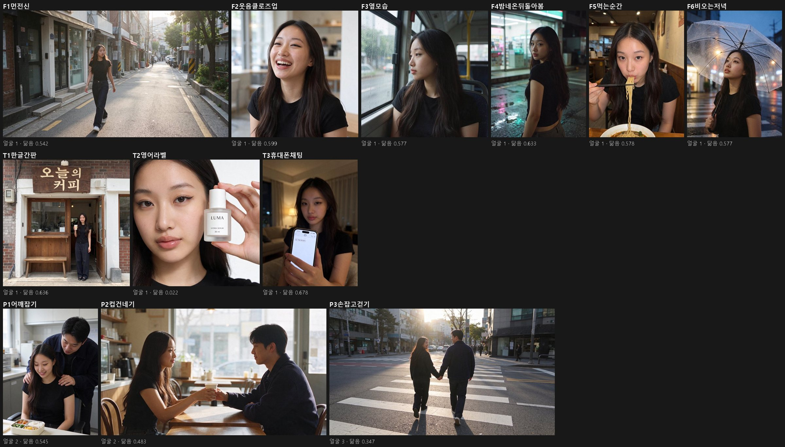

# Seedream 5.5 약점 시험 — 얼굴 · 글자 · 두 사람 (2026-11-19)

> 영상 제작 그림 엔진을 Seedream 5.5로 정한 뒤(결정 11-19), 유호님 「그럼 지금 테스트해보는게 더 좋을것같은데」로 아직 재 보지 않은 셋을 시험했다. 다음에 Seedream이 막힐 때 먼저 여기와 견준다.

**결론: 셋 모두 통과했다.** 한 사람의 얼굴이 여섯 상황에서 같게 나왔고, 한글 · 영어 글자가 정확했으며, 두 사람이 닿는 동작도 손가락까지 자연스러웠다. 새로 찾은 흠은 하나다. 지시문에 옷을 적지 않으면 참고 사진의 옷(검은 반소매 티)이 모든 장에 따라온다.

| 갈래 | 장면 | 결과 |
|---|---|---|
| 얼굴 | 먼 전신 · 웃는 클로즈업 · 버스 옆모습 · 밤 네온 뒤돌아봄 · 국수 먹는 순간 · 비 오는 저녁 | 유나 대표 사진 넷과의 닮음(SFace) 0.54~0.63. 대표 사진끼리 잰 값(0.41~0.66) 안이고, 눈으로도 같은 사람이다. |
| 글자 | 한글 간판 「오늘의 커피」 · 영어 라벨 LUMA / HYDRA SERUM / 30 ml · 휴대폰 한글 말풍선 「지금 어디야?」 | 셋 다 글자가 정확하고 또렷하다([확대](확대_글자_손.jpg)). 라벨 장의 닮음 0.02는 얼굴이 화면 끝에서 잘려 잴 수 없었던 것이다. |
| 두 사람 | 뒤에서 두 손으로 어깨 잡기 · 테이블 너머 컵 건네기 · 손잡고 횡단보도 걷기 | 셋 다 됐다. 어깨 잡기는 「Still」 7번에서 네 번 실패(errorCode 20110)했던 구도인데 이번에는 한 번에 나왔다. 손가락 다섯, 컵을 함께 쥔 손이 자연스럽다. |

## 알고 쓸 것

- **옷은 늘 적는다.** 참고 사진 넷이 모두 검은 반소매 티라, 옷을 적지 않은 열두 장 모두 그 옷을 입었다. 지시문 틀의 WARDROBE AND PALETTE 줄을 빼지 않는다.
- **시안은 1K로 굽는다.** 유호님 11-19 「이런 시안때는 2k로 쓸 필요 전혀 없어. 크레딧 아껴」. 1K는 한 장 최대 6크레딧이고 이 시험 열두 장이 72크레딧 안쪽이었다. 영상에 쓸 시작 그림만 2K(9크레딧)로 굽는다 — `tools/시드림그림.py --해상도 1K`.
- 두 사람 장의 남자는 참고 없이 글로만 그렸다. 실제 편에서 둘째 배역도 얼굴이 이어져야 하면 그 배역의 참고 사진을 함께 넣는다(이번에는 재지 않음).

## 든 것

- 드리미나 unmet23 CLI · Seedream 5.5 · 1K · 한 장씩 열두 장. 지시문과 원본은 git 밖 `synk-vendor/seedream-test-20261119/`(`지시문/` · `받음/` · `판정판.py`).
