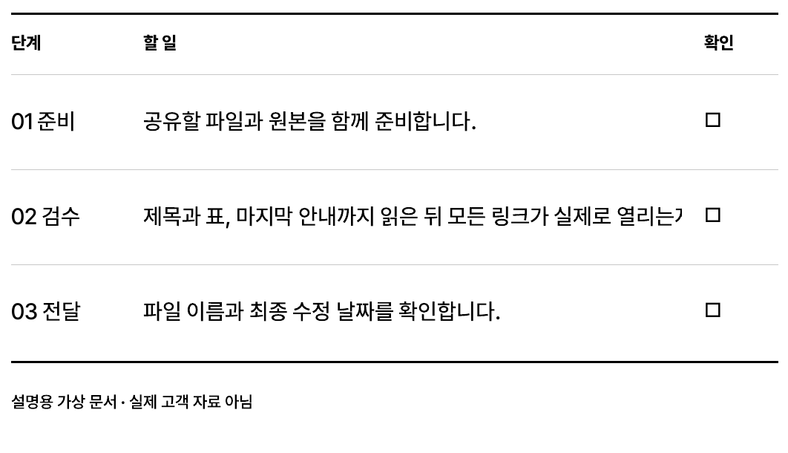
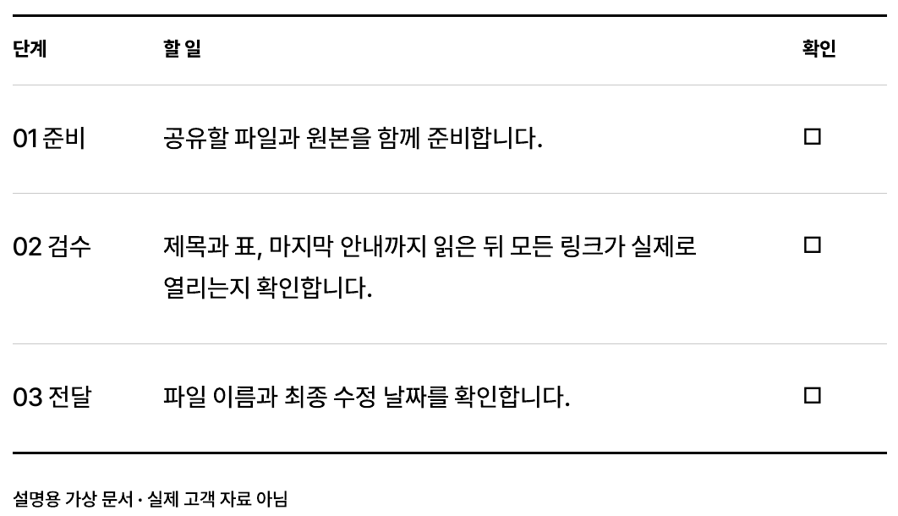
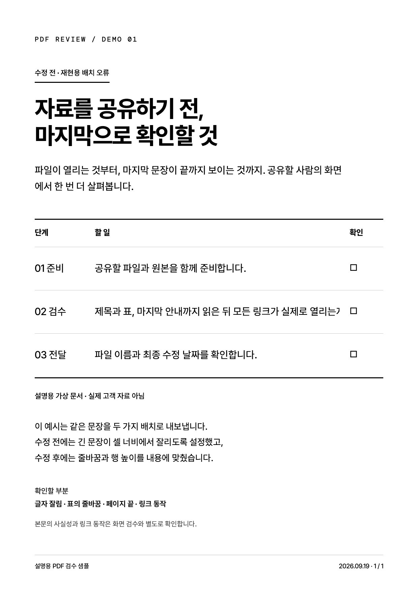
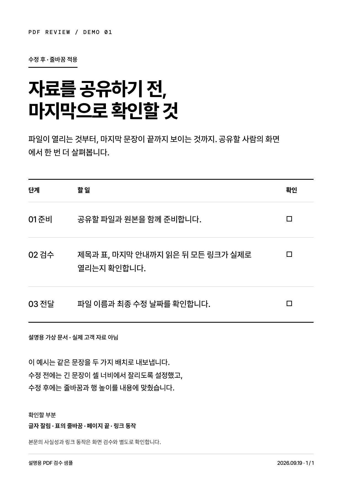

# AI가 만든 PDF, 보내기 전에 확인하는 법

AI가 문서를 다 만들었다고 해서 파일을 보냈는데, 나중에 표 안의 글자가 잘린 걸 발견하면 난감하죠. PDF가 생성됐다는 것과 제대로 읽힌다는 것은 각각 확인해야 합니다.

이번에는 설명을 위한 가상 안내문으로 그 과정을 직접 만들어 봤습니다. 긴 문장이 표 안에서 잘리도록 설정한 뒤, PDF로 저장하고, 실제 페이지를 확인하고, 줄바꿈을 고쳐 다시 저장했습니다. 아래 수정 전 화면은 실제 업무에서 우연히 생긴 오류가 아니라 검수 방법을 보여주기 위한 재현 예시입니다.



02 검수 행을 보면 마지막 문장이 끝까지 보이지 않습니다. 파일은 정상적으로 만들어졌지만 읽는 사람에게 필요한 안내가 잘렸습니다.



줄바꿈을 허용하고 행이 내용만큼 늘어나도록 수정했습니다. 글자를 무작정 작게 만들지 않아도 마지막 문장까지 읽을 수 있습니다.

### 이번에 사용한 도구

**Playwright**는 Microsoft가 GitHub에 공개한 브라우저 자동화 도구입니다. 이번에는 HTML 문서를 브라우저로 열고 PDF로 저장하는 데 사용했습니다. PDF 출력에는 인쇄용 CSS가 적용되므로, 브라우저에서 본 화면과 저장한 PDF를 따로 확인하는 것이 좋습니다. [공식 GitHub](https://github.com/microsoft/playwright) · [PDF 출력 API](https://playwright.dev/docs/api/class-page#page-pdf)

저장된 PDF를 페이지별 이미지로 펼치는 데는 **Poppler의 `pdftoppm`**을 사용했습니다. Playwright가 PDF를 저장하고, PDF 렌더러가 그 결과를 이미지로 보여주는 구성입니다. 이미지로 펼치는 대신 PDF 뷰어에서 모든 페이지를 직접 열어봐도 이번 검수의 목적은 같습니다.

도구가 알아서 문서의 완성도를 보장하는 것은 아닙니다. 우리는 만들어진 화면을 보고, 원본을 고치고, 다시 내보냅니다.

### 1. 확인할 문서와 실행 환경을 준비합니다

이 방법은 AI와 함께 안내문·보고서·자료집을 HTML로 만들고 PDF로 전달할 때 어울립니다. 기존 Word 파일을 편집하는 글은 아닙니다.

직접 명령을 실행하려면 Node.js와 Playwright, Chromium 계열 브라우저가 필요합니다. Playwright가 아직 없다면 빈 작업 폴더에서 아래 명령으로 라이브러리와 브라우저를 준비할 수 있습니다. 기존 프로젝트라면 이미 설치된 도구를 먼저 확인하세요. [공식 라이브러리 설치 안내](https://playwright.dev/docs/library)

```sh
npm install --save-dev playwright
npx playwright install chromium
```

이번 시연은 Windows에 이미 준비된 Playwright 1.62.1과 Chrome을 사용했습니다. 새 컴퓨터에서 설치부터 반복 검증한 사례는 아닙니다.

### 2. HTML 원본을 PDF로 저장합니다

AI에게 문서를 만들게 할 때 아래 요청을 함께 전달해 보세요.

> 이 안내문을 A4 PDF로 만들어 줘. HTML 원본도 남겨 줘. Playwright의 Chromium으로 PDF를 저장하고, 저장한 PDF를 모든 페이지가 보이도록 렌더해서 확인해 줘. 표 안의 긴 문장, 제목, 페이지 끝에서 잘리거나 겹치는 부분이 있으면 원본을 고친 뒤 다시 내보내 줘. 실제로 확인하지 못한 부분은 따로 알려 줘.

직접 실행하는 경우에는 `document.html`과 같은 폴더에 아래 내용을 `export.cjs`로 저장합니다. 이것은 로컬 HTML을 내보내는 최소 예시이고, 위 시연의 브랜드 서체·지면 전체를 재현하는 코드는 아닙니다.

```js
const { chromium } = require('playwright');
const { pathToFileURL } = require('node:url');
const path = require('node:path');

(async () => {
  const browser = await chromium.launch();
  try {
    const page = await browser.newPage();
    await page.goto(pathToFileURL(path.resolve('document.html')).href);
    await page.evaluate(() => document.fonts.ready);
    await page.pdf({
      path: 'document.pdf',
      format: 'A4',
      printBackground: true,
      preferCSSPageSize: true,
    });
  } finally {
    await browser.close();
  }
})();
```

실행 명령은 `node export.cjs`입니다. HTML에 `@page` 크기를 따로 정했다면 위 코드의 `preferCSSPageSize` 설정에 따라 그 크기가 우선합니다. PDF의 인쇄 스타일과 용지를 의도한 대로 지정하세요. [설정별 공식 설명](https://playwright.dev/docs/api/class-page#page-pdf)

### 3. 저장된 PDF를 실제로 봅니다

PDF 뷰어에서 첫 페이지부터 마지막 페이지까지 엽니다. 이미 Poppler가 설치되어 있다면 다음 명령으로 모든 페이지를 PNG로 펼칠 수도 있습니다.

```sh
pdftoppm -r 150 -png document.pdf page
```

생성된 페이지 이미지는 페이지 순서대로 확인합니다. 글자만 추출하거나 “파일 생성 성공” 메시지만 보는 것으로 이 단계를 대신하지 않습니다.

이번 예시에서는 `02 검수` 행의 긴 문장 끝이 잘렸습니다. 화면을 크게 보니 어디가 끊기는지 바로 확인할 수 있었습니다.



### 4. 원본을 고친 뒤 PDF도 다시 저장합니다

이 예시는 긴 문장을 한 줄로 고정한 설정이 원인이었습니다. 해당 셀의 `white-space: nowrap`을 해제하고, 아래처럼 내용에 맞게 줄이 바뀌도록 수정했습니다.

```css
.bodycopy {
  white-space: normal;
  word-break: keep-all;
  overflow-wrap: anywhere;
}
```

행 높이를 작게 고정한 문서라면 그것도 함께 조정해야 합니다. 원본 HTML만 수정하고 예전 PDF를 보내지 않도록, 같은 방법으로 PDF를 다시 저장합니다.

### 5. 수정한 PDF의 마지막 페이지까지 다시 봅니다

줄바꿈을 고치면 표가 더 높아지고, 아래 문단이나 페이지 나눔도 달라질 수 있습니다. 고친 셀만 확인하고 끝내지 말고 제목·표·페이지 끝을 다시 확인합니다.

이번 수정본은 한 페이지로 저장됐고, 표의 문장 끝과 하단 안내·쪽번호까지 화면에서 확인했습니다. 텍스트 추출로도 수정한 문장이 끝까지 들어 있는지 함께 확인했습니다.



화면 검수는 문서에 적힌 사실이나 링크의 작동까지 보장하지는 않습니다. 숫자·출처·링크는 해당 내용에 맞춰 따로 확인해야 합니다.

다음에 AI에게 PDF를 부탁할 때는 이 문장을 추가해 보세요.

> PDF로 저장한 뒤, 모든 페이지를 열어 보고 잘린 부분까지 고쳐 줘.

SYNK SHIFT에서는 AI로 만든 결과를 실제 작업에 쓸 수 있게 다듬는 과정을 기록합니다. 이번 글에서는 설명용 문서로 PDF 저장과 검수 과정을 보여드렸습니다.

### 참고한 공개 자료

- [Playwright GitHub](https://github.com/microsoft/playwright)
- [Playwright 라이브러리 설치](https://playwright.dev/docs/library)
- [Playwright PDF 출력](https://playwright.dev/docs/api/class-page#page-pdf)
- [Playwright 라이선스: Apache 2.0](https://github.com/microsoft/playwright/blob/main/LICENSE)

확인·시연일: 2026년 9월 19일. 이 글은 새로 출시됐다는 뉴스나 업무 시간 절감 실험이 아닙니다.

---
