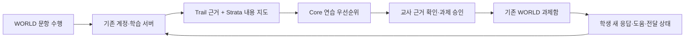

# 아틀라스 구현 명세 — 만드는 순서·계약·인수 기준

> 2026-09-19 · 구현 작업을 위한 문서다. 현재 작업 주체는 §0을 따른다. 구조와 이유는 [아틀라스 설계](아틀라스_설계.md)가 정본이다. 이 문서는 그 설계를 **어떤 작업 묶음으로 나눠 만들지, 만들 때 무엇을 지켜야 하는지, 무엇이 되면 끝난 것인지**로 옮겨 적는다.
> 표시: **[확인]** = 2026-09-18~19에 코드·계약 원문에서 직접 확인한 사실 · **[제안]** = 이 설계의 제안이며, 만들기 전에 실제 코드와 대조해 고친다 · **[사용자]** = 사용자 확인 없이는 진행하지 않는 항목.

## 0. 먼저 읽을 것

**2026-10-02 작업 주체 확정:** 제작·개발에서 사용할 엔진은 현재 GPT·Claude가 공식 하네스에서 선택한다. 이 명세는 담당 엔진의 계약과 연결을 돕는 자료다. 별도 Atlas 자동 선택기·작업 지휘기·LLM 중계를 구현 과제로 추가하지 않는다. 제품 안의 기존 학습 판단·기록·반응과 공통 세션/어댑터는 유지하며 [정의와 역할 경계](아틀라스_설계.md#atlas-engine-ownership)를 따른다.

**2026-10-02 책임 정리:** [Atlas는 기존 8개 엔진의 총칭](아틀라스_설계.md#atlas-engine-ownership)이다. 이 명세는 연결 계약·작업 순서를 다루며, 기능 설계와 구현은 [담당 엔진의 원문·코드](엔진8종_상향설계_v3.md#engine-owner-sources)에서 발전시킨다. `atlas/engine.js`의 이해·선택 계산은 Core, 사건을 받아 연결하는 API는 공통 세션 입구이며 연습 사건 검증은 Trail에 위임한다. 아래 과거 버전·예정 필드는 현행 코드와 대조한다. 새 기능을 하나의 상위 판단 모듈에 모으는 개발 지시는 폐기한다.

**2026-10-02 개인화 런타임 연결:** `atlas-2.2.0`의 듣기·읽기 15개 학습 항목, 능력·언어 난도별 관측·추천을 미니게임과 talk 맞춤 읽기에서 사용한다. 공통 원본은 `atlas/{learning,game-learning,trail,vellum}.js`, 생성 경로는 `tools/build-game-learning.js`와 `tools/sync-atlas.js --consumer talk`다. 후속 [계정 동기화 코드·합성 검증](SYNK_공통계정_구현검증_20261002.md), [Town FT10 로컬 생활 장면](../experiences/synk-town/README.md), [8종 검토](엔진8종_상향설계_v3.md#engine-review-20261002)를 함께 확인한다. [학습 소비 범위 §9](미니게임_TOPIK_I_학습기준.md#9-실제-개인화-연결--2026-10-02-후속-구현)는 첫 감사 §5~8보다 최신이다. 운영 설정·배포·실계정 기기 간 복원·Town 학습 권한 연결은 별도 남은 일이다. 도움 방식 전용 API에 수행 기록을 섞지 않는다.

**2026-10-01 교육 연습 공통 기능(로컬):** 공통 세션 모듈 `atlas-2.1.0`에 Strata 지도, Core 문항 진단(`atlas/education.js`), Vellum 도움 정책(`atlas/vellum.js`: 결과 화면에서 바로 열 것·막힌 순간 권하기), Trail 연습 기록(`atlas/trail.js`: 처음 보는 문항 판단·저장 기록·성장 사실), Temper 집계(`atlas/temper.js`: 학습 항목·비교 회차별)를 연결했다. 게임 전면 재개발(10-01 사용자)로 G4 연결은 걷었고, 새 게임은 [교육 업그레이드 기록 §2](아틀라스_교육업그레이드_20260930.md#2-새-게임이-엔진을-쓰는-법)의 순서로 쓴다. 기기 간 기록 동기화·실학생 학습효과·운영 배포는 완료하지 않았다. 아래 2.0.0 표는 과거 기준선이며 전체 WP 완료를 뜻하지 않는다.

**2026-09-21 첫 지속 기억 구현·검증:** 기존 c16 기록과 공통 Atlas 변환을 G1 편지 연습·G4 서류 관문에 연결했다. 도움 방식의 저장·복원·정정·기본 안내 복귀와 사용자가 선택한 두 콘텐츠 간 한 번 가져오기를 구현했다. 관련 로컬 시험, 실제 리허설 PostgreSQL의 범위·중복·격리·잠금·롤백 검증, PC 브라우저의 실제 G4 합성 화면 검증을 완료했으며 사용자는 Android 브라우저에서 열림과 편한 조작을 확인했다. 합성 미리보기는 계정 저장을 사용하지 않으며, 운영 배포와 실제 계정으로 두 기기에 기억을 이어 쓰는 검증은 아직 남아 있다. 최신 범위·계약·검증·남은 항목은 [첫 연결 구현 기록](아틀라스_첫지속기억_20260921.md)에 둔다. 아래 전체 WP가 완료됐다는 뜻은 아니다.

**2026-09-20 범위 갱신:** [온라인 학습자·약 20개국 동시 출시 방향](온라인학습자_20개국_확장방향_20260920.md)을 먼저 대조한다. 온라인 공개 가입·지속 기억·소통·공통 16인 마을·원가 통제가 우선이며, 아래 WP/PW 목록은 이 확장 범위의 전체 구현 계획으로 아직 재편되지 않았다. 오프라인 관리 설계와 기존 개인정보 경계는 유지한다. 언어·국가 기본값을 몽골로 고정하지 않는다.

**2026-09-21 개발 방식 확정:** 콘텐츠 요청 → 담당 Atlas 엔진과 기존 공통 능력 확인 → 필요한 공통 기능 발전 → 콘텐츠 어댑터 적용 → 실제 경험 확인 → 다음 콘텐츠 재사용 순서로 진행한다. [구조 정본 §1-1](아틀라스_설계.md#1-1-콘텐츠를-만들며-공통-엔진을-발전시키는-개발-방식)과 아래 §9-1을 따른다. 이번 변경은 준비 기준이며 코드·계약 판·DB·소비처 동기화를 실행한 것이 아니다. 아래 09-19 상태·시험 수·사본 경로는 당시 기록이므로 구현에 들어갈 때 다시 확인한다.

1. [아틀라스 설계](아틀라스_설계.md) §2(한눈에)·§3(자동 맞춤의 범위)·§10(경계).
2. 이 문서 §1(이어받을 시제품)과 §9(작업 묶음).
3. 맡은 작업 묶음의 절.

**작업하는 곳.** 아래는 09-19의 작업본·분기 기록이며 현재 경로나 worktree 사용 의무가 아니다. 현재 작업 위치와 다른 변경을 먼저 확인하고 보존한다. 격리가 필요하면 현재 앱의 공식 worktree 기능을 사용하며, 구체 작업 방식은 [AI 운영 원칙](AI_운영원칙.md)을 따른다.

| 저장소 | 공용 작업본의 상태(09-19) | 당시 작업 안내·사본 |
|---|---|---|
| SYNK-appsscript | 공유 master. `docs/Loom_자산/구움/` 등 추적되지 않는 파일이 많다. 아틀라스 설계와 시제품은 `7f9ef1a01`부터 커밋돼 있다 | 이 저장소에서 커밋할 때는 자기 파일만 골라서 커밋한다 |
| SYNK-talk | 커밋되지 않은 변경이 많다(deliver·companion·L0 스키마 등). 로컬 master가 원격보다 3커밋 앞서고 21커밋 뒤처져 있다 | `C:/Users/q1212/Documents/SYNK-worktrees/atlas2-talk-20260918` · 브랜치 `claude/atlas2-20260918` ← 원격 master `9f723d6` |
| SYNK-website | 브랜치 `codex/company-conversations`에서 다른 세션이 작업 중이다. 원격보다 31커밋 이상 앞서 있다 | `C:/Users/q1212/Documents/SYNK-worktrees/atlas2-website-20260918` · 브랜치 `claude/atlas2-20260918` ← 로컬 `fdc76a1` |

**하지 않는 것 [사용자].** 운영·리허설 DB에 DB 조각 적용, Edge Function 배포, 홈페이지 게시, 앱 빌드·출시, 계약 버전 올리기의 병합, 동의 문구 변경은 사용자가 요청했을 때만 한다. 자격증명과 학생 식별 정보는 출력하지 않는다([AI 운영 원칙](AI_운영원칙.md)).

## 1. 이어받을 시제품

공통 세션 모듈 버전 2와 편지 경험 연결은 시제품으로 만들어져 있다 **[확인]**. 버리고 새로 만들어도 되지만, 아래 시험이 지키는 성질은 인수 기준이므로 유지한다.

| 항목 | 파일 | 상태 |
|---|---|---|
| 공통 세션 모듈 | appsscript `atlas/engine.js` (`atlas-2.0.0`) | 순수 모듈. 커밋 `7f9ef1a01` |
| 편지 어댑터 | appsscript `atlas/experiences.js` — `modesFor`·`leversFor`·`guidance`·`aboutYou`·`notice` | 같은 커밋 |
| 공통 세션 모듈 시험 | appsscript `tests/atlas.test.js` 12개(첫 버전의 동작) · `tests/atlas-loop.test.js` 14개(버전 2) | 26개 통과 |
| 앱 연결 | talk 사본 `lib/atlas-session.js`·`src/아틀라스게임.js`·`src/교수멘탈화면.js`·`tests/atlas-session.test.js`·`tests/교수멘탈화면.test.js`·`docs/P0_제품계약.md`(§6-3 개정 표시) | 관련 19개 통과. 전체 3,499개 중 3,497개 통과. 실패 1개는 기존 강사 매뉴얼 원본 누락이고, 할 일 1개가 있다. 커밋 `971a7e9`(push 전) |
| 웹 연결 | website 사본 `dist/try/letter/{atlas-ui.js,app.js,views.js,atlas.css,atlas/*}`·`qa/atlas.test.mjs` | `qa` 12개·`npm run check` 72개 통과. 로컬 브라우저에서 3회차에 습관이 잡히고, 4회차에 반영되고, 「아니에요」를 누른 뒤 원래대로 돌아오는 것을 확인했다. 커밋 `7042286`(push·게시 전) |

<a id="1-1-본체-계약-atlas-200"></a>
### 1-1. Core 판단·공통 세션 계약 (`atlas-2.0.0`)

모든 이벤트에 공통으로 들어가는 값: `schema:1`·`id`·`scope{domain,workspace,subject}`·`at`·`recordedAt`. 이벤트 종류:

| 이벤트 | 핵심 칸 | 연결 규칙 |
|---|---|---|
| `context.set` | `field`(goal·time·support·audio)·`value`·`until` | 최신 선언이 만료되거나 제외돼도 이전 선언을 되살리지 않는다 |
| `decision.made` | `experienceId`·`variant`·`policy`·`evidence`·`arm`·`round`·`seed`·`explore`·`bundle`·`candidateSnapshot`·`leverSnapshot` | `policy`는 알려진 버전(`atlas-1.0.0`·`atlas-2.0.0`)이어야 한다 |
| `experience.completed` | `decisionId`·`experienceId`·`variant` | 같은 범위의 실제 판단에 연결한다 |
| `feedback.given` | `completionId`·`value`(helpful·too_much·want_more·not_fit) | 같은 범위의 실제 완료에 연결한다. 최신 답을 쓴다. 참고 기간은 30일이다 |
| `signal.observed` | `kind`(need·due·trait)·`key`·`strength`0~1·`n`·`assisted`·`until`·`refs` | 어댑터가 요약한 값이다. 원문과 식별자는 넣지 않는다. 종류·키별로 최신 하나만 쓴다 |
| `estimate.responded` | `line`·`value`(yes·no·unsure) | 이해 항목별로 최신 하나만 쓴다 |
| `outcome.observed` | `decisionId`·`measure`·`window`·`value`0~1 또는 `null`+`reason`·`assisted` | 같은 범위의 실제 판단에 연결한다. 값과 사유 중 정확히 하나만 있어야 한다 |
| `record.excluded` | `targetId` | 제외 이벤트 자체는 제외할 수 없다 |

`understand()` → `context`·`evidence`·`expired`·`feedback`·`excluded`·`lines`·`outcomes`·`rounds`.
`decide({events,scope,at,recordedAt,experienceId,candidates,levers,explore})` → 첫 버전의 항목(`selected`·`support`·`focus`·`reasons`·`evidence`·`alternatives`·`outcomeBasis`)에 `arm`·`round`·`seed`·`explore`·`bundle{손잡이:{option,basis,reasons,evidence}}`가 더해진다.
세션: `set`·`observe`·`respond`·`plan(experienceId,candidates,{levers})`·`complete`·`feedback`·`outcome`·`exclude`·`clear`·`state`·`lines`·`events`. `choice(plan, 손잡이, 기본값)`은 판단이 없으면 기본값을 돌려준다.

### 1-2. 시험이 지키는 성질 (인수 기준)

1. 한 번 본 것(`thin`)은 본인이 확인하기 전에는 결정을 바꾸지 않는다.
2. 「아니에요」라고 답하면 `trait`은 본인이 답을 바꿀 때까지 쓰지 않는다. `need`·`due`는 그 뒤에 새 관측이 들어왔을 때만 다시 쓴다. 원래 관측 기록은 남는다.
3. 본인이 직접 정한 설정은 관측·학습·비교 회차보다 우선한다.
4. 모양 조절 항목은 효과가 있던 방식을 유지하고, 「안 맞았어요」가 두 번이면 덜 써 본 방식으로 바꾼다. 좋았던 이력이 있는 방식은 바꾸기까지 더 걸린다. 「많았어요」는 도움 방식이 안 맞는다는 판단으로 쓰지 않는다. 미응답은 불이익이 아니다. 30일이 지난 응답은 반영하지 않는다.
5. 혼자 해낸 성공(값 0.8 이상)이 있으면 그 연습할 항목의 비중을 반으로 낮춘다. 도움받은 성공과 값 없음은 비중을 낮추지 않는다. 더 새로운 관측이 들어오면 새 관측을 따른다.
6. 아는 것이 없으면 내용은 회차마다 돌아가며 나오고, 복습할 때가 된 것은 연달아 나올 수 있다.
7. 비교 회차: 기본 회차는 관측·응답·학습한 비중을 쓰지 않고, 실제로 쓴 근거만 인용한다. 본인 설정은 지킨다. 같은 회차 안에서 설정을 바꿔도 맞춤 회차와 기본 회차가 뒤바뀌지 않는다. 확률이 0.1이면 400회 중 20~60회가 기본 회차다. 어댑터가 요청하지 않으면 0이다.
8. 이벤트와 시각이 같으면 같은 `arm`·`seed`·`bundle`이 나온다.
9. 관측은 만료된다. 최신 관측이 만료돼도 이전 관측이 되살아나지 않는다.
10. PULSE 범위는 관측·확인·결과 이벤트를 거절하고 비교 회차가 0이다.
11. 평가(`judgment`)는 조절 항목의 종류로 등록할 수 없다. 내용 조절 항목은 무작위 학습을 켤 수 없다. 조절 항목 하나가 막혀도 경험 전체가 막히지 않는다.
12. 어댑터의 이유 문장은 판단과 일치한다. 한두 번 본 것은 「~한 적이 있습니다」로, 세 번 이상 본 것은 「~하는 일이 많았습니다」로 말한다. 문장이 없는 키는 사람에게 보여 주지 않는다.

변이 점검 9종(기본 회차가 관측을 씀 · 「아니에요」 무시 · 도움받은 성공을 혼자 해낸 성공으로 계산 · 본인 설정이 학습에 밀림 · 한 번 본 것을 바로 씀 · 기본 회차가 응답을 씀 · 설정 변경으로 맞춤 회차와 기본 회차가 뒤바뀜 · PULSE가 관측을 받음 · 평가를 조절 항목으로 등록)은 공통 세션 모듈를 고칠 때마다 다시 돌려서, 시험이 이 오류들을 잡아내는지 확인한다.

### 1-3. 시제품의 한계 — 이대로는 제품이 아니다

- 편지 어댑터의 `need:honorific`·`need:letter.*` 키는 **임시로 넣어 둔 값**이다. 실제 원천은 §3-2의 오류 태그 키다.
- 앱에서는 로그아웃하면 기억이 비워지므로 습관이 세 번 쌓이기 어렵고, 비교 회차도 꺼 두었다. §2·§3이 구현돼야 의미가 생긴다.
- 앱 G1의 점검은 다섯 칸(인사·사과·이유·요청·맺음)이고 웹은 세 항목(purpose·tone·clarity)이다. 앱에서 「무엇을 먼저 볼지」를 다섯 칸에 어떻게 대응시킬지는 정하지 않았다 **[사용자]**.

<a id="1-4-본체에-더할-것--한곳에-모음"></a>
### 1-4. 발전 과제의 담당 엔진

아래는 2026-09-19 시제품(`atlas-2.0.0`)에서 제안한 발전 과제를 담당별로 분류한 목록이다. 현재 미구현 목록으로 단정하지 않고 작업할 때 실제 코드와 대조한다. 항목마다 아래 담당 엔진의 [원문·구현 입구](엔진8종_상향설계_v3.md#engine-owner-sources)를 고치며 이 연결 표나 `engine.js` 한 곳에 기능을 전부 모으지 않는다.

| 발전 과제 | 사용처 | 담당 엔진·연결 책임 |
|---|---|---|
| 내용 조절 항목이 상위 여러 개를 고르는 기능(`take`) | §4-1 연습할 항목 2개 | Core — 후보 순위·개수 |
| 순서가 있는 **내용** 조절 항목이 수행 결과에 따라 한 단계씩 움직이는 기능 | §4-1 작업 난이도 | Core — 독립 수행 근거로 연습 난도 조정 |
| 맥락 칸 `chatter`·`motion`·난이도 선호 | §4-2 · §4-1 | Core — 명시 설정 반영; Vellum·Loom — 말·움직임의 실제 적용 |
| `ask`와 새 이벤트 `question.shown` | §4-4 묻기 | Core — 질문 필요 판단; Vellum — 질문/표현; Trail — 실제 노출 이력 |
| 이해 항목의 출처 `estimated`. 확인 전에는 표본이 아무리 많아도 쓰지 않는다 | §3-2 AI의 짐작 | Core — 추정과 본인 확인 분리 |
| 마지막 점검: 변화 한도 · 뒤집힘 억제 · 오래된 이해 요약 · 멈춤 | §6-3 안전장치 | Temper — 검사 기준; Core — 결정 전 한도 적용 |
| 점수 계산에 쓰는 숫자를 인자 `params`로 받기(없으면 지금 값) · 판단 기록에 `params_ver` 남기기 | §6-4 매개변수 자동 조정 | Core — 선택 정책; Temper — 적용 결과 대조 |
| 이해 요약으로 세션 만들기(`kernel_events`)와 정책 버전·지도 버전 받기 | §3-1 · §6-4 | Core — 요약/정책 해석; Trail — 기록 근거; Strata — 지도 판. 복원은 호스트/연결 코드 |
| `ask`의 종류 두 가지 추가: `refresh`(오래된 본인 설정이 아직 맞는지) · `follow_up`(날짜가 지난 일의 안부). 날짜가 있는 일의 이벤트 `event.noted`도 추가한다 | §4-4 | Core — 재확인 필요; Trail — 날짜·전달 이력; Vellum — 안부 적합성/표현 |
| 순서가 있는 **모양** 조절 항목(도움 방식)의 「한 단계 적게」 권유와 한시 설정 | §4-6 | Core — 도움 필요 판단; Vellum — 도움 권유와 표현 |
| 맥락 칸 `condition`(그날 끝에 만료) · `register`(말의 눈높이) · `reach`와 소재 선언 `topic`. 본인이 직접 알려 준 일(`event.noted`의 `source: said`)은 확인 없이 쓰고 기본 회차에서도 지킨다 | §4-7~§4-11 | Core — 현재 명시 조건; Trail — 발생·정정 이력; Vellum — 말의 눈높이 |
| 내용 조절 항목의 「둘 중 하나」 규칙. 준비 기간과 달력의 날에는 연습할 항목 하나를 그 일·그날의 학습 항목에 배정한다 | §4-7 · §4-13 | Core — 후보 배정; Strata — 일정·목표와 학습 항목 연결 |
| 문장 모음에서 고르기. 선택지가 문장 모음의 항목일 때는 학습 항목을 먼저 정하고, 문장 모음의 항목은 중복 방지 기간·단계·시드로 고른다. 자동 채점 결과의 키 `need:node.*`·`due:node.*` | §4-15 · §4-16 | Core — 항목/문장 선택; Strata — 검수된 내용 지도; Trail — 최근 제공 이력 |
| `ask`의 종류 하나 추가: `level_up`(연습 수준을 한 단계 올려 볼지). 윗수준 맛보기 표시 `probe`도 추가한다 | §4-17 | Core — 수준 권유 조건; Strata — 다음 학습 내용; Vellum — 제안. 공식 급수 판정과 구분 |

관련 기능을 바꿀 때 §1-2의 성질·해당 실패 사례와 소비처를 확인한다. 이전 버전의 기록(`atlas-1.0.0`·`atlas-2.0.0`)은 계속 읽을 수 있어야 한다.

## 2. 학습 기록 하나 — 계약 개정

**지킬 것 [확인].** talk C0 §4-1: `POST /v1/events`가 유일한 쓰기 경로이며, 배치로 보내고 멱등이다. 두 번째 쓰기 경로를 만들지 않는다. `intervention.delivered`·`task.assigned`는 **서버 이벤트**다. 앱이 직접 쓰지 못한다(`functions/deliver/index.ts` 머리말). 계약 JSON 정본은 appsscript `계약/수집_교정_계약.json`이고 `tools/계약동기화.js`로 형제 저장소에 맞춘다. 검증기는 talk `lib/이벤트검증.js`이며, 생산자가 있는 이벤트에 소비자가 없으면 래칫이 막는다.

**이미 있는 어휘 [확인].** 현행 이벤트 17종: `submission.created`·`quiz.answered`·`choice.selected`·`correction.responded`·`correction.viewed`·`preference.stated`·`session.abandoned`·`intervention.delivered`·`data_use.granted`·`data_use.revoked`·`task.assigned`·`exam.result`·`content.viewed`·`affect.reported`·`estimate.responded`·`goal.responded`·`observation.noted`. c17 예약분(브랜치 `발전안/20260911`의 `7c79ec8`에 들어 있다): 이벤트 `mascot.touched`·`topic.engaged`·`goal.stated`·`atlas.excluded`·`learner_account.linked`, payload 키 `arm_id`·`loom_ver`·`expected_ver`·`shadow`·`intervention_kind`·`intervention_choice`·`ingested_as_of`·`corrected_value`·`self_explain`·`ai_assist`·`moment_id`·`first_kind`·`seed`·`summary_ver`·`summary_hash` 등.

**대응 [제안].**

| 공통 세션 모듈 이벤트 | 학습 기록에서 대응하는 것 | 새로 필요한 것 |
|---|---|---|
| `context.set` | `preference.stated`(`preference_dimension`·`stated_option`·`stated_via`) · 목표는 `goal.stated` | 차원의 선택지 목록에 시간·도움 방식·소리를 추가한다. 유효 기간의 끝(`until`) 칸 |
| `estimate.responded` | `estimate.responded`(`trait_axis`·`shown_key`·`shown_text`·`response`) + `corrected_value` | `need`·`due` 이해 항목에도 답할 수 있도록 `shown_key`의 범위를 넓힌다 |
| `record.excluded` | `atlas.excluded` | 예약분을 계약에 포함한다 |
| `decision.made` + `experience.completed` | 앱은 **소비 이벤트**(새 어휘 · 제안 이름 `experience.consumed`)만 보낸다. 담는 값은 경험 id·회차·시드·`arm_id`·조절 항목 묶음·비교 회차 확률·정책 버전이다. 서버가 검증한 뒤 `intervention.delivered` v2(`intervention_kind`=atlas)를 쓴다 | 새 이벤트 1 · payload 키(묶음·확률·회차) · companion이 「앱 노출 근거로 서버가 개입을 기록」하는 기존 방식과 같은 모양이다 |
| `feedback.given` | 새 어휘(제안 이름 `experience.responded`): 소비 이벤트의 id·답(helpful·too_much·want_more·not_fit) | 새 이벤트 1 · 선택지 목록 1 |
| 습관(`signal.observed` trait) | 새 어휘(제안 이름 `habit.noticed`): 경험 id·습관 키·회차. 터치 하나하나가 아니라 회차마다 1행을 남긴다 | 새 이벤트 1 · 선택지 목록 1 |
| 알려 준 일(`event.noted`) | 새 어휘(제안 이름 `life_event.stated`): 종류(선택지 목록)·날짜. 글은 없다 | 새 이벤트 1 · 선택지 목록 1 |
| 오늘 컨디션(`context.set condition`) | `affect.reported`(이미 있다. 지금 생산자는 라디오 채팅뿐이다) | 앱 생산자를 추가한다. payload는 실제 코드와 대조한다 |
| 소재 선언 · 말의 눈높이 · 손 내밀기 · 알림 설정 | `preference.stated`의 차원 선택지 목록에 추가한다 | 선택지 목록 |
| 손 내밀기의 권함·받음 · 알림의 예약·열림 | 기존 companion 노출 계약과 c17 예약 키 `ai_assist`를 먼저 확인한다. 알림은 새 어휘가 필요할 수 있다(제안 `notification.planned`·`notification.opened`) | 실제 코드와 대조한 뒤 결정한다 |
| 한글 단계의 문항 응답과 배정 | 응답은 `quiz.answered`(이미 있다)를 먼저 확인한다. 배정은 서버 이벤트 `task.assigned`의 새 과제 유형이다 | payload 대조 · 과제 유형 선택지 목록 |
| `signal.observed` need·due · `outcome.observed` | 새 이벤트를 만들지 않는다. 서버가 학습 기록에서 계산해 이해 요약에 넣는다 | — |

**인수 기준.** ① 계약 JSON·검증기·DDL CHECK·두 저장소 동기화가 한 세트로 함께 통과한다(`tests/계약.test.js`·`계약동기.test.js`). ② 새 이벤트마다 소비자(§3의 이해 요약 계산)가 같은 커밋에 들어간다. ③ 이전 버전 앱이 새 어휘를 보내지 않아도 계속 동작한다(선택지 목록 추가는 하위 호환이다. C0 §6). ④ 첫 실제 입력 전에만 남길 수 있는 값(시드·확률·정책 버전·두 기준 시각)이 빠지지 않는다.

**[사용자]** 버전 올리기(c16→c17+)와 새 어휘 이름, 두 DB에 적용하는 시점, 여러 기기에서 기억을 이어 쓰는 데 새 동의 목적이 필요한지(`contents/문구_동의.js`·`lib/동의게이트.js`를 확인한 뒤 보고한다).

## 3. 이해 요약 하나

### 3-1. 모양 [제안]

`GET /v1/atlas`(조회를 추가한다. C0 §4-3의 조회 묶음에 올린다). 비어 있는 상태는 오류가 아니라 `lines: []` + 200이다(같은 조회 묶음의 규칙 **[확인]**).

```json
{
  "envelope_ver": "envelope-1", "estimator_version": "학습자상태.v15",
  "as_of": "…", "ingested_as_of": "…", "valid_until": "…",
  "explore": 0.1,
  "lines": [
    { "key": "need:tag.honorific.subject", "kind": "need", "source": "observed",
      "strength": 0.62, "n": 7, "assisted": false, "at": "…", "until": "…",
      "status": "unconfirmed", "evidence": ["<event_id>", "…"] }
  ],
  "kernel_events": [ "…최근 30일·최대 200건의 공통 세션 모듈 사건 꼴…" ],
  "outcomes": [ { "decision_ref": "<event_id>", "measure": "independent", "window": "d7", "value": 0.8, "assisted": false } ]
}
```

- `kernel_events`는 학습 기록의 아틀라스 관련 이벤트(§2)를 공통 세션 모듈 이벤트 형식으로 옮긴 것이다. 앱은 이것으로 세션을 만들고(`createSession({events})`), 새로 생긴 이벤트는 기기에서 먼저 반영한 뒤 기존 이벤트 대기열을 통해 학습 기록으로 보낸다. 학습 기록과 공통 세션 모듈 이벤트 사이의 변환은 **순수 모듈 하나**(제안 `lib/아틀라스변환.js`)가 맡고, 서버와 앱이 같이 쓴다.
- 이해 요약에는 원문·음성·이름·학교·반을 넣지 않는다. `evidence`에는 이벤트 id만 넣는다.
- 계산은 순수 함수(제안 `lib/이해봉투.js`)로 만들고 `as_of`·`ingested_as_of`를 필수로 받는다(`lib/학습자상태.js`·`lib/성과회수.js`와 같은 규칙 **[확인]**).

### 3-2. 이해 항목의 원천 [제안]

**원칙: 쓰는 곳이 없는 이해 항목은 만들지 않는다.** 키 하나는 ⓐ 사람에게 보여 줄 문장 ⓑ 그 키를 대상으로 하는 조절 항목 선택지 ⓒ 원천 규칙, 이 셋을 모두 갖춰야 등록한다.

| 종류 | 원천 | 강도·표본 | 비고 |
|---|---|---|---|
| `need:tag.<slug>` | 교정의 오류 태그(최근 30일). **사람이 검수·확정한 교정 = 강한 근거 · 사람 확정 전의 AI 교정 = 약한 근거** | 강도 = 그 태그가 들어 있는 교정 수 ÷ 교정 수 · n = 강한 근거는 1건을 1로, 약한 근거는 1건을 0.5로 계산한 합(설계값 · 내림). 약한 근거만 있을 때는 서로 다른 제출 둘 이상에서 반복해서 나와야 이해 항목이 만들어진다 | **사람의 확정이 없어도 동작한다**(설계 §3). 사람이 나중에 확정하거나 뒤집으면 그 판단이 우선한다. 도움받은 제출은 `assisted:true`다. 「오류없음」은 이해 항목이 아니다. 화면 게이지와 자기 점검은 원천이 아니다 |
| `due:tag.<slug>` | 복습 시기 계산(`lib/복습스케줄.js`·`lib/복습파생.js`) | 강도 = 늦은 정도(0~1 범위로 자른다) · n = 그 항목의 복습 이력 수 | 지금 배달 경로에는 소비자가 없다 **[확인]**. 이 이해 항목이 첫 소비자다 |
| `need:node.<마디>` · `due:node.<마디>` | **자동 채점되는 경험의 정답·오답**(한글 단계 · G2 등)과 그 학습 항목의 복습 간격 | 강도 = 최근 틀린 비율 · n = 문항 수 | 사람의 확정이 필요 없는 강한 근거다. 도움을 받은 문항은 `assisted:true`다. G2 결과 이벤트의 모양은 실제 코드에서 확인해야 한다(§11) |
| `declared:*` | `preference.stated`·`goal.stated`·나침반 | — | 본인이 말한 것이다. 시스템 추천과 섞지 않는다. 생활 소재(`declared:topic.<slug>`, §4-10)도 여기에 속한다 |
| `trait:*` | `habit.noticed` · `학습자상태` 축 중 **사람에게 말할 수 있고 조절 항목이 있는 것만** | 강도 = 요약값 · n = 관측 회차 수 | 처음에는 도움 방식 셋(`prefers.all_checks`·`prefers.one_check`·`prefers.write_first`)과 「언제 잘 되나」(`집중띠` 축)만 등록한다. 성격을 판단하는 키는 등록하지 않는다 |
| `moment:*` | 첫 순간(c17 `moment_id`·`first_kind`) · 자기 이전 기록과의 비교(`성과회수`) | — | 돌아볼 때 쓰는 재료다. 결정에는 쓰지 않고 화면에 보여 주는 부분(§8)에 쓴다 |
| `event:<종류>` | 본인이 직접 알려 준 일, 또는 AI의 짐작을 본인이 확인한 일. 종류는 정해 둔 선택지 목록(시험·면접·발표·여행·행사·마감)에 있는 것뿐이다 | — · 날짜 `on`을 가진다 | 안부를 챙길 때 쓰는 재료다(§4-4 `follow_up` · 설계 §8-1). 이해 항목에는 종류와 날짜만 담고 글은 넣지 않는다. 그날에서 7일이 지나면 만료된다(설계값). 선택지 목록에 없는 일과 민감한 일은 이해 항목으로 만들지 않는다 |
| AI의 짐작(`source: estimated`) | 본인이 쓴 글(일기·대화·작문)을 비식별 처리한 뒤 모델이 읽어 낸 후보 | n = 근거가 된 글의 수 | **본인이 「맞아요」라고 하기 전에는 결정에 쓰지 않는다.** 근거가 된 글의 이벤트 id를 남기고, 외부 모델에 보내는 글의 경계(철학 §3)를 따른다. 확인받을 질문은 §4-4가 고른다. 모델을 바꾸면 같은 글에서 이전 짐작과 새 짐작을 비교한다 |

오류 태그 → 키(계약의 23종 **[확인]** · 슬러그는 **[제안]**):

| 태그 | slug | 태그 | slug |
|---|---|---|---|
| 조사:주격(이/가·은/는) | `particle.subject` | 높임:상대(존댓말 등급) | `honorific.level` |
| 조사:목적격(을/를) | `particle.object` | 어휘:유의어혼동 | `vocab.synonym` |
| 조사:처소(에·에서) | `particle.place` | 어휘:연어(자연스러운 짝) | `vocab.collocation` |
| 조사:여격(에게·한테) | `particle.dative` | 어휘:없는말 | `vocab.nonword` |
| 조사:도구·방향(로/으로) | `particle.direction` | 맞춤법:받침 | `spelling.batchim` |
| 조사:접속(와/과·하고) | `particle.and` | 맞춤법:띄어쓰기 | `spelling.spacing` |
| 조사:기타 | `particle.other` | 맞춤법:기타 | `spelling.other` |
| 어미:시제 | `ending.tense` | 어순 | `word_order` |
| 어미:연결어미 | `ending.connective` | 누락:필수성분 | `omission.required` |
| 어미:불규칙활용 | `ending.irregular` | 중복:불필요 | `redundancy` |
| 어미:종결 | `ending.final` | 화용:공손성 | `pragmatics.politeness` |
| 높임:주체 | `honorific.subject` | 오류없음 | (이해 항목 아님) |

슬러그 표는 계약 JSON 옆 한곳에만 두고, 태그 이름이 바뀌면 시험이 실패하게 한다. 편지 어댑터가 연습 대상으로 삼는 키도 이 슬러그로 바꾼다. 예: `tone` ← `honorific.subject`·`honorific.level`·`pragmatics.politeness`, `purpose`·`clarity` ← `omission.required` 등.

**인수 기준.** ① 합성 학습 기록에서 `as_of`·`ingested_as_of`가 같으면 같은 이해 요약이 나온다. ② 게이지의 판단 결과와 자기 점검은 `need`를 만들지 않는다. 사람 확정 전의 AI 교정 한 건만으로는 이해 항목이 만들어지지 않고, 서로 다른 제출에서 반복해서 나오면 약한 이해 항목으로 만들어진다. 도움받은 제출은 `assisted:true`다. 사람이 뒤집은 교정은 다음 이해 요약에서 빠진다. ③ 제외·철회·「아니에요」가 다음 이해 요약에서 빠지고, 그 전에 시작해 늦게 끝난 계산이 이를 되살리지 못한다. ④ 다른 학생의 값이 섞이지 않는다(`current_learner_id()` 같은 실제 계정 매핑. 엔진 v3 §7 U6). ⑤ 이해 요약 어디에도 원문·이름이 없다.

## 4. 조절 항목 목록

| 경험 | 어디서 정하나 | 조절 항목 | 상태 |
|---|---|---|---|
| **매일 말하기**(하루 한 문장) | **서버의 밤 배치**(`functions/deliver`). 공통 세션 모듈는 순수 모듈이므로 함수에 함께 넣어 같은 코드로 돌린다 | `core.aim`(내용 · 무엇을 연습할 항목으로 삼아 과제를 만들지). 상세는 §4-1 | 미착수. 가장 큰 부분이다. 매일 도는 순환이 여기에 있다 |
| 편지 게임 G1 | 앱 | `mode`(분량) · `core.focus`(먼저 볼 것) · `vellum.checks`(점검 방식 · `support`를 따름 · 배우기 켬) | 시제품 |
| G2~G4 · 대화 | 앱 | 각 경험의 성격에 맞게 정한다. 어댑터에는 ⓐ 받는 맥락 ⓑ 바꿀 수 있는 것 ⓒ 바꾸면 안 되는 것 ⓓ 완료의 뜻과 볼 수 있는 결과 ⓔ 실패했을 때의 기본 경험 ⓕ 「막힘」의 뜻(§4-11)을 적는다 | 미착수 |
| 방·마을(Loom) | 앱 | 지금은 `loom.motion`(잔잔히·보통)만 둔다. 상세는 §4-2. 쌓이는 흔적과 축하 연출의 강도는 앱의 「살아 있는 자리」가 만들어진 뒤에 등록한다. 시간·계절·새 편지는 **사실을 반영하는 것**이지 개인화가 아니다 | 미착수 |
| 소리(Reed) | 앱 | `reed.cues`(켬·조용히). 상세는 §4-2. `audio=off`와 녹음 중 정지는 제약이지 조절 항목이 아니다. 음량은 조절 항목이 아니다 | 미착수 |
| 마스코트의 말(Vellum) | 앱 + 서버 | `vellum.chatter`(보통·조용히)와, 이해 요약의 확인된 이해 항목을 재료로 쓰는 챙겨 주는 말(§4-2·§5). 재료가 없으면 기본 인사를 한다 | 미착수 |

**2026-09-21 어댑터 작성 보강:** 기존 여섯 항목 안에서 사용하는 공통 엔진 기능과 판, 게임이 확인할 사실·소유 상태와 공통 판단의 구분, 실제 표현·결과 기록 경로를 함께 명시한다. NPC의 인지 근거와 최근 반응은 ⓐ, 반응의 방식과 시점은 ⓑ, 모르는 사실을 말하지 않음·개인정보 범위·평가 의미는 ⓒ, 실제 행동 실행과 전달 확인은 ⓓ, 빈 기억·오프라인·실패의 기본 경험은 ⓔ에 대응한다. 화면 표시만으로 물건 사용·학습 성공·보상 지급까지 완료로 기록하지 않는다. 새 필드 이름이나 사건 종류는 여기서 확정한 것이 아니다.

### 4-1. 매일 말하기 — 상세

**지금의 흐름 [확인]** (talk 원격 master `9f723d6`)

- 밤 배치 `functions/deliver`가 학생마다 갈래를 정한다(`lib/갈래판정.js`): 첫날 → 교정문 → 생성 → 전날 → 예비 → 도입폴백. **첫날과 교정문이 생성보다 앞이다.**
- 생성 경로: 오케스트레이터 `functions/deliver/생성모드.ts`가 `학습자상태()` 1회 + `과제요약()`으로 draft(스냅샷·요약·근거)를 굳혀 작업 대기열에 싣고, 워커 `deliver-one`이 모델을 부른다. 오케스트레이터는 모델을 부르지 않으며 150초 안에 학급 전원을 싣는다.
- 프롬프트 `prompts/과제생성.md`의 입력 자리는 **둘뿐**이다: `{{요약}}`(과제요약 산출 — 급수·목표 조각 포함) · `{{기술들}}`(연습할 기술마다 `- <label_ko>` 한 줄).
- 연습 대상은 `lib/기술선택.js`: `engine.skills` 문법 후보를 정렬하고 SHA-256(`learner_id:assign_date`) 회전으로 고른다. 최근 중복창 안에 연습 대상으로 정한 것은 건너뛰고, 안 연습 대상으로 정한 것이 둘 이상이면 2개를 고른다. 후보 0일 때만 `[]`다.
- `lib/실행판.js`가 model·prompt_ver·policy_ver·estimator·schema·taxonomy 여섯 칸을 한 곳에서 조립해 행에 굳힌다. 기술선택 파일의 해시가 판의 재료다.
- 과제 스냅샷은 호흡 둘(② 따라 말하기 = 낭독 · ③ 답하기 = 자유발화, Lv1~2는 골라서 답하기)이고 ① 듣기는 `intervention.delivered.output_text`다.
- 오류 태그 ↔ 기술의 다리는 `lib/태그기술표.js` 하나다. 23개 중 **8쌍만** 잇고 15개는 일부러 「대응없음」으로 둔다(뜻이 온전히 겹칠 때만 잇는다).
- `lib/성과회수.js` v2의 `기술` 칸은 연습 대상으로 정한 기술에 후속 교정 열람·응답이 **닿았나**만 센다. **늘었나는 아직 세지 않는다.**
- 생성은 활성 학급에서만 돈다(`engine.gen_active_from`). 비활성·실패는 강등 경로로 가고 `degraded`가 남는다.
- **생성 경로는 Lv3~6만 받는다.** Lv1~2와 급수 미정은 `generation_outcome='대상아님'`이다([상태기반 과제선택](상태기반_과제선택_설계.md) §7-1 — 초급의 골라서 답하기에 필요한 보기를 실행 중에 검증할 수 없어서). 평가 표본과 예비 풀도 Lv3~6뿐이며 「검증된 초급 문장이 0벌」이다(`lib/과제생성평가.js`·`lib/예비과제.js`). 초급은 교정문이 도착한 날이 아니면 고정 도입 문장과 2지 선택을 받는다(`lib/오늘과제.js` `도입`). 같은 문서는 「개원 첫 시즌에 열리는 반이 Lv1~2뿐」이라고 적는다(결정 08-26 인용 — 현재 결정 기록에서는 그 행을 찾지 못했다).

**Core의 판단을 연결하는 자리 [제안]**

| 자리 | 지금 | 바꿀 것 |
|---|---|---|
| 연습 대상 | `기술선택()` 회전 | 새 순수 모듈(제안 `lib/겨냥선택.js`)이 Core의 `decide()`의 `core.aim` 조절 항목으로 고른다. 선택지 = 지금과 같은 후보 목록(기술 id). 선택지의 `targets`는 태그기술표로 만든다 — 그 기술에 이어진 태그의 `need:tag.<slug>`와 그 기술의 복습 카드 `due:*`. 점수 순서 = 복습할 때가 된 것 → 확정 교정의 약점 → 본인 목표. 개수 규칙(2개)과 중복창은 그대로다. **아는 것이 없거나 기본 회차면 지금의 `기술선택()` 결과를 그대로 쓴다** — 회전이 곧 「기본 순서」다 |
| 재료 | `과제요약()`의 축 요약 | 기술에 이어지지 않은 태그 15개의 `need`는 연습 대상이 아니라 **재료**로 싣는다: 요약 문자열에 「최근 확정 교정에서 자주 나온 것」 한 줄. 모델이 짓는 자리에서 쓰게 한다 — 상수 문턱으로 갈래를 나누지 않는다(설계 §3 ①). 기존 절단·널·순서 규칙과 부정 제외를 그대로 따른다 |
| 분량 | 호흡 둘 고정 · 문장 길이는 급수에 따라 정한다 | 처음에는 조절 항목으로 등록하지 **않는다.** 호흡 구조는 낭독/자유발화의 형식 구분과 첫 발화 기준선에 걸려 있어 「바꾸면 안 되는 것」에 가깝다. 맞춤은 곁들임(예문 열기·다시 말하기 권유·이유 한 줄)에서 시작한다 |
| **작업 난이도** | 문장의 길이와 복잡도는 급수(`level_snapshot`)에 따라 정한다. 급수는 사람이 바꾼다 | `core.difficulty` — 순서가 있는 학습 내용 조절 항목(한 단계 아래 · 그대로 · 한 단계 위, 공식 급수의 한 단계 안 — 설계값). §6-1의 혼자 해낸 결과가 이어서 둘이면 올리고, 막힌 결과가 이어서 둘이면 내린다(설계값). 선택은 `{{요약}}`에 「조금 더 길고 복잡하게/짧고 단순하게」 같은 **재료**로 실린다. `level_snapshot`은 바꾸지 않으며 작업 난이도는 어디에도 급수·점수로 표시하지 않는다. 본인이 직접 정하면 그것이 앞선다 |
| 이유 한 줄 | 없음 | 연습 대상의 근거를 draft에 싣고 앱이 과제 앞에 보여 준다. 문장은 어댑터가 가진다. 기본 회차·강등·교정문 제공 경로에는 그 사실을 말한다 |
| 제공 기록 | `intervention.delivered`(skill_ids·policy_ver 등) | `arm_id`·`seed`·회차·기본 회차 확률·연습 대상의 근거를 더한다. 실행판 재료에 공통 세션 모듈 버전(`atlas-2.0.0`)과 겨냥선택 파일의 해시를 더해 **버전이 변경되게** 한다 |
| 결과 | 닿았나만 | §6-1의 「늘었나」 측정을 더한다 |
| **초급(Lv1~2·미정)** | 생성 대상이 아니다 — 고정 도입 문장과 골라서 답하기 | §4-15의 초급 풀에서 고른다. 한글 단계의 학생은 §4-16 |

- 회차는 그 학생이 생성 경로로 배정받은 날 수다. 시드는 공통 세션 모듈 규칙(범위·경험·회차)이라 같은 학생·같은 날의 재실행은 같은 결정을 낸다(지금의 멱등과 아귀가 맞는다).
- **공통 세션 모듈에 더할 것:** 학습 내용의 조절 항목이 상위 여러 개를 고를 수 있어야 한다(제안 `take: 1~3` → `bundle[손잡이].options`). 지금 시제품은 조절 항목당 하나만 고른다.

**지킬 것 [확인]:** 첫날 도입과 교정문 우선순위(②슬롯)는 상태로 바꾸지 않는다(P0 §6-3). 동의 없는 학생은 배정하지 않는다. 생성 실패는 강등 경로로 가고 `degraded`를 남긴다. 연습 대상은 계속 **가설의 기록**이며 그 값을 약점으로 읽지 않는다.

**인수 기준(WP4).** ① 합성 학생 A(「높임:주체」 확정 교정 4건)와 B(자료 없음)가 같은 날 생성 경로일 때, A의 연습 대상에 높임 기술이 들고 이유가 그 교정을 가리킨다. B의 연습 대상은 지금의 회전과 **같다.** ② 기본 회차의 A는 회전으로 연습 대상을 정하고 기록에 기본 회차로 남는다. ③ 첫날·교정문 제공 경로의 산출은 Core의 개인화 선택을 쓰든 쓰지 않든 같다. ④ 같은 학생·날·사건으로 다시 돌리면 같은 연습 대상과 시드가 나온다. ⑤ 본인이 「아니에요」라고 한 약점은 다음 배치의 연습 대상과 요약에서 빠진다. ⑥ 사람 확정 전의 AI 교정 한 건과 도움받은 제출은 연습 대상을 바꾸지 않는다. 강사·검수자가 한 명도 없는 합성 학급에서도 약한 근거가 쌓이면 연습 대상이 바뀐다. ⑦ 실행 버전이 변경되어 이전 버전 행과 새 버전 행이 구분된다. ⑧ 혼자 해내는 일이 이어지는 합성 학생은 공식 급수가 그대로여도 몇 회차 안에 더 길고 복잡한 문장을 받고, 막히는 일이 이어지면 되돌아간다. 작업 난이도는 어느 화면·기록에도 급수나 점수로 나오지 않는다. ⑨ 이 묶음은 생성 경로(Lv3~6)의 것이다. Lv1~2·미정은 §4-15가, 한글 단계는 §4-16이 맡는다.

### 4-2. 말·장면·소리 — 연결 방식 상세

**지금의 실물 [확인]**

| 엔진 | 자리 | 확인한 성질 |
|---|---|---|
| Reed(앱) | talk `lib/소리게이트.js`(순수 · 67줄) → 실행은 `src/소리.js` | 앱 전체 소리·햅틱의 **단일 판정 자리**다. 게이트는 허용·거부·음소거만 안다. **볼륨 재조정은 없다**(밸런스는 파일에 있다). 효과음은 킷 3종 + 가이드 목소리 18종 화이트리스트뿐이고 실패음은 존재하지 않는다. 녹음 중에는 효과음·햅틱 0, BGM 음소거 |
| Vellum(앱) | talk `lib/마스코트생명.js`(617줄) → 화면 `src/마스코트.js`는 연출만 | 마스코트의 반응·혼잣말에서 「무엇이 허용되는가」는 이 파일에서 판단한다. 빈 칸을 비슷한 컷으로 메우지 않는다 |
| Loom(앱) | talk `lib/모션.js`(142줄) | 화면 요소의 등장 한 박자. reduce-motion이면 애니메이션 0으로 최종 상태를 바로 표시한다. 등장은 축하가 아니라 「자리 잡음」이다. 마스코트는 이 파일을 쓰지 않는다(녹음 중 정지와 한 몸) |
| Loom(제작) | appsscript `tools/lib/loom-scene.mjs` — `createScene(config = {})`·`stepScene`·`CONFIG`·`LIMITS` | 렌더러와 무관한 장면 운동. **기본값 + 선택 입력** 모양이 이미 단독 방식이다. `experiences/loom-living/`이 이것을 쓴다 |
| NPC 연출 | talk `lib/NPC연출.js` | 판정층만 있고 소비자는 0이다(형상 시안이 반려됨). 조절 항목을 걸 자리가 아직 아니다 |

**연결의 규칙 [제안]**

1. **절대 제약 → 본인 설정 → 확인된 습관 → 기본값.** 감각(소리·움직임·말의 양)의 조절 항목는 이 순서로만 정한다. 무작위 시도와 회차 응답으로 배우기를 켜지 않는다(`learn` 없음).
2. 아틀라스의 선택은 각 엔진 **판정 자리의 입력**이지 우회로가 아니다. 소리는 계속 소리게이트를 지나고, 녹음 중 0과 화이트리스트는 어떤 묶음으로도 풀리지 않는다.
3. 엔진이 가진 판정을 아틀라스로 옮기지 않는다. 아틀라스는 「조용히/보통」 같은 **방향**만 주고, 그 방향에서 무엇이 허용되는지는 `마스코트생명`·`소리게이트`·`모션`이 계속 판단한다.
4. 단독의 증거: 묶음 없이 각 모듈의 기존 시험이 그대로 통과한다.

**첫 조절 항목 [제안]** — 실제로 바뀌는 자리가 지금 있는 것만.

| 조절 항목 | 선택지 | 따르는 본인 설정 | 볼 수 있는 습관 | 하지 않는 것 |
|---|---|---|---|---|
| `reed.cues`(가이드 목소리·효과음) | `on` · `quiet`(효과음·목소리 없이) | 새 맥락 칸 `audio`의 기존 값 + 앱의 소리 설정 | 소리를 끈 채로 시작한 회차(「소리를 끄고 시작하는 일이 많았습니다」) | 볼륨 조절 항목을 만들지 않는다. 사용자가 끈 소리를 되살리지 않는다. 개인 청취 수집을 되살리지 않는다 |
| `vellum.chatter`(마스코트 혼잣말·반응의 잦기) | `standard` · `quiet` | 새 맥락 칸 `chatter` | 말풍선을 바로 닫는 회차 | 없는 재료로 챙기는 말을 짓지 않는다. 부정·재촉·시무룩한 반응을 만들지 않는다 |
| `loom.motion`(등장·장면 운동의 세기) | `calm` · `standard` — 기본 `calm` | 새 맥락 칸 `motion` | — | OS의 움직임 줄이기는 제약이며 어떤 선택보다 앞선다. 마스코트의 녹음 중 정지를 건드리지 않는다 |
| Loom 제작 도구 | `createScene(config)`에 `motion` 선택을 `gustStrength`·`gustInterval` 등 기존 `CONFIG` 값으로 옮기는 얇은 어댑터. `LIMITS` 안에서만 | — | — | 승인 자산의 정체성·접지·카메라 안정을 바꾸지 않는다 |

- **공통 세션 모듈에 더할 것:** 맥락 칸 `chatter`(quiet·standard)와 `motion`(calm·standard). 지금 공통 세션 모듈의 맥락 칸은 goal·time·support·audio 넷으로 고정돼 있다.
- 마스코트가 **무슨 말을 하는지**(재료가 있는 챙김)는 조절 항목이 아니라 §5의 생성·선택 경로다: 이해 요약의 확인된 이해 항목이 있을 때만 해당 항목을 재료로 쓰고, 실제로 표시된 말은 기존 companion 노출 사건 계약으로 남긴다([살아있는 자리 §1](살아있는자리_설계_v1.md)).
- 내 자리에 쌓이는 흔적·축하 연출·마을 장면은 앱의 「살아 있는 자리」가 실제로 선 뒤에 등록한다. 지금 조절 항목을 먼저 만들지 않는다.

**인수 기준(WP7).** ① 묶음 없이 `소리게이트`·`마스코트생명`·`모션`·`loom-scene`의 기존 시험이 그대로 통과한다. ② `quiet`·`calm` 묶음에서 허용 목록 **안에서만** 덜 나오고, 녹음 중 0과 화이트리스트가 그대로다. ③ 본인 설정이 습관보다 앞서고, 습관에 관한 이해 항목에 「아니에요」를 누르면 기본으로 돌아간다. ④ 움직임 줄이기가 켜져 있으면 어떤 묶음이어도 정지 화면이다.

### 4-3. SYNK Strata — 배울 것의 지도 · 여덟째 엔진

정본은 [Strata 설계](Strata_설계.md)다. 과목별 학습 지도(`strata/maps/<과목>.json`)와 이를 읽는 순수 함수로 구성한다. 일곱 곳에 흩어진 자료(기술 30 · 문법 코드 91과 도입급 · 오류 유형 23 · 태그↔기술 8쌍 · `engine.skills` 표 · 교안과 차시 · 게임 상황)를 자동으로 모아 첫 버전을 만들며, **이 단계에서는 기존 동작을 바꾸지 않는다.** 부족한 관계는 AI가 초안을 만들고 자동 검증을 거쳐 권장 선행 관계로 추가한다. 이 과정은 사람의 입력 없이 진행할 수 있다. 아틀라스는 `다음후보()`를 통해 지도를 읽고, 그 결과를 §4-1 `core.aim`의 선택지와 `targets`로 쓴다. 인수 기준은 Strata 설계 §8에 있다.

### 4-4. 묻기 — 오늘 물어볼 한 가지 [제안]

구조는 설계 §5-1을 따른다. 행동 관측만으로 새 학습자를 파악하는 데 걸리는 시간을 줄이기 위해 필요한 정보를 직접 묻는다.

**후보 질문의 종류.**

| 종류 | 무엇을 묻나 | 언제 후보가 되나 |
|---|---|---|
| `confirm` | 미확인 이해 항목이 맞는지(맞아요/아니에요/잘 모르겠어요) | 관측이 한두 번뿐인 항목(`thin`)이 먼저다 — 확인되면 비로소 쓸 수 있게 되므로 값이 크다 |
| `setting` | 비어 있는 본인 설정(목표·도움 방식·말의 잦기·움직임 등) | 그 경험의 조절 항목이 그 칸을 따를 때만 |
| `choice` | 공통 세션 모듈가 우선순위를 정하기 어려운 두 선택지 중 하나 | 1·2위 점수 차가 작을 때(설계값 0.5 미만) |
| `refresh` | 본인이 정한 설정이 아직 맞는지(그대로예요/바뀌었어요) | 정한 지 60일이 넘었고(설계값) 그 설정을 빼면 오늘 묶음이 달라질 때만. 같은 설정은 60일에 한 번 |
| `follow_up` | 날짜가 지난 일의 안부(잘됐어요/그럭저럭/아쉬웠어요/말하고 싶지 않아요) | 확인된 `event` 줄의 날짜가 지난 뒤 1~3일 안에 **한 번**(설계값). 때를 놓치면 묻지 않는다 |

**고르는 법.** 후보 질문의 각 응답을 가상 이벤트로 추가한 뒤 `decide()`를 다시 실행한다. 현재 결정과 비교해 달라지는 조절 항목에 점수를 준다(내용 2점 · 모양 1점 — 설계값). 응답 확률을 모르면 균등한 확률로 평균한다. 점수가 가장 높은 질문 **하나**를 고르고, 0점이면 묻지 않는다. `refresh`는 해당 설정을 제외했을 때와 현재 결정의 차이로 점수를 계산한다. `follow_up`은 날짜가 정해진 안부이므로 이 점수로 고르지 않는다. 해당 날짜의 질문 한도를 먼저 사용하고 다른 질문은 보내지 않는다. 후보 8개와 응답 3개라면 `decide()`를 최대 24회 실행하며, 공통 세션 모듈가 순수 함수이므로 외부 호출 없이 계산할 수 있다.

**예산.** 하루 한 가지(출발값). 예외는 하나 — 아무 설정도 없는 새 사람의 **첫 회차**에는 최대 세 가지(목표·도움 방식·분량)를 한 화면에서 물을 수 있고 전부 건너뛸 수 있다. 같은 질문은 7일 안에 다시 묻지 않는다. 「아니에요」라고 답한 항목은 다시 묻지 않는다. 시험 문제처럼 평가로 읽히는 질문은 넣지 않는다. 그 학생의 눈높이 단계에 틀이 없는 질문은 후보에서 뺀다(§4-8).

**공통 세션 모듈에 더할 것.** `decide()` 반환의 `ask`(없을 수 있음): `{id, kind, about, options[], because}` · 새 이벤트 `question.shown`(`questionId`·`kind`·`about`) — 노출 기록이며 예산과 재질문 억제의 근거다. 답은 기존 이벤트(`estimate.responded`·`context.set`)으로 들어온다. 노출만 있고 답이 없으면 미응답이고 실패가 아니다. 학습 기록에서는 기존 「맞아? 카드」 어휘(`shown_key`·`shown_text`·`response`)와 `preference.stated`를 쓴다. 날짜가 있는 일은 새 이벤트 `event.noted`(`kind`·`on`·`source`(said·estimated)·`refs`)로 들어오고 항목 키는 `event:<kind>:<on>`이다. `estimated`는 확인 전에는 쓰이지 않는다. `follow_up`의 답은 `moment` 재료로만 남고 어떤 조절 항목의 점수에도 들어가지 않는다. 학습 기록에는 새 어휘가 필요하다 **[사용자]**.

**재료.** appsscript `tools/patent-studio`는 근거 자격·관측·재판정 모듈 0.5.0이며 그 안의 `observation-planner`가 「보류된 판단을 풀 다음 관측을 고른다」 **[확인: `API.md`]**. 로컬 시연용 서버와 저장이 함께 들어 있으므로 가져올 것은 **판단 함수뿐**이다. `confirm` 후보를 고르는 데 그 처리 관계를 쓸지는 소스를 읽고 정한다.

**인수 기준.** ① 답이 무엇이든 묶음이 같으면 `ask`가 없다. ② 본인이 이미 정한 설정은 묻지 않는다. ③ 「아니에요」라고 답한 항목과 7일 안에 물은 것은 다시 묻지 않는다. ④ 하루 예산을 넘지 않고, 첫 회차 예외는 설정이 하나도 없을 때만 열린다. ⑤ `thin` 줄이 확인되면 다음 판단부터 해당 항목이 쓰인다. ⑥ 기본 회차에도 물을 수 있으나 그 답은 그 회차의 묶음을 바꾸지 않는다. ⑦ 새 합성 학생이 질문 기능을 사용할 때 사용하지 않을 때보다 「사용할 수 있는 이해 항목이 셋 이상」에 먼저 도달한다(시뮬레이션). ⑧ 정한 지 60일이 안 된 설정과, 빼도 묶음이 같은 설정은 `refresh`로 묻지 않는다. 「바뀌었어요」 뒤에는 그 설정의 `setting` 질문이 열린다. ⑨ `follow_up`은 선택지 목록 안의 확인된 일에만, 날짜가 지난 뒤 정해 둔 창 안에서 한 번만 나온다. 답이 없거나 「말하고 싶지 않아요」여도 다시 묻지 않는다. 「그 얘기는 그만」 뒤에는 해당 항목이 어떤 말에도 쓰이지 않는다. ⑩ 안부의 답은 어떤 판단의 점수도 바꾸지 않는다.

### 4-5. 사람이 있을 때 — 선택 입력 [제안]

**원칙(2026-09-19 사용자 지시).** 개인화의 모든 단계는 강사·검수자·운영자가 0명이어도 돈다. 사람은 세 가지로만 들어온다 — ⓐ 더 강한 근거 ⓑ 멈춤과 되돌림 ⓒ 곁들여 받는 제안.

| 사람 | 있으면 더해지는 것 | 없을 때 개인화 과정이 하는 일 |
|---|---|---|
| 검수자·강사의 교정 확정 | 약점 근거가 강한 근거로 바로 인정된다 | 확정 전 AI 교정을 약한 등급으로 세고, 서로 다른 제출에서 거듭 나오면 이해 항목이 만들어진다(§3-2) |
| 강사의 교실 관찰(`observation.noted`) | 강사판 이해에 더해진다. 학생에게 보여 줄 개인 해석의 근거로 쓰지 않는다(기존 경계) | 앱의 관측과 본인의 말로 돈다 |
| **강사 제안 카드**(출력) | Core가 현재 도움 필요를 판단하고 Trail의 첫 성취·Temper의 점검 근거를 Vellum이 제안 카드로 표현한다. 강사가 하면 행위가 기록된다 | 같은 조치를 시스템이 **먼저** 한다(안전장치의 낮은 난이도에 고정되는 문제 해소 · 마스코트의 첫 순간 챙김). 카드는 조치의 대신이 아니다 |
| 조 편성 제안 | 교실이 있을 때 기존 경로(발화 기회 지수)로 | 교실이 없으면 해당 없음 |
| 내용 담당자의 지도 검토 | Strata 관계에 `reviewed:true`를 기록하면 필수 선행 관계로 쓸 수 있다 | AI 초안은 권장 선행 관계로만 쓴다 |
| 운영자 | 전체 멈춤 · 판 되돌림 · 조건 수치 변경 | 안전장치가 자동으로 되돌린다 |
| 부모 | 소식을 받는다 — 평가의 의미이며 자동으로 바꾸지 않는다 | 개인화 과정과 무관하다 |

- 강사 제안 카드는 개인화 과정의 **출력을 받는 자리**이지 입력 의존이 아니다. 강사가 카드를 무시해도 다음 날의 개인화 과정은 같다.
- 「말 걸었다」는 행위 기록이지 효과가 아니다(엔진 v3 §6 U7). 미선택을 「아무것도 안 함」으로 읽지 않는다.
- **인수 기준 — 사람의 입력 없이 실행하는 순환 시험.** 시뮬레이션에서 사람 입력이 0인 합성 학급을 60일 돌렸을 때 ① 이해 항목이 생긴다 ② 연습 대상이 바뀐다 ③ 결과가 다음 결정에 반영된다 ④ 낮은 난이도에 머무는 상태가 해소된다 ⑤ 새 버전이 조건을 채우면 넓혀 가고 급락하면 되돌아간다. 같은 학급에 교정 확정을 넣으면 ①이 **더 빨리** 선다 — 사람 입력이 없어도 동작하며, 입력이 있으면 도움이 되는지 확인하는 비교다.

### 4-6. 도움 줄이기 [제안]

구조는 설계 §5-4. 도움 방식 조절 항목(`vellum.checks` 등)의 선택지에 순서를 둔다 — `all_checks`(도움 많음) → `one_check` → `write_first`(도움 적음).

- **권유가 열리는 때.** 그 경험에서 혼자 해낸 결과(§6-1 즉시 창의 값 1)가 이어서 셋(설계값)이고, 지금 선택지가 가장 적은 도움이 아니며, 본인이 직접 정한 도움 방식이 없을 때. §4-4의 `choice` 질문으로 나가고 하루 예산을 함께 쓴다.
- **받아들이면** 한 단계 적은 선택지를 `context.set support`의 **한시 설정**(`until` = 다음 회차가 끝날 때 · 길어도 3일)으로 남긴다. 기존의 「본인 설정이 앞선다」가 그대로 그 회차를 정하고, 만료 뒤에는 그 회차의 응답으로 배운 비중이 정한다.
- **거절하거나 「안 맞았어요」**면 14일(설계값) 동안 다시 권하지 않는다. 미응답은 거절이 아니다.
- 도움이 많은 방식의 결과가 전부 `assisted`로 남는 경험에서는 이 권유가 열리지 않는다. 그 자리는 안전장치의 낮은 난이도에 고정되는 문제 해소(§6-3)가 맡는다 — 낮은 난이도에 고정되는 문제 해소는 순서 있는 조절 항목 전부에 걸린다.
- **인수 기준.** ① 본인 설정이 있으면 권유가 나오지 않는다. ② 도움받은 성공은 「이어서 셋」에 세지 않는다. ③ 받아들인 회차는 한 단계 적은 도움으로 나가고, 한시 설정은 영구 설정으로 남지 않는다. ④ 거절 뒤 14일 안에는 다시 권하지 않는다. ⑤ 시뮬레이션에서 「도움이 많아야 편한」 가상 학생은 권유를 거절해도 불이익이 없고, 「혼자 할 준비가 된」 가상 학생은 몇 회차 안에 도움이 줄어든다.

### 4-7. 날짜가 있는 일 — 알려 주기 · 미리 준비 [제안]

구조는 설계 §8-1. 안부는 §4-4의 `follow_up`이다.

**지금의 실물 [확인].** 앱(talk 원격 master 기준)에 학생이 자기 일을 말하는 자리가 없다 — 일기장은 설계에만 있고(엔진 v3 D29) `lib`·`src`·`functions`·`contents`에 코드가 없다. [살아있는 자리 §1](살아있는자리_설계_v1.md)은 「시험·목표·삶: 학생이 남긴 유효한 기록과 실제 날짜를 사용」을 허용한다.

**알려 주기.**

- 자리: 새 화면을 만들지 않는다. 마스코트를 눌렀을 때의 선택지 하나(「알려 줄 일이 있어요」)와 「나」 자리의 「알려 준 일」 목록.
- 입력: 종류(선택지 목록 `exam`·`interview`·`presentation`·`trip`·`event`·`deadline`) + 날짜. 글 입력은 없다. 「바쁜 주」는 일이 아니라 기간이므로 기존 맥락 칸으로 남긴다 — `context.set time=short until=<끝나는 날>`.
- 되받아 말하기: 저장 직후 한 줄 — 「10월 3일 면접, 기억해 둘게요.」 같은 자리에 고치기·지우기가 있다. 지우면 `record.excluded`다.
- 공통 세션 모듈: `event.noted`(`source: said`) → 줄 `event:<kind>:<on>`. 본인이 말한 것이므로 확인 없이 쓸 수 있다. 같은 종류·같은 날짜는 하나로 합친다. 지난 날짜는 받지 않는다. 살아 있는 일은 최대 5개다(설계값).

**미리 준비.**

- 준비 기간: 그날의 3일 전부터 전날까지(설계값 · 시험은 7일 전부터).
- 학습 내용의 조절 항목(`core.aim` 등)의 선택지는 `targets`에 `event:<kind>`를 달 수 있다 — Strata 상황별 학습 항목의 `for_events`에서 온다(Strata 설계 §3). 준비 기간에는 연습 대상 둘 중 **하나**를 그 일의 학습 항목에 준다. 나머지 하나는 평소 순서(복습할 때 → 약점 → 목표)다. 맞는 학습 항목이 없으면 묶음은 평소와 같고, 이유 한 줄도 준비했다고 말하지 않는다.
- 시험(`exam`)은 상황별 학습 항목 대신 복습할 때가 된 것과 목표 길 위의 학습 항목에 비중을 더한다(매개변수 `event_prep`).
- 재료: 생성 입력에 「며칠 뒤 면접을 앞두고 있다」 한 줄. 종류와 남은 날수만 싣는다.
- 본인이 알려 준 일은 본인 설정과 같은 선이다 — 비교용 기본 회차에서도 지키고, 그 근거를 기록에 남긴다.

**인수 기준(WP22).** ① 두 번 탭으로 남고, 되받은 문장의 종류·날짜가 입력과 같다. ② 지우면 다음 계산부터 준비·안부·알림 어디에도 쓰이지 않는다. ③ 준비 기간에만, 연습 대상 하나만 바뀐다. 맞는 학습 항목이 없으면 묶음이 평소와 같다. ④ 기본 회차에서도 준비가 지켜진다. ⑤ 그날이 지나면 준비가 멈추고 안부가 한 번 나온 뒤 항목이 만료된다. ⑥ 선택지 목록 밖의 종류는 받지 않는다. ⑦ 시뮬레이션 `알려 준 일` 시나리오에서 준비 → 그날 → 안부 → 만료가 순서대로 한 번씩 일어난다.

### 4-8. 눈높이 한국어 문장 틀 [제안]

구조는 설계 §8-2. **2026-09-19 사용자 결정: 몽골어는 한글 단계에서만 쓴다. 그 밖에는 넣지 않는다**(같은 날의 「두 언어」 안을 고친다). 같은 날 사용자가 「이 앱은 몽골인 전용이 아니다 — 한국어를 배우고 싶은 모든 사람을 위한 앱」이라고 알려, 이 규칙을 **도움 언어**(학습자가 고른 자기 말 · 첫 언어는 몽골어)로 일반화한다.

**지금의 실물 [확인].** 앱의 학생 접점 문구는 `{ko, mn}` 두 칸 꼴이고 빈 `mn`은 조용히 건너뛴다(talk `contents/문구_*.js` — `mn` 77칸 중 채워진 것 1 · 원격 master 기준). 아틀라스 시제품의 문장은 눈높이 구분이 없는 한국어다. 기존 「맞아? 카드」의 문장은 길어서(「요즘 과제를 마감보다 미리 내고 계시던데요 — 미리 계획해 두는 편이에요?」) 초급 학생은 읽지 못한다.

- 학생에게 보이는 아틀라스의 말(이유 한 줄 · 알게 된 것 · 질문 · 안부 · 권유 · 되받아 말하기 · 알림)은 전부 **틀 문장 + 빈칸**이고 **한국어**다. 어댑터는 문장을 직접 짓지 않고 틀 id와 빈칸 값을 낸다. 틀은 한 곳에 둔다(제안 talk `contents/문구_아틀라스.js`).
- 틀은 **눈높이 단계**를 가진다: `basic`(낱말과 그림 글자 — 「어제: ‘을/를’ ✗ → 오늘: ‘을/를’ 연습」) · `easy`(짧은 한 문장) · `plain`(보통). 같은 뜻의 틀을 단계마다 둔다. 없는 단계는 아래 단계로 내려가고, `basic`도 없으면 그 말은 그 학생에게 보이지 않는다.
- 틀에 쓰인 문법 코드와 낱말이 그 단계의 급수 안인지 **Strata로 검사한다**(시험). 앱의 말도 배우는 재료다.
- 조절 항목 `vellum.register`(순서가 있는 경험 방식 조절 항목 · `basic` → `easy` → `plain`). 본인 설정(새 맥락 칸 `register`)이 앞서고, 없으면 작업 난이도와 공식 급수를 따른다(설계값: Lv1~2 `basic` · Lv3~4 `easy` · Lv5~6 `plain`). 배우기를 켜지 않는다.
- 글이 길어질 수밖에 없는 질문(습관 확인 등)은 그 학생의 단계에 틀이 있을 때만 후보가 된다(§4-4). 없으면 묻지 않고 해당 항목은 미확인으로 남는다.
- 눌러서 듣기: 되는 기기에서는 문장을 누르면 한국어로 읽어 준다(기기의 읽어 주기 · 없으면 조용히 없음).
- **도움 언어 칸(`l1` — 첫 언어 `mn`)은 한글 단계(§4-16)의 틀에만 있다.** 검수된 문장만 보이고, 졸업하면 사라진다. 도움 언어가 없는 학생에게는 시범과 그림만으로 돈다.
- 마스코트의 챙김 말(§5)도 틀에서 시작한다. AI가 짓는 자유 문장은 `plain` 단계의 학생에게만, 캐릭터 가이드 정본 안에서 쓴다.

**인수 기준(WP23).** ① 학생에게 보이는 아틀라스 문장은 전부 틀 id를 가진다(시험이 어댑터의 모든 출력 경로를 확인한다). ② 틀의 문법·낱말이 그 단계의 급수를 넘지 않는다. ③ 그 학생의 단계에 틀이 없는 말은 보이지 않는다. ④ 한글 단계 밖에서는 어느 화면·알림에도 아틀라스의 도움 언어 문장이 없다. ⑤ 내부 키와 슬러그는 화면에 나오지 않는다.

**[사용자]** 도움 언어의 목록(첫 언어 몽골어)과 언어별 원어민 검수 · 동의·개인정보처럼 뜻을 정확히 알아야 하는 앱의 기존 문구를 어느 언어까지 둘지(아틀라스 밖의 영역 — 이 세션의 권고는 그 사람이 읽을 수 있는 말로 두는 쪽).

### 4-9. 오늘 컨디션 한마디 [제안]

구조는 설계 §8-3.

- 자리: 책상의 작은 버튼. 늘 있고, 시스템이 묻지 않으며, 하루의 질문 예산을 쓰지 않는다. 값은 `good`·`okay`·`tired`·`no_time`.
- 공통 세션 모듈: 새 맥락 칸 `condition`(`until` = 그날 끝). `no_time`은 기존 `time=short`(그날 끝까지)로 남긴다.
- 효과(그날만): `tired` → 분량 조절 항목이 있으면 짧은 쪽 · `vellum.chatter=quiet` · 그날의 `ask` 0 · 낮은 난이도에 고정되는 문제 해소와 도움 줄이기의 권유를 쉼. `good`·`okay`는 아무것도 바꾸지 않는다.
- 하지 않는 것: 행동·목소리·표정으로 짐작하지 않는다(설계 §9-2). 아틀라스는 오늘 값만 쓰고 쌓아서 이해 항목으로 만들지 않는다. 강사·부모 화면에 보이지 않는다. 다음 날 그 값을 꺼내 말하지 않는다.
- 학습 기록: `affect.reported`가 있다. 지금 생산자는 라디오 채팅뿐이다 **[확인]**(talk `lib/라디오채팅파서.js`·`lib/라디오승격.js`). 앱 생산자를 더하며 payload는 실물과 대조한다.

**인수 기준(WP24).** ① 누르지 않으면 아무 일도 일어나지 않는다. ② `tired`인 날의 묶음은 짧고 조용하며 `ask`가 없다. ③ 다음 날의 이해 요약과 묶음에 그 값이 남지 않는다. ④ 기본 회차에서도 지켜진다. ⑤ 어떤 지표의 실패 셈에도 들어가지 않는다.

### 4-10. 내 생활에서 온 예문 [제안]

구조는 설계 §8-4.

- 생활 소재 항목 `declared:topic.<slug>` — 본인이 고른 것만. 선택지 목록(제안): 전공 분야 · 하는 일 · 좋아하는 것. 학교·회사 이름처럼 식별되는 값은 목록에 넣지 않는다.
- 고르는 자리: 「나」 자리와 첫 주의 `setting` 질문(§4-4). 여러 개 고를 수 있고 언제든 뺀다.
- 쓰는 자리: 생성 입력(`lib/과제요약.js`)에 한 줄 — 「예문의 소재: 병원(본인이 고른 분야)」. 연습 대상·난이도·문항 조건은 바꾸지 않는다.
- **번갈아 쓴다.** 고른 소재가 여럿이면 회차마다 돌아가고, 소재 없는 회차를 섞는다(설계값 둘 중 하나). 비교용 기본 회차는 소재 없는 회차로 센다 — 소재는 어차피 번갈아 쓰이므로 본인의 선택을 어기지 않는다.
- 이유 한 줄이 쓴 소재를 말하고, 산출의 `cited_refs`에 해당 항목이 남는다.
- 나중: c17 예약 `topic.engaged`로 「이 소재의 회차를 끝까지 하는 일이 많았습니다」를 관측해 확인 뒤 `trait:topic.*`로 쓴다.

**인수 기준(WP25).** ① 고르지 않은 소재는 나오지 않는다. ② 소재가 든 회차와 없는 회차가 섞인다. ③ 외부 모델에 가는 입력에 이름·학교·회사 이름이 없다. ④ 소재를 빼면 다음 생성부터 쓰이지 않고, 그 전에 시작한 늦은 생성이 되살리지 못한다.

### 4-11. 막힌 순간에 먼저 손 내밀기 [제안]

구조는 설계 §8-5.

**지금의 실물 [확인].** talk `lib/마스코트생명.js`에 막힌 순간의 도움 권유는 없다(낱말 검색 0 · 본문은 읽지 않았다).

- 판정은 순수 함수 하나다(제안 talk `lib/손내밀기.js`): 입력 = 같은 자리에서의 실패 수 · 무입력 시간 · 이번 회차에 이미 권했는지 · 녹음 중인지 · 본인 설정 · 오늘 컨디션. 출력 = 권함/안 권함과 모양(말풍선/버튼).
- 열리는 때(설계값): 같은 자리에서 두 번 막힘 또는 40초 무입력. 한 회차에 **한 번**. 녹음 중에는 0이다.
- 모양: `vellum.chatter=quiet`이거나 오늘 컨디션이 `tired`면 말풍선 대신 힌트 버튼이 조용히 밝아진다.
- 받아들이면 그 회차의 결과는 `assisted:true`다(§6 — 혼자 해냄으로 세지 않는다). 거절하면 그 회차에는 다시 권하지 않는다. 이어서 세 번 거절하면 14일 쉰다(설계값). 본인 설정 `reach=off`면 나오지 않는다.
- 「막힘」의 뜻은 경험마다 다르므로 어댑터의 여섯째 항목(ⓕ)으로 적는다. 매일 말하기의 녹음 호흡에는 걸지 않는다.
- 학습 기록: 권함·받음은 기존 companion 노출 계약과 c17 예약 키 `ai_assist`를 먼저 본다.

**인수 기준(WP26).** ① 한 회차에 두 번 나오지 않는다. ② 녹음 중에는 나오지 않는다. ③ 받아들인 회차의 결과가 독립 수행으로 세어지지 않는다. ④ 거절·무시에 불이익이 없다. ⑤ `off`면 나오지 않는다.

### 4-12. 한 달 전의 나와 나란히 듣기 [제안]

구조는 설계 §8-6. 맡는 엔진은 Trail이다.

**지금의 실물 [확인].** 「어제의 나」(talk `lib/견줌.js`)는 횟수만 견주고, 늘었을 때만 말을 붙인다(「줄었다고는 말하지 않는다」). [앱 재설계](앱재설계_v2.md)의 편지함은 내 녹음·답장·교정본 낭독을 나란히 두며 편지는 전부 남는다(사용자 확정 09-05). 첫 순간에는 글자·팝업 없이 동작으로만 반응한다.

- 때: 이전에 `need`였던 학습 항목을 **처음 혼자 해낸 날**(`moment:first_independent.<마디>`). 편지함의 그 편지 곁에 카드가 놓인다. 그 자리에서 팝업으로 권하지 않는다.
- 고르는 옛 녹음: 같은 학습 항목을 연습 대상으로 정한 과제의 본인 녹음 중 21일 이상 지난 가장 가까운 것(설계값). 없으면 카드를 만들지 않는다.
- 일반 학습자의 녹음 원본은 30일 뒤에 지워진다(09-19 사용자 확정 · [공개판 설계](공개판_설계.md) §7-1). 그래서 일반 학습자의 옛 녹음은 **이정표 녹음**(첫 녹음 · 달마다 하나) 가운데서 고른다. 학원에 연결된 학생은 학원의 보관 규칙 안에서 고른다.
- 하지 않는 것: 점수 · 파형 비교 · 발음 판정(엔진 v3 D11) · 다른 학생과의 비교 · 「줄었다」는 말. 재생은 본인 기기에서 본인 녹음만.

**인수 기준(WP27).** ① 옛 녹음이 없거나 보관 기간이 지났으면 카드가 없다. ② 카드는 좋은 순간에만 생긴다. ③ 점수·등수·판정 문구가 없다. ④ 동의 철회·제외 뒤에는 카드와 재생이 사라진다.

### 4-13. 두 나라의 달력 [제안]

구조는 설계 §8-7.

- 달력 표(제안 talk `contents/달력_두나라.js`): 날짜 · 이름 · 인사 틀 id · 그날의 표현 학습 항목(Strata `for_days`). 한국(설날·추석·한글날 등)과 학생의 나라(첫 나라는 몽골 — 차강사르·나담 등). 음력에 따라 해마다 달라지는 날은 **해마다의 날짜를 표에 적어 두고** 계산하지 않는다.
- 그날: 방·마을의 작은 장식(Loom) · 마스코트의 인사 한 줄(Vellum · 틀) · 그날의 표현을 연습 대상 하나에(Core — §4-7의 「둘 중 하나」와 같은 규칙).
- 개인화가 아니라 사실의 반영이다(§4 표의 「시간·계절·새 편지」와 같은 선). 누구에게나 같고 개인 자료를 쓰지 않는다. 본인이 끌 수 있다.
- 「학생의 나라」는 가입 때 기기의 지역 설정에서 읽은 기본값이고 본인이 설정에서 바꾼다(공개판 설계 §4-1). 모르면 한국의 날만 나온다. 나라는 이해 요약의 맥락 칸이며 개인 해석의 근거로 쓰지 않는다.

**인수 기준(WP28).** ① 표에 없는 날에는 아무것도 나오지 않는다. ② 표의 해가 지나면 조용히 멈춘다 — 틀린 날짜로 인사하지 않는다. ③ 인사와 표현은 틀과 Strata에서만 온다.

**[사용자]** 달력 표의 날짜와 이름 확인.

### 4-14. 알림 — 일주일에 한두 번 [제안]

구조는 설계 §8-8(2026-09-19 사용자 지시). 맡는 엔진은 Vellum이다.

**지금의 실물 [확인].** 앱에 알림 코드가 없다(`expo-notifications` 등 검색 0 · talk 원격 master 기준). [앱 재설계](앱재설계_v2.md)는 「답장 도착 알림 — 푸시는 뒤 판」, talk C0 §10은 「푸시 토큰 등록 — 알림 기능을 붙일 때」로 미뤄 두었다.

- **한도.** 어떤 7일 창에서도 최대 2번. 둘째 알림은 그 주에만 있는 일(알려 준 일의 준비 · 답장 도착)이 있을 때만 쓴다. 본인이 0·1·2번 중에 고를 수 있고 2번을 넘길 수 없다. 재촉 · 연속 기록 · 빠진 날을 세는 알림은 만들지 않는다.
- **계획기**는 순수 함수다(제안 talk `lib/알림계획.js`): 입력 = 이해 요약(복습할 때 · 알려 준 일 · 공부하는 시간대) · 달력 표 · 최근 알림 이력 · 본인 설정 · 지금 시각. 출력 = 앞으로 7일의 알림 0~2개(`kind` · 틀 id · 보낼 시각).
- **종류와 우선순위.** ① 알려 준 일의 준비(그날의 2일 전) ② 답장 도착(2단) ③ 복습할 때 ④ 두 나라의 달력 ⑤ 다시 만남 — 14일 넘게 못 봤을 때 **한 번**이고 그 뒤로는 돌아올 때까지 침묵한다.
- **때.** 본인이 정한 시간 → 확인된 공부 시간대(`집중띠`) → 기본값 저녁 7시(설계값). 조용한 시간(밤 9시~아침 9시 · 기기 시간대)에는 보내지 않는다. 그날 이미 공부했으면 그날 알림을 지운다.
- **문장.** 눈높이 한국어 틀(§4-8)에서만 온다. 한글 단계의 학생에게만 도움 언어 문장을 쓴다. 잠금 화면에 개인 이야기를 띄우지 않는다 — 일의 종류·약점·급수·점수·이름을 넣지 않는다. 누르면 그 알림이 가리키는 자리로 간다.
- **동의.** 앱 안에서 먼저 묻는다(뜻이 있는 순간 — 첫 일을 알려 준 직후나 첫 답장을 받은 직후). 받아들이면 OS 권한을 청한다. 거절하면 30일 동안 다시 묻지 않는다.
- **물러남.** 열지 않은 알림이 이어서 셋이면 주 1번으로 줄이고, 다시 셋이면 멈추고 앱 안에서 한 번 묻는다(하루의 질문 예산을 쓴다). 알림은 돌아오는 비율을 높이려고 최적화하지 않는다(설계 §7-4) — 규칙으로만 정하고 배우기를 켜지 않는다.
- **단계.** 1단 = 기기 예약 알림: 앱이 열릴 때 계획기를 돌려 기존 예약을 지우고 0~2개를 다시 예약한다. 서버에 토큰을 두지 않으므로 새 개인정보와 새 동의 목적이 없고, 앱을 열지 않으면 예약된 것만 울린 뒤 저절로 조용해진다. 2단 = 서버 푸시: 답장 도착처럼 앱이 닫힌 동안 생기는 일에 필요하다. 토큰 저장 · 동의 목적 · 발송 함수가 필요하다 **[사용자]**. 두 단은 같은 계획기와 같은 한도를 쓴다.
- 안전장치(§6-3)가 한도·조용한 시간·잠금 화면 규칙을 마지막에 거른다.

**인수 기준(WP29).** ① 어떤 7일 창에서도 세 번째 알림이 없다. ② 조용한 시간에 예약되지 않는다. ③ 알림 문장에 개인 내용이 없다(틀 검사). ④ 끄면 모든 예약이 즉시 지워진다. ⑤ 그날 공부를 마치면 그날 알림이 지워진다. ⑥ 14일 넘게 못 본 뒤에는 한 번만 울리고 멈춘다. ⑦ 지운 일과 본인이 부정한 항목은 알림에 쓰이지 않는다.

### 4-15. 초급 풀 — 짓지 않고 고른다 [제안]

구조는 설계 §6-1(2026-09-19 사용자 결정).

**지금의 실물 [확인]** (talk 원격 master 기준)

- 급수는 `Lv1`~`Lv6`이고(Lv1 = TOPIK 1급 … Lv6 = 4~5급 · `lib/문법급수.js` `레벨밴드`) 급수 미정은 초급으로 본다(`lib/오늘과제.js` `초급인가` — 2급 이하·모름).
- 생성 경로는 Lv3~6만 받는다(§4-1). 초급이 받는 것은 `도입`의 고정 문장(「안녕하세요. 저는 (이름)입니다. 몽골에서 왔습니다.」)과 골라서 답하기 2지다(`평일답하기선택` — 보기는 `{option_id, label}`이고 하나는 그대로 말할 수 있으며 하나는 ○○ 자리다). 선택 기록의 정본은 `lib/선택로그.js`다.
- 갈래는 첫날 → 교정문 → 전날 → 예비 → 도입폴백이다(`lib/갈래판정.js`). 예비 풀(`contents/예비과제풀.js`)은 Lv3~6뿐이라 초급은 도입 폴백으로 간다.
- 게임날(화·금): 초급은 G2의 `Lv1~2` 급수대(조사·맞춤법)만, 비초급은 G1·G3·G4 회전이다(`lib/게임배정.js`). 고르는 법은 학생·날짜의 해시이고, 팩은 `검수확정`이어야 열린다.

**풀의 모양.** 항목 = `{pool_id, level(Lv1|Lv2), step(1~3), node(Strata 마디 id), sentence, question, options[2]{option_id,label}, dimension, topic?, for_events?, reviewed}`. 기존 도입 과제의 계약을 그대로 따른다 — 보기 둘 중 하나는 ○○ 없이 통째로 말할 수 있고, `option_id`는 불변이며, 보기와 차원은 한 객체다. 자리(제안): talk `contents/초급풀.js` + 순수 모듈 `lib/초급풀.js`.

**만드는 법.** 후보는 AI가 묶음으로 지어도 된다(실행 중이 아니라 제작 때). 자동 검사(길이 · 금칙 · 쓰인 문법 코드와 낱말이 그 급수 안인지 — Strata · 보기 계약) 뒤에 **사람이 한 번 확인**한 것만 `reviewed:true`가 되어 학생에게 나간다(지금의 예비 풀·게임 팩과 같은 fail-closed). **[사용자]** 확인의 주체와 기준(예비 풀의 일곱 축을 그대로 쓸지) · 첫 판의 크기(출발값: 급수마다 60문장).

**고르는 법.** 갈래는 첫날 → 교정문 → **초급 풀** → 도입폴백이다. ① Core의 `core.aim`이 연습할 학습 항목 **하나**를 정한다(초급은 과제가 한 문장이다 — `take: 1`). 선택지는 풀에 항목이 있는 학습 항목이다. ② 그 학습 항목의 항목 가운데 중복창 안에 나가지 않았고 `step`이 작업 난이도(`core.difficulty`)와 맞는 것을 시드로 고른다. 다가오는 일(§4-7)과 생활 소재(§4-10)가 맞는 항목이 있으면 그것이 먼저다. ③ 아는 것이 없거나 기본 회차면 학생·날짜의 회전으로 고른다. ④ 맞는 항목이 하나도 없을 때만 도입 폴백이다.

**근거.** `need`는 확정 교정의 오류 태그(§3-2)에 더해 **자동 채점 결과**(`need:node.*`)에서 온다 — 한글 단계(§4-16)와 G2의 문항 정오는 사람의 확정이 필요 없는 강한 근거다. 초급에게 자유 답하기를 주지 않는다는 선은 그대로다.

**기록.** 서버가 `intervention.delivered`에 `arm_id`·`seed`·회차·연습 대상의 근거·`pool_id`를 남긴다. 과제 생성 기록의 `대상아님`은 그대로 두고(그 표의 뜻을 바꾸지 않는다) 출처를 `초급풀`로 적는다.

**인수 기준(WP30).** ① Lv1~2·미정 학생이 풀이 있는 날 도입 폴백을 받지 않는다. ② 「조사:목적격」 확정 교정이 거듭된 합성 초급 학생은 그 학습 항목의 문장을 받고 이유 한 줄이 그것을 가리킨다. 자료 없는 학생은 회전이다. ③ `reviewed`가 아닌 항목은 나가지 않는다. ④ 같은 항목이 중복창 안에 다시 나가지 않는다. 풀이 모자라 다시 나간 날은 「풀 고갈」로 남는다. ⑤ 모든 항목이 보기 계약을 지킨다(시험이 풀 전체를 돈다). ⑥ 혼자 해내는 일이 이어지면 `step`이 오르고 끝에 닿으면 멈춘다 — 공식 급수는 바꾸지 않는다. ⑦ 첫날·교정문 제공 경로는 Core의 개인화 선택을 쓰든 쓰지 않든 같다.

### 4-16. 한글 단계 — 새 경험 [제안]

**정본은 [한글 단계 설계](한글단계_설계.md)다**(단원 · 가르치는 장면 · 문항 꼴 일곱 · 따분하지 않게 하는 장치 · 「익힘」과 졸업 · 팩과 자산과 소리 · 기록 · 판의 범위 · 인수 기준 열다섯). 아래는 아틀라스와 닿는 자리의 요약이다. 구조는 설계 §6-2(2026-09-19 사용자 결정).

**지금의 실물 [확인].** 앱에 한글 자모를 익히는 과제·게임이 없다(talk 원격 master 기준 검색). [커리큘럼 정본](커리큘럼_정본_v1.md)의 Lv1은 「한글 자모·받침을 읽고 쓰며 정확한 발음으로 소리 낼 수 있다」에서 시작하고, [체험 2주 설계](파일럿_체험2주_설계_v1.md)는 자모·인사와 「이름 명패」를 다룬다. 가입 문항의 주석은 「앱에 키릴 폰트가 아직 없다」고 적는다(talk `lib/가입문항.js` — `src/테마.js` 몽골어 층).

**문항 꼴(전부 자동 채점).** `listen_pick`(소리 → 글자) · `see_pick`(글자 → 소리) · `pair`(헷갈리는 짝 가르기) · `build`(자음·모음·받침으로 들린 음절 만들기) · `match`(글자와 소리의 카드 짝 맞추기 — 시간 제한 없음) · `word`(낱말 ↔ 그림·소리) · `echo`(따라 말하기 — 판정 없음. 내 소리와 본보기를 나란히 듣기만 · 엔진 v3 D11). 모듈은 G2의 방식(콘텐츠 팩 + 스냅샷 + 결정적 시드 + `검수확정` 게이트)을 따른다(제안 talk `contents/한글팩.js`·`lib/한글단계.js`).

**Strata 한글 층**(Strata 설계 §3): 학습 항목 `letter`·`syllable`, 선행 관계(`authored` — 모음 → 자음 → 음절 → 쌍자음·이중모음 → 받침 → 낱말), 헷갈리는 짝(`contrasts_with`).

**학습 결과 반영.**

- 근거: 문항의 정오 → `need:node.<마디>`(자동 채점 = 강한 근거) · 복습 간격(`lib/복습스케줄.js`) → `due:node.<마디>`.
- 조절 항목: `core.aim`(오늘 새로 배울 항목과 복습할 항목 — 선행 내용을 익히지 않은 항목은 새로 내지 않는다) · `core.difficulty`(보기의 수 2→4 · 보기가 비슷한 정도 · 음절의 길이) · 분량(5·10·15문항). 새 학습 항목과 복습의 비율은 매개변수다.
- 결과: 도움 없이 맞힌 비율이 「늘었나」다(§6-1).
- 이유 한 줄과 안내는 이 단계에서만 도움 언어다(§4-8 · 몽글의 시범이 먼저다) — 「어제 ㅓ와 ㅗ가 헷갈렸어요. 오늘 다시 해요.」
- **기능 글.** 이 단계에 있는 사람에게는 앱의 기능 글(설정 · 오류와 한도의 안내 · 권한을 청하는 말 · 로그인 화면)에도 도움 언어를 곁들인다(09-19 사용자 확인 · 공개판 설계 §6). 앱의 문구 파일(talk `contents/문구_*.js`)에는 몽골어 칸이 이미 있고 거의 비어 있다 **[확인]** — 영어 칸을 더하고, 검수된 칸만 그린다. 졸업 표시가 서면 그리지 않는다.

**진입과 완료.** 새 학생(Lv1·미정)의 첫 회차에 열 문항으로 읽기 능력을 확인하도록 권한다. 통과하거나 본인이 「읽을 수 있어요」를 선택하면 한글 단계를 건너뛴다. 받침까지의 핵심 학습 항목을 모두 접하고 최근 스무 문항을 혼자 맞힌 비율이 90% 이상이면 단계를 마친다(설계값). 완료는 `moment`로 남고 그날부터 몽골어 안내가 사라진다. 공식 급수와 무관한 앱 안의 학습 단계다.

**하루의 자리.** 한글 단계에 있는 학생의 갈래는 첫날 → 교정문 → **한글 단계**이고, 졸업 뒤에는 초급 풀(§4-15)이다. 첫날 도입 과제와 첫 발화 기준선은 바꾸지 않는다. 배정은 서버 이벤트(`task.assigned`)이며 새 과제 유형이 필요하다. 문항 응답은 기존 `quiz.answered`를 먼저 본다(payload 대조).

**이름 명패.** 익힌 글자가 자기 이름의 글자이면 명패의 그 칸이 채워진다. 이름은 앱이 이미 가진 표시 경로에서만 쓰고 공통 세션 모듈·이해 요약·외부 모델에 싣지 않는다. 계산은 기기에서 한다.

**재미.** 따분하지 않아야 한다(09-19 사용자). 연속 기록 · 목숨 · 등수 · 시간 제한 · 재촉 알림은 두지 않고, 글자 자수 · 읽히기 시작하는 간판 · 명패 · 퀼트 · 가르쳐 주기 · 가나다 장단 · 고르는 재미를 둔다(한글 단계 설계 §6). 놀이의 취향과 축하의 세기는 경험 방식의 조절 항목다.

**자산과 소리(09-19 사용자 지시).** 자산은 전부 「GPT 이미지 2.5」로 굽는다 — Loom의 구운 자산 규칙(한 장에 함께 굽기 · 같은 화소 · 형태로 오리기)을 따르고, **구운 글자는 표준 글꼴의 본과 대조해 통과한 것만 쓴다.** 글자 소리와 음성은 **확정된 하나의 목소리만** 쓴다(옛 후보 DIVE → 2026-10-03 유호님 「다이브 말고 타입캐스트로 바꿨어」: Typecast, 쓸 목소리 하나는 확인 중 — [한글 단계 설계](한글단계_설계.md) §10). 목소리가 정해지기 전에는 소리 자산을 만들지 않고 필요한 소리의 목록(`audio_manifest`)만 갖는다. 만든 소리는 귀로 확인한 파일만 소리 게이트의 허용 목록에 더한다(§4-2). 몽골 키릴을 그리는 글꼴은 앱에 이미 실려 있다(Inter Tight — talk `src/테마.js`의 `몽골어폰트` **[확인 09-19]**). 새 결제·구독·자동충전을 하지 않는다. **[사용자]** 목소리의 확정 · 구운 자산과 소리의 마지막 확인 · 도움 언어 문장의 검수.

**인수 기준(WP31).** ① 모든 문항이 자동 채점되고 발음 판정·점수·등수가 없다. ② ㅓ/ㅗ를 자주 틀리는 합성 학생에게 그 짝이 복습 간격대로 돌아오고, 맞히기 시작하면 간격이 벌어진다. ③ 선행이 빈 학습 항목(모음을 모르는데 받침)는 새로 나오지 않는다. ④ 확인 회차를 통과하거나 본인이 고르면 건너뛴다. ⑤ 졸업 뒤에는 어느 화면·알림에도 아틀라스의 도움 언어 문장이 없다. ⑥ 이름이 공통 세션 모듈 이벤트·이해 요약·생성 입력에 없다. ⑦ 첫날 도입 과제가 그대로다. ⑧ 시뮬레이션 `한글 단계` 시나리오에서 가상 학생이 졸업에 닿고, 헷갈리는 짝이 없는 학생이 더 빨리 닿는다.

### 4-17. 연습 수준과 올리기 권유 [제안]

구조와 조건은 [공개판 설계](공개판_설계.md) §4-2 · 설계 §5-2. 사용자 09-19: 「너무 쉽게 단계를 올리지 않도록 보수적으로 · 확실히 레벨업했을 때만 한 단계」.

**지금의 실물 [확인].** `learners.level_current`(text)는 명부 시트의 강사 입력에서 온다(talk `lib/명부규칙.js`). 값이 없으면 초급으로 본다(`lib/오늘과제.js`). 생성 경로의 급수는 `level_snapshot`으로 굳는다(§4-1).

- **값의 자리.** 일반 학습자의 연습 수준은 본인의 선언이다 — 학습 기록에 설정 사건으로 남고(누가 · 언제 · 어느 화면 · 권유에 답한 것인지), 서버가 `level_current`에 옮겨 적되 **출처를 함께 둔다**(`self` · `academy`). 학원에 연결된 동안에는 `academy`의 값이 앞서고 본인의 선언은 그대로 보관된다. 과제 생성과 초급 풀은 출처를 가리지 않고 같은 값을 읽는다.
- **권유의 계산.** 순수 함수(제안 talk `lib/수준권유.js`): 입력 = 이해 요약(회차 결과 · 작업 난이도의 이력 · Strata의 학습 항목별 상태) · 본인의 선언 이력 · 지금 시각. 출력 = `none` · `probe`(윗수준 맛보기를 하나 낸다) · `ask`(물어볼 때가 됐다) · `offer_down`(돌아가기를 묻는다)과 그 근거(사건 id). 조건 일곱은 **전부** 차야 하고 수치는 `policy_params`에 둔다(§6-4). 이 수치는 자동 경로가 느슨하게 하지 못한다 — 평가의 의미에 닿는 값이다(§6-4의 「자동 경로에 실을 수 없는 것」).
- 맛보기는 `core.aim`의 연습 대상 가운데 **하나**만 윗수준의 마디로 바꾼다(선행이 다 찬 학습 항목 · 서로 다른 날 · 하루 하나). 기록에 `probe:true`로 남고, 그 결과는 새 버전의 승격 집계에 넣지 않는다(난이도가 다른 과제다).
- 질문은 §4-4 묻기의 한 종류(`level_up`)다 — 하루의 질문 예산 안에서, 다른 질문보다 뒤 순위로. 기본 회차는 묻지 않는다. 거절하면 30일, 돌아간 뒤에는 60일 쉰다.
- 학원에 연결된 학생에게는 `ask`를 내지 않고 강사 제안 카드(§4-5)에 「수준을 올려 볼 만해요」와 근거를 싣는다.

**인수 기준(WP32).** 공개판 설계 §4-2의 여덟에 더해 ① 같은 이해 요약 · 같은 시각이면 같은 출력 ② 조건을 하나씩 뺀 변이에서 `ask`가 나오는 것을 시험이 잡는다(조건마다) ③ 시뮬레이션에 「천천히 느는 학생」과 「운 좋은 하루」 시나리오를 더한다(§6-2).

## 5. 기억을 읽는 생성

- 입력 조립은 지금의 `lib/과제요약.js`를 넓힌다 **[확인: 이 파일이 상태→생성 입력의 유일한 자리이고 부정한 지표를 입력에서 뺀다]**. 더할 것: 묶음의 연습 대상·난이도·분량, 이해 요약에서 그 경험에 필요한 줄.
- 요약 문자열은 렌더된 요청 본문에 그대로 남기고(`generation_input_text`), 산출에는 실제로 쓴 줄의 근거를 남긴다(`cited_refs`). 조회한 것과 실제로 쓴 것을 구분한다.
- 외부 모델에 가는 글에는 이름·학교·날짜 조합이 없어야 한다. 열 제거만으로 비식별이 되지 않는다(철학 §3).
- 같은 입력에서 옛 입력과 새 입력의 산출을 나란히 놓고 사람이 본다. 합성 시험만으로 개인 이해의 품질을 주장하지 않는다.

<a id="6-결과-되먹임"></a>
## 6. 결과 반영

- 서버가 `intervention.delivered`(kind=atlas)를 닻으로 `lib/성과회수.js`의 창(즉시·1·7·30일 **[확인]**)에서 결과를 계산해 이해 요약의 `outcomes`에 싣는다. 값이 없으면 사유를 싣는다.
- 학습 내용의 조절 항목에 쓰는 측정은 **혼자 한 수행**뿐이다: 연습 대상으로 정한 태그가 다음 확정 교정에서 다시 나왔는지, 교정 뒤 다시 말하기(`retry_of_event_id`)가 있었는지. 도움받은 제출은 `assisted:true`로 싣고 공통 세션 모듈가 쓰지 않는다.
- 같은 후행 제출을 여러 개입의 독립 표본으로 부풀리지 않는다(엔진 v3 §4 U5).

### 6-1. 「늘었나」 측정 [제안]

지금은 연습 대상으로 정한 기술에 후속 교정이 닿았는지만 센다 **[확인]**. 다음을 더한다.

| 창 | 값 |
|---|---|
| 즉시 | 그 과제의 ③ 답하기 제출에 대한 **확정 교정**에 연습할 기술의 태그가 없으면 1, 있으면 0 |
| d7 · d30 | 같은 기술을 다시 연습 대상으로 정한 다음 과제에서의 같은 측정 |
| 즉시(자동 채점 경험) | 한글 단계·G2의 문항을 도움 없이 맞혔으면 1, 아니면 0 |
| 값 없음 | 제출 없음·교정 미확정은 `no_sample`, 창이 아직 안 찼으면 `not_due`. 도움받은 제출은 `assisted:true`로 싣고 공통 세션 모듈가 쓰지 않는다 |

- **한계를 그대로 적는다.** 겨냥했다고 그 문법을 쓸 기회가 보장되지는 않는다. 기회 불명과 오류 없음은 다르다(엔진 v3 §8 U2). 그래서 값 1은 「연습 대상으로 정한 자리에서 그 오류가 관측되지 않았다」이지 「익혔다」가 아니다. 공통 세션 모듈가 하는 일도 그 연습 대상의 비중을 반으로 낮추는 데까지이고, 새 관측이 오면 새 관측을 따른다. 사람에게 「이제 잘한다」고 말하는 근거로 쓰지 않는다.
- 태그기술표에 없는 태그 15개는 이 측정을 하지 않는다(연습 대상이 아니라 재료이므로).

<a id="6-2-시험장-제안"></a>
### 6-2. 시뮬레이션 [제안]

구조는 설계 §7-1. 자리(제안): appsscript `atlas/lab/`(순수 모듈) + `tools/아틀라스시험장.js`(실행과 보고). **가짜인 것은 학생뿐이다** — 이해 요약 계산·공통 세션 모듈·결과 계산·안전장치는 실제 모듈을 그대로 쓴다.

**가상 학생의 숨은 값.** 학습 항목별 숙련(0~1) · 배우는 속도와 잊는 속도 · 맞는 도움 방식 · 분량을 견디는 정도 · 응답 성향(답할 확률·솔직함) · 앱을 여는 리듬 · 본인 목표. 난수는 시드로 고정한다.

**하루.** 합성 학습 기록에서 이해 요약 계산 → 실제 공통 세션 모듈로 묶음 결정 → 가상 학생의 반응(끝까지 했는지·응답·수행 결과를 숨은 값에서 확률로) → 사건을 학습 기록에 덧붙임 → 밤에 결과 관측과 안전장치.

**기본 시나리오.** `기본` · `무인`(사람 입력 0 — §4-5) · `새 학생 몰림`(첫 주) · `낡은 봉투` · `전원 아니에요` · `응답 없음` · `판 교체` · `지도 교체` · 그리고 **변화 따라잡기 넷** — `목표 변경` · `실력 상승` · `리듬 변화` · `긴 공백 뒤 복귀` — 과 `말 없는 목표 변경`(본인이 설정을 고치지 않는다 — `refresh`가 찾아내는지) · `작은 학급`(학생 20명 — §6-4의 단계별 적용 확대가 가능한지) · `한도 0`(보조 AI 호출의 한도가 0 — 개인화 과정이 그대로 도는지) · `알려 준 일`(가상 학생이 일을 알려 준다 — 준비·그날·안부·만료가 순서대로 한 번씩) · `알림`(한 주 한도와 조용한 시간) · `초급 학급`(Lv1~2·미정만 있는 학급 — 개인화 과정이 닿는지) · `한글 단계`(글자를 모르는 가상 학생 — 졸업까지).

| 동작 검증 지표 | 뜻 | 합격선(설계값) |
|---|---|---|
| 같은 내용 연속 반복률 | 복습할 때가 아닌데 직전 회차와 같은 연습 대상 | 5% 이하 |
| 장기간 선택되지 않은 학습 항목 | 약점·복습 대상인데 60일간 한 번도 연습 대상으로 선택되지 않음 | 0 |
| 뒤집힘률 | 경험 방식의 조절 항목이 A→B→A로 오감 | 10% 이하 |
| 기본 회차 누출 | 기본 회차의 근거에 관측·응답이 인용됨 | 0 |
| 「아니에요」 위반 | 본인이 부정한 항목이 근거로 쓰임 | 0 |
| 유효기간이 지난 이해 요약 위반 | 유효 끝이 지난 이해 요약의 개인별 이해 항목 사용 | 0 |
| 본인 설정 위반 | 본인 설정과 다른 선택 | 0 |
| 비교 회차 비율 | 기본 회차의 실제 비율 | 설정값 ±3%p |
| 질문 예산 위반 | 하루 예산 초과 · 부정한 것 재질문 | 0 |
| 난이도 고정 미해소 | 안전장치가 찾은 갇힘이 정해 둔 회차 안에 안 풀림 | 0 |
| 따라잡기 지연 | 가상 학생의 목표·실력·리듬이 바뀐 뒤 묶음이 그 변화를 반영하기까지의 회차 수 | 5회차 이하 |
| 밀린 복습 몰림 | 긴 공백 뒤 첫 회차들의 복습 연습 대상이 한도를 넘음 | 0 |
| 편한 쪽 표류 | 새 버전에서 난이도·도움이 쉬운 쪽으로 움직였는데 혼자 해냄이 오르지 않음 | 그런 판이 넓혀 가면 불합격 |
| 챙김 위반 | 선택지 목록 밖의 일·확인 전의 일에 대한 안부 · 두 번째 안부 · 「그만」 뒤의 언급 | 0 |
| 한도 위반 | 하루 한도를 넘긴 보조 AI 호출 | 0 |
| 말 걸기 예산 위반 | 하루에 시스템이 먼저 물은 것이 둘 이상 · 한 회차에 손 내밀기 두 번 · 녹음 중 권함 | 0 |
| 알림 위반 | 7일 창의 세 번째 알림 · 조용한 시간의 알림 · 개인 내용이 든 알림 문장 · 끈 뒤의 알림 | 0 |
| 틀 밖의 말 | 학생에게 보인 아틀라스 문장 중 틀 id가 없는 것 · 그 학생의 눈높이를 넘는 틀 · 한글 단계 밖의 도움 언어 문장 | 0 |
| 초급 미도달 | 풀에 맞는 항목이 있는데 Lv1~2·미정 학생이 고정 도입 문장을 받은 회차 | 0 |
| 풀 고갈 | 같은 초급 문장이 중복창 안에 다시 나간 회차의 비율 | 알림 값(합격선 아님) — 풀을 늘릴 때를 알린다 |

- 산출: 판·학습 지도 버전·시드·시나리오·지표·합격 여부를 담은 JSON과 사람이 읽는 한 장. 가상 학생의 「숙련이 오른다」는 모형의 가정이므로 **효과의 증거로 쓰지 않는다**고 산출물에 적는다.
- 나중: 실제 학습 기록에 기록된 확률로 「이 규칙이었다면」을 되짚어 본다. 비교 회차가 있어야 가능하다.
- **인수 기준.** ① 같은 시드·판·지도면 같은 지표. ② 일부러 망가뜨린 규칙(같은 것만 고르기 · 기본 회차에 관측 쓰기 · 「아니에요」 무시)을 지표가 잡는다. ③ 위 시나리오 전부가 한 명령으로 돈다. ④ 합성 학생 리허설(2026-12-07 주간)의 사전 점검으로 쓸 수 있다.

<a id="6-3-지킴이-제안"></a>
### 6-3. 안전장치 [제안]

구조는 설계 §7-2. 최적화와 독립이며, 점수식이 무엇이든 아래가 앞선다. 수치는 전부 설계값이고 첫 적용 전에 적어 두며 바꾸면 새 버전이다.

| 층 | 자리 | 하는 일 |
|---|---|---|
| 공통 세션 모듈 안 | `decide()` 뒤의 마지막 거름 | **변화 한도** — 직전 회차와 달라지는 조절 항목는 최대 2개, 넘으면 점수 차가 큰 것부터 남긴다 · **뒤집힘 억제** — 직전 두 회차 안에 A→B로 바꾼 조절 항목을 이번에 A로 되돌리지 않는다 · **낡음** — 유효 끝이 지난 이해 요약면 개인별 이해 항목을 쓰지 않는다 · **멈춤** — 이해 요약의 `guard.mode`가 `hold`면 기본 회차. 본인 설정과 실제 제약은 어느 한도에도 걸리지 않는다 |
| 서버(밤) | 이해 요약 계산과 함께 | **낮은 난이도에 고정되는 문제 해소** — 순서 있는 조절 항목의 가장 낮은 선택지에 연속 10회차 또는 3주 머물면 이해 요약에 「한 단계 올려 보기」 항목을 포함하고 §4-4의 질문 후보로 올린다. 자동으로 올리지 않고 **권하고 묻는다.** 거절하면 14일 쉰다. 강사가 있으면 강사 제안 카드에 알림이 곁들여진다 · **급락 되돌림** — 새 버전을 받은 회차의 7일 완료율이 기존 버전 대비 15%p 넘게 떨어지거나 즉시 창의 혼자 해냄이 10%p 넘게 떨어지고(설계값) 표본이 30회차 이상이면 자동으로 이전 버전으로. 표본이 모자라면 넓혀 가기만 멈춘다 · **전체 멈춤** — 운영 값 하나로 전원을 기본 회차로 |
| 서버(호출 앞) | 보조 AI 호출의 입구 | **비용 한도** — AI의 짐작·Strata의 AI 초안처럼 개인화 과정에 꼭 필요하지 않은 호출은 부르기 전에 하루 한도(전체와 한 사람당)를 확인한다. 넘으면 부르지 않고 `skipped:budget`을 남기며 다음 날 다시 돈다. 재시도가 한도를 우회하지 못한다. 과제 생성·교정 같은 본 흐름은 이 한도의 대상이 아니다(그쪽의 상한 대응은 엔진 v3 D28). 한도는 운영 값이며 자동 경로가 올리지 못한다 |
| 말과 알림의 마지막 거름 | 어댑터와 알림 계획기 뒤 | 하루의 질문 예산 · 회차당 손 내밀기 한 번 · 한 주 알림 두 번 · 조용한 시간 · 잠금 화면 규칙은 점수와 계획의 선택이 무엇이든 마지막에 거른다(설계 §8-9). 전체 멈춤이면 개인 알림은 0이다 |

- **다시 만남**(서버 층). 14일 넘게 쉬다 돌아오면 첫 세 회차는 분량을 짧게 하고(본인 설정이 있으면 그것이 앞선다) 복습 연습 대상은 회차당 둘까지만 가장 급한 것부터 준다(설계값). 쉰 기간을 세어 보여 주거나 탓하는 문장을 만들지 않는다.
- 안전장치의 모든 조치는 무엇을·왜·어느 판에서 했는지 학습 기록에 남는다.
- **인수 기준.** ① 점수식을 어떻게 바꿔도 변화 한도와 뒤집힘 억제가 지켜진다(변이 점검에 추가). ② 강사가 0명인 합성 학급에서 갇힘이 스스로 풀린다. ③ 전체 멈춤을 켜면 다음 회차부터 전원이 기본 회차이고 기록에 그렇게 남는다. ④ 급락 되돌림이 실제로 이전 버전의 묶음을 낸다. ⑤ 본인 설정은 어느 조치로도 덮이지 않는다. ⑥ 한도가 0이어도 사람의 입력 없이 실행하는 순환 시험이 통과한다. 한도를 넘긴 호출이 없고 쉰 사실이 남는다.

### 6-4. 방법도 스스로 고친다 [제안]

구조는 설계 §7-3. 새 규칙 버전이 넓혀 가는 길(수치는 설계값):

| 단계 | 받는 몫 | 다음으로 가는 조건 |
|---|---|---|
| 0 | 시뮬레이션 | §6-2의 합격선을 전부 통과 |
| 1 | 회차의 5% — 하루 회차가 300 미만이면 25%(설계값 · 회차 단위 · 시드 고정) | 해당 버전의 회차가 100 이상 쌓이고 7일 이상 지남 · **늘었나**: 즉시 창의 혼자 해냄이 기존 버전보다 나쁘지 않음 · **맞았나**: 「맞아요」 비율과 긍정 응답률이 나쁘지 않음 · **편했나**: 완료율이 나쁘지 않고 「많았어요」 비율이 늘지 않음(각각 차이의 아래 한계가 −5%p 이상) · 안전장치 위반 0 |
| 2 | 25% — 작은 학급은 50% | 같은 조건 + 전체의 7일 혼자 해냄 추세가 후보 시작 전보다 나빠지지 않음 |
| 3 | 전체 | — |

- **방향은 셋이다**(설계 §7-4) — 늘었나 · 맞았나 · 편했나. 「늘었나」가 첫째 잣대이고 나머지 둘은 나빠지면 안 되는 값이다. 다시 오는 비율과 머문 시간은 조건에 넣지 않는다. 표본이 모자란 것은 실패가 아니며 그 단계에 머문다.
- **몫은 회차 단위로 나눈다**(학생·경험·회차의 시드 — 비교 회차와 같은 방식). 학생 단위로 나누면 학생 20명에서 5%는 한 명이라 단계별 적용을 확대하기 어렵다. 학생이 충분해지면(설계값 하루 회차 3,000 이상) 학생 단위로 바꿀 수 있다. 비교 회차(기본 회차)은 이 몫과 따로 유지한다. 작은 학급에서는 후보를 **한 번에 하나**만 올린다.
- **회차 단위 자료는 그 회차의 결과로만 견준다.** 배움은 한 사람 안에서 이월되므로 7일·30일 결과를 회차 단위 배분으로 가르지 않는다. 7일 결과는 전체 추세의 성능 저하 방지 지표이다.
- **진짜 학습자의 회차만 센다.** 학습자의 종류가 테스터 · 합성 · 직원이거나 이상 사용으로 보류된 계정의 회차는 단계별 적용 비율 · 비교 회차 · Prism의 집계에서 뺀다([공개판 설계](공개판_설계.md) §4-3 · 시험 계정 표식 `engine.learners.is_test`는 이미 있다 **[확인]**). 그 사람 안의 맞춤에는 그대로 쓴다. 윗수준 맛보기(`probe`)의 회차도 집계에서 뺀다.
- **집단별 성능 저하 방지 지표.** 다음 단계로 가는 조건에 「일반 · 학원, 그리고 모국어의 큰 집단 각각에서 세 방향이 나빠지지 않았다」를 더한다. 집단의 회차가 100 미만이면 『모자라다』로 두고 막지 않는다(설계값) — 학원생이 0명인 동안 단계별 적용 확대가 멈추지 않게 한다.
- 조건을 채우면 **사람의 승인 없이** 다음 단계로 간다. 못 채우면 그 단계에 머물고, 급락하면 §6-3이 되돌린다. 사람은 언제든 멈추고 되돌릴 수 있다.
- 이해 요약이 그 학생에게 적용할 정책 버전과 학습 지도 버전을 싣고, 공통 세션 모듈는 알려진 판만 받는다(지금 `POLICIES` 목록 **[확인]**).
- **숫자는 매개변수 버전에 둔다.** 점수의 가중치(약점·복습·목표·쉬어 가기·기본값의 출발 비중)와 한도는 코드의 상수가 아니라 `policy_params`다. 이해 요약이 그 학생에게 적용할 `params_ver`를 싣고, 공통 세션 모듈는 인자로 받아 쓰며 없으면 지금 값을 쓴다. 판단 기록에 `params_ver`가 남는다.
- **후보는 시스템이 만든다.** 밤 배치가 지금 매개변수의 작은 변형을 후보로 만들고(한 번에 한두 값 · 정해 둔 범위 안), 위 표의 길에 올린다. 비교 회차와 단계별 적용 비율의 자료가 어느 쪽이 나은지 말해 준다 — 「나은지」의 뜻은 위의 세 방향이다. 사람이 새 코드를 쓰지 않아도 방법이 나아지는 자리가 여기다.
- **자동의 범위.** 자동으로 움직이는 것은 매개변수 버전과, 이미 배포된 규칙 버전들 사이의 몫이다. **구조를 바꾸는** 새 코드를 짓고 배포하는 일은 개발 흐름이다. AI가 새 구조까지 제안하는 일은 3단(여러 학생에게서 배우기) 뒤의 과제로 둔다.
- 자동 경로에 실을 수 없는 것: 평가의 의미 · 동의와 보관 · 외부 모델로 나가는 자료의 범위를 바꾸는 변경.
- **[사용자]** 조건의 수치와, 자동으로 넓혀 가기를 처음 켜는 시점.

<a id="7-비교-몫-읽기"></a>
## 7. 비교 회차 읽기

화면보다 먼저 **읽는 도구**를 둔다(제안 `tools/아틀라스비교.js`): 맞춤 회차와 기본 회차의 수행(늘었나)·「맞아요」와 응답(맞았나)·완료(편했나)를 표본 수와 함께 낸다. 표본이 모자라면 「모자라다」고 낸다. 결과는 견줌이지 인과 확인이 아니다. 정책 버전이 넓혀 가는 길은 §6-4이고, 이 도구는 사람이 같은 자료를 읽는 창이다.

## 8. 보여 주는 자리의 인수 기준

| 자리 | 되어야 하는 것 |
|---|---|
| 이유 한 줄 | 판단의 근거와 일치한다. 기본 회차는 기본 구성이라고 말한다. 근거가 없으면 아무것도 주장하지 않는다 |
| 지금까지 알게 된 것 | 직접 말한 것과 본 것을 나눈다. 본 것에는 맞아요/아니에요가 있다. 한두 번 본 것은 그렇게 말하고 「확인 전에는 반영하지 않는다」고 알린다. 알게 된 것이 없으면 그리지 않는다. 내부 키이 화면에 나오지 않는다 |
| 「아니에요」 | 누른 다음 계산부터 해당 항목이 쓰이지 않고, 화면이 그렇게 말한다 |
| 달라진 점 | 자기 이전 기록과만 비교한다. 다른 학생·평균·등수가 없다 |
| 문구 | 안내 문장은 판단 근거와 실제 동작을 정확히 설명한다. 캐릭터가 직접 하는 대사는 [가이드 정본](캐릭터/가이드_정본.md)을 따른다. 이 기준을 일반 문서의 말투나 단어 선택을 강제하는 검사로 확대하지 않는다 |
| 접근성 | 버튼은 상태(`aria-pressed`·`accessibilityState`)를 갖고, 좁은 화면에서 가로로 넘치지 않으며, 움직임 줄이기에서도 정보가 남는다 |
| 눈높이 한국어 | 학생에게 보이는 아틀라스의 말은 전부 틀 id를 가지며, 그 학생의 눈높이 단계를 넘지 않는다. 한글 단계 밖에는 도움 언어 문장이 없다 |
| 알려 준 일 | 두 번 탭으로 남고, 되받은 문장이 입력과 같으며, 같은 자리에서 고치고 지울 수 있다 |
| 알림 | 문장에 개인 내용이 없다. 끄면 예약이 즉시 지워진다 |

## 9. 작업 묶음과 순서

<a id="9-0-가장-얇은-첫-고리"></a>
<a id="9-0-가장-얇은-첫-개인화-흐름"></a>
### 9-0. 처음 구현할 최소 개인화 흐름

전체 기능을 한 번에 구현하지 않는다. 아래 범위부터 연결해 학습 기록 → 이해 요약 → 경험 선택 → 결과 반영이 한 사람에게 끝까지 동작하도록 한다. 합성 학생 리허설(2026-12-07 주간)의 목표도 이 흐름을 확인하는 것이다.

1. WP0 — 시제품 인수.
2. WP1 — 학습 기록. 새 어휘는 꼭 필요한 셋(소비·회차 응답·습관)과 예약분 중 쓰는 것만.
3. WP2 — 이해 요약. 줄은 `declared`·`need`·`due`만. `trait`·`moment`·AI의 짐작은 뒤로.
4. WP3 — 앱이 이해 요약으로 세션을 세운다. 비교 회차를 켠다.
5. WP4 — 매일 말하기의 연습 대상과 이유 한 줄. 작업 난이도는 뒤로.
6. WP5 — 결과 반영은 즉시 창만.
7. WP14의 공통 세션 모듈 안 층(변화 한도·유효기간이 지난 이해 요약·멈춤)과 WP13의 `기본`·`무인` 시나리오.

이 일곱이 돌면 나머지(묻기 · 말·장면·소리 · Strata의 자라기 · 작업 난이도 · AI의 짐작 · 매개변수 자동 조정 · 다른 경험 · 소통의 장면과 알림)는 그 위에 하나씩 얹는다.

첫 개인화 흐름의 이유 한 줄은 처음부터 눈높이 틀(§4-8)로 만든다 — 읽히지 않는 이유 한 줄은 없는 것과 같다.

**첫 학생이 Lv1~2라면** 개인화 과정이 닿는 자리는 WP4(생성 경로 · Lv3~6)가 아니라 **WP30(초급 풀)**이다. 그 경우 위 5번을 WP30으로 바꿔 읽고, 글자를 모르는 학생이 있으면 WP31(한글 단계)이 그 앞이다. 첫 시즌 반의 급수는 사용자 확인 자리다(§10).


| 묶음 | 내용 | 끝났다는 증거 | 앞선 조건 |
|---|---|---|---|
| WP0 | 시제품 인수: 검토 → 두 작업 사본의 가지(`claude/atlas2-20260918`)를 각 저장소에 합류·push → 공용 사본 동기화(`node tools/sync-atlas.js --check` 통과). 세 곳의 커밋은 09-19에 끝났다 | 시험 통과 기록 · 트랙 갱신 | 다른 작업의 미커밋 보존 |
| WP1 | 통합 학습 기록(§2) | 계약·검증기·DDL·동기 시험 통과 · 합성 왕복 | **[사용자]** 버전 변경·어휘·동의 |
| WP2 | 통합 이해 요약(§3) — 계산 모듈·변환 모듈·조회 문 | §3 인수 기준 · 리허설 실왕복 | WP1 |
| WP3 | 앱이 이해 요약으로 세션을 세우고 새 이벤트을 학습 기록에 보낸다. 비교 회차 켬 | 로그아웃 뒤 다시 들어와도 기억이 이어진다 · 오프라인에서 기본 구성으로 돈다 · 계정 전환 시 이전 사람의 기억이 남지 않는다 | WP2 |
| WP4 | 매일 말하기의 연습 대상·분량·이유(§4) | 합성 학생 둘이 같은 날 다른 문장을 받고 이유가 각자 맞다 · 아는 것이 없는 학생은 지금과 같은 회전 · 강등 경로 유지 | WP2 |
| WP5 | 결과 반영(§6) | 혼자 해낸 뒤 다음 연습 대상이 바뀐다 · 도움받은 결과는 안 바꾼다 | WP4 |
| WP6 | 앱의 보여 주는 자리(§8) — 책상·「나」·액자 | §8 인수 기준 · 실기기 확인 | WP3 |
| WP7 | Vellum → Loom → Reed 연결 방식(§4) | 묶음이 없을 때 각 엔진 시험이 그대로 통과(단독) · 묶음이 있을 때 등록한 조절 항목만 바뀐다 | WP3 |
| WP8 | G2~G4·대화 어댑터 | 경험마다 어댑터 여섯 항목과 시험 | WP3 |
| WP9 | 비교 회차 읽는 도구(§7) | 합성 자료로 표본 부족·충분 두 경우의 출력 | WP3 |
| WP10 | 여러 학생에게서 배우기(Prism) — 비슷한 학생 추천은 여기서 한다(새 엔진 아님) | 동의·최소 인원·재식별 점검 | 실제 학생이 쌓인 뒤 |
| WP11 | Strata 첫 판 — [Strata 설계](Strata_설계.md) §8의 ①~⑤(모으기 · 동작 변화 0), 이어서 ⑥(자라기) — 흩어진 다섯 재료를 모으고 오류 태그 15개가 가리킬 학습 항목을 만든다 | §4-3 인수 기준 | 새 엔진 `Strata`(09-19 확정). WP4와 나란히 갈 수 있다 — 빈 지도에서도 WP4는 돈다 |
| WP12 | 묻기(§4-4) — `refresh`·`follow_up`은 앞의 세 종류가 선 뒤에 얹는다 | §4-4 인수 기준 | WP3 |
| WP13 | 시뮬레이션(§6-2) | §6-2 인수 기준 | WP0. **일찍 세운다** — WP4·WP5·WP14의 사전 점검이고 12월 리허설의 준비다 |
| WP14 | 안전장치(§6-3) | §6-3 인수 기준 | 공통 세션 모듈 안 층은 WP0 직후, 서버 층은 WP2 뒤. 비용 한도는 보조 AI 호출(WP18 · WP11의 ⑥)이 서기 전에 |
| WP15 | 방법도 스스로 고친다(§6-4) — 세 방향과 회차 단위 배분 | 합성 자료에서 새 버전이 조건을 채우면 넓혀 가고, 급락하면 되돌아간다 · 학생 20명의 합성 학급에서도 단계별 적용 확대가 진행된다 · 편한 쪽으로만 움직이는 판은 넓혀 가지 못한다 | WP9·WP13·WP14 |
| WP16 | 사람이 있을 때의 선택 입력(§4-5) — 교정 확정의 근거 등급 · 강사 제안 카드 · 지도 검토 표시 | **사람의 입력 없이 실행하는 순환 시험** 통과 + 사람 입력을 넣었을 때 줄이 더 빨리 만들어지는 대조 | WP2·WP13. 강사 제안 카드 화면은 WP6 뒤 |
| WP17 | 작업 난이도(§4-1) | §4-1 인수 기준 ⑧ | WP5 |
| WP18 | AI가 추정한 이해 항목(§3-2) | 확인 전에는 어떤 판단에도 쓰이지 않는다 · 근거 글이 남는다 · 비식별 경계를 지킨다 | WP2·WP12 |
| WP19 | 매개변수 자동 조정(§6-4) | 합성 자료에서 더 나은 매개변수가 스스로 넓혀 가고 나쁜 것은 되돌아간다 · 옛 기록이 그때의 `params_ver`로 재현된다 | WP9·WP13·WP14·WP15 |
| WP20 | 하루 구성(설계 §5-3) | 상세 설계 뒤 | WP8 |
| WP21 | 도움 줄이기(§4-6) | §4-6 인수 기준 | WP5·WP12 |
| WP22 | 날짜가 있는 일 — 알려 주기와 미리 준비(§4-7). 안부는 WP12 | §4-7 인수 기준 | WP3·WP4. 미리 준비는 Strata 상황별 학습 항목의 `for_events`(WP11) 뒤 |
| WP23 | 눈높이 한국어 문장 틀(§4-8) | §4-8 인수 기준 | **첫 개인화 흐름와 함께** — 이유 한 줄(WP4·WP30)·보여 주는 자리(WP6)의 문장을 처음부터 틀로 만든다 |
| WP24 | 오늘 컨디션 한학습 항목(§4-9) | §4-9 인수 기준 | WP3 |
| WP25 | 내 생활에서 온 예문(§4-10) | §4-10 인수 기준 | WP4 |
| WP26 | 막힌 순간에 먼저 손 내밀기(§4-11) | §4-11 인수 기준 | WP8(어댑터의 ⓕ) |
| WP27 | 한 달 전의 나와 나란히 듣기(§4-12) | §4-12 인수 기준 | WP6. 녹음의 실제 보관 기간 확인 뒤(§11) |
| WP28 | 두 나라의 달력(§4-13) | §4-13 인수 기준 | WP23. 달력 표 확인은 **[사용자]** |
| WP29 | 알림(§4-14) — 1단 기기 예약, 2단 서버 푸시 | §4-14 인수 기준 | 1단은 WP3·WP23. 2단은 토큰 저장과 동의 **[사용자]** |
| WP30 | 초급 풀(§4-15) — Lv1~2·미정의 매일 과제 | §4-15 인수 기준 | WP2·WP11(마디). 풀 문장의 확인은 **[사용자]**. **첫 학생이 초급이면 첫 개인화 흐름의 일부다**(§9-0) |
| 공개판 | 공개 가입 · 내 자격 · 계정 지우기 · 비용 상한 · 학원 연결 등 — 작업 묶음 PW1~PW17은 [공개판 설계](공개판_설계.md) §10 | 같은 문서의 인수 기준 | 2~3주 뒤 비공개 테스트 출시가 첫 관문이다. 공개 사용자가 아틀라스의 회차 수를 만든다(§6-4) |
| WP31 | 한글 단계(§4-16 · [한글 단계 설계](한글단계_설계.md)) — 첫 판은 U1~U4 · 문항 꼴 넷 · 만나기 카드 · 글자 자수 · 한글 길 · 명패 · 간판 둘셋 | 한글 단계 설계 §13의 인수 기준 | WP2·WP11(한글 층)·WP23. 소리·타일 자산과 도움 언어 문장의 검수는 **[사용자]** |
| WP32 | 연습 수준 올리기 권유(§4-17 · 공개판 설계 §4-2) — 조건 일곱이 전부 찼을 때에만 한 단계 | §4-17 인수 기준 | WP5 · WP11 · WP12 · WP17. 수준 고르기(PW14)는 비공개 테스트 전에 따로 선다. 조건의 수치는 **[사용자]** |

**시한.** 기억 기록(2026-09-06) 기준으로 마감이 둘이다 — 합성 학생 리허설 2026-12-07~12-18(그날 개인화 과정이 끝까지 돌아야 한다: WP1~WP6) · 진짜 학생의 첫 자료 2027-02-11. 소급이 안 되는 것은 뒤쪽이다: 그날 WP1·WP2·WP5의 **기록 부분**(시드·확률·정책 버전·묶음·결과 연결)이 서 있지 않으면 첫 학생들의 맞춤 이력은 다시 만들 수 없다. 09-18에 문서를 초기화했으므로 두 날짜는 현재 문서에서 다시 확인한다.

### 9-1. 새 콘텐츠 요청을 엔진 발전으로 연결하기

2026-09-21 개발 방식과 2026-10-02 담당 엔진 발전 기준은 사용자 결정이다. 설계 작업은 해당 엔진 정본의 변경 위치·입력·출력·검증 조건까지 남긴다. 구현 작업은 해당 엔진 원본 코드·실제 소비처·관련 검증까지 연결한다. 전체 연결 명세만 작성한 작업을 개별 엔진의 설계·구현 고도화 완료로 보고하지 않는다. 아래 첫 NPC 범위와 세부 순서는 **준비 제안**이며 구현 완료가 아니다. 기존 WP를 활용하고 새 개인화 장부나 별도 프로젝트 체계를 만들지 않는다.

**지금 준비할 일과 기존 작업의 연결**

| 준비할 일 | 이어 쓸 기존 작업 | 다음 구현에서 남길 근거 |
|---|---|---|
| 여덟 엔진의 담당 능력과 실제 원본·소비처를 맞추기 | WP0 · 구조 정본 §9 | 요청에 필요한 엔진의 구현 입구, 재사용할 것, 부족한 것. 설계에만 있는 능력은 구현됨으로 쓰지 않음 |
| 계정에 묶인 지속 기록과 필요한 정보 전달 | WP1·WP2·WP3 · SYNK ID 장기 방향 | 재접속·다른 기기의 복원, 계정 분리, 정정·삭제·만료 반영. 계정 인증과 판단 코어의 역할은 분리 |
| 한 NPC 경험을 공통 능력으로 만들고 적용 | WP7·WP8·WP23, WP13·WP14의 관련 부분 | 엔진 함수만 바뀐 것이 아니라 실제 주민의 말·행동이 근거에 맞게 달라지는 장면 |
| 다른 콘텐츠 하나에서 같은 능력 재사용 | WP8 확대 · WP5/Temper의 결과 확인 | 두 번째 실제 어댑터, 공통 구현을 고치지 않고 바꿔 끼운 콘텐츠 재료, 실제 도움과 제한된 정보 전달 |

계정 전체를 먼저 완성해야 모든 연구를 시작할 수 있다는 뜻은 아니다. NPC 반응 선택은 합성 입력으로 먼저 개발할 수 있다. 다만 지속 기록을 연결하기 전에는 “다음 날·다른 기기에서도 기억하는 NPC”가 완성됐다고 보고하지 않는다. 회사 전체 인증·저장소의 기존 상태는 담당 구현 작업에서 확인한다.

**첫 적용 후보: 받은 물건을 기억하고 실제로 사용하는 주민**

예시는 “플레이어가 주민에게 우산을 건넸고, 다음 비 오는 만남에 그 주민이 실제 우산을 쓰며 짧게 반응한다”이다. 주민 이름·대사·보상 규칙을 확정한 것이 아니다. [주민 설계 §6·§7·§9](주민_설계.md), [대화 설계](대화_설계.md), [NPC 성과 인정](디자인/마을_NPC_성과인정_설계_20260921.md)의 기존 재료를 사용한다.

| 담당 | 발전시킬 공통 능력 또는 콘텐츠의 책임 |
|---|---|
| Trail | 관계 사건·기여·정정과 이미 전달한 반응의 시간 관계를 연결. 지속 저장은 기존 장부·게임 상태 계약에 연결 |
| Vellum | NPC가 알 수 있는 사실, 성격 설정, 지금 상황, 최근 반응으로 말과 행동을 선택. 근거 없는 기억과 반복을 억제 |
| Core | 허용된 사용자 이해와 현재 사정으로 도움의 양·선택을 조정. 주민의 모든 생활 규칙을 여기로 옮기지 않음 |
| Loom·Reed | 선택된 반응을 물건 사용·표정·동작·소리로 표현. 사용자가 끈 소리·줄인 움직임을 존중 |
| Strata | 짧은 대화의 어휘·문법·상황을 배울 내용의 지도에 연결. 물건 전달 성공을 한국어 숙련으로 바꾸지 않음 |
| Temper | 실제 전달 여부·정확성·도움 여부를 확인. 합성 시험과 사용자에게 확인한 효과를 구분 |
| Prism | 첫 사례의 필수 의존성으로 두지 않음. 허용된 집계가 충분해지면 조건별 차이와 출발값 개선에 사용 |
| 마을 서비스·콘텐츠 어댑터 | 누가 누구에게 무엇을 줬는지, 주민이 실제로 아는지, 우산 소유·비·위치·사용 가능한 동작을 확인해 필요한 재료만 전달. 주민의 사연·시간표·구체 대사와 게임 실행은 콘텐츠가 담당 |

첫 구현에서 여덟 엔진을 모두 고치지 않는다. 우선 Vellum·Trail의 기존 능력과 연결 부족을 확인하고, 실제 우산 사용을 표현할 때 필요한 Loom 연결을 함께 만든다. 나머지는 이미 제공하는 기능을 재사용하거나 후속으로 둔다. 기본 주민·대화는 현행 설계의 **실행 중 AI 호출 0**을 유지한다. 별도 AI 대화 기능을 구체화할 경우에만 그 범위와 비용을 따로 설계하며, “살아 있게”라는 요청을 상시 모델 호출로 바꾸지 않는다.

**기존 작업 안에 남길 개발 기록**

- 요청한 경험의 전후 차이, 담당 엔진, 실제 변경한 담당 원문·코드 위치, 바뀐 공통 능력과 콘텐츠에 남길 재료를 적는다. 연결 문서만 바꾸면 연결 설계 정리, 기존 능력을 그대로 적용하면 재사용으로 구분한다.
- 사용하는 입력 근거·NPC 인지 범위·출력과 실제 소비 위치를 위 §4 어댑터 계약에 적는다. 미구현 입력이나 임의 필드를 현행 코어에 이미 지원되는 값처럼 넣지 않는다.
- 코드 변경 시에만 엔진·정책·사건 계약·어댑터/콘텐츠의 판을 각각 검토한다. 문서 수정만으로 `atlas-2.0.0`을 올리지 않는다. 이전 기록과 기존 소비처 호환성을 확인한다.
- 완료 보고에서 공통 기능 구현, 첫 콘텐츠 연결, 두 번째 콘텐츠 재사용, 사용자 효과 확인을 구분한다. 새 승인 단계나 의무 보고 파일을 추가하지 않는다.

**이 사례의 구현 검증 근거**

WP13의 기존 시뮬레이션에 이 사례를 넣어 받은 주민/모르는 주민, 전달 전/전달 후, 같은 사건 재전송, 반응을 이미 전한 뒤, 기록 정정·제외·만료, 취향 변경·늦은 비동기 결과를 구분한다. 실제 게임에서는 우산이 있는 주민만 사용하고 행동이 끝난 뒤 전달 사실을 기록하는지 확인한다. 계정 전환·재접속·마을 이동 뒤에는 다른 사람의 기억이나 새 주민의 허위 기억이 생기지 않아야 한다. 오프라인 기본 동작과 공유 상태의 충돌 처리는 별도로 확인한다.

공통 코어의 범위 격리를 통과한 합성 시험만으로 “여러 실제 콘텐츠에 적용됐다”고 보고하지 않는다. 두 번째 콘텐츠에는 사건을 다른 `scope`로 그대로 복제하지 않고 허용된 공통 정보만 전달하는 실제 어댑터가 필요하다. 클릭·체류·호감도와 한국어 학습 효과는 각각 확인한다.

**원본과 소비처:** 2026-10-02 현재 `tools/sync-atlas.js`는 `atlas/`의 명시된 공통 모듈과 Strata 지도·조회 코드를 talk·website의 지정 소비처에 복사한다. 교육 관측·필요 계산·추천 모듈도 대상에 포함됐다. 새 NPC 모듈이나 다른 런타임은 자동 대상이 아니다. 실제 소비처와 변경 범위를 확인한 뒤 담당 원본과 연결 경로를 정하고, 필요할 때만 배포/동기화 경로를 확장한다. 아래 생활 사건 계약의 문서화는 동기화·코드 실행·계약 배포를 뜻하지 않는다.

<a id="town-runtime-contract"></a>
<a id="town-world-contract"></a>
### 9-2. 싱크 타운의 생활 사건과 세계 변화 계약

**2026-10-02 설계안.** 사용자가 자신의 행동에 따라 주민·퀘스트·마을이 달라지는 경험을 만들도록 필요한 설계의 구체화를 요청했다. 아래 필드·상태 이름·처리 순서·세부 정책은 구현을 위한 출발안이며 사용자가 각각 확정한 값이나 현재 지원 API가 아니다. 경험·세계 범위의 정본은 [싱크타운 행동과 세계 변화](싱크타운_행동과_세계변화_설계.md#scope), 검증할 사용자 경험은 같은 문서의 [인수 기준](싱크타운_행동과_세계변화_설계.md#acceptance)에 둔다. 여기서는 그 경험을 저장·실행·복원하는 경계를 정한다.

**현재 코드와 확장할 부분.** `atlas-2.2.0`의 `education.js`·`trail.js`는 문항의 노출·도움·첫 응답·음성 전달과 판단 근거를 처리한다. `learning.js`는 영역·응답 형식·자체 난도별 연습/복습 필요와 후보를 계산하고 `game-learning.js`는 기기 사건 기록을 이어 쓴다. 이 자체 난도는 TOPIK 급수가 아니다. talk `lib/town-language.js`는 공통 요약으로 쉬운 장면과 확장 제안을 고르는 준비된 계약이며 `changesRelationship: false`다. 이 기능들이 선물 소유권·주민 인지·관계·퀘스트·개인 세계를 확정하거나 저장하지 않는다. 기존 `atlas-memory`·`atlas/preferences.js`의 편지/G4 도움 설정 계약도 그대로 유지한다. 생활 기억을 도움 설정 payload에 넣거나, 현재 `practice.*`·`signal.observed`에 임의의 마을 필드를 추가하지 않는다.

#### 9-2-1. 생활 사실의 정본과 Atlas에 전달할 요약

생활 사건의 정본은 **마을 서비스가 확정한 사건과 그 사건으로 계산한 게임 상태**다. 현재 구현된 서비스/DB 이름이라는 뜻은 아니다. 학습 프로필을 하나 더 만들지 않으며, 생활 상태와 공통 학습 요약은 원인 사건을 가리키는 어댑터로 연결한다. 제안하는 `TownCommand`·`TownEvent`·`TownSnapshot`·`TownReaction`은 이 절의 개념 이름이다. 실제 모듈/API·테이블은 기존 인증·저장소·게임 런타임을 확인한 뒤 담당 구현에서 정한다.

- **명령(`TownCommand`)**은 플레이어가 하려는 일이다. 인증된 세션에서 소유자와 권한을 찾고, 입력의 계정·NPC·보상 값을 사실로 믿지 않는다. `command_id`, 입력 지문, 대상 범위, 영향받는 엔티티의 예상 revision을 받는다. 단말 발생 시각은 참고값이며 충돌 순서는 서버가 정한다.
- **확정 사건(`TownEvent`)**은 서버가 허용하고 상태에 적용한 일이다. `event_id`, `command_id`, 계약 판, 규칙/콘텐츠 판, 서버 확정 시각, 범위별 증가 순번, 원인 사건, 엔티티 revision 전후, 허용된 구조화 payload를 가진다. 제출되지 않은 선택·단순 클릭·실패 명령을 성공 사건으로 만들지 않는다. 원문 대화·학습 답안·실명·토큰을 이 payload에 넣지 않는다. 내부 불투명 참조도 개인정보일 수 있으므로 조회 권한·보관 정책을 그대로 적용한다.
- **범위**는 개인 세계, 공유 마을, NPC가 아는 사실을 구별한다. 개인 이야기와 대사는 해당 계정에만 보인다. 공동 시설의 완성은 공유 상태이며, 기여자의 개인 학습·사연을 공개하지 않는다. 특정 NPC는 직접 겪었거나 콘텐츠 규칙에 따라 전달받은 사건만 안다. 같은 마을에 산다는 이유로 전원에게 사연을 복사하지 않는다.
- **Atlas 요약 어댑터**는 허용된 학습 필요·선택한 도움·최근 소재, 현재 가능한 생활 행동, 해당 NPC가 아는 사건 참조만 전달한다. 전체 개인 장부를 모든 NPC에 넘기지 않는다. 학습 관측이 필요한 장면은 별도의 검수된 문항/의미 확인 계약을 통해 기존 `practice.*`에 연결한다. 심부름 완료·선물·친밀도는 독립 한국어 성공으로 변환하지 않는다.
- **정정**은 원인을 가리키는 정정/취소 사건과 새 revision으로 계산 상태를 고친다. 후속 의존 상태와 예약 반응을 재계산하고, 이미 본 장면의 전달 이력까지 없던 일로 바꾸지 않는다. 개인정보 삭제·보관 만료 요청은 기존 정책에 따라 별도로 처리하며 이 설계의 사건 이력이 영구 보관 권한을 만들지 않는다.
- **기억 이용 제외·공유 철회**는 이후 NPC 인지 요약·언급·추천·미전달 반응에 반영한다. 본인이 제외한 기억을 다른 사건의 요약으로 우회해 다시 전달하지 않는다. 물건 소유·완료 보상·이미 공유된 시설을 계산하는 데 필요한 사실과 이후 개인화에 써도 되는 사실을 구분하고, 학생에게 삭제/제외의 적용 범위를 설명한다.

동일 계정 범위의 같은 `command_id`와 같은 입력 지문은 최초 결과를 돌려준다. 같은 ID에 다른 내용은 거절한다. 서로 다른 명령이 같은 물건을 동시에 사용하면 예상 revision을 비교해 하나만 확정하고 나머지는 최신 상태를 돌려준다. 검증 → 사건 추가 → 관련 상태 revision 갱신 → 보상 원장 확정 → 후속 처리용 outbox 기록을 한 트랜잭션으로 묶는다. 필요한 개인/공유 엔티티를 같은 트랜잭션에서 보장하지 못하면 예약과 재시도 계약을 따로 구현하기 전에는 교차 범위 기능을 열지 않는다. outbox 소비도 사건 ID로 멱등 처리하며, 서버가 확정한 사실과 반응 선택 실패를 분리한다.

#### 9-2-2. C01 우산 대여와 반환의 처리 예시

[생활 사건 C01](디자인/싱크타운_생활사건_설계.md#C01)의 우산 갈래를 기술 계약으로 옮긴 예시다. 모든 ID·시간·문장은 합성 값이며 `npc-resident-a`는 예시 우체부의 내부 참조다. 우산의 **소유자(owner)는 플레이어로 유지하고 보유자(holder)만 NPC로 바꾼다.** 처마 길을 안내하는 B 갈래에는 물건 이동이나 대여 기록을 만들지 않는다. 아래는 구현할 서버 출력의 설계 예시이며 현재 실행 가능한 API도, 클라이언트가 작성해 제출하는 JSON도 아니다.

```json
{
  "schema_version": "town-event-proposal-1",
  "event_id": "evt-loan-001",
  "command_id": "cmd-loan-001",
  "input_digest": "synthetic-canonical-input-digest",
  "type": "item.loaned",
  "scope": { "kind": "personal", "world_ref": "world-example-a" },
  "actor_ref": "player-example-a",
  "committed_at": "2026-10-02T10:00:00Z",
  "sequence": 104,
  "caused_by": [],
  "rule_version": "town-rules-proposal-1",
  "content_version": "umbrella-story-proposal-1",
  "entity_revisions": [
    { "ref": "item-umbrella-001", "before": 3, "after": 4 },
    { "ref": "loan-umbrella-001", "before": 0, "after": 1 },
    { "ref": "relation-resident-a", "before": 6, "after": 7 }
  ],
  "payload": {
    "item_ref": "item-umbrella-001",
    "owner_ref": "player-example-a",
    "holder_before": "player-example-a",
    "holder_after": "npc-resident-a",
    "loan_id": "loan-umbrella-001",
    "loan_status": "active",
    "location_ref": "market-entrance",
    "transfer_kind": "loan"
  },
  "knowledge": [
    { "npc_ref": "npc-resident-a", "basis": "direct-participant", "source_event": "evt-loan-001" }
  ],
  "rewards": []
}
```

1. 서버는 같은 개인 세계에서 플레이어가 소유·보유한 대여 가능한 우산인지, 다른 대여/예약에 사용 중이지 않은지, 해당 우체부의 출발 전 장면·학습 해금·이용권 조건이 맞는지 확인한다. 클라이언트가 우산을 숨겼다는 이유로 인도를 성공 확정하지 않는다.
2. 물건·대여·관계의 revision을 잠그고 `item.loaned`를 확정한다. owner는 유지하고 holder를 NPC로 옮기며 대여 상태를 active로 둔다. 관계에는 **우산을 빌려준 사실**을 연결한다. 점수나 성격 추정을 자동으로 더하지 않는다. 같은 명령 재전송이나 다른 명령의 중복 대여 시도에서 인도와 대여가 한 번만 성립한다.
3. 대여 뒤 현재 비 오는 출발 장면에서 마을 서비스가 활성 대여·실제 holder·NPC 위치·날씨·인지 범위·접근권한을 다시 계산한다. Vellum에 우산 사용 행동, 쉬운 말과 확장 표현, 정지 그림 대안, 근거 `evt-loan-001`을 전달한다. 처마 길 B를 골랐으면 경로 확정 사건에 연결된 이동만 보여 주며 플레이어 우산을 사용하지 않는다.
4. 선택된 반응은 아래 상태표를 거쳐 예약된다. 렌더 직전까지 대여·holder·비·위치·권한·원인 revision이 유효한지 확인한다. 우산을 이미 돌려줬거나 NPC가 이동했으면 오래된 결과를 폐기하고 현재 가능한 후보만 다시 고른다.
5. 실제 화면에서 NPC가 우산을 사용하는 장면과 그 근거가 표시된 뒤 전달 확인을 보낸다. 대사는 예를 들어 “우산 고마워요.”로 시작할 수 있다. 움직임을 줄인 기기에서는 같은 NPC·우산·현재 상황을 보여 주는 정지 그림과 짧은 글로 표현한다. 다른 행동을 보여 주고 동일한 전달로 세지 않는다.
6. **배달 완료가 확정되면 서버가 같은 물건을 자동 반환한다.** 원 대여 사건·loan ID·현재 holder와 revision을 확인해 holder를 플레이어로 되돌리고 loan을 returned로 바꾼다. owner는 변하지 않는다. 완료 전에도 플레이어가 메인의 기본 소유물 관리에서 반환을 요청할 수 있다. 마을 입장·현재 구독·날씨·NPC와의 만남은 반환 조건이 아니다. 이미 반환했다면 다음 만남에는 그 사실에 맞는 짧은 인사만 제공하고, 연출을 볼 때까지 물건을 붙들지 않는다. 재접속에서는 확정 인벤토리와 미전달 인사를 별도로 복원한다.
7. 반환 또는 B 갈래의 실제 안내 길 사용을 확인한 뒤 C01의 후속 후보를 고른다. 수락 전까지 새 퀘스트는 시작되지 않는다. 완료는 그 부탁의 실제 조건으로 판정하고 단순 대사 표시·호감 점수·언어 정답을 대신 사용하지 않는다.

아래 반환은 배달 완료 전에 소유자가 요청했고, 원 대여 이후 물건·대여 revision이 그대로인 합성 사례다. 실제 요청은 **현재** revision을 제시해야 하며, 중간 변경이 있으면 먼저 다시 읽는다. 이미 returned인 loan에는 다른 command ID의 요청도 추가 물건을 만들지 않고 확정된 반환 결과를 돌려준다. 대여가 성립하지 않은 취소 요청을 성공 반환으로 꾸미지 않는다. 자동 반환은 원 대여와 배달 완료 사건을 함께 원인으로 참조하고 `return_reason`을 `delivery-completed`로 둔다. 배달 완료 확정과 필요한 반환을 같은 트랜잭션으로 처리하며, 수동 회수와 동시에 진행돼도 loan revision과 유일한 반환 결과를 확인해 한 번만 보유자를 바꾼다.

```json
{
  "schema_version": "town-event-proposal-1",
  "event_id": "evt-return-001",
  "command_id": "cmd-return-001",
  "input_digest": "synthetic-return-input-digest",
  "type": "item.loan.returned",
  "scope": { "kind": "personal", "world_ref": "world-example-a" },
  "actor_ref": "player-example-a",
  "committed_at": "2026-10-03T10:00:00Z",
  "sequence": 105,
  "caused_by": ["evt-loan-001"],
  "rule_version": "town-rules-proposal-1",
  "content_version": "umbrella-story-proposal-1",
  "entity_revisions": [
    { "ref": "item-umbrella-001", "before": 4, "after": 5 },
    { "ref": "loan-umbrella-001", "before": 1, "after": 2 }
  ],
  "payload": {
    "item_ref": "item-umbrella-001",
    "owner_ref": "player-example-a",
    "holder_before": "npc-resident-a",
    "holder_after": "player-example-a",
    "loan_id": "loan-umbrella-001",
    "original_loan_event": "evt-loan-001",
    "loan_status_before": "active",
    "loan_status_after": "returned",
    "return_reason": "owner-request"
  },
  "knowledge": [
    { "npc_ref": "npc-resident-a", "basis": "direct-participant", "source_event": "evt-return-001" }
  ],
  "rewards": []
}
```

**취소·회수·날씨는 별도 상태다.** 출발 전이며 인도도 확정되지 않았다면 예약을 풀고 출발 반응을 cancelled로 한다. 대여·도움 완료·감사·신뢰의 근거를 만들지 않는다. 이미 인도했다면 출발 전이어도 위 **대여 후 반환** 계약으로 처리하고 실제 대여의 과거 사실은 보존한다. 사용할 우산이 사라진 출발 반응은 취소하며 우체부에게 공용 우산 등 현재 가능한 기본 행동을 제공한다. 비가 그치면 비 전용 대사/사용 후보는 조건 상실로 cancelled 처리하고, 정해진 전달 기한이 지난 경우에만 expired로 둔다. 날씨 변경 자체가 loan을 returned로 바꾸지는 않는다. 배달 완료 자동 반환 또는 소유자의 회수 요청으로 닫힐 때까지 반환 의무는 남는다. 이용권이 만료돼도 **메인의 기본 소유물 관리에서 기존 우산 회수를 요청하고 확정할 수 있어야 한다.** 이 경로는 마을 입장·새 유료 퀘스트·대화 접근을 열지 않으며 구독 갱신·날씨·NPC 만남·장면 재생을 소유물 복구의 조건으로 삼지 않는다. 오프라인 회수 요청은 잠정 대기로 남고 연결 복원 후 같은 명령 ID로 확정한다.

반응의 한 예는 다음과 같다. `eligibility`는 서버가 평가할 조건 참조이며 브라우저가 보내는 허가증이 아니다. 횟수·만료 시각은 콘텐츠 검증에서 정할 값이고 아래 예시를 전역 상수로 복사하지 않는다.

```json
{
  "reaction_id": "reaction-umbrella-001",
  "scope_ref": "world-example-a",
  "source_events": ["evt-loan-001"],
  "npc_ref": "npc-resident-a",
  "action_ref": "use-borrowed-umbrella",
  "eligibility": ["npc-knows-loan", "loan-active", "npc-holds-item", "rain-now", "same-visible-place", "access-current"],
  "dedupe_key": "evt-loan-001:first-rain-use",
  "content_version": "umbrella-story-proposal-1",
  "state": "proposed",
  "valid_until": null,
  "presentation": {
    "easy_ref": "umbrella-thanks-short",
    "extended_ref": "umbrella-thanks-reason",
    "motion_ref": "resident-umbrella-open",
    "still_ref": "resident-under-umbrella"
  },
  "delivery": null
}
```

#### 9-2-3. 반응과 퀘스트의 상태

| 대상 | 상태와 전이 | 확정하는 사실과 실행 조건 |
|---|---|---|
| 반응 후보 | `proposed → eligible → queued → delivered`. 기한이 지나면 `expired`, 근거·조건이 사라지면 `cancelled` | 후보 생성·API 성공·음성 호출만으로 delivered가 되지 않는다. 후보 선택은 소유권·퀘스트 보상을 바꾸지 않는다 |
| 기다리는 반응 | queued 상태로 표시 기회를 기다린다. 조건이 사라지면 cancelled, 기한이 지나면 expired | 같은 범위·반응 ID에 표시 예약을 하나만 허용해 여러 기기의 중복 자동 재생을 막는다. 짧은 예약 시간은 실측에서 정한다 |
| 퀘스트 | `available → offered → accepted → active → resolved` | offered는 실제 제안을 보여 준 상태, accepted는 본인의 수락, active는 시작 조건 충족, resolved는 완료 조건과 결과가 확정된 상태다 |
| 퀘스트 미루기와 종료 | offered/accepted/active에서 `deferred`, 제안을 거절하면 `declined`, 근거가 사라지면 `invalidated` | 이전 단계를 보관한다. 재개 때 조건을 다시 검사해 제안/활동으로 돌아간다. 조건 무효화 때 재료 반환·대안은 콘텐츠에서 정의하며 언어 능력이나 성격을 추정하지 않는다 |

**표의 상태 이름은 계약 제안이다.** 반응 후보의 적합성은 원인 사건, NPC 인지, 물건의 현재 소유·보유·대여 상태와 사용 가능 여부, 장소·날씨·시간, 이야기 선행, 현재 접근권한, 같은 반응 전달 이력, 플레이어의 현재 상호작용 제어와 명시한 자동인사 선호를 모두 확인한다. 기본 생활 규칙의 후보 중에서 학습 요약이 표현과 도움을 고른다. 학습 필요가 높다고 존재하지 않는 물건·장소·NPC 행동을 만들어 내지 않는다. 모든 NPC가 같은 날 같은 문장을 반복하지 않도록 사건별·주민별·표현 계열별 최근 전달을 함께 본다.

날씨·위치처럼 일시 조건이 아직 맞지 않으면 proposed에서 기다린다. 이미 예약한 뒤 조건이 바뀌면 그 예약 시도는 cancelled로 남기며, 다음 만남에 근거가 여전히 유효하면 새 reaction ID로 다시 제안할 수 있다. 같은 dedupe key의 delivered 이력이 있으면 첫 감사 반응을 또 만들지 않는다. cancelled/expired를 전달 성공이나 영구적인 관계 거절로 세지 않는다. 현재 상호작용에서 선택한 조용히/그만을 무시하고 그 자리에서 다시 권유하지 않으며, 이후 장면에는 별도로 저장된 자동인사 선호를 확인한다.

한 번의 감사 전달을 마쳤다고 NPC의 평소 우산 사용을 막지 않는다. 일상 동작은 활성 대여·실제 보유·날씨·장소 조건으로 계속 계산하고, 첫 감사를 반복하는 연출만 전달 이력으로 제한한다. 반환 뒤에는 이 우산 사용을 중단한다. 이용권 만료만으로 원인 사실·약속·소유물을 취소하지 않는다. 잠긴 구간의 표시 예약은 멈추고 권한 회복 뒤 현재 조건을 다시 판단하며, 시효가 지난 인사는 복원 목록에서 제외한다. 이 표시 제한은 앞서 정한 기존 대여물 회수 경로를 막지 않는다.

`delivered`는 인증된 현재 화면 세션의 `render_ack`가 도착한 뒤 확정한다. ack는 반응 ID·delivery ID·시도 번호·콘텐츠 판·표현 방식·실제로 적용한 엔티티 revision을 연결하고, 서버의 표시 예약·현재 계정·순서를 확인한다. 호스트는 실제 보이는 장면에서 약속한 핵심 행동 또는 동일 사실의 정지 표현을 적용한 뒤 보낸다. 숨은 탭·리소스 실패·빈 자리·중단된 음성만으로 ack를 보내지 않는다. 이는 **표현 전달 확인이지 플레이어의 주의·감동·한국어 이해를 측정한 값이 아니다**. 독립 학습 성공과 보상 판정에 재사용하지 않는다.

전달 직후 응답이 유실되면 같은 delivery ID로 재전송한다. 이미 확정됐으면 기존 결과를 반환한다. ack 전 재접속에서는 실제로 봤는지 확실하지 않으므로 성공 이력을 만들지 않고 원래 delivery ID를 복구한다. 필요한 경우 조용한 다시 보기로 제공하며 화면 효과의 절대 한 번 재생을 보장한다고 주장하지 않는다. 퀘스트 보상은 `(개인/공유 범위, quest_instance, reward_slot)`의 유일성으로 별도 확정하므로 재생·ack 재전송이 보상을 늘리지 않는다.

**‘지금은 조용히’·다른 일·그만**은 현재 상호작용에만 적용한다. 지금은 조용히는 그 장면의 추가 대사/권유를 줄여 행동과 개인 기록으로 전달하고 현재 상호작용이 끝나면 효력을 마친다. 다른 일은 다른 가능한 활동을 제안하고 그만은 현재 상호작용을 종료한다. 이 선택들만으로 다음 방문의 인사 선호를 저장하지 않는다. 이미 소유한 물건·세계 사실·반환 의무도 바꾸지 않는다.

**‘앞으로 먼저 말 걸지 않기’는 별도의 명시적 설정**이다. 플레이어가 직접 켰을 때만 계정의 자동인사 선호로 유지하고, 같은 설정에서 언제든 해제한다. 대상은 NPC가 먼저 시작하는 인사/권유이며 플레이어가 직접 건 대화에 대한 응답·물건 사용·수락한 퀘스트 진행·소유물 회수는 막지 않는다. 저장 중/확정/실패를 구분하고 타기기 복원에 포함할 미래 마을 선호 계약으로 설계한다. 기존 편지/G4 도움 설정 API에 임의로 추가하지 않는다. 현재 장면에서의 침묵·연결 종료·조용히 선택을 이 장기 설정으로 승격하지 않는다.

자동 말걸기가 허용된 경우에도 기존 **하루 한 번** 상한을 계정의 서비스 기준 일자에서 공유하며 재접속·기기 변경으로 초기화하지 않는다. 플레이어가 시작한 대화와 수락한 상호작용은 이 상한에 묶지 않는다. 정확한 일자 경계와 예약 만료는 구현에서 정의한다. 거절·느린 조작·접속 중단·언어 오답을 무관심·게으름·성격·호감 하락으로 해석하지 않는다. 선택된 도움과 대화 부담의 개인화는 위 제어보다 우선하지 않는다.

#### 9-2-4. 늦은 결과와 재접속

- **늦은 비동기 결과:** 요청 당시 계정 세대·세계 범위·콘텐츠 판·관련 revision을 붙인다. 결과가 도착할 때 하나라도 달라졌으면 현재 화면/상태에 적용하지 않는다. 같은 계정으로 돌아왔더라도 이전 로그인 세대의 결과를 복구용 조회 없이 적용하지 않는다.
- **철거·소유 변경·취소:** 시설을 철거했거나 물건·퀘스트 조건이 사라지면 그 대상을 쓰는 미전달 반응을 취소한다. 과거 기여 사실은 현재 시설 존재와 구분해 유지하되 “지금 쓰고 있다”는 대사를 내지 않는다. 보상 확정 뒤 정정이 필요한 경우 콘텐츠가 정한 보정 사건으로 처리하며 물건/보상을 조용히 두 번 만들지 않는다.
- **재접속/타기기:** 서버의 범위·판·revision·마지막 순번이 있는 snapshot과 그 이후 사건을 읽는다. 읽기 실패를 빈 마을이나 첫 만남으로 처리하지 않는다. 같은 사건을 다시 접어도 같은 상태가 나오고, 잠정 명령은 해당 계정·범위에만 이어 붙인다. 신규 기기에는 서버 학습 기록을 아직 가져오지 못한 부분을 모름으로 표시한다.
- **로그아웃/계정 변경:** 화면 세대와 표시 예약을 끝내고 남은 요청의 적용을 차단한다. 캐시·잠정 명령·snapshot은 소유 계정별로 격리한다. 다음 계정에 이전 계정의 주민 기억·퀘스트·마지막 위치·대사·보상 메시지를 노출하지 않는다. 로그아웃을 계정의 확정 진행 삭제로 취급하지 않는다.
- **오프라인:** 마지막으로 검증한 상태의 산책·준비된 표현은 허용 범위에서 쓸 수 있다. 선물·공유 시설 기여·재화·퀘스트 보상처럼 권위가 필요한 쓰기는 대기 중으로 표시하고 온라인 확정과 구분한다. 명령을 같은 ID로 재전송해 서버가 순서·revision·권한을 다시 검사하며, 거절되면 잠정 표현을 되돌리고 가능한 다음 행동을 안내한다. 오프라인 기본 플레이와 이용권 유효기간의 구체 정책은 [지속 저장 설계](싱크타운_행동과_세계변화_설계.md#persistence) 및 BM 계약에서 정한다. 무기한 캐시 사용권을 가정하지 않는다.
- **공유 마을:** 공동 시설 변화는 해당 공유 범위의 서버 상태가 모든 참여자에게 같아야 한다. 기여 명령의 개인 재료 차감과 공유 증가를 함께 확정한다. NPC의 개인 대사·관계는 계정 범위이며, 공유 시설을 봤다는 이유로 다른 사람의 비공개 사연을 알게 하지 않는다. 마을 이동 때 개인 소유·이야기·NPC 기억의 이전 범위는 콘텐츠 규칙으로 명시하고, 새 마을 주민에게 과거 인지 사실을 자동 복제하지 않는다.

#### 9-2-5. 편안한 생활을 지키는 실행 계약

아래는 [편안한 선택](싱크타운_행동과_세계변화_설계.md#comfort-choice) 등 여섯 보완을 구현할 때 필요한 계약 제안이다. 새 API나 저장 필드가 이미 존재한다는 뜻은 아니다. 기존 사건·반응·권한 계약을 유지하며 다음 경계를 추가한다.

**시작한 장면의 개인화는 안정적으로 유지한다.** 장면 시작 때 세계의 관련 상태/revision, 퀘스트 단계, 콘텐츠 판, 선택한 문장·도움·응답 방식·학습 목표를 묶은 장면 snapshot을 잡는다. 진행 중 새 학습 요약이나 자동 추천이 도착해도 다음 장면부터 적용한다. 플레이어가 직접 요청한 도움은 즉시 바꿀 수 있으며 도움을 받은 시점과 그 전의 응답을 구분해 기록한다. 소유 변경·철거·권한 만료처럼 행동의 유효성을 없애는 변화는 예외다. 권위가 필요한 명령 직전에 현재 조건을 다시 검사하고, 무효라면 이유와 가능한 대안을 보여 주되 이미 확정한 진행은 보존한다. snapshot이 오래된 권한이나 물건 사용을 허용하지 않는다. 익숙한 활동의 표현을 계속 높이기보다 다음 장면의 도전을 선택하게 하고, [성장 표현](싱크타운_행동과_세계변화_설계.md#comfort-growth)은 관측한 독립 수행과 도움 받은 수행을 구분한다. [개인화 적용 시점](싱크타운_행동과_세계변화_설계.md#comfort-adaptation)을 따른다.

**개인 꾸미기는 미리 보고 확정하며 되돌림은 보정으로 처리한다.** preview는 임시 화면이며 생활 사건·소유·재료·보상·관계·학습 결과를 바꾸지 않는다. 통로·물건의 사용 가능 여부·진행 중 의뢰의 영향도 함께 안내하고, 확정 직전 서버가 현재 소유자·접근권한·관련 revision을 검사한다. 되돌리기는 원인 사건을 참조하는 새 보정 명령으로 처리하고, 요청자의 현재 소유권과 revision을 다시 확인한다. 과거 사건열을 삭제하거나 예전 snapshot 전체를 덮어쓰지 않는다. 기존 소유물의 직전 개인 배치 복구는 별도 비용 없이 제공하며, 이용권 만료 뒤에도 허용할 수 있는 제한된 복구와 새 유료 편집 권한을 분리한다. 콘텐츠별로 복원할 배치, 돌려줄 수 있는 재료, 관련 퀘스트의 미완료 단계와 그 조건을 미리 정한다. 배치 때문에 멈춘 미완 의뢰는 현재 조건을 다시 검사해 이전 진행에서 잇되, 이미 전달한 반응·확정 보상·완료 이력은 보존하고 보상 재수령도 막는다. 소유 이전이나 다른 사건의 의존 때문에 복원할 수 없는 부분은 범위와 대안을 알린다. 다른 사람의 진행이나 공동 마을 상태를 개인 되돌림으로 롤백하지 않는다.

**쉬었다 돌아오기는 개인 진행과 공유 시간을 분리한다.** 개인 퀘스트의 중단 지점에는 콘텐츠 판·단계·확정된 선택/진행을 보관한다. 작성 중 자유문은 미제출 로컬 초안으로 구분하고, 자유문·음성의 기존 기기 전용·민감정보 처리 범위를 재개 기능 때문에 넓히지 않는다. 미제출 입력을 전송·학습 관측하거나 타기기 복원 대상이라고 표시하지 않으며 로그아웃·계정 변경 때 이전 초안을 노출하지 않는다. 중단 시 표시 예약과 더 이상 필요하지 않은 자리/물건의 임시 점유, 미확정 대여 예약을 해제한다. 이미 확정된 대여는 앞의 자동 반환·회수 계약을 유지한다. 다른 사람의 행동·공유 일정·날씨는 계속 흐른다. 재개 때 현재 세계·이용권·콘텐츠 판을 다시 검사해 이어갈 단계나 대안을 고르고, 유예한 후속 의뢰를 자동 시작하거나 만료된 제안/인사를 새 성공으로 복원하지 않는다. 만료·중단 기록과 이미 확정한 생활 진행은 보존한다. [중단과 복귀](싱크타운_행동과_세계변화_설계.md#comfort-resume)의 안내를 따른다.

**완료 결과와 다음 의뢰의 수락을 분리한다.** 완료된 퀘스트의 결과·보상은 한 번 확정하고 그 결과를 전달한다. 새로 가능한 후속 퀘스트는 `available`에 두며, 완료 처리나 결과의 render_ack만으로 `offered/accepted/active`를 연쇄 생성하지 않는다. 플레이어가 기존 행동 목록이나 수첩에서 다음 일을 열어 실제 제안을 볼 때 offered, 직접 수락할 때 accepted가 된다. 현재 의뢰의 결과를 보는 데 새 의뢰 수락을 요구하지 않는다. ‘지금은 쉬기’나 종료 뒤에는 확정된 완료 지점으로 돌아올 수 있고, 자동 말걸기 예산이 남아 있어도 같은 회차에 권유를 다시 시작하지 않는다. 다음 회차에도 유예한 후속 의뢰를 한꺼번에 제안하지 않는다. [편안한 마무리](싱크타운_행동과_세계변화_설계.md#comfort-finish)를 따른다.

**추천 수정에는 적용 범위와 되돌리기가 있다.** ‘오늘은 다른 일’은 이번 회차만 바꾸고, ‘이런 일은 덜 추천’은 명시한 사건 계열의 향후 추천 순위를 낮춘다. 후자는 계정 설정에서 확인·해제할 수 있으며 기존 ‘이런 부탁은 쉬고 싶어요’의 추천 제외와 구분한다. 직접 찾는 활동의 입구는 유지한다. ‘그때만 한 거예요’는 해당 행동에서 만든 취향 추정을 정정하며 실제 생활 사건·학습 증거·숙련·호감·수락한 퀘스트를 삭제하거나 고치지 않는다. 변경 직후 짧게 적용 범위를 알리고 같은 추천 메뉴에서 되돌릴 수 있게 한다. 저장은 미래 마을 선호 계약에서 계정·대상 계열·이번 회차/계속 유지의 범위·revision으로 다루며, 취소도 현재 revision을 확인하는 보정으로 처리해 다른 기기의 이후 변경을 덮어쓰지 않는다. 회차의 식별·종료 기준을 명시하고 달력의 하루나 재접속만으로 장기 선호를 만들지 않는다. 저장 중/실패/확정을 구분하고 확정된 장기 설정을 타기기에서 복원한다. 기존 편지/G4 도움 API에 임의 필드를 넣지 않는다. §9-2-3의 현재 상호작용 제어를 추천 선호로 자동 승격하지 않는다.

**결과를 확인할 기회는 현재 방문 안에 둔다.** 각 생활 사건은 확정 뒤 현재 방문에서 직접 고를 수 있는 결과 장면을 준비하고, 비나 NPC 일정만 기다리며 영구 대기하지 않도록 제작 단계에서 대안을 정한다. 현재 조건에서 실제 가능한 NPC 행동·물건 변화·메뉴/기능 변화를 보여 주며, 관련 revision과 전달 조건을 다시 확인한 뒤 render_ack로 기록한다. 아직 발생하지 않은 미래 사용은 명시한 미리보기로, 이미 있었던 일은 지난 기록의 다시 보기로 구별한다. 미리보기나 재생으로 새 생활 사건·학습 성공·보상을 만들거나 주민이 실제로 쓴 사실을 증명하지 않는다. 우산이 이미 반환됐다면 그 우산을 들고 있는 장면을 만들지 않는다. 미래의 감사와 별개로 현재의 확정된 변화가 보이도록 [결과 확인](싱크타운_행동과_세계변화_설계.md#comfort-result)을 설계한다.

#### 9-2-6. 구현 순서와 확인할 증거

우산은 계약 설명용 예시다. 실제 첫 제작은 [제작 순서](싱크타운_행동과_세계변화_설계.md#production)의 사건집 C01을 따라 **행동 → 확정 → NPC 기억/소유 → 다음 상황의 실제 표현 → 재방문 복원**을 잇는다. 생활 사건/상태 계산과 선택별 분기 → 실제 NPC·물건·표현 전달 → 계정 저장·충돌/복원 → 두 번째 사건 재사용 → 여러 이야기·공유 시설 순으로 넓힌다. 퀘스트의 상태·보상 계약은 첫 상태 모델부터 포함한다. WP1~WP3의 기록/요약, WP7·WP8의 소비처, WP13의 합성 시험, WP23의 눈높이 표현을 이어 쓴다. 첫 장면이 실제로 작동하기 전에 더 많은 주민·전체 지도·실시간 AI를 필수 의존성으로 추가하지 않는다.

| 확인 대상 | 합성/계약 시험에서 통과할 조건 | 실제 경험에서 따로 확인할 것 |
|---|---|---|
| 확정과 순서 | 같은 명령 재전송·다른 내용 같은 ID·동시 대여·응답 유실에 holder/보상이 한 번만 반영되고 owner는 유지됨. 같은 사건열/판은 같은 상태 | 플레이어가 인도 성공과 대기/충돌을 구분하고 인벤토리의 대여 표시·주민 물건이 일치함 |
| C01 두 갈래·반환 | B 갈래에는 물건 이동 0. 인도 전 취소·인도 후 반환·배달 완료 자동 반환·수동 회수 경합·중복 반환·비 그침·권한 만료를 구분. 대여당 반환은 한 번만 성립 | 다음 접속이 맑거나 이용권이 끝나도 메인에서 소유물 회수가 가능하고, 자동 반환은 NPC 만남·연출을 기다리지 않음 |
| NPC 인지·공유 범위 | 받은 주민과 모르는 주민을 구분. 개인 사연 누출 0. 개인 차감+공유 기여 원자성 | 내 선택을 아는 주민의 반응과 공동 시설의 변화가 이해됨 |
| 적합성과 늦은 결과 | 비 그침·소유 변경·NPC 이동·철거·권한 만료·계정 변경 뒤 오래된 반응이 표시되지 않음 | 눈앞의 장소·물건·날씨와 대사/행동이 맞음 |
| 전달·재생 | proposed/queued는 delivered로 세지 않음. 렌더 실패·숨은 화면·ack 유실·두 기기 경쟁을 구분. 중복 보상 0 | 움직임/정지 대안 모두 같은 사실이 보임. 기기 성능·화면 읽기·줄인 움직임 상태에서 직접 확인 |
| 퀘스트와 거절 | 명시 수락 전 시작 0. deferred/declined/invalidated가 실패·성격·학습 약점으로 섞이지 않음. 지금은 조용히는 해당 상호작용만, 앞으로 먼저 말 걸지 않기는 명시 저장·해제에만 반응 | 다른 일을 고르거나 쉬어도 세계가 납득할 수 있게 이어지고, 이번만 조용히 받는 선택과 이후 인사 설정이 구별됨 |
| 복원 | 재로그인·타기기·오프라인 대기·순서 역전·읽기 실패·이전 계정 응답을 재현. 기억/권한/보상 누출 0 | 실제 두 기기와 다음 방문에서 같은 주민 기억·물건·진행이 이어짐 |
| 장면과 추천 수정 | 진행 중 자동 개인화는 다음 장면으로 이월, 요청한 도움은 즉시 적용, 세계/권한 무효화는 즉시 재검사. 이번 회차/덜 추천/추정 정정·취소·타기기 충돌·저장 실패를 구분 | 답하는 중 문장/목표가 바뀌지 않고, 한두 조작으로 추천 오판을 바로잡아도 익숙한 생활을 계속 고를 수 있음 |
| 미리보기와 되돌림 | preview의 권위 있는 쓰기 0. 확정 직전 revision 충돌, 소유 이전, 보정 재전송, 퀘스트 의존을 검사. 공동 상태 롤백·중복 보상 0 | 확정 전 결과를 보고 바꾸며, 되돌릴 수 있는 범위와 남는 완료 이력을 이해함 |
| 중단·완료·현재 결과 | 미확정 점유 해제, 확정 대여 반환 의무 유지, 공유 시간 진행, 초안 계정 격리, 복귀 재검사. 후속은 available 유지. 미리보기/과거 재생을 새 사건으로 세지 않음 | 쉬고 돌아와 이어 할 곳을 알며, 현재 방문에서 실제 변화를 확인한 뒤 새 의뢰 없이 만족스럽게 끝낼 수 있음 |
| 학습과 재미 | 생활 성공은 학습 숙련으로 집계하지 않음. 근거 있는 새 문항·나중 확인만 해당 학습 결과에 사용 | 플레이어가 바뀐 이유를 알아차리는지, 자율성과 재미를 느끼는지, 새로운 표현을 이해하는지 각각 확인 |

위 시험 통과는 소프트웨어 계약의 증거다. “나를 기억한다”는 체감, 장기 이용, 학습 효율·유지·TOPIK 성과는 실제 학습자 관찰과 평가로 따로 검증한다. 상세 콘텐츠 제작과 반응의 신선도 기준은 [제작](싱크타운_행동과_세계변화_설계.md#production)과 [반응 반복 관리](싱크타운_행동과_세계변화_설계.md#freshness)를 따른다. 이번 문서화는 새 모듈·API·DB·계정 저장·실제 장면의 구현 완료를 뜻하지 않는다.

<a id="town-life-adapter"></a>
#### 9-2-7. 첫 생활 구간의 콘텐츠 선택과 결과 연결

첫 대표 구간은 **찻집 앞 작은 쉼터**이며 범위·콘텐츠 정본은 [첫 생활 구간](디자인/싱크타운_첫생활구간_설계.md#scope)이다. 생활 제작, 메뉴, 발견, 주민 사연의 네 입구를 한 장소에 연결한다. 어느 한 경로만 골라도 자기 선택의 결과를 보고 끝낼 수 있으며, 네 활동을 전부 하는 것이 완료 조건은 아니다. 구현할 대사·분기·행동·자원·학습 항목은 [제작 패키지](디자인/싱크타운_제작패키지.md), 반복 경제와 상품 권한 검증안은 [경제·상품 정본](디자인/싱크타운_생활경제와_상품_설계.md)에 연결한다. 후속 원고가 작성된 것이며 이 절의 미구현 계약을 구현 완료로 바꾸지 않는다.

이 절은 콘텐츠와 기존 Atlas 사이에 추가할 **어댑터·조회 모델·화면 소비 계약의 설계**다. 신규 모듈·API·DB·동작 자산을 구현한 기록이 아니다. 권위 있는 생활 사건, 소유·반환·보상, 전달 확인, 중단·복구는 §9-2-1~5를 그대로 사용한다. §9-2-6의 C01은 공통 계약을 먼저 검증할 기술 사례이며, 이 구간은 그 연결을 여러 생활 입구로 확장할 콘텐츠 단위다.

**먼저 개인 이야기에서 완결한다.** 개인 이야기 범위의 편집 슬롯에서 배치·메뉴·관계만 바꾸는 것이 기본이다. 공용 마을의 기본 지형·날씨·타인의 배치/이동 상태를 바꾸지 않고 이 개인 장면에 타인의 실시간 캐릭터를 함께 표시하지 않는다. 쉼터 참여를 C06 집 초대·공개 소개·이웃 공유 동의로 확대하지 않는다. 화면에 같은 마을 이름이나 찻집이 있다고 다른 사람의 상태까지 바꾸지 않는다. 공동 행사와 공동 시설 기여는 [C08](디자인/싱크타운_생활사건_설계.md#C08)의 공유 권한·슬롯 계약으로 별도 연결하며, 개인 완료를 공유 기여로 자동 복제하지 않는다.

**콘텐츠부터 실제 소비까지 잇는 표**

아래 화면은 제작할 소비처이며 현재 실행 가능한 화면 목록이 아니다. 각 행의 선택 갈래·대사·재료는 [네 입구](디자인/싱크타운_첫생활구간_설계.md#routes)에서 제작하고, 표는 무엇을 넘기고 어디에서 결과를 확인할지를 정한다.

| 콘텐츠 입구 | 입력 근거 | 정책 판단 | 실제 소비 화면 | 확정 사건과 표현 이력 | 다음 후보 |
|---|---|---|---|---|---|
| 생활 제작 — C02/C05 | 선택한 용도, 보유 재료/가구, 편집 권한·배치 revision, NPC 사용 동작, 별도의 요청·위치 학습 근거 | 타운이 제작·배치 가능한 갈래를 추리고, Core가 도움 필요를 판단하며 Vellum이 검수된 표현을 고름 | 재료/용도 선택, 개인 배치 미리보기, 찻집 앞 자리 또는 공방에서의 실제 사용 | 제작·소모·배치와 실제 사용을 각각 확정. 미리보기/배치 저장만으로 NPC 사용을 만들지 않음. 눈앞 사용 표현의 완료는 별도 ack | 받침대·안내 그림·내 집의 같은 용도 등 현재 상태에 맞는 후속을 available로 둠 |
| 메뉴 — C03/C07 | 재료 출처·재고, 레시피·첫 시식 몫, 손님의 요청·동의, 별도의 듣기/읽기 관측 | 실제 제공 가능한 메뉴와 준비/대체 갈래를 먼저 확인. Atlas는 주문을 이해하는 언어 후보를 비교 | 메뉴/재료 선택, 제조·실제 제공, 차림표·진열, 품절 시 대안 | 실제 차감·제조·제공을 기록하고 메뉴 해금과 영업 재고를 분리. 계획 합의만으로 제공 완료나 수익을 만들지 않음 | 시식 비교·메뉴 소개·대체 안내·보관 개선을 available로 둠. 자동 납품 의무 없음 |
| 발견 — C04와 정원 | 개인 진행에 속한 발견 대상·장소, 표본/관찰 갈래, 해당 슬롯·원래 장소 상태, 공개 허용, 별도의 안내 이해 관측 | 채집·반환·전시가 가능한 대상만 허용. 관찰 대안을 유지하고 Atlas는 준비된 안내 표현을 선택 | 산책 대상, 표본/관찰 카드 전달, 온실의 전시와 연구원의 실제 확인. 쉼터 화분은 별도 선택 | 발견·이동/기록·전시와 실제 확인을 구분. 온실 전시로 첫 성취를 완결하며 카드에서 식물 자원을 만들지 않음. 쉼터 화분은 별도 소유 개체이고, 표본 반환·재채집은 최초 보상을 새로 만들지 않음 | 새 관찰 또는 안내/배치 갈래를 available로 둠. 같은 식물 이름만 바꾼 과제는 새 사건으로 세지 않음 |
| 주민 사연 — 찻집 주인과 공방 주인 | 각 주민이 직접 밝힌 목표, 필요한 전달 허용, 두 주민의 응답·합의, 현재 일과·기본 좌석·음료·보조 영업 | 양쪽 인지·동의와 실행 가능한 조율안을 확인. 새 제작/메뉴 없이 기본 준비로 완결하게 하고 Atlas는 준비된 표현을 선택 | A는 공방 주인이 쉼터로 와 차를 마심. B는 사장님이 공방에 차를 가져가며 찻집 보조 영업이 이어짐 | 제안·한쪽 동의·양쪽 합의·실제 이동/제공을 구분. 합의만으로 만남·차 제공을 완료 처리하지 않으며 모르는 사연·하지 않은 전달을 만들지 않음 | 쉼터 장식 의견 또는 공방 주인의 내 집 받침 배치 도움을 available로 둠. 도움은 직접 부탁할 때 열고 집 방문·물건 지급은 별도 동의/완료로 확인 |

**기존 학습 판단과 추가할 생활 판단의 순서**

1. 플레이어가 생활 입구와 하고 싶은 일을 직접 고른다. 취향 추정은 확인 전까지 추천 후보에만 쓰고 입구·보상·관계·성격을 고정하지 않는다.
2. 마을 측이 학습 해금·체험/정액 권한, 앞 사건, 재료·소유, NPC 인지·일과, 현재 배치·상태로 실행 가능한 갈래를 추린다. 다른 플레이어의 공유 진행으로 개인 갈래를 완료하지 않는다.
3. 검수된 콘텐츠 팩에서 현재 가능한 갈래에 대응하는 언어 후보만 Atlas에 전달한다. Strata의 실제 지원 항목, 듣기/읽기, 응답 방식, 문항·변형 계열, 자체 난도, 도움·음성 조건을 붙이며 생활 상태를 기존 학습 payload에 임의로 끼워 넣지 않는다.
4. Core는 제공받은 학습 후보의 필요·복습·최근 노출을 비교한다. Vellum은 기존 도움 계약에 맞게 안내를 열고 Trail은 실제 노출·응답·도움·전달을 남긴다. Core의 추천 결과는 제작 명령이나 주민의 동의가 아니다.
5. 사용자가 고른 생활 명령을 서버가 현재 revision·권한·자원으로 다시 확인해 확정한다. 실패하면 가능한 대안과 기존 진행을 보여 주며, 추천이나 안내 성공만으로 자원·보상·세계 상태를 바꾸지 않는다.
6. 화면은 확정 상태를 읽어 실제 물건·메뉴·주민 행동을 적용하고 표현 완료를 별도 기록한다. 장부 확정과 화면 전달은 각각 검증한다. Loom 등의 표현 수단을 연결하더라도 애니메이션 호출 자체는 생활 사실이나 render_ack가 아니다.
7. 확정된 결과·인지·최근 의미 계열을 반영해 다음 후보를 다시 계산한다. 후속은 available에 두고 직접 목록에서 열어 본 뒤 offered, 본인이 수락한 뒤 accepted로 바꾼다. 완료 대사 뒤에 새 일을 연쇄 수락시키지 않는다.

현재 `learning.js`의 최근 문항 감점은 동일 문항/항목의 재노출을 줄이는 기능이다. **타운의 같은 목적·해결 방법·결과를 반복하는 사건을 구별하는 기능을 대신하지 않는다.** 생활 후보는 팩의 사건 계열·선택한 해결·현재 결과·전달 이력을 별도로 비교하고, 문장이나 재료 이름만 바뀐 반복을 새 사연으로 계산하지 않는다.

현재 자체 난도 1~3은 TOPIK 급수가 아니며 높은 난도에 대한 점수 조정도 영구 해금이나 강제 상승 규칙이 아니다. 시작한 장면의 목표·문장·도움·응답 방식은 §9-2-5처럼 유지하고 자동 변경은 다음 장면부터 적용한다. 사용자 요청 도움은 즉시 반영하고, 세계/권한이 무효가 된 행동은 현재 조건으로 다시 검사한다.

첫 구간의 언어 목표·경로별 예시 표는 검수할 콘텐츠 가정이다. 실제 지원 능력·문항/음성·응답 형식·시각 단서의 영향을 검수한 후보만 관측에 연결한다. 장면 제목·그림을 따라 한 클릭이나 자동 조리 결과를 언어 정답으로 만들지 않으며, 지도 밖의 이유·담화·쓰기는 추가 교육 검수 대상으로 남긴다.

**팩과 조회 모델의 최소 책임**

- 각 팩은 의미가 다른 2~3개 작성된 갈래와 연기·거절·기본 활동을 가진다. 생성형 AI가 준비되지 않은 재료·동작·결말을 즉석에서 추가하는 방식으로 후보 부족을 숨기지 않는다.
- 팩에는 원인/완료 조건, 선행·자원 요구, 상태와 NPC 인지 범위, 실제 사용할 물건/동작, 쉬운 언어 변형, 반복 계열, 후속·무효화 조건을 함께 둔다. 대사만 있는 팩은 실행 가능한 생활 콘텐츠가 아니다.
- 화면용 조회 모델(read model)은 현재 상태를 읽기 위한 요약이다. 원인 사건·범위·콘텐츠 판·관련 revision·현재 가능한 갈래·각 NPC가 아는 사실 참조·미전달 결과를 전달하고, 상태를 스스로 확정하지 않는다. 이 조회 모델과 API는 추가 구현 대상이다.
- 의뢰 목록, 인벤토리/보관함, 배치 화면, 메뉴판, NPC 행동이 같은 확정 상태를 소비해야 한다. 연결 페이지에 예시 상태를 표시한 것만으로 실제 세계 상태 연결을 완료했다고 하지 않는다.
- 후보가 없으면 현재 공간 이용·산책·이미 만든 메뉴/물건 보기·직접 고른 기본 활동으로 돌아간다. 없는 의뢰를 자동 생성하거나 더 어려운 표현을 강제로 골라 빈자리를 메우지 않는다.
- 도움 방식이 달라도 같은 생활 선택·완료 조건이면 같은 물건·관계 결과·보상을 받는다. 도움 받은 수행은 독립 학습 근거와 구분하고, 생활이 끝났다는 이유로 언어 성공을 자동 기록하지 않는다.
- 추천 정정은 §9-2-5의 이번 회차/덜 추천/추정 정정과 같은 메뉴의 되돌리기를 따른다. 정정 뒤의 후보부터 반영하며 이미 확정한 사건·학습 기록이나 현재 장면을 지우지 않는다.
- [재료 마련](디자인/싱크타운_첫생활구간_설계.md#materials)은 계정별 유한한 최초 준비물·첫 수확·조리분으로 경험을 끝낼 경로와 소모를 정한다. 지급 이력과 잔량을 확인하고 재설치·재접속·경로 변경·구독 갱신으로 재지급하지 않는다. 지원물·완성품의 재판매/거래와 재수확·반복 공급은 첫 구간에서 열지 않고 별도의 운영 팩에서 정한다. 가격·생활 재화·상용 생산·자동 영업·오프라인 수익을 확정하지 않으며, 예시 재료 제공을 반복 판매 가능한 무한 공급으로 해석하지 않는다.

**현재 기반과 이번에 추가할 부분**

현행 학습 관측·후보 선택·도움·기록은 [첫 구간의 Atlas 연결](디자인/싱크타운_첫생활구간_설계.md#atlas)에 연결하되 §0과 §9-2의 현재 구현 경계를 유지한다. `game-learning.js`의 계정 저장 범위·동기화 훅 존재는 계정 서버 왕복·타기기 운영 검증이나 타운 저장 완료를 뜻하지 않는다.

생활 갈래의 적합성 판단, 세계 조회 모델, 두 주민의 합의와 실행, 실제 화면 어댑터, 생활 상태의 계정 저장은 이 구간에서 구현·확인할 부분이다. 실제 하지 않은 일을 칭찬하는 문구로 대체하지 않고 [성과 인정](디자인/싱크타운_첫생활구간_설계.md#recognition)을 확정 사실과 인지 범위에 연결한다.

**첫 구간의 확인표**

아래 합성/계약 검사는 [첫 구간 인수 기준](디자인/싱크타운_첫생활구간_설계.md#acceptance)의 실제 플레이 관찰과 함께 수행한다. 수치·학습 효율·즐거움이 검증됐다는 주장으로 바꾸지 않는다.

| 확인 상황 | 계약·상태에서 볼 것 | 실제 소비 화면에서 볼 것 |
|---|---|---|
| 같은 출발의 A/B/하지 않기 | 갈래별 결과·후속 차이, 하지 않은 일의 확정/보상 0 | 물건·메뉴·동선·주민 행동 중 하나 이상이 실제로 다르고 기본 활동도 가능 |
| 다른 도움으로 같은 선택 완료 | 생활 결과·보상 동일, 언어 관측은 도움/독립으로 분리 | 쉬운 말·그림·재청취를 써도 같은 성취를 누리고 어려운 말이 강제되지 않음 |
| 제작/대화 중 중단·재개 | 확정/예약/초안 구분, 불필요 점유 해제, 현재 자원·권한 재검사, 중복 소모/보상 0 | 마지막 확정 단계부터 이어지며 이미 끝낸 일과 자동 후속을 다시 요구하지 않음 |
| 추천 추정 정정·되돌리기 | 이번 회차와 장기 선호 범위 구분, 이후 후보에 반영, 과거 사실/현재 장면 보존 | 같은 메뉴에서 고치고 익숙한 활동을 직접 선택할 수 있음 |
| 재료 부족·동시 소모·배치 무효 | revision 검사로 미확정 소비/완료 방지, 현재 가능한 갈래 제시 | 재료/통로 안내가 실제 상태와 맞고 새 유료 상품 구매만이 진행 대안이 되지 않음 |
| 초도 준비물·재배·발견 반복 | 계정별 지급/소모/첫 수확 한도, 권위 있는 시간, 표본의 현재 위치와 화분 별도 개체를 확인. 재접속·시계 변경·반환/재채집으로 추가 지급 0 | 받은 딸기와 직접 기른 딸기의 공로가 다르고, 관찰 카드를 보냈다는 이유로 식물이 복제되지 않음 |
| 두 NPC의 인지·합의·실행 | 직접 아는 사실·공유 허용·각 동의·실제 행동을 각각 확인 | 한쪽만 합의했거나 자리가 없으면 해결됐다는 연출을 하지 않음. 모르는 NPC가 사연을 먼저 말하지 않음 |
| 장부 확정과 실제 사용·전달 | 제작/배치/제공, NPC 실제 이용, render_ack를 각각 구분. 재생으로 새 사건/보상 0 | 인벤토리·배치·메뉴·NPC가 같은 상태를 보여 줌. 전달 실패는 미전달로 남고 정지 대안도 같은 사실을 표현 |
| 후보 소진·완료 후 종료 | 의미 중복을 새 사건으로 세지 않음, 후속 available 유지 | 기본 생활을 누리고 종료할 수 있으며 자동 권유·난도 상승으로 붙잡지 않음 |

<a id="town-engine-loop"></a>
#### 9-2-8. 행동과 변화와 재방문을 잇는 공통 실행 흐름

**2026-10-02 구현 후속:** 아래 계약의 일부를 [FT10 쉼터·FT51 안내판 로컬 개발 체험](../experiences/synk-town/README.md)에 연결했다. 담당 원본은 [Trail 생활 투영](궤적_원장기록_실행지.md#trail-life-runtime), [Vellum 생활 반응](세층합류_설계_v1.md#vellum-life-runtime), [Loom 생활 표현](Loom_엔진_설계.md#life-presentation)이다. 안내판 선택·실제 동선·현재 좌석 목적지·재방문 기억까지 연결하며, 실제 계정/TOPIK 해금은 기본 잠금이다. 공유 마을·실시간 NPC 예약·언어 능력별 퀘스트 선택은 아직 설계 범위다. 이 후속은 아래 전체 계약의 구현 완료를 뜻하지 않는다.

2026-10-02 사용자 후속 방향은 실제 행동·변화·다음 방문 반응을 세밀하게 만들며 이 로직으로 공통 엔진을 발전시키는 것이다. 이 절은 §9-2-1~7의 **기존 사건·소유·반응·전달·복원 계약을 하나의 작성 및 실행 흐름으로 연결하는 추가 설계**다. 별도 생활 장부·학습 프로필·아홉 번째 엔진을 만들지 않는다. 새 API·필드·검증기는 구현 제안이고 코드가 이미 지원한다는 뜻이 아니다.

**현재 기반과 추가할 연결.** 현행 [Trail](../atlas/trail.js)의 `practice.*`, `validate/checkLink/summarize/openHistory/remember/growth`는 제공된 학습 로그의 연결·도움·첫 수행을 다룬다. [Vellum](../atlas/vellum.js)의 `reviewOpen/offerCue/learningReason`은 도움·학습 설명을 다루고, [Core](../atlas/learning.js)의 `summarizeLearning/recommend`는 학습 후보 순위를 정한다. 이 세 가지가 NPC 기억·이동·소비·생활 재방문을 이미 실행하는 것은 아니다. 그림·동작의 통로는 [Loom 원본과 소비처](Loom_엔진_설계.md#architecture)를 확인하고 게임 화면 호스트에 연결한다.

**가. 원고 한 갈래를 공통 계약으로 읽기**

각 원고의 선택 갈래는 다음 항목을 한 묶음으로 연결한다. 새로운 DB 스키마가 아니라 §4의 콘텐츠 어댑터와 §9-2-7 팩의 검사 항목이다. 전체 대화나 사생활 원문을 NPC 입력으로 복제하지 않는다.

| 필수 항목 | 콘텐츠가 제공하는 것 | 공통 기능이 확인하고 돌려줄 것 |
|---|---|---|
| 원인과 범위 | 이야기/갈래/계약 판, 원인 사건, 개인/공유 범위, 관련 물건과 현재 revision | 계정·범위·선행 사실의 유효성. 실패 사유와 현재 가능한 대안 참조 |
| 의도와 결과 | 플레이어의 선택, NPC 각자의 목표, 변경할 대상, 완료에 필요한 실제 사실 | 취향 선택과 언어 정답 구분. 선택하지 않기의 기본 상태. 새 결과가 기존 것과 무엇이 다른지 |
| NPC 인지 | 누구의 직접 경험인지 또는 누가 언제 전달했는지, 언급 가능한 사실 참조 | 해당 NPC가 현재 사용해도 되는 사실만 포함한 읽기 요약. 누락이면 확인/기본 대사 후보 |
| 행동 단계 | 실제 개체·집기/이동/놓기/사용 순서, 단계 선행·예약·소비·완료·취소 대안 | 직전 단계와 현재 상태를 확인한 실행 계획. 끝난 단계의 재실행/소비 금지 |
| 표현과 재방문 | 동작·정지 대안·짧은 대사, 첫 전달의 의미 키, 반복 일상 동작, 후속 후보 | 현재 상태에 맞는 표현 계획과 근거. 미전달·이미 전달·현재 무효를 구분 |
| 학습과 도움 | 검수된 능력·문항·쉬운 변형·도움·응답 방식 | 기존 학습 계약에 맞는 후보만 연결. 생활 완료를 자동 정답으로 만들지 않음 |

공통 검사기는 참조 누락·도달 불가능한 분기·소모 후 산출/취소 규칙 누락·선행 순환·대사가 주장하는 사실의 근거 누락을 제작 단계에서 찾는다. 런타임 적합성 검사는 현재 권한·자원·위치·동선을 다시 확인한다. 정적 검사 통과가 물리 이동이나 학생 체감을 증명하지 않는다. 같은 이벤트/상태/콘텐츠 판/명시 설정이면 같은 계획을 재현하며 시드는 유효한 동률 후보만 가른다.

**나. 행동의 중간까지 이어지는 실행 계약**

1. **계획:** 타운이 현재 가능한 행동·자원·NPC 일정·동선을 제공한다. 공통 선택층은 근거 있는 후보를 추리고 언어·도움을 연결한다. 계획만으로 물건·수익·관계 사실이 생기지 않는다.
2. **예약:** 마을 서비스가 명령 ID·대상 revision·입력 자원·NPC 행동 자리를 확인한다. 하나의 NPC가 같은 시간에 서로 다른 장소의 행동을 수행하는 계획은 동시에 활성화하지 않는다. 예약 실패는 현재 단계 유지와 대안 안내로 처리한다.
3. **단계 실행:** 게임 실행기는 `이야기 인스턴스 + 행동 인스턴스 + 단계 ID`로 집기·이동·놓기·사용을 잇는다. 의미 있는 물건 이전/제공/소비 때만 권위 있는 사건을 확정하며, 걷기의 모든 프레임을 학습 장부에 쌓지 않는다. 수락 당시 revision만 믿지 않고 상태를 바꾸는 단계 직전에 재검사한다.
4. **확정:** 마을 서비스가 검증한 단계의 소모·산출·위치·완료를 같은 원장 규칙으로 처리한다. NPC 이동/사용을 사실로 채택할 조건은 게임 실행기의 검증된 상태 전이로 정의한다. 클라이언트가 보낸 ‘애니메이션 성공’만으로 확정하지 않는다. 퀘스트 완료는 해당 원고의 필수 사실이 충족될 때이며 플레이어가 끝까지 관람했는지와 다르다.
5. **표현:** 화면 호스트는 실제 확정된 물건과 현재 유효한 동작을 표현한다. 아직 확정되지 않은 미래 행동은 미리보기/진행 중으로 구분한다. 약속한 핵심 결과를 보이는 화면에 적용한 뒤 기존 `render_ack` 계약으로 전달을 확인한다. 음성 재생·애니메이션 호출·배경 탭만으로 완료하지 않는다.
6. **중단·재개:** 확정된 마지막 단계와 아직 남은 의무만 불러온다. 차를 이미 건넸다면 간식만 예약/제공하고 차는 다시 소비하지 않는다. 현재 손님 요구나 통로가 달라졌으면 미제공 단계만 취소·대안 제안하고 소비된 음식·확정 보상은 복제하지 않는다. 소유물 회수 같은 필수 정리는 이용권 만료로 막지 않는다.

행동 단계의 재시도와 반응 전달의 재시도는 다른 ID를 사용한다. 행동은 한 번 확정됐지만 화면 확인이 끊겼다면 **행동을 재실행하지 않고 현재 결과를 표현**한다. 반대로 화면의 미리보기를 봤어도 확정 사건이 없으면 실제로 사용/제공했다고 저장하지 않는다. 반응·퀘스트의 상태는 §9-2-3을 재사용한다. 행동 단계의 완료는 마을 서비스가 검증한 확정 사건, 반응의 전달은 `render_ack`, 퀘스트의 완료는 원고의 필수 사실 충족으로 각각 판정한다. 이 세 판정을 같은 완료 상태로 합치지 않는다.

**다. NPC가 아는 사실을 대사와 행동의 근거로 사용하기**

인지 조회는 `사실 참조 / 대상 NPC / 직접 경험 또는 전달 사건 / 허용 범위 / 현재 유효성 / 관련 revision`을 함께 반환하는 설계다. ‘차양을 만들었다’, ‘지금 배치되어 있다’, ‘손님이 이용했다’, ‘사장님이 그 이용을 보았다’는 서로 다른 주장이다. 복합 대사가 두 사실을 말하면 두 근거를 모두 확인한다.

- 공방 주인에게만 초대를 전한 상태에서는 사장님에게 합의 기억을 주지 않는다. 전달 명령과 상대의 동의가 확정된 뒤 각 NPC의 요약을 갱신한다.
- 제작 성취는 물건을 치운 뒤에도 과거 사실로 남을 수 있지만 현재 사용/그늘/재고 주장은 별도로 검사한다. 계절·날씨·개체 상태가 달라지면 현재를 말하는 변형만 고른다.
- 인지 이용을 제외하거나 공유를 철회하면 해당 사실을 요구하는 미전달 말·후속 후보를 무효화한다. 다른 요약 문장을 경유해서 다시 개인 사연을 말하지 않는다. 필요한 소유·소비 원장은 기존 보존/삭제 정책을 따른다.
- 근거가 없으면 짧은 확인 또는 기본 행동으로 돌아간다. 추정한 성격, 언어 약점, 대사를 고른 횟수로 NPC 친절함·보답·대우를 낮추지 않는다.

**라. 재방문은 과거 장면을 재생하는 대신 현재를 다시 읽는다**

한 번의 복원 조회에 현재 확정 snapshot과 순번, 관련 엔티티 revision, 마지막 확정 행동 단계, NPC별 허용 사실, 반응 전달 이력, 현재 유효한 미전달 결과, 수락 가능한 후속 참조를 연결한다. 별도 영구 사용자 프로필을 복제하지 않는다. 마지막 `render_ack`의 revision은 **마지막 표현 확인**이며 학생이 기억하거나 이해한 상태를 뜻하지 않는다.

| 다시 들어왔을 때의 조건 | 선택할 표현·행동 | 유지할 것 |
|---|---|---|
| 실제 행동 미완이며 같은 요청이 유효 | 남은 단계 하나와 이어 하기/둘러보기 | 이미 건넨 몫·진행·소유 |
| 완료했으나 전달 확인이 없음 | 지금 유효한 결과의 조용한 관람/정지 대안 | 원래 완료와 보상. 재실행하지 않음 |
| 완료 후 물건·재고·자리 변경 | 현재 상태를 먼저 표현하고 필요한 때만 원래 성취와 연결 | 과거 완료 이력과 지금 상태를 동시에 참으로 유지 |
| 첫 감사가 이미 전달됨 | 조건이 맞는 평소 사용·짧은 기본 인사 | 물건 사용은 지속, 첫 감사만 억제 |
| 언급 허용 철회 또는 대체된 결과 | 해당 개인 사실 언급을 제외한 기본 행동 | 다른 합법적인 소유·진행과 개인 설정 |
| 작성된 새 후속이 없음 | 익숙한 공간 이용·산책·기존 생활 | 관계·성취. 대사만 바꾼 새 퀘스트를 만들지 않음 |

여러 변화가 쌓였어도 읽던 문장과 본인이 고른 활동을 우선한다. 자발적으로 연 상호작용에서는 **현재 막힌 단계의 해결 → 아직 보지 못한 유효 결과 → 현재 요청에 맞는 생활 반응** 순으로 고르고, 다음 의뢰는 기존 목록의 available에 남긴다. 한 장면에서 핵심 변화 하나를 먼저 보여 주며 밀린 감사·학습 카드·신규 의뢰를 연속 재생하지 않는다. 자동 말걸기는 기존 하루 한 번 예산과 명시 설정을 공유하며 새 예산을 추가하지 않는다. 나가거나 ‘지금은 조용히’를 고르면 현재 권유를 끝낸다.

첫 감사의 중복 키는 원인 사건과 의미 계열을 기준으로 유지한다. 문구·옷·음원 버전만 바뀌어도 동일 완료의 첫 감사를 다시 발행하지 않는다. 실제 새 배치·새 만남·새 결과는 새 사건을 원인으로 하되, 같은 일을 반복한 이력과 새 문제·역할을 구별한다. 의미 단위 신선도는 현재 Core의 문항 재노출 감점과 별도로 검사한다. 콘텐츠 판 변경은 기존 완료·전달 키를 이어받는 변환을 제공하고, 대응을 모르면 첫 만남으로 초기화하지 않는다.

**마. 첫 원고에서 공통 엔진으로 옮길 반대 사례**

아래는 앞으로 구현할 검사 자료다. 이 표를 썼다고 실행 시험을 통과한 것으로 보고하지 않는다. 각 경우에는 입력 사건·현재 상태·선택 계획·실제 단계 결과·전달 상태·복원 결과를 함께 남긴다.

| 사례 | 입력과 중간 변경 | 기대하는 NPC 행동·재방문 | 반드시 없어야 할 결과 |
|---|---|---|---|
| E01 자리 회수 — FT10 | 차양 제작·배치·이용 후 플레이어가 회수. 옛 사용 계획이 늦게 도착 | 기본 좌석으로 서빙. 과거 제작 기록은 보존하고 차양은 보관함 한 개 | 없는 그늘 현재 대사, 옛 동작 적용, 성취 삭제·차양 복제 |
| E02 일부 제공 — FT20/RV04 | 차 1몫 제공 확정 뒤 중단, 간식은 미제공. 복귀 때 손님 요구 확인 | 같은 요청이면 간식만 제공. 변경이면 남은 예약만 대안/해제, 현재 재고가 없으면 품절 표시 | 차 재차감·재생성, 기본 메뉴를 내 메뉴의 공로로 기록 |
| E03 한쪽 동의 — FT40 | 공방 주인만 동의. 사장님께 전하기 전 공방 앞 이용 조건 변경 | 실제 전달·양쪽 동의·현재 가능한 장소를 다시 확인한 뒤 이동 | 사장님의 허위 합의, 만남 완료 선기록, 임의의 집 초대 |
| E04 완료 후 미관람 — FT10/FT40 | 실제 배치/만남 완료, render_ack 전 종료. 재접속 때 관련 상태는 유효 | 현재 결과를 표현하고 같은 전달을 확인. 행동·보상 원장은 원래 결과 재사용 | 보상 두 번, 다시 소비·이동, 관람 누락을 학습 실패로 기록 |
| E05 비공개 기록 — RV07/RV09 | 개인 수첩만 선택 또는 전시 철회. 다음 안내 장면 수락 | 기록만으로 완료 보존. 공유 허용 없는 개인 카드는 제외하고 연구원 기본 자료 사용 | 비공개 내용의 NPC 전파, 전시 강요, 카드에서 생물 아이템 생성 |
| E06 반복과 새 배치 — RV08/RV09 | 같은 확정/ack를 재전송한 경우와 본인이 실제 배열을 바꾼 새 명령 비교 | 재전송은 원래 결과, 새 명령은 새 revision과 그 배열에 맞는 나비/주민 경로. 첫 발견 보상은 동일 | 재전송을 새 경험으로 집계, 새 배열인데 옛 경로 재생, 반복을 독립 언어 성공으로 인정 |

여섯 사례 모두 도움을 많이 쓴 경우/소리 끔/움직임 줄이기에서도 생활 결과가 같아야 한다. 학습 기록은 별도의 실제 언어 과제·응답·도움·전달 근거가 있을 때만 생성한다. 실제 수행 근거가 없으면 ‘모름’으로 남기고 클릭·접속·친밀도로 채우지 않는다.

**바. 공통화의 완료 판정과 다음 적용**

먼저 기존 §9-2-6의 C01로 공통 사건·반응·복원 계약을 검증한다. 그다음 첫 쉼터의 학생 장면 통합은 C02를 구체화한 제작/배치 FT10의 현재 상태·사용·회수·복원부터 연결하고, 같은 계약을 소비/제공 FT20 또는 RV04에서 사용해 본다. 두 번째 적용에서 다른 것은 콘텐츠의 조건·재료·대사·행동 어댑터여야 한다. 공통 층에 ‘찻집이면’, ‘딸기라면’ 분기를 추가해야만 가능하면 책임 경계를 다시 검토한다. 그다음 두 NPC 합의 FT40와 비공개 관찰 RV07로 범위를 넓힌다. 기존 계정 연결 순서는 유지한다.

각 작업의 기존 명세/트랙에는 `담당 엔진·변경한 원문/코드 → 부족했던 경험 → 바뀐 기능과 판 → 콘텐츠 소비처 → 반대 사례 결과 → 다음 콘텐츠 재사용 근거`만 추가한다. 새 관리 시스템이나 예약 자동화를 만들지 않는다. 설계 반영·공통 코드/계약 검사·첫 장면 실동작·계정/다른 기기 복원·두 번째 콘텐츠 재사용·학생의 인과 인지를 분리해 보고한다. 버전 번호만 올리거나 합성 화면만 만든 상태를 엔진 고도화 완료로 표시하지 않는다.

<a id="flow-runtime"></a>
### 9-3. 순간 맞춤으로 구현된 제안 항목 (2026-10-02)

[순간 맞춤](아틀라스_순간맞춤_20261002.md)이 아래 [제안] 항목의 엔진 쪽을 구현했다. 격리 작업본에서 구현·시험·실제 Chrome 확인을 한 뒤 메인에 합쳤고, 엔진은 커밋 `4a1360d50`에 들어 있다. 배포와 실제 사용자 효과는 아직이다.

| 항목 | 구현 | 남은 연결 |
|---|---|---|
| §4-1·설계 §5-2 작업 난이도 | Core `atlas/flow.js`: 콘텐츠가 선언한 손잡이(쉬움→어려움)를 내용·시간 두 감당력에 맞춰 응답마다 한 칸. 올리기는 혼자 해낸 정답 뒤에만, 다음 답에 바로 되돌아올 자리로는 올리지 않음. 본인 고정·정해진 속도·비교 회차는 원래 값이고 맞춰 둔 자리를 덮지 않음. 콘텐츠별 기억(학습 기록 세대를 따름), 14일 뒤 가볍게, 다른 게임 기록으로 시작점 | 매일 말하기 생성 경로, 선언안 콘텐츠(레이싱·바람길·입장 검사·선생님이 돌아왔다·싱크 타운·앱) |
| §4-4 묻기 | Core `atlas/ask.js`: 답마다 결정을 다시 계산해 바뀌는 질문만, 가장 크게 바뀌는 하나. 내용 2·모양 1. 거절·7일·하루 예산. `fromAtlas`는 가상 사건으로 `decide()` 재실행 | `question.shown` 어휘, 앱 질문 화면, 맞춤 도구 `wizard.js` 순서 연결 |
| §4-6 도움 줄이기 | Vellum `vellum-flow.supportStep` + Core `acceptLessHelp`(한 칸, 다른 변화와 같은 응답에 겹치지 않음) | 게임 화면의 제안 문장 |
| §4-9 오늘 컨디션 | `game-flow` 포트의 `today/setToday`(그날 끝까지), 허브 버튼. `tired`인 날은 그 판에서 아무것도 올리지 않고 도움 줄이기 권유를 쉼(시작 문장은 그 약속만 말함). `easier`·`harder` 선택은 내용·시간 목표를 같은 비율로 움직임 | 앱 책상 버튼, `affect.reported` 생산자 |
| §4-11 막힌 순간 | Vellum `stuckFor`: 본인의 최근 응답 시간 중앙값 × 2.5(8~90초) | 각 게임의 `offerCue` 호출부 |
| §6-2 시뮬레이션 | Temper `simulate`(행동으로만 설명한 가상 사람 7, 맞춤/고정 비교), `tools/flow-evaluate.js` | 이해 요약·묻기·알림까지 포함한 전체 시나리오 |
| §6-3 안전장치 | Temper `check`: 한 칸·한 번·되튐 금지(2)·올린 뒤 쉬기(2, 실제 답으로만 셈)·선언 전용·멈춤. 결함 심기 점검 `tools/flow-mutation-check.js` 25가지 | 서버의 급락 되돌림·전체 멈춤 운영 값 |

공통 계약은 바뀌지 않았다. 새 이벤트 어휘를 만들지 않았고, 문항을 낼 때의 설정은 `decision.made`의 후보 사본 `flow`에 남는다. 듣기·읽기 밖의 분야를 받도록 `learning.js`·`trail.js`·`strata/index.js`를 넓혔으므로, 그런 기록을 계정 서버로 보내기 전에 talk 서버 사본도 같은 확장이 필요하다.

<a id="world-teacher-learning-loop"></a>
### 9-4. WORLD 학습 기록 → 교사 판단 → WORLD 과제 연결 설계안 (2026-10-02)

이 절은 처음에 **설계만** 요청으로 작성했다. 후속 「연동해 꼼꼼하게 두번 체크해」로 실제 WORLD 호스트와 교사 화면을 빈 기록부터 연결하는 **로컬 수업 연결 MVP**를 구현했다. 일회용 학생 연결·역할별 세션·동의 revision, 게임 사건 공유, 읽기 과제함·서버 채점·추천 갱신을 두 클라이언트에서 검증했다. [구현·검증·남은 범위](../experiences/teacher-world/README.md)의 4295 연결판이 현재 기준이다. 아래 운영 장부·정식 ID·과제 API 전환 설계 전체를 구현한 것은 아니다. 운영 로그인·공개 업데이트·배포 패키지·실기기 설치 검증의 MVP 이후 유예를 유지한다.

후속 「제대로 완성해줘 꼼꼼히 두번씩 체크해서」로 로컬 연결을 6게임+Town, 레이싱 듣기/읽기 분리의 **8개 게임 활동**까지 넓혔다. 실제 콘텐츠 metadata로 Core 후보를 구성하고 학생·공유판·과제판에 묶인 수행 ID로 3개 문항군 응답을 완료 처리한다. 지연 전송·전환·재개·취소의 귀속을 고정하며 읽기 서버 채점도 공통 Atlas 사건으로 내려보내 다음 게임 판단에 반영한다. Town 생활 상태는 학생별 분리하고 생활 행동은 언어 평가에서 제외한다. 바람길은 조작과 분리한 MP3 듣기 확인을 사용한다. WORLD의 학습 안내는 현재 근거와 Core 제안이며 외부 AI 대화나 운영 일일 숙제 연결을 대신하지 않는다. 자동 회귀525개와 별도 교사/WORLD 실제 화면31항목, 6게임+Town 실제 입력 전달14항목, Town/바람길 콘텐츠14항목을 통과했다. 자세한 실행·증거·제한은 위 구현 README가 담당한다.

추가 검토에서 위 일반3문항 완료 방식이 추천한 약점의 수행까지 보장하지 못하는 것을 확인했다. 사용자 「1,2,3 이어서 해」로 **학생별 목표 스냅샷→기존 게임 출제→같은 목표의 완료 판정**으로 교체했다. `gameTargetFor`가 Core 추천의 영역·난도·응답 형식과 실제 family/item 쌍을 학생별로 고정하고 `run.target`/WORLD `coach.assignment()`로 전달한다. 현재 실제 보유량 안에서 최대3개를 고르며 문항이 적으면 실제 수를 표시한다. 과제 표시/게임 진입만 목표를 바꿔 임의의 쉬운 문항으로 완료할 수 없고, 교사 작성 중 자동 갱신도 검토한 목표를 바꾸지 않는다. 바람길 확인16개(기존MP3), Town 읽기18개로 늘려 미노출 우선·복습 구분을 적용했다. 10-03 최종 대조에서 누락된 빈칸 베기의 기존36문항도 연결해 현재 **7게임+Town, 9개 게임 활동**이다. 자동 회귀와 학생4유형·게임별 실제 목표 과제 완주의 최신 증거는 [교사 앱 README](../experiences/teacher-world/README.md#학생별-목표를-실제-출제로-연결--2026-10-02-후속)가 담당한다. 합성 시나리오를 통한 동작 검증이며 실학생 학습 효과 판정은 아니다.

#### 목적과 첫 완료 기준

학생이 WORLD에서 무엇을 연습했고 어느 조건에서 어떻게 답했는지가 교사의 다음 수업·과제 선택을 바꾸고, 학생이 그 과제를 WORLD에서 수행하면 다음 판단에 다시 반영되어야 한다. 단순 게임 점수 대시보드나 교사에게 전체 학생 원본을 복사하는 방식으로 끝내지 않는다.

첫 완료 기준은 **WORLD의 실제 문항 사건 → 권한 있는 교사의 근거와 과제 초안 → 교사 승인 → 같은 학생의 WORLD 과제함 → 새 문항 응답 → 서버 확인 → 교사 결과와 다음 추천 갱신**의 왕복이다. '실제 문항 사건'은 게임·읽기 화면을 사람이 수행해 발생한 사건을 뜻하며 합성 계정으로 먼저 검증한다. 실학생·실기기·학습 효과 검증은 별도다.



#### 현재 구현과 연결할 자리

| 구간 | 확인한 현재 상태 | 다음 구현에서 맡을 일 |
|---|---|---|
| WORLD 수집 | `atlas/game-learning.js`의 `present/delivery/help/answer`, Trail 사건과 게임별 어댑터 | 기존 관측 계약을 유지하고 과제 수행과 연결 |
| 소유권·전송 | `account/world-learning-host.js`, `atlas/learning-sync.js`: 계정·동의 revision별 저장, 전송 대기, 재전송·중복 처리 | 교사가 볼 수 있는 범위를 서버에서 확인한 뒤 요약 제공 |
| 계정 학습 장부 | SYNK-talk `engine.synk_learning_events`: `synk_user_id`에 귀속 | 기존 교사 기록의 `learner_id`와 검증된 서버 매핑으로 연결 |
| 기존 교사 서버 | `teach/records/roster`, `records/student`, `feedback/classes`, `observe/*`: 담당 반·동의·감사 경계 | 기존 제출·관찰 조회와 미니게임 학습 요약을 연결. 별도 성향 계산을 만들지 않음 |
| 기존 WORLD 과제함 | `task.assigned`와 `task_snapshot`을 소비 | 교사가 승인한 구조화 과제를 발행·수정·취소하고 학생별 수행을 연결하는 서버 어댑터 |
| 교사 로컬 MVP | `experiences/teacher-world/model.mjs`: 합성 데모와 빈 기록으로 시작하는 local-linked 분리, Core/Strata 추천, 읽기4활동·게임8활동 과제 | 로컬 역할 세션을 운영 서버 계약을 소비하는 화면으로 전환. 실제 자료를 demo 저장소에 넣지 않음 |

두 학습 장부를 물리적으로 합치거나 모든 원본을 복제하는 마이그레이션부터 시작하지 않는다. 기존 서버에 조회·판단·과제 연결 어댑터를 두며 새로운 Atlas 엔진이나 별도 LLM 하네스를 만들지 않는다.

#### 1. 사람·기관·공유 범위

- 소유자는 요청한 `learnerId`, 이름, 이메일, 게임 사건의 `scope.subject`로 결정하지 않는다. 현재 WORLD 계정 모드에서도 사건 subject는 `device`일 수 있다. 인증된 `synk_auth_links → synk_user_id`와 `learners.auth_user_id → learner_id` 연결을 서버에서 검증한다. 미연결·중복·모호한 연결은 자료 없음이 아니라 **계정 연결 확인 필요**다.
- 교사 조회마다 활성 교사와 담당 반, 학생 소속, 허용된 기록 범위, 현재 동의와 사건 발생 시점의 동의를 확인한다. 같은 SYNK ID·플랫폼의 교사 앱 메뉴·회사 직원 권한은 학생 자료 조회 권한을 대신하지 않는다. 다른 기관으로 옮겼다고 과거 기관의 비공개 기록을 자동 공개하지 않는다.
- 요약의 '자료 완전성'은 **해당 교사에게 허용된 기간·범위**에 대한 값이다. '공유된 읽기 기록 없음'을 '학생이 WORLD에서 읽기를 한 적 없음'으로 바꾸지 않는다. 학생과 교사는 같은 Core 정책을 사용하되 볼 수 있는 근거 범위가 다르면 추천도 다를 수 있으며, 교사 화면에서 숨겨진 개인 기록의 존재·내용을 추론해 표시하지 않는다.
- WORLD의 본인 기기 간 기록 동기화와 교사에게 개인 연습 요약을 공유하는 목적을 구분한다. 기존 동기화 동의를 교사 공유 동의로 확대하지 않는다. 학교 과제 제출 결과는 기존 수업·과제 접근 계약에 따르며, 이 구분을 이유로 현재의 담당 반/현재+발생 시점 동의 검사를 완화하지 않는다. 운영 전 실제 동의 화면·목적·범위 계약을 확정한다.
- 교사에게 기본 제공할 것은 학습 항목별 근거 요약, 해당 과제 결과, 확인 가능한 문항·도움 조건이다. 오늘 피곤함·시간 없음 같은 비공개 설정, Town 사적 대화·생활 취향, 회사 메신저, 나이·성별, 다른 교사의 비공개 메모는 자동으로 포함하지 않는다.
- 교사·학생 앱은 각자의 세션을 유지한다. 현재 교사 클라이언트는 인증 없는 로컬 preview이고 공통 OAuth 제품 목록도 platform/world/messenger다. 실제 연결 단계에서는 teacher 제품·콜백·토큰 검증·기관 권한을 별도로 추가해야 한다. WORLD 토큰을 교사 앱에 복사하거나 기존 teach의 주체 파서만 호출해 새 OAuth 인증이 완성됐다고 보지 않는다.

#### 2. 기록은 정답·도움·전달·검증 출처를 나눠 받는다

| 묶음 | 보존할 최소 정보 | 쓰임 |
|---|---|---|
| 사건·소유자 | 기존 event ID와 presentation/attempt 연결, 서버 소유자, 계정·학습 revision, 발생 시각과 서버 수신 시각 | 중복·계정 혼합·오프라인 지연 구분 |
| 무엇을 풀었는가 | 게임/활동 ID, 콘텐츠 manifest 판, itemKey·familyKey, skill ID, 언어 난도, 응답 형식 | 같은 문항 변형을 새 근거로 세지 않고 실제 학습 범위 확인 |
| 어떤 조건이었나 | 첫 응답/재시도, 도움 종류와 순서, 기본 제공을 넘는 재청취, 음성 완료/실패, 텍스트 전환, 시연/조작 제외 사유 | 독립 수행·도움 후 수행·평가 불가 구분 |
| 어떻게 판정했나 | 실제 선택, 정오와 채점 출처, 원인 사건 참조, 판단 정책판·지도판 | 재계산·설명·오채점 정정 |
| 어느 과제인가 | 서버의 배정·수행 연결 ID와 콘텐츠 판 | 자유 연습과 배정 수행을 연결하되 완료를 임의 주장하지 못하게 함 |

현재 사건 수집 서버는 **소유권·형식·관계·중복**을 검사하며 게임 정답을 독립 채점하지 않는다. 따라서 다음 두 축을 따로 둔다.

1. `채점 출처`: 기존 게임이 보고한 정오 / 검수된 정답표로 서버가 채점한 선택형 응답 / 교사 확인. 게임 보고 결과는 참고 신호로 표시하며 서버 채점 결과와 한 분모로 합치지 않는다. 최초 교사 과제는 서버 채점 가능한 읽기 문항부터 연결한다.
2. `관측 조건의 출처`: 게임이 보고한 도움·재청취·음성 전달 / 서버가 확인한 제시·제출. 음성 완료 콜백이 실제로 소리를 들었다는 증거는 아니다. 서버 채점이 맞더라도 도움 여부까지 서버가 보증한 것으로 표시하지 않는다.

게임 스키마의 임의 확장이나 과거 사건의 덮어쓰기를 피한다. 현재 `present(item, context)`는 `flow`만 허용하며 `taskVersion`만으로 출제 콘텐츠 판 전체가 고정되지 않는다. **서버 배정 수행 기록 ↔ 기존 presentation/attempt event ID** 연결을 먼저 두고, manifest와 채점 출처는 그 서버 계약에서 판을 관리한다. 공통 사건 어휘 확장이 필요해지면 별도 버전·이전 자료 호환 규칙으로 다룬다.

#### 3. 교사에게 보여 줄 판단과 다음 행동

단위는 **능력 × 언어 난도 × 응답 형식 × 관측·채점 조건**이다. 듣기 O/X와 읽기 3지 선택, 리듬 박자·레이싱 조작 점수를 합쳐 학생의 종합 실력 점수를 만들지 않는다.

| 상태 | 교사에게 보일 내용 | 제안할 다음 행동 |
|---|---|---|
| 연결/수집 확인 필요 | 연결되지 않음, 전송 중, 일부 기록만 수신, 마지막 확인 시각 | 동기화 확인 또는 교사의 수동 과제 선택. 약점 판단 보류 |
| 아직 확인하지 않음·확인 중 | 해당 범위 기록 없음 또는 새 문항이 적음 | 쉬운 대표 새 문항으로 짧게 확인 |
| 보충 후보 | 같은 관측 조건의 최근 새 문항에서 반복된 유효 오답과 근거 수 | 해당 항목을 연습한 뒤 다른 문항군으로 재확인 |
| 도움 후 수행 | 어떤 도움 뒤 성공했는지와 도움 없이 해 본 기록의 유무 | 도움을 유지한 연습, 준비되면 새 문항에서 도움을 줄여 확인 |
| 최근 혼자 수행 | 정확히 어떤 범위에서 새 문항 몇 개를 수행했는지 | 비중을 줄이고 다른 확인·보충 범위로 이동, 간격을 둔 재확인은 유지 |
| 다시 확인할 때 | 이전 근거의 시각·현재 기록과의 불일치 | 새 문항으로 확인하고 상태 갱신 |
| 평가 불가 | 음성 실패·조작 혼입·시연·정답 노출 등 구체적 사유 | 전달·입력 문제 해결. 오답이나 미달로 계산하지 않음 |

`Core learning-priority-3`의 현재 30일·최근 최대 12개 문항군, 7일 재확인, 동일 조건의 독립 표본 4개 이상·80% 등은 **추천용 초기 정책**으로 재사용한다. 교사용 별도 80점 규칙을 만들지 않고 표본수·분모·기간을 함께 보인다. 이 값은 숙달·TOPIK 급수·합격 확률의 검증된 기준이 아니다. 출처가 다른 수행은 별도 묶음이며 읽기 기록 부재는 읽기 약점이 아니다.

과제 후보는 학생 목표·현재 배정과 분량·콘텐츠 접근 가능 여부·기기/소리 조건을 먼저 확인한 뒤, 확인된 보충 필요·미관측 범위·재확인 시기를 함께 대조한다. 최근 혼자 수행한 듣기만 계속 추천하지 않고, 반대로 좋아하는 듣기를 영구히 잠그지도 않는다. 학생의 자유 연습 선택은 유지한다. 실행 가능한 후보가 없으면 '해당 연습 준비 필요'를 표시하고 다른 능력으로 채운 척하지 않는다.

#### 4. 교사 화면의 최소 구성과 승인

- **반 화면:** 학생별 전송 상태, 확인할 학습 항목 한두 개, 진행 중 과제, 교사 확인이 필요한 사유. 종합 점수 순위 대신 오늘 수업에 필요한 행동을 보여 준다.
- **학생 상세:** “무엇을 근거로 무엇을 제안하는가”를 먼저 표시한다. 예: `읽기 · 세부 정보 / 3지 선택 / 서로 다른 문항 3개 중 첫 응답 정답 1개 / 도움 후 정답 1개 / 서버 채점 / 마지막 수신 시각`. 기존 게임 보고 기록은 별도 참고 줄로 구분한다.
- **과제 초안:** 추천 목표, 콘텐츠/문항 범위, 예상 분량, 도움 허용, 완료 조건, 근거와 다른 선택. 교사는 승인·수정·보류할 수 있다. 추천만으로 반 전체에 자동 배정하지 않는다.
- **배정 후:** 제출 여부와 학습 수행을 나눠 보인다. `도움을 받고 과제 완료`, `전송 대기`, `혼자 푼 새 문항이 부족해 추가 확인 필요`를 구분한다. 교사 관찰·변경 이유는 정오나 고정 성향으로 자동 변환하지 않는다.

배정할 때는 초안을 만든 뒤 기록·동의·담당 반이 바뀌지 않았는지 다시 확인한다. 범위나 추천 근거가 달라지면 '새 기록 도착·다시 확인'을 표시하며 이전 초안을 몰래 바꿔 발행하지 않는다. 최초 추천과 교사가 최종 고른 내용·변경 이유를 함께 남긴다.

#### 5. 과제 발행·수행·결과 계약

아래는 **신규 계약 제안**이며 현재 API에 이미 존재하는 필드·경로로 표시하지 않는다. 기존 과제함/교사 서버를 확장하고 새 독립 과제 서버를 만들지 않는다.

| 계약 | 필요한 내용과 서버 책임 |
|---|---|
| 교사용 학습 요약 조회 | 권한 있는 learner, 조회 범위, 마지막 수신과 집계 기준 시각, 원본 watermark/revision, 자료 완전성, 정책/지도/콘텐츠 판, 조건별 근거 수·상태·추천과 원인 사건 참조 |
| 과제 초안·발행 | 대상 반·학생, 구조화 학습 목표, 난도·형식, 실제 콘텐츠와 manifest 판, 범위/분량·도움·완료 조건, 추천 snapshot와 교사 수정, 마감, 요청 중복 키. 서버가 대상·콘텐츠 접근·최신 근거를 재검사 |
| 학생 과제 조회·시작 | 기존 WORLD 과제함에서 자신의 배정만 조회. 서버가 learner/배정판/콘텐츠를 묶은 수행 ID 발급. 링크에 장기 토큰을 넣지 않으며 과제 ID 자체는 권한이 아님 |
| 수행 연결·제출 | 수행 ID에 기존 제시·응답 사건 ID를 연결. 학생 소유자, 실제 낸 문항과 답안, 제시판, 도움/전달 순서, 중복을 확인. 클라이언트의 완료 플래그만으로 완료하지 않음 |
| 결과·다음 판단 | 수행 결과를 기존 제출/과제 소비 경로에 반영하고 같은 Core/Trail 판단을 재계산. 원본 사건을 두 장부에서 두 번 세지 않으며 과거 판단 snapshot은 그때의 판단으로 남김 |

배정의 상태와 학생 수행 상태는 분리한다. 배정은 초안→발행→취소/종료, 학생 수행은 미시작→수행 중→전송 대기→서버 확인 완료이며 지각·도움 사용·평가 불가는 별도 속성이다. 완료는 정답률 통과가 아니라 **정한 활동을 서버가 확인했다는 뜻**이다.

기존 `task_ref`는 배정↔제출 연결에 재사용하되, 현재 배치의 '학생·날짜 1건' 규칙과 교사의 추가 과제가 충돌하지 않게 배정 ID·학생별 전달 ID를 둔다. 발행·감사·전달 상태는 같은 트랜잭션으로 확정하고 `GET /v1/tasks`가 일일 과제와 교사 과제를 함께 반환하도록 확장한다. 기존 `assignment_status`의 `있음/없음/생성중/오류`는 과제함 생성 상태이므로 학생의 수행 상태로 해석하지 않는다. `게임배정.js`의 G1~G4는 기존 쓰기·교정 게임이며 현재 레이싱·리듬이나 이 읽기 과제를 이미 수용하는 계약이 아니다. 새 콘텐츠 종류·문항 답안·제출 검증을 명시적으로 추가해야 한다. demo `/api/assignments`를 운영 통로로 개방하지 않는다.

학생이 시작한 출제 내용은 해당 콘텐츠 판으로 고정한다. 시작 후 내용 변경은 새 배정판으로 처리하고 이미 낸 답을 새 문제에 채점하지 않는다. 취소된 배정의 늦은 답은 해당 과제 완료로 되살리지 않으며 허용된 개인 연습 기록 보존과 구분한다. 오프라인 발생 시각과 서버 수신 시각을 모두 보이고 늦게 수신됐다는 이유만으로 성실성·실력을 추정하지 않는다.

#### 6. 기존 여덟 엔진의 책임과 이번 발전 범위

| 엔진 | 입력 → 출력 / 재사용·보완 |
|---|---|
| **Core** | 자격 있는 조건별 근거·목표·실행 가능한 후보 → 확인/보충/재확인 우선순위·과제 후보·이유. 기존 `summarizeLearning/recommend` 재사용. **보완 설계:** 채점 출처·기록 완전성에 따른 근거 자격과 보류를 명시하고 교사/학생이 같은 정책 결과를 소비하게 함 |
| **Trail** | 기존 문항·도움·음성·응답 사건 → 첫 수행/반복/도움/제외/시간 근거. 서버 과제 수행과 원인 사건을 연결하되 소유권·과제 상태 저장은 제품 서버가 담당 |
| **Strata** | 검수된 skill·문항·형식·콘텐츠 판 → 실제 가르칠 수 있는 내용 후보와 범위 부족. 목표만 있는 빈 콘텐츠를 배정하지 않도록 manifest의 학습 범위를 연결 |
| **Vellum** | Core 상태·관측 수·불확실성 → 학생과 교사가 이해할 근거·과제 안내. 단정적 약점·성격·급수 문구를 만들지 않음 |
| **Temper** | 배정 전 근거·도움 조건·다른 새 문항의 후속 수행 → 같은 조건에서 비교 가능한 결과/비교 보류. 숙제 완료를 학습 효과로 바꾸지 않음 |
| Loom | 학생·교사의 역할과 보기 설정 → 기존 승인 자산·읽기 쉬운 화면 표현. 학습 판단이나 조회 권한은 맡기지 않음 |
| Reed | 듣기 과제를 실제 전달할 때 필요한 소리 상태와 소비처 검증에 적용. 음성 전달 사건 생산자는 각 게임/호스트이며, 이 조회 연결을 위해 새로운 음성 판단 서비스를 만들지 않음 |
| Prism | 첫 개별 왕복에는 추가 집단 추론을 넣지 않음. 이후 충분한 표본·동일 조건·분모가 있을 때 반 단위 수업 자료의 집계에 사용 |

첫 연결의 중심은 Core·Trail·Strata다. Vellum·Temper를 근거 표현과 후속 확인에 연결하고, 나머지를 형식적으로 전부 호출하지 않는다. 개인화 판단은 기존 담당 엔진에, 인증·기관/반·전송·과제 상태는 제품 서버에 둔다.

#### 7. 콘텐츠별 연결 순서

1. **WORLD 읽기 ↔ 교사 읽기 과제:** 이미 서버 채점 가능한 읽기 3활동을 기존 WORLD 과제함에서 수행하게 하는 한 경로부터 설계·구현한다. 목표별 새 문항 풀이 작으므로 3문항 완료를 4개 이상 독립 근거로 부풀리지 않는다. 재확인용 새 지문/문항군의 검수·확보도 완료 조건이다.
2. **레이싱:** 목표에 맞는 검수된 듣기/읽기 3지 선택 후보를 제한하고 기존 `personalizedStage()`가 실제 출제하게 연결한다. 배정은 '레이싱 1회'가 아니라 목표 항목과 출제 범위다. 운전 성적·완주를 제출 정답률로 대체하지 않는다. 자유 연습의 기존 게임 보고 결과는 참고 신호로 먼저 제공하고, 배정 수행의 채점·연결 계약을 별도로 검증한다.
3. **리듬:** 현재 개인화 단위는 곡이며 O/X 문항이 곡 안에 정해져 있다. 초기에는 목표가 포함된 곡과 실제 학습 항목 구성을 보여 주고 곡 단위 과제로 연결한다. '부정 표현만 5문항'처럼 현재 구성으로 보장할 수 없는 과제를 만들지 않는다. 그런 과제는 별도 연습 구간 제작 이후다.
4. **Town·코칭 확장:** 구조화된 언어 과제와 허용된 학습 근거부터 연결한다. Town 생활 행동·호감도·사적 대화를 TOPIK 이해도의 대용으로 쓰지 않는다. 바람길의 조작 혼입 기록도 독립 정오 근거로 승격하지 않는다.

첫 단계는 격리 서버·합성 계정으로 실제 WORLD 화면에서 발생한 사건의 왕복을 확인한다. 정식 SSO 설정·운영 DB 반영·실제 기관 계정 투입·실기기 검증은 MVP 이후의 별도 단계다.

#### 8. 실패 처리와 인수 시나리오

- **듣기 편중:** 같은 조건의 듣기 최근 독립 수행이 충분하고 읽기 기록은 없다 → '읽기 약점' 대신 읽기 확인 과제. 읽기 반복 오답이 새로 확인되면 해당 항목 보충 초안으로 갱신한다.
- **도움과 반복:** 자막/힌트 뒤 정답·동일 문항 변형·정답을 본 뒤 재시도 → 도움/반복으로 남고 독립 표본은 증가하지 않는다. 뒤늦게 온 도움 사건으로 앞선 응답의 자격을 잘못 바꾸지 않는다.
- **전달 실패:** 음성이 재생되지 않았거나 조작 때문에 오답을 구분할 수 없다 → 학습 오답 분모 제외, 전달/입력 확인 안내.
- **전송·저장 실패:** 게임은 완료했어도 서버 확인 전에는 전송 대기. 같은 요청 재시도와 두 기기의 같은 event 재전송에도 배정·제출·관측은 한 번만 반영된다.
- **미완전한 기록:** 일부 동기화·삭제/동의 revision 불일치·계정 매핑 실패 → 알려지지 않은 상태로 표시하고 자동 진단/자동 발행을 보류한다. 동기화 뒤 실제 없는 기록과 수신하지 못한 기록을 구분한다.
- **권한 철회·계정 전환:** 공유 철회나 교사 담당 반 해제 때 새 조회를 차단하고 요약·캐시·열린 화면·대기 응답을 갱신한다. 원본 삭제/정정은 파생 요약과 다음 추천에도 반영하며 오래된 응답이 복원하지 못한다. 과거 감사 기록 보존은 기존 보관 정책 범위로 별도 처리한다.
- **응답 직전 재검사:** 현재 teach의 조회 감사·응답 직전 동의 재검사를 요약 API에서도 유지한다. 철회 후 재동의만으로 공유가 허용되지 않았던 과거 기록을 되살리지 않으며, 원장도 현재 records 계약의 담당 반 범위를 따른다.
- **과제 정합성:** 다른 학생의 배정 ID·다른 콘텐츠 답안·오래된 배정판으로 제출해도 자신의 현재 과제 완료로 처리되지 않는다. 취소·수정·오프라인 제출이 겹친 경우 사용자에게 실제 상태를 설명한다.
- **범위·효과:** 읽기 도움이 듣기 숙달로 이동하지 않고, 같은 문항 재풀이가 향상으로 표시되지 않는다. 새로운 근거가 충분하지 않으면 다음 추천이 유지되는 이유를 설명한다.

성공 증거는 원본 사건 ID→교사 요약 근거→승인 배정→WORLD에서 제시한 실제 콘텐츠→서버 확인 결과→다음 판단판을 하나의 검증 사례에서 추적할 수 있는 것이다. 화면 캡처만으로 이 왕복이나 학생 학습 효과를 완료 처리하지 않는다. 파일·함수 단위 구현 착수, 정식 필드명/API 경로·저장 구조의 확정, 교원 문항 검수와 실학생 효과 검증은 아직 하지 않았다.

## 10. 사용자 확인이 필요한 자리

**2026-09-21 갱신:** Strata를 포함한 엔진 수의 표기 통일은 이번 사용자 요청으로 진행하므로 더 이상 시점 확인을 기다리는 항목이 아니다. 현재 역할표는 [엔진 8종 상향 설계](엔진8종_상향설계_v3.md)를 따른다. Strata의 구현과 아래 검수·계약·배포 항목은 별개다.

Strata 이름의 몽골어 원어민 검수 · 자동으로 넓혀 가는 조건의 수치와 처음 켜는 시점 · 계약 버전 변경과 새 어휘 이름 · 새 동의 목적의 필요 여부 · 두 DB 적용 시점 · 함수 배포·홈페이지 게시·앱 빌드 · 비교 회차 비율(출발값 약 10%) · 앱 G1 다섯 칸과 「먼저 볼 것」의 대응 · 보여 주는 자리의 실제 문구(특히 캐릭터의 말) · 부모·강사 화면에 아틀라스의 이해를 보일지(지금은 보이지 않는다 — 평가의 의미에 속한다) · 보조 AI 호출의 하루 한도 · 「아직 맞나요?」의 기간(출발값 60일) · 안부를 물을 수 있는 일의 종류와 그 새 어휘 이름 · 한글 단계의 도움 언어 목록과 언어별 원어민 검수(도움 언어는 한글 단계에서만 쓴다 — 09-19 사용자 결정 · 첫 언어 몽골어) · 동의·개인정보 같은 앱의 기존 문구를 어느 언어까지 둘지 · 첫 시즌 반의 급수(Lv1~2뿐인지) · 초급 풀 문장을 확인하는 사람과 기준, 첫 판의 크기 · 한글 단계의 목소리 확정(후보 DIVE — 확정 전에는 소리 자산을 만들지 않는다)과 구운 자산(「GPT 이미지 2.5」)의 마지막 확인 · 두 나라 달력 표의 날짜와 이름 · 생활 소재의 선택지 목록 · 알림의 문구와 주 한도(출발값 2번)·조용한 시간 · 서버 푸시를 위한 토큰 저장과 동의 목적.

**09-19 여섯째 검토에서 더해진 자리.** 연습 수준을 올리는 조건의 수치와 수준 고르기의 문장 넷(§4-17) · 학습자의 종류를 바꾸는 운영 절차(공개판 설계 §4-3) · 집단별 성능 저하 방지 지표의 집단 나눔과 최소 회차(§6-4).

## 11. 확인하지 못한 것

- 상태 기반 과제 생성이 실제로 켜진 학급이 있는지(`engine.gen_active_from` 게이트 — 운영 DB를 보지 않았다).
- `functions/progress`가 이미 계산하는 상태 요약을 이해 요약이 재사용할 수 있는 모양인지.
- `lib/성향확인.js`의 「같은 날 둘째 답을 버리는 저장 구조의 제약」(09-09 기록)이 남아 있는지.
- 실제 기기에서의 G1 조작(첫 판 게시 기록에도 미검증).
- 말·장면·소리 모듈은 머리말과 공개 입구만 읽었다(§4-2). 본문 전체·`src/소리.js`·`src/마스코트.js`·라디오 송출 쪽은 열지 않았다.
- 매일 말하기는 오케스트레이터·판정·프롬프트 입력 자리까지 확인했다(§4-1). 워커 `deliver-one`·`lib/과제생성.js`·`lib/과제검문.js` 본문과 앱의 말하기 화면은 열지 않았다.
- c17 가지(`발전안/20260911` `7c79ec8`)가 지금 원격 master와 얼마나 벌어졌는지.
- 녹음의 실제 보관 기간과 편지함의 재생 경로(§4-12). 앱 재설계의 「편지는 전부 남는다」는 설계 문장이고 실물은 열지 않았다.
- 앱의 알림 권한과 빌드 설정(Expo)의 실제 모양(§4-14).
- `affect.reported`의 payload 모양(§4-9).
- talk **공용 작업본의 미커밋**에 일기장이나 알림 코드가 있는지. 확인은 원격 master 기준의 작업 사본에서 했다.
- G2의 채점이 자동인지와 그 결과 사건의 모양(§4-15의 근거).
- 「개원 첫 시즌에 열리는 반이 Lv1~2뿐」 — 상태기반 과제선택 설계가 결정(08-26)을 인용하나 현재 결정 기록에는 그 행이 없다.
- G3·G4의 급수 처리 본문. (앱의 키릴 글꼴은 09-19에 확인했다 — Inter Tight가 실려 있다.)
- 직원 계정이 학습자 표에도 행을 갖는지, 밤 배치가 시험 계정(`is_test`)에도 배정하는지(§6-4의 「진짜 학습자의 회차만 센다」가 닿는 자리).
- 과제 생성이 수준을 읽는 자리(`level_snapshot`)에 본인이 고른 연습 수준을 닿게 하려면 어디를 고쳐야 하는지(§4-17).
