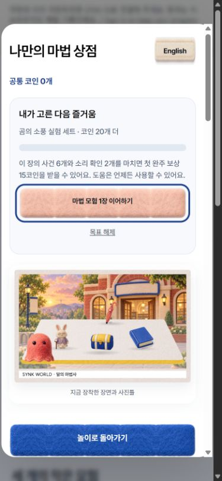
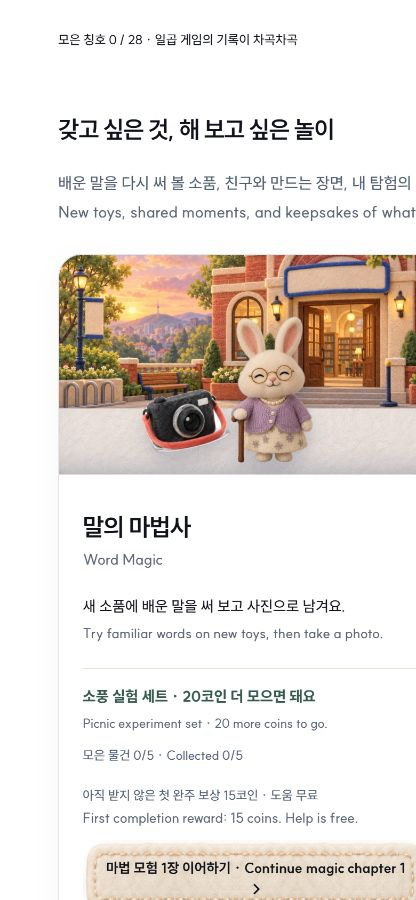

# 입문 게임 재방문과 보상 연결 마감 · 2026-10-09

사용자의 자체 검수 후 「이어서 해」 요청으로 우선순위 1·2와 발견한 마감 3건을 **로컬 구현**했다. 새 완성 장면 앨범은 이번 범위에 넣지 않았다. 공개 배포·추가 외부 모델 검토는 실행하지 않았다. 기존 공개판의 증거는 [이전 마감](../nonvoice-shop-finish-20261009/README.md)에 있으며 이번 코드와 혼동하지 않는다.

## 변경

- **상점 목표 → 지금 가능한 학습:** `play-common/collection-adapter.js`의 읽기 전용 `beginnerRewardRoute`가 복원된 계정 저장과 실제 공통 지갑의 보상 영수증·서울 날짜의 10회 한도를 읽는다. 미수령 마법 장, 배운 두 표현으로 하는 하루 5코인 실험, 첫 가게 최초 영업을 안내한다. 이미 지급된 반복 축제·다른 사람이 필요한 우주선 탐험을 코인용 다음 과제로 강제하지 않는다. 계정 오프라인/충돌/종료·저장 실패·일일 한도에서는 보상 약속 없이 무료 학습을 안내한다. 구매/장착/가격/지급 규칙은 기존 정본 그대로다.
- **말의 마법사:** 사건 6개와 소리 확인 2개를 구분한다. 빠진 확인과 완료 보상 저장 재시도로 직접 이어진다. 선택 복습은 이미 소개된 표현 2–3개를 다른 물건에 적용하며 첫 답 전 목표·철자·뜻을 숨긴다.
- **첫 가게:** 무료 축제는 본편 seed와 별도 방문 이력으로 주문·손님 순서를 바꾼다. 실제 본편에서 도움·재시도가 있었던 최근 표현 최대 두 개를 다른 손님·선반 배치로 복습한다. 방문 이력은 기존 계정 지원 진도 JSON의 호환 필드다.
- **우주선:** 완료된 탐험에서 실제 사용한 소리 세 개를 혼자 떠올리는 무료 복습을 제공한다. 현재 협동 방을 유지하며 친구가 탐험을 시작하면 복습 음성과 창을 정리한다. PNG는 준비 완료라고 알리고, 실제 1200×1050 미리보기와 지속되는 다운로드 링크를 제공한다. 창 닫기·탐험 변경·기록 밀림에서 이전 URL과 늦은 export를 정리한다.

복습은 본편 진도·공통 학습 성적·Atlas 관측·코인·새 숙련 판정을 만들지 않는다. 그 자리에서의 첫 응답과 교정은 짧은 놀이 안의 피드백으로만 보여 준다. 모두 기존 승인 MP3와 펠트 자산을 재사용했다. 새로운 계정 저장 키·서버 API·DB·경제 규칙·음성 생성은 없다.

TOPIK 관련 구현 범위는 TOPIK I 듣기의 짧은 낱말·기초 요청·수량/위치 의미를 행동과 연결해 다시 연습하는 것이다. 이 복습이 실제 기억 유지나 TOPIK 점수 향상을 만들었는지는 아직 측정하지 않았다.

## 확인

| 근거 | 결과 |
|---|---|
| [공통 및 게임 회귀](combined-tests.tap) | 최종 147/147. 계정 복원/차단·지갑 중복/한도·허브 서빙·음원 무결성·마법/첫 가게/우주선 상태 경계 포함 |
| [마법 담당 QA](../../../word-magic/qa/return-memory-20261009/README.md) | 새 복습·완료/장 링크·소리 실패/중단, 320/390 화면, 기존 전체 모험과 상점 키보드 12조건 |
| [첫 가게 담당 QA](../../../order-rush/qa/return-loop-20261009/README.md) | 새 흐름 6조건·기존 MP3 종료 16회, 최종 경로 UI 4조건, 기존 상점 10조건 |
| [우주선 담당 QA](../../../spaceship-coop/qa/return-recall-20261009/README.md) | 복습/PNG/방 경계 31조건+최종 PNG 정리 4조건, 기존 협동 전체 UI 95체크·18수리·기존 즉시 회상·보상 중복 방지 |
| [직접 브라우저 확인](root-browser.json) | 별도 비회원 origin에서 실제 목표 선택 → 해당 장 시작 → 허브 목표 복원. 320/390/1280px 가로 넘침 0·console 오류 0 |
| [현재 원문과 생성본](completion.json) | 이번 파일 SHA·정식 생성한 11게임 공통 collection 사본의 바이트 일치. 공통 adapter만 수정하고 생성 파일을 손으로 고치지 않음 |

마법의 음성 완료 대기 timeout과 root 브라우저의 새로고침 응답 지연이 한 차례 있었다. 단독 재생/현재 화면 확인은 통과했으며 원인을 확정하지 않는다. 각 담당 QA에 선택자·집계·허용 파일/CSP와 정리 단계의 실패 기록도 보존한다. 성공한 검사와 실패한 시도를 구분한다.

실제 계정/운영 DB 쓰기 0, 실제 참가자 0, 물리 휴대폰 0, 새 음성/이미지 생성 0, 공개 배포 0. 합성 완료 기록과 시험용 코인은 격리 QA용이며 실제 학습자 성적이 아니다. 기존 계정 계약의 자동 복원 검사는 물리 PC↔휴대폰 왕복을 대신하지 않는다.

사용자 미리보기는 기존 공통 서버의 `http://127.0.0.1:4340/learning-hub/#beginner-title`이다. 49321은 이번 별도 비회원 QA origin이며 마감 후 종료한다. 4340 미리보기는 공개 서버가 아니다.

