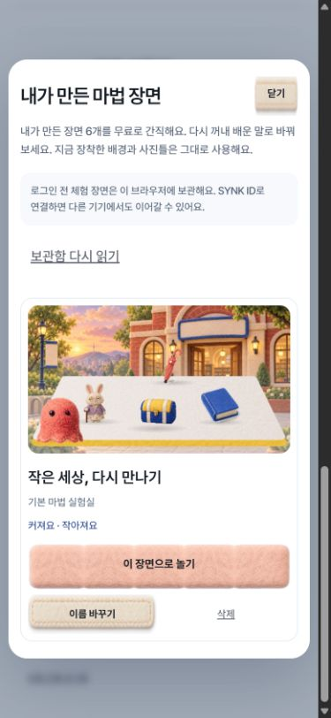

# 마법 장면 보관함과 입문 재방문 공개 반영

작업 시작 2026-10-09, 검증·공개 반영 완료 2026-10-10(KST). 사용자 「이어서 해」로 장면 보관함과 앞서 로컬에 남은 재방문 마감을 함께 반영했다. 공개 commit `10493b5a15a0815c5bf64f5483b9d1824a3bfc92`, [게시](public-published.json)·[공개 31파일 SHA/MIME와 Pages/CI 성공](public-verified.json)·[직접 공개 화면](public-browser.json)을 확인했다. `synk.im 배포 점검` run 37951794946과 Pages run 37951794795는 모두 성공했다.

## 사용자에게 달라지는 것

- **내 장면 보관함:** 실험실이나 사진 미리보기에서 이름 붙인 장면을 최대 6개까지 무료로 간직한다. 다시 열어 배운 말로 바꾸고, 이름 변경·직접 고른 교체·삭제를 할 수 있다. 현재 장착한 배경과 사진틀을 사용한다. 코인이나 새 숙달 판정을 보관/열기만으로 지급하지 않는다.
- **계정 저장:** 기존 `synk.word-magic.progress.v1`에 검증된 소품 세트·변형·이름·소개된 표현을 저장한다. 픽셀·Base64·새 업로드 저장소는 없으며 미리보기는 기존 자산으로 다시 그린다. 로그인한 WORLD 계정에서는 기존 서버 저장/복원 경로를 사용하고, 로그인 전 체험 기록은 자동으로 계정에 합치지 않는다.
- **재방문 마감 공개:** 세 게임의 선택형 기억 놀이, 미수령 보상으로 이어지는 상점 목표, 마법의 사건/듣기 확인 구분, 첫 가게 무료 축제 변주, 우주선의 PNG 미리보기·직접 다운로드를 포함한다. 다른 창에서 탐험이 이어져 입구로 돌아온 우주선에서도 무료 복습 버튼이 작동한다.

새로운 서버·DB·OAuth·가격·지급 규칙은 없다. 기존 WORLD client `97774f54…`와 그 고정 입력은 재빌드하지 않았다([현재 공개 계정 원문 근거](account-baseline.json)). 공통 게임 bridge에는 안내가 게임의 쓰기 기준을 바꾸지 않도록 읽기 전용 `readRecord`를 더했고, 11게임 `collection.js`는 정식 생성기로 만들었다.

## 공개 전에 잡은 문제

| 문제 | 재현과 수정 |
|---|---|
| 공개 경로 중복 | 공개 변환기가 동적으로 합치는 학습 주소에 `/try/`를 다시 붙일 수 있었다. runtime `gamePath`로 만들고 실제 변환 bundle을 VM에서 실행했다. [public-route.test.mjs](public-route.test.mjs) |
| 마법의 다른 기기 진도 손실 | 보관함 읽기가 저장의 관찰 기준을 바꾸면서 옛 화면 진도를 정상 저장할 수 있었다. 초기/직전 원문과 최신 원문을 비교해 본편 변경 시 쓰기를 멈추고, 보관 작품만 바뀌었을 때만 병합한다. [독립 전후 재현](../../../spaceship-coop/qa/scene-keepsake-data-review-20261009/README.md) |
| 첫 가게의 같은 저장 경계 | 공통 보상 안내의 읽기도 게임의 관찰 기준을 바꿀 수 있었다. 계정 snapshot의 허용된 기록만 읽고 관찰 기준을 전진시키지 않도록 수정했다. 실제 WORLD host에서 이전 코드의 진도 덮어쓰기와 현재 충돌/보존을 확인했다. [reward-cas.test.mjs](reward-cas.test.mjs) |
| 종료된 탐험의 복습 버튼 | 다른 창으로 탐험이 넘어간 상태에서 보이는 복습 버튼이 아무 반응이 없었다. 중단되어 입구로 돌아온 상태만 허용하고 정상 협동 중에는 차단한다. [집중 검증](../../../spaceship-coop/qa/scene-keepsake-release-review-20261009/README.md) |

## 확인 범위

- [최종 관련 검사](combined-tests.tap): **173/173**. 계정/진도/지갑·음원 무결성·허브 서빙·게임/보관 상태·공개 변환/CAS 포함. 전체 저장소의 모든 검사를 통과했다는 뜻은 아니다.
- [모듈 연결](module-links.json): **11/11**. 새 모듈의 실제 export/import를 평가 없이 연결했다.
- [후보 원문](candidate.json)·[기존 공개판 재현](baseline-preflight.json): 기존 27파일을 보존 원문과 같은 변환기로 정확히 재현한 뒤 수정하고, 새 모듈 4개만 더했다. [연결 268개·누락0](link-checks.json), 기존 의존 93파일 SHA를 고정했다.
- [마법 담당 검사](../../../word-magic/qa/scene-keepsake-20261009/README.md): Node 38개, 격리 Chrome 11흐름, 한영 320/390/1200 화면 6개, 기존 MP3로 꺼낸 작품을 다시 바꾸는 동작. 위 173에 포함된 Node 수를 별도로 더하지 않는다.
- [계정 복원 추가 검사](account-keepsake.test.mjs): 실제 WORLD host 코드와 합성 서버의 서로 다른 저장 공간에서 작품 복원, 원본 진도/지갑 보존, 동시 수정 충돌, 종료 후 이전 handle/다른 계정 차단을 확인했다.
- [직접 공개 후보 화면](root-candidate-browser.json): 실제 변환된 코드를 현재 공개 의존 파일과 조립해 입문→이름 보관→새 탭 복원, 320/390/1280 넘침0·오류0을 확인했다. 초기 49323 탭의 CDP 지연 두 건은 성공으로 세지 않았으며 새 고정 후보 탭에서 실제 결과를 확인했다.

사용자가 외부 최종 검토를 유예하고 자체 검수를 요청한 지시를 유지했다. [검토 상태](review-status.json)는 외부 검토 미완료·모델 호출0이며 PASS로 표시하지 않는다. 별도 과금·모델 대체·자동 재시도는 없다.

## 공개와 남은 경계

`publish.cjs`는 31개 명시 경로만 임시 index에서 조립한다. 원격의 같은 파일/의존성이 바뀌면 쓰기 전에 멈추며, 정상 FF만 사용하고 현재 SHIFT 작업 트리·HEAD·기본 index·다른 dirty 파일을 보존한다. 공개 뒤 canonical URL 전 파일의 SHA/MIME와 Pages·`synk.im 배포 점검`을 확인한다. 다른 담당이 이어서 정상 FF한 경우에도 조상 관계와 내 파일 유지 여부를 기록하며 재푸시하지 않는다.

첫 게시 전 비교는 실제 Git 출력과 예상 출력의 정렬 기준이 달라 멈췄다. 양쪽을 같은 기준으로 정렬해 정확한 31개 A/M 검사를 유지했다([원본 실패](publication-first-preflight-failure.json)). 이후 fetch의 자동 pack 정리가 PC 공간 부족으로 실패했으며, 해당 Git 임시 파일 삭제는 자동 승인 검토가 정책상 차단했다([실패·미정리 상태](publication-disk-failure.json)). 삭제하지 않고 **이번 게시 명령에서만** 자동 maintenance를 생략해 정상 게시했다. Git 설정·작업 트리·기본 index·원본 데이터는 바꾸지 않았다. 공유 원격이 진행된 `0e5ffd03…`를 새 부모로 삼았고, 대상/의존 SHA를 다시 대조해 다른 담당의 반영을 보존했다.

실제 계정 거래·운영 DB 수정·새 음성/이미지 생성0, 실제 참가자0·물리 휴대폰0. 이번 복습의 구현 영역은 TOPIK I 기초 낱말·짧은 부탁·수량/위치의 소리와 행동 연결이며, 실제 재미·기억 유지·TOPIK 점수 향상은 측정하지 않았다. 재녹음은 마지막 일정으로 유지한다.

