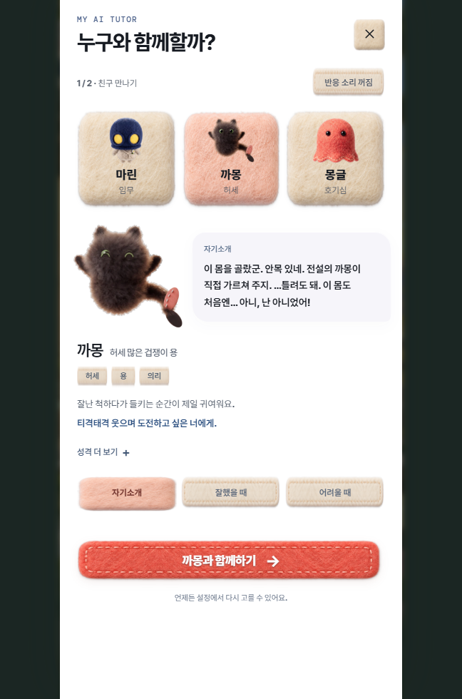

# 까몽 스티치 눈웃음 · 2026-10-11

사용자의 반쯤 뜬 눈 후보 거절과 스티치 눈웃음 요청을 반영했다. [정본·생성 방식·픽셀 검증](../../../../docs/캐릭터/표정교정_20261011/README.md).

[실제 선택 화면 20개 검사](selection-result.json) 통과. 390·648px에서 자기소개(으쓱)·성공(기쁨)의 스티치 눈, 정본 대사, 몸 이미지·표시 크기 보존, 2.1초 뒤 기본 복귀를 확인했다. 전체 튜터 이미지 26개의 URL 해시와 실제 파일 해시가 일치한다. JS 오류·누락 자산·외부 요청 0. 로그인·계정·선택 저장은 변경하지 않았다.

관련 기존 Node 8개 통과. 고정 출력은 `.tmp/world-app-kkamong-stitch-20261011/world`이며 1,817개 파일·185,835,841바이트, 누락·비공개 파일·빌드 중 원본 변경 0. 이전 출력 보존. 로컬 반영이며 외부 공개 배포·실물 휴대폰 확인은 하지 않았다.



```powershell
node experiences/brand-opening/qa/kkamong-stitch-20261011/verify-selection.cjs
node --test experiences/brand-opening/qa/tutor-choice.test.mjs experiences/brand-opening/qa/game-tutor.test.mjs
```
