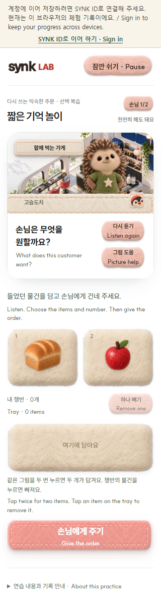
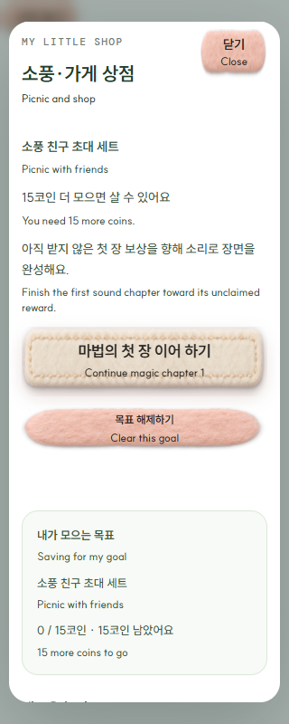

# 첫 가게 재방문·다음 학습 연결 · 2026-10-09

사용자의 자체검수 후 「이어서 해」 요청에 따른 로컬 구현입니다. 공식 Claude 검토·공개 배포·실제 계정/DB 변경은 수행하지 않았습니다.

- 무료 축제만 별도 방문 seed를 사용해 직전 주문과 손님 배열을 모두 피합니다. 본편의 고정 seed·장·firstCorrect·checkpoint·roundId·지급과 기존 소풍의 방문 이력은 바꾸지 않습니다.
- 입구의 선택형 짧은 기억 놀이는 실제 본편의 최근 도움/재시도/재청취 표현 최대 두 개를 사용합니다. 기존 승인 음원, 다른 손님, 바뀐 선반, 첫 답 전 숨김, 오답/그림 도움 뒤 교정을 제공합니다. 본편 기록·부분 쟁반·코인을 보존하고 Atlas에 제시/답을 보내거나 새로운 독립 성공을 세지 않습니다.
- 두 방문 이력은 기존 계정 지원 `synk.order-rush.beginner.v1` JSON의 호환 필드이며 새 브라우저 전용 저장 key는 없습니다. 저장 실패는 연속성 경고와 함께 지금 창의 무료 놀이를 계속 허용합니다.
- 부족한 코인과 목표 카드의 다음 학습은 공통 `beginnerRewardRoute`를 기존 refresh에 함께 읽습니다. 이전 refresh가 새 경로·상품 선택·초점을 덮지 않으며 API 부재/오늘 한도는 무료 허브로 연결하고 코인을 약속하지 않습니다.

## 검증

| 근거 | 확인 결과 |
|---|---|
| [node-tests.txt](node-tests.txt) | 49/49. 기존 카페·입문·소풍 회귀와 50seed×30축제 재방문, JSON 복원·잘못된 이력, 기억 후보/새 손님/배치·기본 무료 경로 |
| [browser-results.json](browser-results.json) | 격리 Chrome 6조건, 승인 MP3 16회 종료, 새 입구의 선택성·첫답 숨김·도움 교정·쟁반 멈춤, 기억 후 원본 첫 오답/부분 쟁반 복원, 축제9주문 완주·3방문/재로드, 저장실패·다음 학습, 콘솔/외부 요청0 |
| [route-results.json](route-results.json) | 최종 CSS·실제 shop 모듈의 4조건. 실제 크림 펠트 CTA·키보드·320px, 오늘 한도, 구버전 기본 무료 경로, 늦은 경로 응답 무시. 음성/외부 요청0 |
| [기존 상점 회귀](shop-regression/browser-results.json) | 지연 구매/장착/목표·재입장·초점·저장실패 10조건, 콘솔/외부/음성 요청0 |

첫 브라우저 시도는 입구/상점의 학습 링크 두 개를 한 locator로 선택한 **QA 선택자 오류**로 끝났습니다. 두 번째는 재로드에서 초기화된 음성 종료 카운터의 **QA 집계 오류**로 끝났습니다. 실패 JSON/PNG를 삭제하지 않았고, scoped locator 및 재로드 전 누적 집계로 고친 최종 시도가 통과했습니다. 제품 오류나 학생의 실패로 세지 않습니다. 처음 성공한 흐름 QA의 CSS SHA `ffcda6…` 뒤, 직접 캡처에서 상점 바깥 CSS 범위의 새 링크가 일반 파란 링크처럼 보이는 점을 고쳤습니다. 최종 `route-results.json`의 CSS SHA가 현재 제품 CSS이며 실제 펠트 배경/색/높이와 경로 분기를 별도로 확인했습니다.

합성 진도/게스트 저장 공간은 시험용입니다. 음원 종료는 브라우저에서 확인했고 사람이 발음·자연스러움·기억 효과를 평가한 결과는 아닙니다. 실제 학생/물리 휴대폰 0, 음성·이미지 생성0, 실제 계정·운영 데이터 쓰기0, 공식 모델 호출0, 공개 배포0입니다. 회귀에 사용한 synthetic 지갑 코인100도 격리 fixture이며 실제 지갑 변경은 아닙니다.

