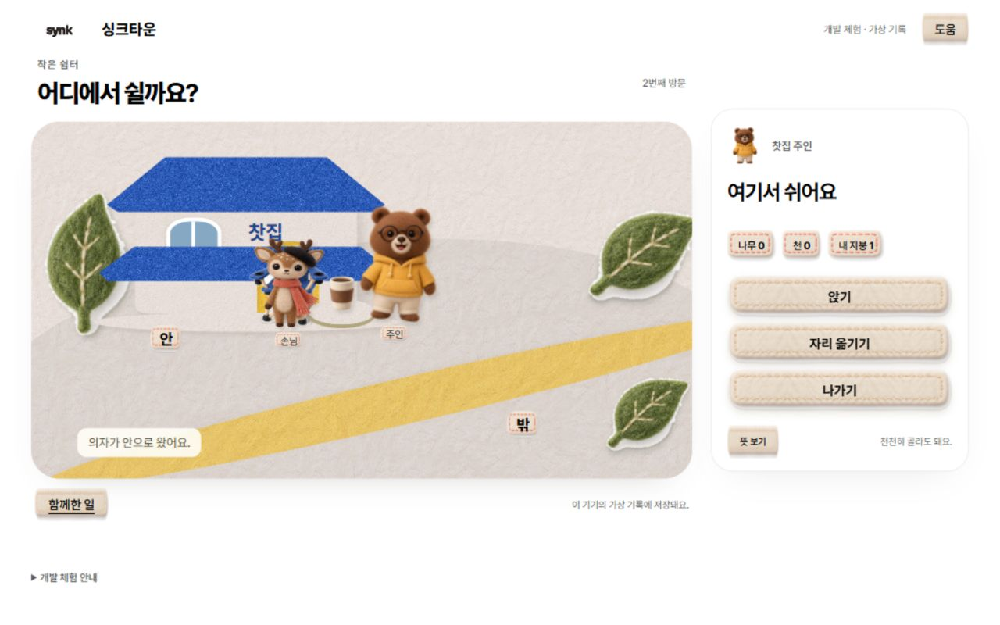

# FT10·FT51 실행 연결 검증 · 2026-10-02

상태: **로컬 개발 체험 구현·검증**. 실제 학생 계정·운영 배포·학습효과 검증은 아니다. 범위와 실행은 [README](../README.md)에 둔다.

## FT10 최초 연결 검사

```powershell
node --test experiences/synk-town/core.test.mjs experiences/synk-town/server.test.mjs tests/atlas-life.test.js tests/loom-life.test.js tests/loom-motion.test.js tests/atlas-trail.test.js tests/atlas-education.test.js
```

**88개 통과, 실패 0.** Town 15개, 생활 엔진 24개, 기존 Loom 시계·Trail·교육 회귀 49개. `app.mjs` 구문 검사와 해당 문서/코드 diff 공백 검사도 통과했다.

| 확인한 동작 | 근거 |
|---|---|
| 안쪽 재료 0, 밖의 재료 1회 지급·제작 1회, 네 자리 외 통로 거절 | core 시험 |
| 제작·배치 미리보기 중 이탈 뒤 같은 단계 복귀 | core 시험 |
| 확정했지만 못 본 이용은 기존 사건으로 복원, 본 뒤 새 방문만 새 일상 이용 | core 시험 |
| 중복 명령·충돌 ID·다른 창의 낡은 revision, 배치 변경 후 늦은 ACK 거절 | core + Trail/Loom 시험 |
| 숨김/정지/자산 미완료/단계 누락은 전달 영수증 금지 | core + Loom 시험 |
| 저장 실패는 미진행, 파일 재시작 복원, 손상된 파일 보존 | 실제 임시 파일 및 실패 주입 시험 |
| 회수 뒤 보유물·과거 성취 유지, 현재 지붕 대사 제거, 안/밖 이동과 재설치 시 중복 감사 방지 | core 시험 |
| 못 본 NPC·철회·관련 없는 전달 근거 차단, 서로 다른 진짜 원인에 대한 반응 구분 | Trail/Vellum 시험 |
| 기본 입장과 체험 API 잠금, query로 해금 불가, 명시적 loopback 개발 모드, 타 출처 POST·저장/소스 파일 노출 차단 | HTTP 서버 시험 |
| 생활 행동이 `practice.*`와 TOPIK 성공으로 바뀌지 않음 | core·생활 계약 및 기존 교육 회귀 |

## 실제 브라우저 확인

Codex 내장 브라우저에서 `http://127.0.0.1:4288/preview.html`을 직접 조작했다.

- **바깥 완주:** 밖 선택 → 만들기 → 노랑 → 제작 → 배치. 보유 수량이 나무0·천0·지붕1에서 배치 후 지붕0으로 바뀌었다. 손님 이동·자리 이용·주인의 차 제공 표현 뒤 `motion` 전달이 저장됐다.
- **재방문:** 나가기 → 다시 왔어요. 두 번째 방문은 ‘함께 만든 자리예요’를 반복하지 않고 ‘이 자리에 앉아요’를 표시했다. 서버의 첫 감사 영수증 1개와 별도 일상 이용 영수증을 확인했다.
- **회수:** 지붕 챙기기. 지붕이 화면에서 사라지고 기본 의자로 돌아가며 ‘내 지붕 1’을 표시했다.
- **안쪽/정지 대안:** 안이 좋아요 → 옮기기 → 저쪽 → 배치. 처마 오른쪽의 이용 모습과 ‘옮긴 의자예요’를 확인했다. `prefers-reduced-motion: reduce`에서 같은 결과를 정지 표현하고 서버가 `static` 전달을 저장했다. 이후 임시 설정은 복구했다.
- **복원:** 새로고침과 실제 서버 재시작 뒤 소유·배치·관람 상태가 유지됐다.
- **일반 입구:** `/`에서 TOPIK1급+ 통과 안내와 아직 권한 연결 준비 중인 잠금 화면을 직접 확인했다. 개발 체험으로 이동하는 학생용 단추는 없다.
- **화면 크기:** 1280px 데스크톱과 390×844 휴대폰 크기에서 주요 대사와 행동, 장면을 확인했다. 작은 화면의 버튼 그림 크기 및 CSS 문자열 오류를 수정한 뒤 다시 확인했다. 320px 추가 검사는 브라우저 제어 시간 초과로 완료하지 못해 통과로 세지 않는다.
- 확인 시 앱 콘솔 오류는 없었다. 도구의 간헐적 CDP 시간 초과는 기록을 새로 읽어 동작 성공 여부를 확인했으며 앱 오류로 섞지 않았다.

HTML/CSS가 참조하는 로컬 화면·엔진·그림·글꼴 23개 HTTP 요청이 모두 200이었다([기록](http-assets.json)).

현재 저장된 가상 체험 영수증: `FT10:outside:first / motion`, `FT10:daily-use / motion`, `FT10:inside:first / static`. 개인·학생 데이터는 사용하지 않았다.



## FT51 추가 적용과 재검증

```powershell
node --test experiences/synk-town/core.test.mjs experiences/synk-town/sign.test.mjs experiences/synk-town/server.test.mjs experiences/synk-town/loom-roundtrip.test.mjs tests/atlas-life.test.js tests/loom-life.test.js tests/loom-motion.test.js tests/atlas-trail.test.js tests/atlas-education.test.js
```

**103개 통과, 실패 0.** 앞의 88개와 겹치는 회귀를 포함한 최종 실행 수다. FT51 전용 13개, 실제 FT10 계획의 JSON→브라우저 재준비 1개, 공통 Loom 초기 자세 직렬화 회귀 1개를 추가했다.

- 안/밖 × 의자/차 × 왼쪽/오른쪽 여덟 조합에서 재료·성취 조건이 같다. 실제 판 접근·읽기·현재 좌석 도착 경로는 판 위치에 따라 달라진다.
- FT10 미관람 직접 시작, 미리보기 취소·이탈, 실제 파일 재시작, 새/기존 저장 복원, 재방문 첫 감사 중복 방지, 좌석 변경·회수 때 목적지 수정/중지, 낡은/중복 명령·저장 실패를 검사했다. 생활 선택은 학습 점수가 되지 않는다.
- 서버가 이미 준비한 Loom 계획을 JSON으로 전송하고 브라우저가 다시 준비하면 잔의 초기 `hidden` 자세가 빠지는 결함을 재현했다. 공통 `loom-life.js`에서 첫 자세를 보존해 실제 안/밖 계획의 운반·배치까지 확인했다.
- 같은 계획에서 `자리 보기/앉기`를 눌러도 이동이 처음부터 재시작되지 않는다. 진행 대사와 도착 대사를 분리하고 도착 반응을 최소 1.2초 보여 준 뒤 전달한다. 정지 대안도 총 2.4초 이상 보이며 숨김·도움 대화창·화면 밖에서 관람 시간이 흐르지 않는다.

Codex 내장 브라우저의 같은 가상 기록으로 **차 그림·오른쪽 배치 → 손님 이용 → 다음 방문 → 의자를 바깥 오른쪽으로 이동 → 지붕 회수 → 재배치 → 움직임 줄이기 재방문**을 직접 실행했다. 안내판 목적지가 함께 바뀌고, 회수 중 화살표·길 도움은 숨겨졌다. 의자 그림·왼쪽 미리보기를 취소하면 기존 차 그림·오른쪽 판이 남았다. `FT51:first / motion`은 한 번만 남고, 네 번째 방문의 `FT51:daily-use / static`을 서버 기록에서 확인했다.

추가 실제 Chromium 검사에서는 **1280·390·320px**, 미리보기/확정, 판을 읽는 위치, 이동 중과 도착 후 `SIT`, 결과 대사 시점, 완료 ACK, 새로고침 복원을 확인했다. 가로 넘침·브라우저 오류는 없었다. 앞의 320px 미완료 기록은 이번 검사로 보완했다. 실행 스크립트와 과정 캡처는 로컬 임시 검증 폴더 `synk-town-ft51-ui-8cfcfc25fa0a4746944e4eb6f4db5b9f`에 있다.

마지막 화면 검사에서 바깥 오른쪽 자리의 주인이 장면 끝에 잘리던 것을 코어 계획·정적 화면에서 같은 좌표 한계로 수정했다. 접근성 설명도 안내판 접근/읽기/자리 이동/도착을 실제 표현에 맞춘다. 수정 뒤 103개를 다시 통과했고, 4288 서버 재시작·새로고침에서 네 번째 방문과 판·자리를 복원했다. 내장 브라우저의 390/320px에서 깨진 그림·가로 넘침 0, 390px 주인 이미지의 장면 경계 내 표시를 확인했다. 임시 화면 크기·움직임 줄이기 설정은 복구했다.

최종 캡처: [데스크톱](ft51-desktop.png), [390px](ft51-mobile-390.png), [320px](ft51-mobile-320.png).

## 남은 검증과 구현

- 실제 휴대폰 터치·장시간 성능·시각/학습 만족도와 실제 앱 iframe 반입은 확인하지 않았다. 320px 검사는 데스크톱 브라우저의 화면 크기 검사다.
- 숨김·가시성·저장 실패·인지 철회는 해당 함수와 서버 경계 시험이다. 실제 운영 계정 권한 철회/네트워크 장애/두 기기 동기화 검증은 아니다.
- 자리 사용은 서버의 제한된 턴 방식 상태 전이이며 실시간 물리나 NPC 예약 경쟁을 검증한 것이 아니다. 앉기·서빙은 임시 펠트 그림의 위치/자세 표현으로, 최종 전용 동작 제작은 남아 있다.
- 현재 원고는 짧은 생활 표현을 제공한다. 정오·이해·새 문항 전이·TOPIK 점수나 학생 학습효과는 측정하지 않았다.
- FT10·FT51 외의 다른 생활 콘텐츠, 실제 TOPIK1급+ 입장 확인·체험/구독/상품 권한은 아직 연결하지 않았다. 일반 입구는 기본 잠금이다.
