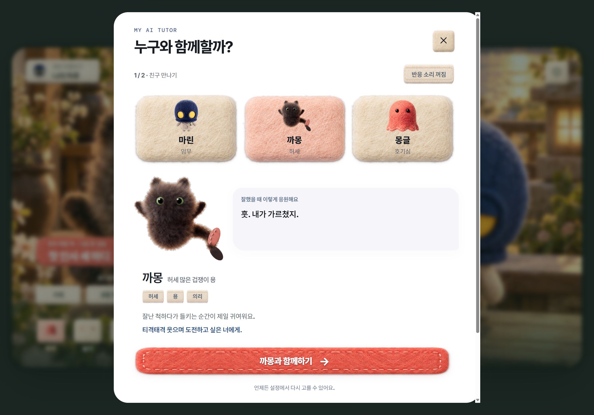

# 실제 계정 저장과 PC WORLD 반영 — 2026-10-12

실제 SYNK ID로 공개 WORLD에 로그인해 까몽을 고르고 「첫 인사 세 마디」를 완료했다. 새로 진입한 뒤와 로그아웃·재로그인 뒤 모두 까몽, 완료 1/22, 오늘의 표현 3개, 다음 학습 「이름표를 찾아서」가 복원됐다. [실제 UI 관찰](real-account-ui.json).

최초 저장은 실패했다. 운영 `synk-play` v9의 허용 목록에 `synk.life-korean.progress.v1`이 없었다. 운영 원문에 이 키 하나만 추가한 v10을 배포했다. 후보의 생활 저장·계정 분리·CAS 10개와 기존 회귀 28개를 확인하고, 배포 후 모듈·인증 정책 45개를 대조했다. 다른 런타임·함수·DB·인증 정책은 보존했다. [운영 배포와 롤백 원본](../tutor-switch-20261011/backend-life-20261012/postdeploy.json).

공개 WORLD는 `1ce4365dfe83b11813f17c36802ea2463532951b`로 6개 파일만 갱신했다. 새 네이티브 계정 연결은 기존 토큰을 main에 유지하고 고정된 WORLD API 요청을 사용한다. 외부 bootstrap으로 PC의 기존 CSP를 유지하며, 새 계정 연결 시 홈·학습을 복원한다. 기존 공개 번들을 정확히 재현한 뒤 해당 어댑터만 더했으며 다른 모듈은 동일하다. 번들 직접 검사 30개, 관련 데스크톱·문서·계정 검사 86개, 공개 HTTPS 해시 6/6 통과. [배포 기록](publication.json), [HTTPS 대조](public-http.json), [번들 대조](bundle-verification.json). Pages 38154258669와 공개 CI 38154258928 성공.

## 이 PC에 적용한 내용

- **WORLD Preview 0.4.2**: NSIS 설치 종료 0. 설치 파일 74개가 검증된 패키지와 일치한다. 설치 직전·직후 WORLD 프로필 70개 파일의 통합 해시가 같고, 이전 설치본의 인증 설정과 sessionScope도 같다. [설치 확인](desktop-installed.json).
- **Platform Preview 0.4.0의 WORLD 등록 목록**: 기존 플랫폼이 0.4.2를 모르는 실제 실행 차단을 확인했다. `runtime.json`에 검증된 WORLD 해시를 등록하고 포함 WORLD 설치 파일을 0.4.2로 교체했다. 플랫폼/PULSE 코드 116개와 다른 앱 등록은 그대로다. 설치된 플랫폼의 실제 검사 함수로 WORLD `installed / canLaunch:true / version:0.4.2`를 확인했다. 기존 ASAR·설치 파일은 `.tmp/world-tutor-native-20261012/launcher/`에 보관했다. [등록 갱신](launcher-update.json).
- 공개 0.4.1 다운로드 파일은 이번에 교체하지 않았다. 이번 0.4.2는 이 PC 설치와 로컬 배포 파일이다. [검증된 설치 파일](../../../../desktop/dist/preview/win32/x64/world/SYNK%20WORLD%20Preview-0.4.2-win-x64.exe), [로컬 배포 등록](local-release.json).

설치와 같은 패키지를 새 격리 프로필에서 실행해 공개 홈, 세 튜터의 선택·성공 표정·홈, 게임 로그인 안내, 기존 계정 화면에서 돌아오기 26/26을 확인했다. 네트워크 차단 안내와 복구까지 29/29을 확인했다. 두 검사에서 개발 서버 요청·인증 요청·CSP 오류·외부 실행은 0이었다. 첫 검사 실패는 검사기의 top-level await 사용 오류였고 제품 변경 없이 검사기만 고쳤다. [온라인](native-online.json), [오프라인·복구](native-offline.json).

## 저장 범위와 남은 확인

튜터 선택·안내 연습 기억은 **이 기기에서 계정별 저장**이다. 브라우저와 PC 앱 사이 또는 다른 기기로 선택 튜터가 동기화되는 기능은 아니다. 생활 학습 완료·표현·복습 일정은 **SYNK 계정 서버 저장**이다.

실제 계정 로그인·완료·재로그인 검사는 Chrome의 공개 WORLD에서 수행했다. PC 패키지의 실제 계정 로그인 왕복, 실제 게임 완료의 서버 저장, 다른 실물 PC·휴대폰은 이번에 검증하지 않았다. 새 PC 설치본은 실행했지만 개인 프로필을 디버거로 조작하지 않았다. 완료 화면은 CUA 캡처로 확인했으며 이후 캡처 저장은 브라우저가 폭 0을 반환해 실패했다. 위 PNG는 명시한 격리 PC 검사의 화면이다.

TOPIK 관련 구현 범위는 인사·감사·자기소개 표현을 상황에 맞게 선택하는 기초 한국어 연습이다. 실제 학습자 효과나 시험 점수 향상은 확인하지 않았다.
