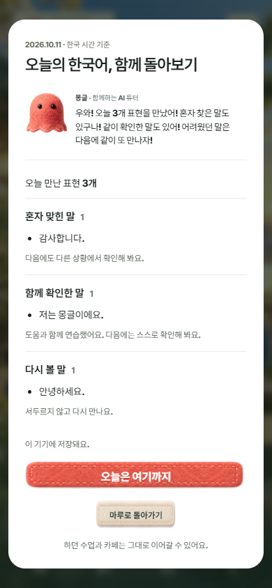
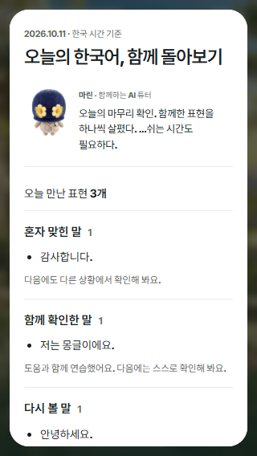

# 튜터와 하루를 돌아보고 다음 방문 이어가기

2026-10-11 로컬 구현·검증. [홈 미리보기](http://127.0.0.1:4314/mobile.html?opening=off). [기록·추천·저장 계약과 비교 근거](../../LIFE-CONTENT.md#함께한-하루와-다음-방문--2026-10-11).

생활·카페·홈의 안내 연습 성공을 즉시 기억한다. 홈에서 고른 튜터가 혼자 맞힌 말·함께 확인한 말·다시 볼 말을 자기 말투와 표정으로 돌아본다. 같은 날 다시 접속하면 마무리를 복원하고, 다음 방문에는 실제 마지막 날짜·표현에 맞춰 어제/지난번을 구분해 반긴다. 하루 마무리 뒤에도 하던 수업·카페를 계속할 수 있다. 한국 시간 기준이며 같은 표현을 여러 수업에서 만났어도 하루 한 번 센다.

## 확인한 결과

- [소스 브라우저 88개](source-r3/report.json): 세 튜터 실제 선택, 실제 오답·독립 정답·도움 정답, 안내 오답/정답 순간 저장, 돌아가기 전 새로고침, 중복 추천 제외, 마무리 취소/완료/복원, 어제/지난번 인사, 다음 날 독립 복습, 마무리 뒤 품절 카페 오답·안내 연습·같은 교정 단계 복귀. 320×568·390×844·740×320의 너비/44px 조작과 작은 화면의 제목·튜터 시작 위치 확인. JS 오류·누락 자산·외부 요청 0.
- [고정 출력·계정 30개](account-r3/report.json): `/world/`의 최종 r3 출력에서 synthetic 공식 계정 계약으로 기록 로딩·안내 성공 즉시 저장·재방문·마무리·로그아웃 격리·독립 홈 번들·읽기 오류 확인. 복습 시각 전 안내 성공 → 새로고침 → 같은 날 정규 정답에서 실제 `helped`와 튜터의 도움 반응이 일치한다. 첫 응답·복습 일정·지갑은 보존한다. 실제 OAuth·원격 운영 DB 검증은 아니다.
- [기존 생활·카페 브라우저 127개](../life-tutor-20261011/daily-regression-final/report.json): 실제 직원 MP3 재생 종료, 세 튜터의 반응·표정·힌트·안내 연습, 원래 응답·주문·수령 및 중단 위치 보존, 기존 듣기 흐름 확인. 이전 118개에서 안내 성공의 하루 기록 검증 9개를 추가했다.
- [관련 Node 92개](unit.tap): 하루 쓰기·중복·날짜·용량·이전 기록 복원·소유자·오류·첫 응답/간격 보존, 추천·말투·표현 중복 제거, 기존 콘텐츠/카페/저장 계약. 실제 로컬 PGlite JSONB 계정 쓰기·응답 유실 재시도·충돌·소유자 전환 4개를 포함한다.
- 기존 홈 검사의 안내 연습 후 기대값도 하루 기록 저장에 맞췄다. [홈 64개](../home-tutor-20261011/daily-regression-final/report.json), [수명·도움 22개](../home-tutor-20261011/daily-regression-final-lifecycle/report.json), [홈 고정 계정 16개](../home-tutor-20261011/daily-regression-final-account/report.json), [생활 고정 계정 10개](../life-tutor-20261011/daily-regression-final-account/report.json) 통과. 첫 답·복습 일정·지갑·취소 보존 단언은 유지하고, 안내 성공의 하루 쓰기만 허용해 검증했다. 위 검사와 중복되는 경로가 있으므로 합계로 성과를 부풀리지 않는다.

[소스 해시와 출력 대조](source-validation.json). 최종 준비물은 `.tmp/world-app-daily-tutor-20261011-r3/world`이며 1,817개 파일·185,838,617바이트다. 빌드의 누락 참조·비공개 파일·원본 변경은 0, 이전 출력은 보존했다. 독립 `brand-opening/home.html` 자체는 출력에 포함하지 않으므로 독립 홈 검사의 HTML은 현재 원문, 모듈·생활 번들은 고정 출력으로 확인했다. 초기 r2 결과와 수정 전 화면은 조사 흔적으로 남기며 최종 근거는 `source-r3`·`account-r3`다.

## 화면





## 재현

```powershell
node tools/build-world-life.mjs --check
$env:SYNK_DAILY_TUTOR_RUN='source-r3'
node experiences/synk-world-app/qa/daily-tutor-browser.cjs
$env:SYNK_DAILY_TUTOR_STATIC_PAYLOAD='.tmp/world-app-daily-tutor-20261011-r3/world'
$env:SYNK_DAILY_TUTOR_STATIC_QA_RUN='account-r3'
node --test experiences/synk-world-app/qa/daily-tutor-static.test.mjs
$env:SYNK_LIFE_TUTOR_RUN='daily-regression-final'
node experiences/synk-world-app/qa/life-tutor-browser.cjs
node --test experiences/brand-opening/qa/daily-tutor.test.mjs experiences/brand-opening/qa/home-tutor.test.mjs experiences/brand-opening/qa/life-tutor.test.mjs experiences/synk-world-app/qa/life-daily-progress.test.mjs experiences/synk-world-app/qa/daily-tutor-store.test.mjs experiences/synk-world-app/qa/life-progress.test.mjs experiences/synk-world-app/qa/life-progress-store.test.mjs experiences/synk-world-app/qa/cafe-activity.test.mjs experiences/synk-world-app/qa/content-validation.test.mjs
```

브라우저 검사는 실제 소리와 페이지 가시성을 사용하므로 순서대로 실행한다. 공개 배포·실제 원격 계정 왕복·실물 휴대폰·학생 학습 효과는 이번 검증 범위 밖이다. 새 유료 AI·튜터 TTS는 호출하지 않았다.
