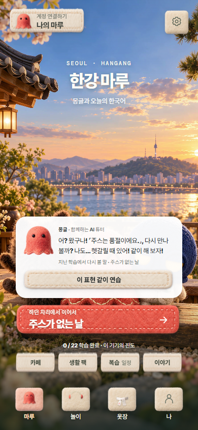
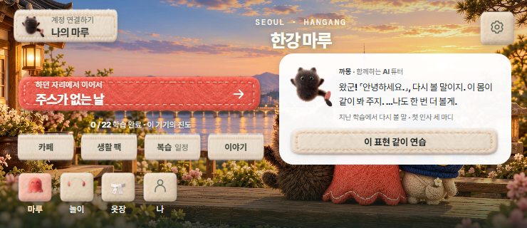

# 홈에서 반겨 주고 기억하는 튜터

2026-10-11 로컬 구현·검증. [홈 미리보기](http://127.0.0.1:4314/mobile.html?opening=off). [동작·추천 기준·비교 근거](../../LIFE-CONTENT.md#홈에서-기억하고-함께-시작하는-튜터--2026-10-11).

고른 마린·까몽·몽글이 자신의 말투로 인사하고, 실제 미해결 표현 하나와 오늘 할 행동을 안내한다. 추천에서 기존 새 상황 원고로 바로 연습하고, 오답의 표정·해설과 성공의 축하를 본 뒤 홈으로 돌아온다. 카페/수업의 중단 위치와 첫 응답·복습 간격은 유지한다. 동일한 예정 복습의 정답을 미리 봤다면 도움 이력을 남긴다. 이미 독립 복습에 성공한 표현을 계속 미해결로 부르지 않는다.

## 확인한 결과

- [홈 실제 브라우저 61개](source/report.json): 세 튜터를 실제 선택 → 첫 학습 → 실제 오답 → 홈 기억 → 새로고침 → 안내 연습의 취소/오답/정답 → 홈 축하 → 같은 카페 교정 단계 복귀. 320×568, 390×844, 740×320의 44px 조작·넘침·상단/하단 겹침 확인. JS 오류·누락 자산·외부 요청 0.
- [계정·고정 출력 15개](account/report.json): `/world` 아래 실제 출력에서 synthetic 공식 계약으로 로딩/원래 오답/복원/안내 연습/로그아웃 경계 확인. 독립 홈 번들, 계정·게스트 읽기 실패, 자산 경로, 기존 계정 쓰기/지갑 보존 확인. 실제 OAuth·원격 DB 증명은 아니다.
- [수명 주기·도움 기록 19개](lifecycle/report.json): 눈깜빡임 타이머 1개, 화면 이탈 시 정지, 움직임 감소, 이미 시작한/아직 시작하지 않은 예정 복습 모두 안내 정답을 독립 정답으로 세지 않음, 도움의 새로고침 복원.
- [기존 생활·카페 브라우저 118개](../life-tutor-20261011/home-regression-final/report.json): 실제 직원 MP3 종료, 세 튜터 힌트·반응, 카페 다섯 방문 관련 기존 흐름과 원래 답/연습 복귀 회귀. 최초 동시 Edge 실행에서 미디어 종료 대기가 초과했으며, 단독 실행으로 끝까지 통과했다.
- [관련 Node 57개](unit.tap): 추천 순서·소유자·오류·해결된 표현 제외, 정본 말투, 기존 생활 진도/복습/카페·콘텐츠 계약. 홈 순수 검사 13개 포함.

[소스 해시·고정 출력 대조](source-validation.json). 공개 경로용 준비물은 `.tmp/world-app-home-tutor-20261011-r2/world`이며 1,815개 파일, 누락 참조·비공개 자산·빌드 중 원본 변경 0. 이전 출력은 그대로 유지했다. 독립 `home.html` 자체는 출력에 포함하지 않으므로 계정 검사의 독립 홈 HTML은 현재 원문을 사용하고 모듈/번들은 고정 출력으로 검증했다.

## 화면





## 재현

```powershell
node tools/build-world-life.mjs --check
node experiences/synk-world-app/qa/home-tutor-browser.cjs
node experiences/synk-world-app/qa/home-tutor-lifecycle.cjs
$env:SYNK_HOME_TUTOR_STATIC_PAYLOAD='.tmp/world-app-home-tutor-20261011-r2/world'
node --test experiences/synk-world-app/qa/home-tutor-static.test.mjs
node --test experiences/brand-opening/qa/home-tutor.test.mjs experiences/brand-opening/qa/life-tutor.test.mjs experiences/synk-world-app/qa/life-progress.test.mjs experiences/synk-world-app/qa/life-progress-store.test.mjs experiences/synk-world-app/qa/cafe-activity.test.mjs experiences/synk-world-app/qa/content-validation.test.mjs
```

브라우저 검사는 실제 직원 소리의 종료·페이지 가시성을 사용하므로 각각 따로 실행한다. 실물 휴대폰·네이티브 WebView·실제 학생의 학습 효과·공개 배포는 이번 검증에 포함하지 않았다. 새 유료 AI 호출·튜터 TTS·새 평가 저장소·배포는 실행하지 않았다.
