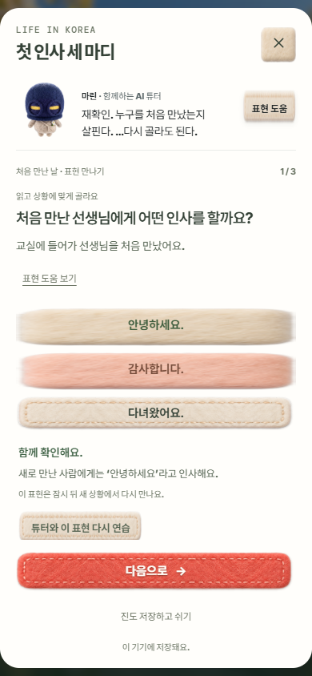
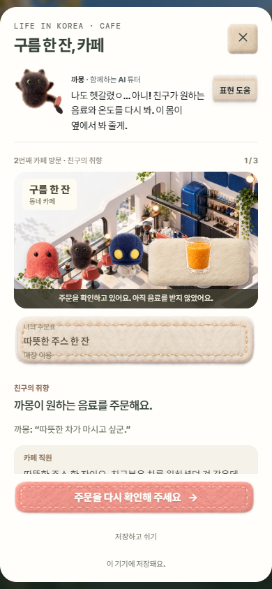
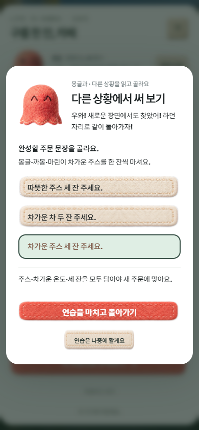

# 생활·카페 튜터 동행 검수 · 2026-10-11

고른 마린·까몽·몽글이 생활 한국어·이야기·카페·복습에 동행하고, 헷갈린 표현을 기존 새 상황 원고로 다시 연습한 뒤 같은 자리로 돌아오는 로컬 구현을 확인했다. [내용·비교 근거·기록 경계](../../LIFE-CONTENT.md#고른-튜터와-생활카페-안내--2026-10-11).

- [소스 브라우저 118개 통과](source-final/report.json): 세 튜터 모두 실제 선택 → 생활 첫 오답/힌트/도움 사용/정답/완료 → 새 상황 안내 연습 → 예정된 복습 → 카페 듣기/오주문/교정/수령 → 도움 목록 → 닫기를 실행했다. 첫 답·도움·복습 간격·문제/주문 상태를 비교했다. 실제 직원 MP3의 종료를 기다렸고 반응 소리를 켠 상태에서도 직원 질문과 겹치지 않았다. 까몽의 연습 취소도 확인했다. 320×568, 740×320에서 가로 넘침과 44px 미만 버튼이 없었다.
- [계정/마운트/독립 홈 10개 통과](account/report.json): `/world/`에 고정한 출력과 공식 계정 전송 계약의 합성 제공자를 사용했다. 손님 마린/계정 까몽을 다르게 준비해 소유권·재연습의 계정 쓰기 없음·계정 진도 복원·세 친구 배역·로그아웃 후 격리·자원 정리·독립 생활 번들을 확인했다. 독립 홈 HTML은 저장소 원문으로 제공하고 연결된 모듈·번들·자산은 고정 출력에서 읽었다. 실제 OAuth·운영 DB 검증은 아니다.
- [관련 Node 76/76](unit.tap): 새 말투/반응/복습 선택과 전체 변형 원고, 기존 콘텐츠·생활 진도·저장 포트·카페 활동/조립/방문/미디어·문서·선택/게임 계약을 검사했다. 이 수에는 실제 Edge를 실행하는 고정 경로 검사가 2개 포함돼 있다. 하나는 계정 동행 10개, 다른 하나는 [기존 카페 다섯 방문의 저장·완료 검증](../cafe-pack-20261010/life-tutor-20261011-final/report.json)이다.
- [현재 소스/고정 출력 대조](source-validation.json): 새 모듈·CSS와 독립 번들을 출력에 포함했고 원문 해시를 확인했다. `node tools/build-world-life.mjs --check` 통과. 공개 출력 생성은 격리된 `.tmp`에서 수행했으며 배포·push를 하지 않았다.

소스 브라우저, 계정 확인 모두 JavaScript 오류·누락 자산·예상 밖 요청 0건이다. 계정 요청은 모두 시험 제공자로 가로챘으며 실제 원격 서비스에 학습/계정 쓰기를 보내지 않았다. 마스코트와 소리는 기존 승인 자산을 재사용했고 유료 AI·새 음성 제작·마스코트 낭독을 실행하지 않았다.

화면은 실제 Edge 렌더를 보고 확인했다.





실물 휴대폰·설치형 WebView·실제 운영 계정 왕복·사람의 듣기 승인·교원/학생 효과·공개 반영은 이번 검증 범위에 포함하지 않는다. 안내 연습 성공을 독립 이해나 TOPIK 점수로 환산하지 않는다. `source`, `source-r2`~`source-r4` 및 `.tmp/life-tutor-20261011`의 실패 기록은 수정 전 시험 기록이며, 완료 근거는 `source-final/report.json`·`account/report.json`·`unit.tap`이다.

재현은 로컬 리허설 서버를 사용한다.

```powershell
node experiences/synk-world-app/qa/life-tutor-browser.cjs
node --test experiences/brand-opening/qa/life-tutor.test.mjs
$env:SYNK_LIFE_TUTOR_STATIC_PAYLOAD='.tmp/world-app-life-tutor-20261011-r3/world'
node --test experiences/synk-world-app/qa/life-tutor-static.test.mjs
```

로컬 진입: `http://127.0.0.1:4314/mobile.html?opening=off&cafe=1`. 새 사용자라면 마루의 카페/생활 팩에서 튜터를 먼저 선택한다.
